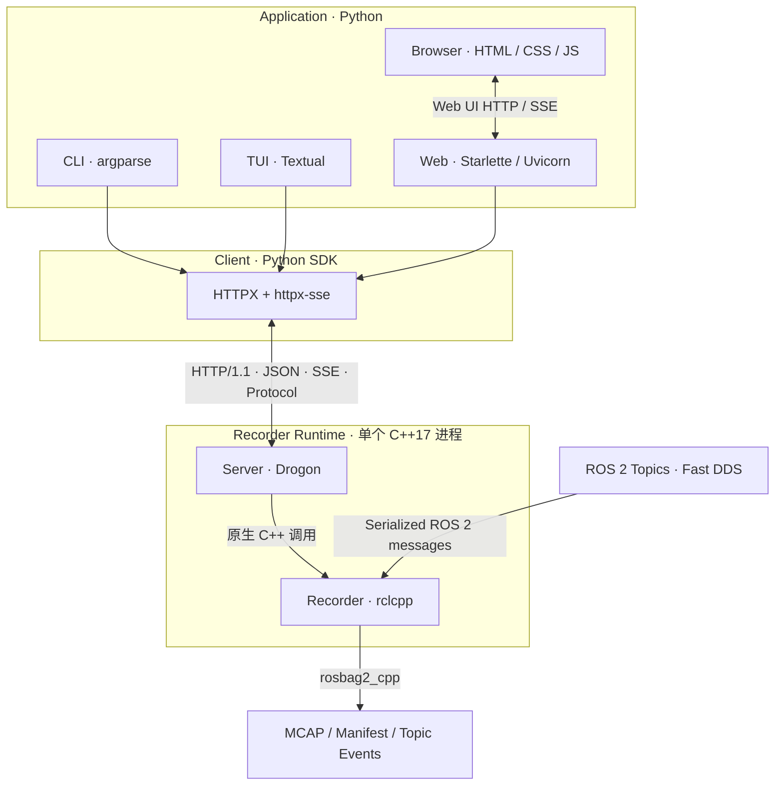

# ros2_bag 系统架构设计

| 属性 | 内容 |
|---|---|
| 文档版本 | v0.3.4 |
| 文档状态 | **DRAFT — V1.0 开发阶段，随时修订；规范尚未批准用于完整实施** |
| 文档范围 | V1.0 系统架构、组件边界与跨层契约 |
| 技术选型依据 | `docs/system_technology_selection.md` |

# 1. 概述

## 1.1 目标与范围

`ros2_bag` 面向 ROS 2 机器人的通用数据录制，提供可控制、可观测、资源有界、异常可恢复的录制能力，并通过统一网络协议供不同用户界面和自动化程序使用。

系统必须维持三项核心目标：

1. **录制可靠性优先：** ROS 2 消息接入、队列、存储、磁盘保护与恢复不依赖网络或用户界面是否在线。
2. **职责独立：** Recorder 管理录制事实，Server 提供网络访问，Client 封装跨语言通信，Application 负责展示与交互。
3. **部署与维护克制：** 使用成熟组件和标准 HTTP/JSON/SSE；避免重复控制协议、额外 IPC、进程内 Python 绑定及无业务需求的消息代理。

**文档边界：** 本文规定 V1.0 的逻辑分层、部署关系、资源所有权与跨层运行契约，**不记录实现进度、测试结果或交付状态**；这些信息由项目进度、验证及发布资料管理。详细 API 字段、性能数值、模块内部算法在相应模块规范中定义。本文随架构、所有权和跨层契约的实质变化持续修订，不为尚未发布的历史方案维护兼容路径。

**文档权责：** `docs/system_technology_selection.md` 回答“选择什么技术”，本文回答“组件如何分层、协作，以及由谁拥有状态和资源”。技术选型冲突以选型文档为准；分层与跨层契约冲突以本文为准。若二者在技术决策上存在实质冲突，应先评审并修订相应规范，不能通过单方面解释绕过。

## 1.2 设计原则与非目标

- **Primitives, not Features：** 只建立必要的基础能力，不把潜在功能提前实现成子系统。
- **数据面与控制面隔离：** 录制回调和 Writer 不直接执行 HTTP、Python、UI 工作；网络慢客户端不能传播为录制背压。
- **单一事实来源：** Recorder 持有录制状态及其持久化记录；Server 和各 UI 不维护另一套权威录制状态。
- **有界资源、显式失败：** 队列、连接、订阅者、请求及超时必须有边界；不得通过无限缓存伪装为可靠传输。
- **领域内聚：** Recorder 的消息池、Queue、Writer 等内部结构仅因录制领域要求改变，不因新增 Server、Client 或 UI 而引入通信层依赖。
- **规范与验证分离：** 设计描述应满足的行为；工程验证负责证明这些行为是否达标。

**V1.0 非目标：** 分布式 Recorder 集群、独立消息 Broker、数据库状态中心、WebSocket/gRPC、C++ Client SDK、Python/C++ Binding、浏览器直接控制 ROS 2、通用工作流引擎。

## 1.3 核心术语

| 术语 | 所属边界 | 定义 |
|---|---|---|
| Recorder Runtime | 运行时 | 承载 Recorder 与 Server 的**单个 C++17 进程**，负责共享资源与生命周期；下文简称 **Runtime** |
| Recorder | 录制领域 | 管理单活动任务、ROS 2 Topic、录制状态、Writer、持久化与恢复的逻辑组件 |
| Server | 网络服务 | 处理 HTTP 控制/查询、身份认证入口、SSE 订阅及网络资源 |
| Protocol | 跨语言契约 | Server 与 Client 共同遵守的 HTTP/JSON/SSE 规范，**不是运行时服务** |
| Recorder Snapshot | Recorder | 某一时刻的录制状态快照，不表示持久化完成或连续事件历史 |
| 持久化记录 | Recorder | Manifest、Topic Event 与 Recovery 等存储事实，不能等同于 SSE 通知 |
| Protocol 数据模型 | Protocol | 独立于 C++/ROS 类型的网络请求、响应与状态数据结构 |
| recording_generation | Recorder | 用于区分同一 Recorder 内录制任务世代的领域标识，非 SSE 事件序号 |
| topic_epoch | Recorder | 同一 Topic 身份的生命周期世代，区分重建后的实例 |
| operation_id | 领域/协议映射 | 关联控制操作的身份；其生成范围、幂等与网络映射由 `protocol.md` 定义 |
| SSE event id | Protocol | SSE 通知的协议身份；不自动等于操作或录制身份，不保证持久化重放 |
| Runtime 实例标识 | Runtime/Protocol | 区分 Runtime 不同进程生命周期的逻辑身份；是否及如何编码由 `protocol.md` 定义 |
| 调度域（执行域） | Runtime | Drogon I/O、Server 控制执行环境和 ROS 2 Executor 等互相独立的执行上下文；不可形成自等待 |

# 2. 系统架构

## 2.1 逻辑分层与数据流

系统采用 **Recorder – Server – Client – Application** 四层逻辑架构。**Protocol 是 Server 与 Client 共同遵守的独立契约，不是第五个运行时组件。**



图中的箭头表示职责、消息和依赖方向，不要求每一层独立进程；不引入额外的 Server–Recorder IPC。

- **数据面：** ROS 2 Topic → GenericSubscription → 有界内存与队列 → Writer → MCAP；相关 Manifest、Topic Event、Recovery 与资源保护均属于 Recorder。
- **控制面：** Application → Client → HTTP JSON → Server → Recorder 原生方法；结果沿原路返回。
- **状态/事件面：** Recorder 状态快照 → Server 映射 → HTTP 查询或 SSE 推送 → Client → Application。SSE 不承载 ROS 2 高频原始录制流。

依赖方向由外向内；Recorder 不依赖 Drogon、HTTP、Python 或 Application。

## 2.2 进程与部署模型

- **Recorder Runtime：** 单个 C++17 进程内同时承载 Recorder 与 Server。二者使用原生 C++ 接口交互，不额外引入进程间控制协议。
- **Client SDK：** 独立 Python 包，可与 CLI/TUI/Web 安装在同一设备，亦可部署在其他受信任设备；不依赖 `rclpy`。
- **CLI / TUI：** 独立 Python 进程，直接使用 Client SDK 连接 Recorder Runtime。
- **Web：** Starlette/Uvicorn 提供浏览器 UI 和必要的 Web 后端交互，由其通过 Client SDK 访问 Recorder Runtime。默认不要求浏览器直接访问 Drogon Server。
- **ROS 2 及存储：** Recorder Runtime 所在设备必须具备匹配的 ROS 2/RMW、MCAP Storage Plugin 和可用存储路径。Docker 主要用于可复现构建与验证，不作为用户运行的强制前提。

部署边界允许 UI 独立启停或断线重连；**Recorder 是否运行不由任何 UI 的生命周期决定**。Server 与 Recorder 因同进程共享故障域，不声称二者具有进程级故障隔离。

## 2.3 依赖与所有权

| 对象/资源 | 唯一权威或所有者 | 约束 |
|---|---|---|
| ROS Node、Executor、进程信号、启动恢复、输出根目录锁 | Runtime | Runtime 在 Recovery 前取得独占锁，退出时按序释放 |
| 录制状态、Topic 身份、录制世代、消息队列、Writer、持久化记录 | Recorder | 不接受 UI/Server 直接修改内部状态或文件 |
| HTTP 监听、认证/授权入口、请求关联、网络连接及 SSE 订阅资源 | Server | Server 状态不能替代 Recorder 领域状态 |
| API 资源、状态/事件数据模型与兼容规则 | Protocol 规范 | Server 与 Client 双方一致；不直接暴露 ROS/C++ 类型 |
| HTTP 连接池、重试/重连、协议解析、面向应用的客户端模型 | Client | 不复制 Recorder 状态机，不隐式启动/停止 Recorder |
| 交互状态、会话与展示缓存 | 各 Application | 缓存可丢弃、可重新从 Client 获取权威状态 |

运行时每份实际资源只有明确管理方；配置与快照可以跨层复制，**生命周期所有权、执行线程与缓存副本不得混淆**。Server 的 HTTP 请求执行器与 ROS 2 Executor 是不同的调度域；二者不得互相作为无条件可等待的资源。

**Executor 并发度是受控运行配置，而非固定的架构层数。** V1.0 采用单 Executor Worker 作为 Humble/Fast DDS 动态订阅销毁的保守默认配置；是否满足标准录制吞吐必须按需求验收，不能因默认线程数被写入架构就豁免性能指标。改用多 Worker 前须验证订阅 Add/Remove、WaitSet/Reader 生命周期、Stop/Shutdown 的并发安全；确切线程数的配置与验证矩阵由 `recorder.md` 维护，Writer 仍有独立线程。

# 3. 组件设计与接口边界

## 3.1 Recorder 与 Runtime

Recorder 通过原生 C++ 接口提供录制启动、定时启动、停止、暂停、恢复、动态 Topic 管理、状态快照及 Shutdown。接口契约可由 `RecordingCoordinator` 等录制领域对象承载；精确 C++ 签名、返回语义和线程约束由 `recorder.md` 定义。

Recorder 内部管理 Topic 订阅、队列预算、消息池、Writer、快照缓存、清理与资源监测。录制状态至少区分 `Idle / Recording / Paused / Stopping / Failed`；具体状态转换及错误返回属于 Recorder 接口契约。

**实例与任务边界：** V1.0 中**一个 Runtime 管理一个 Recorder 实例，同一时刻最多一个活动录制任务**。该任务可包含多个动态 Topic，并可采用 Normal、Timed 或 Rolling 模式；Rolling 的多个存储分段仍属于同一任务。任务结束后可以顺序启动下一任务。多个任务并行录制、多 Recorder 注册表及跨实例协调不属于 V1.0 范围。

**跨层契约：**

1. Server 通过类型明确的 C++ 原生方法调用 Recorder，不直接获取 Writer、Queue 或修改 Manifest。
2. Recorder 方法的调用线程、完成条件、错误结果及 Shutdown 并发规则必须被 Server 适配；Recorder 的控制调用可能同步等待 Writer 或 Executor 协作，不得假定所有调用立即返回。
3. Recorder 的 `RecorderStatus` 是状态快照，不是 HTTP 资源模型；Server 负责向独立 Protocol 数据模型转换。
4. Recorder 中 `recording_id`、`recording_generation`、Topic ID/Epoch、`operation_id` 等领域身份不得与 HTTP 请求 ID、SSE 事件 ID 自动等同。
5. 保留 `manifest.json`、`topic_events.jsonl`、`recovery.json` 的存储领域语义。网络协议的事件序列或缓存不自动具备相同的持久性保证。
6. Recorder 内部的定时 Stop、Rolling 轮转与磁盘保护回调不由 HTTP 请求触发。Server 必须允许这些内部事件与外部控制安全交错，不得将对外请求的串行化误认为 Recorder 内部全部状态变化都通过 Server 发生。

Runtime 必须遵守“**先取得输出目录所有权锁，再执行恢复**”的顺序。输出目录进程级互斥由 Runtime 负责，不得隐含为 Recorder Core 的自动行为；其他嵌入 Recorder Core 的宿主同样必须保证输出目录所有权。

**Recorder 内部时间事件的执行域：** ROS Executor Timer 只发布有界触发事件，不在回调线程完成可能阻塞的 Timed Stop、Rolling Rotate、磁盘保护收尾。**RecorderControlSequencer 是所有 Task/Topic/Writer mutation 的唯一领域线性化执行域**：Server 的独立 ControlWorker 只负责网络 Admission、外部 FIFO 和等待 Recorder `ControlHandle`，它把请求提交给 Sequencer，不能与 Sequencer 形成第二个“关闭权”裁决点。唯一例外是不会推进领域状态机的**无阻塞安全 Gate**：Producer 准入可在自身线性化点因 Timed steady deadline 或磁盘危险原子拒绝新准入，并仅向 Sequencer 提交合并事件；Writer Close、Topic 状态、Manifest 终态仍只能由 Sequencer 协调。Writer 本身始终由独立 Writer Thread 独占。Stop/Shutdown 必须真实等待 Sequencer/Handle 所代表的领域工作结束后再回收 Recorder 和 ROS Context。

## 3.2 Server 与独立 Protocol

Server 使用 C++17 和 Drogon，承担 HTTP 访问、请求校验、调用调度、返回结果、状态查询和 SSE 订阅管理。**Server 不重新实现 Recorder 的录制状态机、持久化机制或 Topic 管理规则。**

Server 至少遵守以下架构约束：

- 把外部输入转换为受校验的 Recorder 参数；在网络边界处理认证、授权和请求大小限制。
- 可能阻塞的 Recorder 调用不得直接长时间占用 Drogon 网络 I/O 事件循环；调度、并发限制和关闭同步必须受控，不预设独立大型任务框架。
- **同一 Recorder 的外部状态变更调用必须串行化：** Server 同时最多持有一个“已提交给 Recorder 且领域尚未 DONE”的外部 mutation；请求的受理、提交和完成顺序必须可判断。Recorder 返回受管 `ControlHandle` 后，即使 HTTP ResponseSink 已超时/断开，Server 仍保持该外部执行槽，直到 Handle DONE；不得仅因网络等待结束就提交下一项冲突 mutation。队列和执行单元必须有界。
- 只读状态查询可以在 Recorder 快照访问具备线程安全保证的前提下并发进行；内部定时器、磁盘保护和 Writer 故障仍可能并发改变领域状态，由 Recorder 的状态与同步约束裁决；Server 必须使用 Recorder 返回结果与后续权威快照识别冲突，不得推断自己的请求必然获胜。`server.md` 必须定义典型竞态下的结果解释与同步方式（例如外部 Stop 与磁盘保护 Pause 交错）。具体执行器与锁方案留给 `server.md`，不预先引入通用任务框架。
- SSE 基于 Drogon 异步 Streaming 能力实现，订阅者与待发送数据必须有界；连接断开时释放相应资源，不允许慢客户端影响录制路径。
- Server 重启与 Recorder 同属 Runtime 生命周期；不能把 HTTP 服务状态当成录制持久状态。

`docs/protocol.md` 将独立定义 HTTP API 路径和方法、请求/响应 Schema、版本、错误码、超时与操作完成语义、幂等规则、SSE 帧、事件身份与重连行为。**架构规范不预先固定 URL、JSON 字段或可靠事件重放承诺。**

## 3.3 Client 与 Application

Python Client 是所有 Application 访问 Recorder Runtime 的统一入口，使用 HTTPX 和 httpx-sse，提供同步/异步访问能力。其公共数据类型应使用与具体 HTTP/SSE 库解耦的 Python 类型。

Client 负责：

- 统一连接配置、超时、认证传递、错误映射及连接释放；
- 按 Protocol 转换状态快照与业务结果；
- SSE 流解析、断线检测、重连和必要的状态重新同步；
- 清楚区分**已接收请求、操作成功、未知结果、连接失败**，避免把网络超时推断为录制操作失败；
- 在不改变 Application 公共调用约定的前提下保留 SSE Parser 可替换性。

Application 职责如下：

| 应用 | 技术 | 边界 |
|---|---|---|
| CLI | `argparse` | 面向命令行控制及自动化；输出与退出码由 CLI 规范确定 |
| TUI | `Textual` | 终端交互、实时状态展示、用户操作与连接状态提示 |
| Web | `Starlette + Uvicorn`、原生 HTML/CSS/JS | Web 页面、会话、浏览器交互与状态转发；不直接访问 ROS 2 |

三种 Application **只共享 Client SDK，不相互依赖**。Web 应用的浏览器会话和 CSRF 防护由 Web 层承担；不能假设 Drogon 的 HTTP 控制授权自动覆盖 Web 浏览器安全边界。

# 4. 核心运行机制

## 4.1 启动、控制和关闭

**Runtime 启动顺序：**

```text
读取并校验 Recorder/Server 配置
    → 获取输出根目录独占锁
    → 恢复未完成的清理与录制记录
    → 初始化 ROS 2 Node、Recorder、Executor
    → 初始化 Server（仅在依赖资源就绪后对外服务）
    → 进入运行状态
```

**启动故障分界：** 配置无效、输出目录不可使用、锁被其他进程持有、必要 ROS/存储依赖初始化失败等，无法保证 Runtime 安全运行时，必须停止启动，且不得开放 Server 控制接口。对于可安全隔离、保留数据及诊断的历史任务恢复异常，应记录 Recovery Finding 并可继续启动；不得把所有恢复失败一律当作致命故障，也不得忽略会危及数据安全的恢复错误。`recorder.md` 定义恢复结果分类规则；`server.md` 定义 Runtime 启动流程对各类结果的处置。

**Runtime 关闭顺序：**

```text
停止接收新的状态变更请求
    → 标记 Server 关闭，阻止新 SSE 订阅并有界结束在途控制调用
    → 执行 Recorder Stop/Shutdown（ROS 2 Executor 保持可运行）
    → 完成 Writer/Topic/必要清理，确保不再访问 ROS Node
    → 结束 SSE 与网络工作，停止 Server
    → 停止 ROS 2 Executor 并释放 Node
    → 关闭 ROS 2 Context，最后释放输出目录独占锁
```

这是**资源依赖与关闭屏障**，不是要求某个线程同步阻塞直到每一项完成。Runtime 必须满足以下约束：

1. 关闭开始后不再受理新的状态变更；在途外部控制必须在有界关闭策略下**完成、拒绝或显式确定为结果未知**，不可无限等待。
2. **Recorder Shutdown 所需的 ROS 2 Executor 协作尚未结束前，Executor 和 ROS 2 Context 必须保持可运行。** 不得先 `rclcpp::shutdown()` 或停止所有 Executor 工作线程，再等待依赖 Executor 的 Recorder 操作完成。
3. Shutdown 与定时 Stop、Topic 移除、Writer Drain 和 Server 处理线程可能并发。不得在 Executor 回调线程或 Drogon I/O 线程同步等待一个只能由同一执行域推进的操作，避免自等待死锁。
4. Server 的在途调用完成（或被安全隔离）且不再引用 Recorder 后，才能销毁 Recorder；Recorder 终结后才允许释放其依赖的 Node/Executor。监听关闭、SSE 终止与 C++ 对象析构应遵守这个关系。
5. SIGINT/SIGTERM 的处理方式须配合这一关闭屏障。**不能假定 ROS 2 默认信号处理已满足该顺序**；Server 接入阶段必须验证信号与 `rclcpp::shutdown()` 的真实先后行为。
6. 异常启动与部分初始化失败按已取得资源的逆依赖顺序释放，每项资源至多释放一次，输出目录锁最终释放。

Runtime 发起 Shutdown 必须是**非阻塞提交 + 独立完成观察**：Recorder 提供幂等的 Shutdown 请求/共享 Completion，真正的 Stop、Writer/Cleanup/Monitor 退出由 Recorder 自身执行域推进。Runtime 的关闭管理线程只等待 Completion 并施加 deadline；若超时则保持对象图和依赖存活并进入 UNSAFE_TO_DESTROY，不能让一个永久 `join()` 卡住唯一的超时判定线程。

具体的线程协调、超时和失败退出策略由 `server.md` 决定，并通过并发 Stop/Shutdown、信号打断和部分启动失败测试验证。

Client/TUI/Web 退出或网络连接断开，**默认不触发 Recorder Stop 或 Shutdown**；显式停止命令另行处理。

## 4.2 控制并发与录制数据路径

Recorder 高频数据路径采用以下结构：

```text
ROS 2 Executor / GenericSubscription
    → SerializedMessage / Pool
    → 有界 QueueBudget + MessageQueue
    → Writer Thread / rosbag2_cpp
    → MCAP
```

网络控制路径经 Server 调用 Recorder 原生接口，不得绕过状态检查、Topic 身份规则、Writer 串行约束及持久化边界。

控制请求与持续录制可以并发，但有两层不同的串行域。Server Control Worker 只负责外部 HTTP 状态变更的有界 Admission/Deadline/调用顺序；Recorder 自己的 RecorderControlSequencer 是**所有领域变更的最终线性化执行域**，同时接收外部 Start/Stop/Pause/Resume/Add/Remove 和内部 Timed Stop、Rolling、Disk Safety、Writer Failure。后者不能依赖 Server 存在。HTTP 连接寿命不是 Recorder 锁寿命；请求断连或超时不得取消已经被 Recorder Sequencer claim 的领域操作，也不能让后续冲突操作越过尚未完成的领域事务。

必须满足：

- 网络 I/O、SSE 编码或客户端缓存不进入 ROS 回调和 Writer 热路径。
- 同一 Recorder 的外部状态变更先经 Server 有界串行 Admission，再由 RecorderControlSequencer 与内部安全事件统一裁决；两层队列都必须有界，调用方取消不意味着已 STARTED 的领域操作撤销。
- 任何操作的“完成”以实际领域完成边界为依据；HTTP 请求结束不自动证明操作已写入磁盘。
- Server 不持有 Recorder 内部锁后再等待网络、用户界面或远程资源。
- 停止、动态移除 Topic、Writer Drain、Rolling 轮转等顺序必须遵守 `recorder.md` 定义的领域契约。

操作排队、超时和幂等由 Protocol/Server 规范分别定义。**原始 HTTP `OperationResult`、当前 `CurrentStatus` 与可选的领域持久化证据是三个独立事实源。** `protocol.md` 只定义 V1.0 实际存在的结果确认能力：Topic Add/Remove 可按精确的请求/Topic 身份查询 durable Evidence；Start/Stop/Pause/Resume 不提供通用请求级终态查询。状态快照只能说明 Recorder 现在处于什么状态，不能把一个原始 UNKNOWN 请求补写为 SUCCESS/FAILURE；持久化 Evidence 只能确认对应领域终态/副作用，也不能倒填“当时 HTTP 已收到成功回执”。不额外预设通用 Operation Registry 或任务调度平台。

## 4.3 状态、事件与一致性

**权威状态：** Recorder 的状态接口提供 Recorder Snapshot；Manifest、Topic Events 与 Recovery 文件记录存储事实。状态快照不代表持久化事件的完整历史。Topic 录制统计应区分**实时消息成功写入**与 **Rolling Snapshot 跨 Segment 重放成功写入**；两者不能混为独立接收或发布消息，也不能通过重放虚增标准负载的有效录制序号。计数器定义由 `recorder.md` 规范，协议呈现由 `protocol.md` 规范。

**对外状态：** Server 将 Recorder Snapshot 映射为 Protocol 的独立状态模型，供 HTTP 查询和 SSE 消费。V1.0 采用**有界周期采样 + 变化通知**，不引入 Recorder 内部通用 EventBus：录制控制与状态消费不要求建立完整的高频事件总线，采用快照驱动可保持职责和实现成本可控。`server.md` 应规定采样周期的默认值、允许范围与资源上限，并根据 `recorder.md` 定义的 Snapshot 访问开销控制采样成本，避免状态采样干扰录制数据面。

**首次订阅与重新同步：** 不能采用“先 HTTP 查询 Snapshot、再订阅 SSE，并假定两者之间没有变化”的实现。建立 SSE 时必须提供一个**与该订阅连续衔接的完整权威状态基线**：例如先注册有界订阅，再获取并发送 Recorder Snapshot，对采样期间的变化执行版本检查或再同步；也可以采用等价的一致性机制。这里的“版本”指可识别状态变化的快照或状态版本，**不得直接将 `recording_generation` 当作状态版本**；版本的身份域、递增条件及与 Runtime 世代的关系由 `protocol.md` 定义。**如订阅建立期间缓冲变化，缓冲必须有界；超限时不得静默丢失影响状态一致性的增量，必须触发完整重新同步或终止订阅并要求重连。** 缓冲上限与执行策略由 `server.md` 定义，超限对客户端的可见语义由 `protocol.md` 定义。关键保证是 Client 最终获得建立订阅后有效的当前状态，不会因查询和订阅之间的空窗永久停留在旧状态。这不构成全部中间事件无损交付的承诺。

**一致性规则：**

1. SSE 用于**尽力而为的状态变化和业务通知**，不是可靠消息队列。
2. Client 初次连接、断线重连、事件缺口或进程代际变化时，必须重新建立有效的完整状态基线；不得仅依赖订阅前的一次 HTTP 查询，也不得把旧展示缓存当成当前录制事实。
3. 对 Snapshot 变化的通知不能宣称完整、无遗漏的操作历史；确需重放时必须另行确定保留期限、序列空间与持久化方案。
4. `SSE id`、录制领域 `operation_id` 与 `recording_generation` 语义独立；协议必须说明关联规则，而不是依赖字符串碰巧相等。
5. 慢客户端必须通过有界发送策略、合并状态更新或断开连接处理；不能扩大 Recorder Queue 来吸收 UI 延迟。

Server 的采样周期与开销约束、初始快照与订阅衔接策略、变化版本判定、事件分类和恢复能力由 `protocol.md` 与 `server.md` 联合明确，并验证订阅建立期间的状态变化、缓冲超限与断线重连。不承诺全部中间事件的无损重放。

## 4.4 故障、恢复与安全

| 故障或异常 | 架构处理原则 |
|---|---|
| CLI/TUI/Web 退出，Client 或网络断开 | Recorder 继续运行；Client 恢复连接后重新同步状态 |
| HTTP 请求超时或结果丢失 | 原始请求结果保持 **UNKNOWN**；CurrentStatus 只用于重新同步当前状态，有限 Topic Evidence 只确认精确关联的领域终态/副作用，二者均不得倒填原始 HTTP SUCCESS/FAILURE |
| Server 请求过载 / SSE 慢客户端 | 有界排队、拒绝或断开；不得影响 ROS 数据面 |
| ROS 2 数据突发 / Queue 达预算 | 按 Recorder 已定义的有界策略处理、记录统计，不让控制层创建无界缓存 |
| 磁盘临界或状态不可知 | Recorder 的磁盘保护状态优先；Server 不得绕开暂停、恢复的安全判定 |
| Writer 或持久化失败 | Recorder 维护 FAILED、错误诊断和未完成数据的恢复证据；Server 如实映射 |
| 启动所需资源不可用或输出目录锁冲突 | 阻止 Runtime 对外提供控制服务，并明确失败退出 |
| 历史录制片段恢复异常但仍可安全隔离 | 保留文件和 Recovery Finding；允许 Runtime 按保守恢复契约继续启动并暴露诊断 |
| 进程崩溃或非正常断电 | Runtime 重启后在取得输出根目录锁的前提下执行保守恢复 |
| Server/Recorder 同进程致命崩溃 | 整个 Runtime 故障；由外部进程监管机制恢复，不假定 Server 与 Recorder 有进程级隔离 |

Recorder 恢复语义要求保留 `INCOMPLETE` 片段，对未能证明成功的 Topic 操作标记 `UNCERTAIN`；不得因网络客户端重连而修改已持久化的录制事实。恢复异常的“可继续启动”仅在不会覆盖、污染或错误回收录制数据时成立；恢复结果不等于录制成功，也不能被 Server 隐藏。

**安全边界：** HTTP 控制服务默认只监听受限本机地址，但 Runtime API 本身仍使用预共享不透明 Bearer Token 鉴权；权限固定为 `read` / `control`，其中 `control` 包含 `read`。远程访问除 Token 外必须经过 TLS，可由 Drogon 直接终止或由显式受信反向代理终止；无论哪种部署，Runtime 都自行验证 Bearer Token，不能把代理 Header、浏览器 Cookie 或 Origin 当作身份。`protocol.md` 定义 Header/权限语义，`server.md` 负责 Secret Provider、授权、TLS/代理边界与拒绝策略；Web 另外负责浏览器 Session 和 CSRF，两套安全边界不可混同。敏感配置及凭证不进入普通状态响应和日志。输出目录遵守最小权限和所有权要求，不能由 HTTP 参数绕过路径及恢复约束。

# 5. 工程约束与演进

## 5.1 技术与部署约束

技术选型以 `docs/system_technology_selection.md` 为权威来源，本文只规定跨层使用关系，不重复候选比较或锁定版本。V1.0 技术组合：

| 领域 | 技术基线 |
|---|---|
| Runtime / Recorder | C++17、rclcpp、Fast DDS、rosbag2_cpp、MCAP、LZ4 |
| Server / Protocol | C++17、Drogon、HTTP/1.1、JSON、SSE |
| Client | Python 3.10+、HTTPX、httpx-sse |
| CLI / TUI / Web | argparse；Textual；Starlette + Uvicorn；原生 HTML/CSS/JS |
| 构建/部署 | CMake + ament_cmake、Git Submodule 精确锁定、GitHub Actions + Docker |
| 平台 | Ubuntu 22.04/Humble、Ubuntu 24.04/Jazzy，AMD64/ARM64 |

Drogon SSE 必须满足协议正确性、慢客户端资源有界、断线清理与 Recorder 数据面隔离；httpx-sse 必须满足标准 SSE 解析与取消关闭要求。这些属于技术生产准入条件，具体版本、风险和验证结论由选型规范及验证报告维护。

C++ Runtime 为每目标平台提供原生 ELF，Recorder/Server 私有代码可静态集成，ROS 2/RMW 运行库及 Storage Plugin 按目标环境动态提供。不要求完全静态链接 Linux 程序。Python Client 与各 Application 独立分发；Web/TUI 的可选依赖不进入基础 Client 包。

## 5.2 质量属性与验证边界

跨层设计必须有可验证的质量约束：

| 质量属性 | 必须验证的行为 |
|---|---|
| 正确性 | Recorder 方法、Topic 生命周期、MCAP 可读性、Manifest/Recovery 一致性 |
| 有界性 | Queue、Pool、HTTP 并发、SSE 订阅缓存、资源释放与慢客户端 |
| 隔离性 | 网络连接中断、Web/TUI 故障不干扰录制与 Writer |
| 生命周期 | 初始化失败、重复 Shutdown、SIGINT/SIGTERM、并发 Stop 与 Server 关闭 |
| 一致性 | 状态重新同步、请求结果未知、SSE 断线与代际变化 |
| 安全性 | 默认监听范围、远程身份验证/TLS、Web CSRF、输入与路径校验 |
| 可移植性 | Humble/Jazzy × AMD64/ARM64、Python 3.10/3.12、版本与依赖闭包 |
| 可维护性 | 构建可复现、文档一致、依赖版本可追溯与许可证义务明确 |

质量要求须在要求规范和专项测试中给出定量阈值，不能在缺乏测量依据时臆定 CPU、时延、连接数或内存限额；架构文件仅确定必须覆盖的验证维度。

## 5.3 模块设计文件与开发顺序

本文只管理**跨层架构契约**。后续文档应按职责拆分，文件名不使用 `_design` 后缀：

| 文档 | 主要内容 |
|---|---|
| `requirements.md` | 产品需求、非功能需求与可验证的验收目标 |
| `recorder.md` | Recorder 原生接口、状态机、录制数据面与规范性恢复语义 |
| `protocol.md` | HTTP/JSON/SSE API、数据模型、错误、版本、操作完成与恢复语义 |
| `server.md` | Drogon 接入、线程/控制调度、网络资源与状态/SSE 实现 |
| `client.md` | HTTPX/httpx-sse 封装、同步/异步 API、重试重连与错误映射 |
| Application 设计（CLI/TUI/Web） | 在对应实现前补齐；可统一成一份文档或按应用拆分，承载交互、状态展示、退出码、浏览器安全及部署契约，不预设必须新增三个文件 |

`system_technology_selection.md` 管理技术选择；Recorder 的恢复语义与取证统一由 `recorder.md` 定义，验收由 `verification.md` 承担。历史研究不作为当前设计约束，避免重复维护第二套含糊的规范。

文档契约建议按 `requirements.md → recorder.md → protocol.md → server.md → client.md` 的依赖关系细化，再分别定义 CLI、TUI 与 Web；任何跨层契约变更须同时评估被依赖模块，不得未经评审直接扩散。

## 5.4 架构设计持续审查标准

本项目尚处于开发阶段，所有设计均可调整；**不维护历史方案兼容性，也不存在不允许修订的上位设计文件**。修改前须明确实际功能、状态/资源所有权、数据安全边界，修改后同步修正受影响的需求、Recorder、Protocol、Server、Client 和验证规格。判断优劣依赖可实现性和可执行的正确性验证，而非“上一版已经同意”。

重点审查：Runtime 是否只有一个权威 Recorder、Shutdown 是否保持相关 Worker/Executor 活性直到所有引用结束、HTTP UNKNOWN 是否不借状态伪证、SSE 是否有界且能够重新同步、MCAP Schema 是否能脱离业务消息包解析、远程权限是否默认拒绝。**任一核心契约存在不明确的实现分歧时先直接修订设计，不将分歧留给 Codex 决策。** 不影响对外语义和安全性的局部类名、缓存布局可以留给实现。
