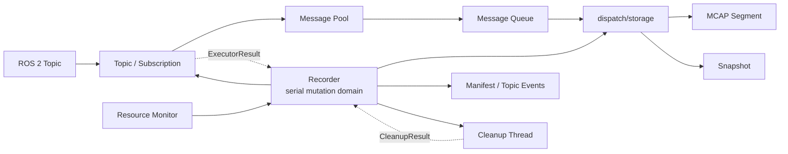
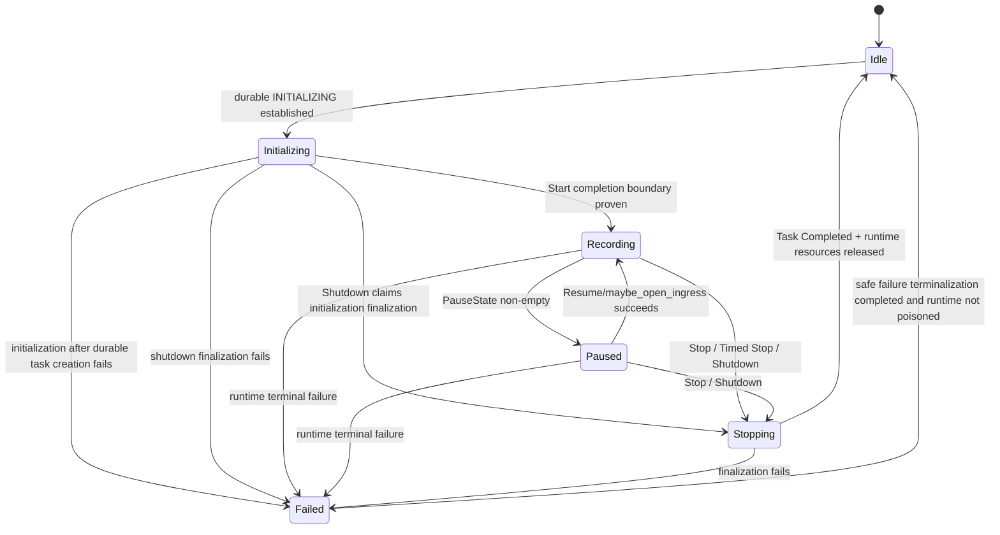
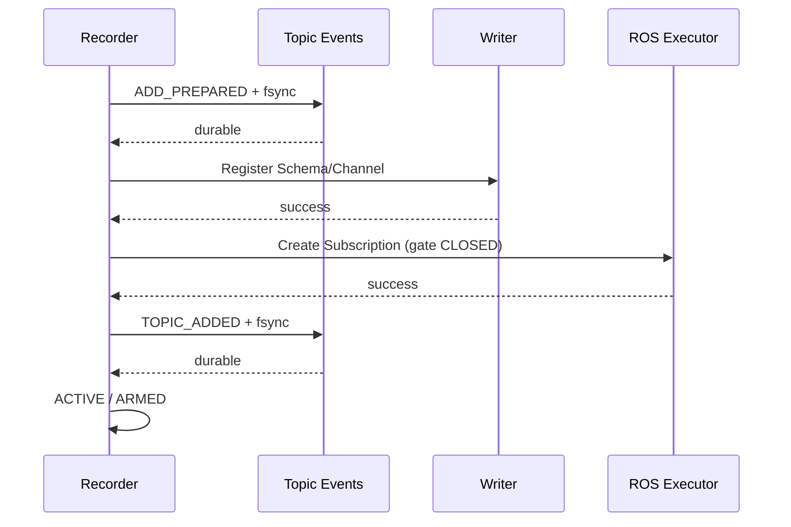
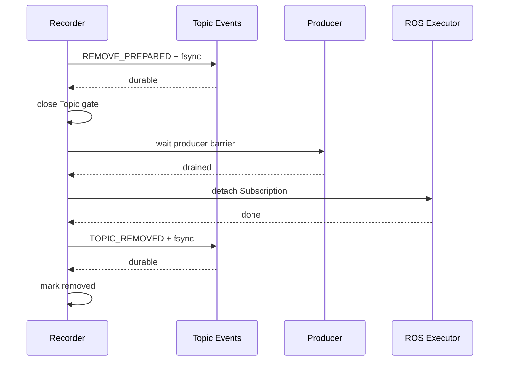
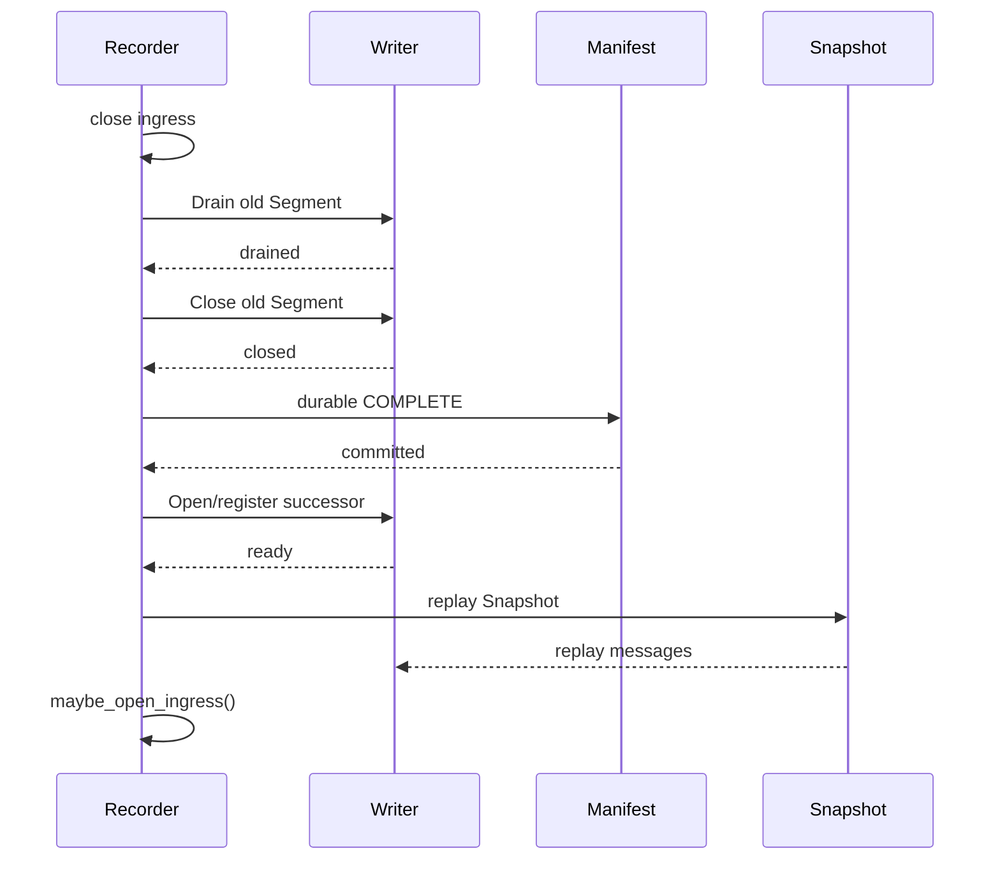
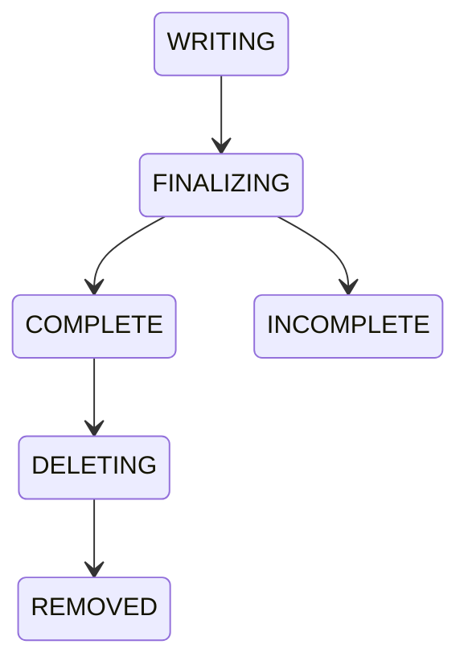

# Recorder

| 属性 | 内容 |
|---|---|
| 文档版本 | v0.3.6 |
| 文档状态 | **DRAFT — V1.0 冻结候选；完成 v0.3.5 全文审查、错误码机器映射与跨文档一致性修订，待最终评审确认** |
| 范围 | C++17 Recorder 模块、ROS 2 Topic 录制、消息数据路径、MCAP、持久化、恢复、资源保护、状态观测与关闭 |
| 上位规范 | `docs/architecture.md`、`docs/requirements.md` |
| 技术选型 | `docs/system_technology_selection.md` |
| C++ 规范 | `docs/cpp_coding_guidelines.md` |
| Result 契约 | `docs/result.md` |

---

# 1. 概述与代码组织

## 1.1 模块定位

Recorder 是 `ros2_bag` 主程序中的内部 C++ 模块，是录制领域的唯一事实来源。

Recorder 负责：

- ROS 2 Topic 发现；
- Topic 订阅的创建、销毁与生命周期；
- Normal / Timed / Rolling 三种录制模式；
- 消息准入、内存预算、消息池与队列；
- 单 dispatch/storage 执行上下文；
- MCAP Segment 创建、写入、轮转和关闭；
- Schema 解析与自包含定义；
- Snapshot 与 Rolling Segment 重放；
- Manifest 与 Topic Event 持久化；
- Retention 与 Segment 删除；
- 提供 Recorder 领域的 Recovery 能力；其启动执行由 Runtime 在开放正常 Recorder mutation admission 前编排；
- 磁盘保护与资源采样；
- 当前运行状态快照；
- 已完成 Task 查询；
- Topic Add/Remove durable 结果查询；
- Recorder Shutdown。

Recorder 不负责：

- HTTP / SSE；
- Drogon；
- Protocol JSON 编解码；
- Client / CLI / TUI / Web；
- Runtime 的 output_root 进程锁；
- Runtime 的 ROS Context / Executor 最终生命周期；
- 跨进程 IPC；
- 用户数据库与认证。

V1.0：

```text
one Recorder Runtime
→ one Recorder
→ at most one active Task
```

Rolling 中多个 Segment 仍属于同一个 Task。

## 1.2 核心设计原则

1. **模块接口直接。** Recorder 是进程内 C++ 模块，不采用 RPC 风格 Request/Response API。
2. **抽象来自真实职责。** 不为结构对称预建 Coordinator、Manager、Adapter、Store、Registry、Context。
3. **运行态与持久态分离。** 当前 Recorder 状态与 Manifest 中 Task 生命周期不是同一状态机。
4. **多原因暂停可表达。** 用户暂停与一个**生效中的**磁盘保护原因可以同时存在；该原因来自 `DiskPauseReason`，不等同于最新 `DiskSafetyState`。
5. **Error 必须机器可映射。** Server 不解析 `Error.message` 推导 Protocol ErrorCode。
6. **Effects 与 UNKNOWN 分离。** Effects 描述已经取得 Recorder 最终 Failure 时可证明的副作用范围；UNKNOWN 是 Server/Client 等观察者无法确认领域终态的观察结果，不是 Recorder 自身状态。
7. **唯一串行 mutation 域。** Task、Topic、Writer、Manifest 的状态变化只有一个权威线性化顺序。
8. **高频数据路径有界。** ROS callback 不做文件 I/O、网络 I/O、复杂 JSON 或无界等待。
9. **存储调用串行。** 一个 dispatch/storage 执行上下文消费 `MessageQueue` 批次并直接调用 `rosbag2_storage_mcap` vector write；控制面通过 `Writer` mutex 同步。
10. **持久化成功必须可证明，不确定时保守降级。** durable 证据不足不能伪造成功；一旦关键 durable outcome 无法确认，必须停止依赖该事实继续推进会扩大不确定性的 mutation。
11. **Recovery 保守。** 不续录旧 Task、不恢复旧 Topic ACTIVE、不自动删除 INCOMPLETE。
12. **V1.0 一次实现完整 Recorder。** Topic、Writer、Snapshot、Recovery、Cleanup、Resource Monitor 全部属于第一版。

## 1.3 整个 C++ 工程目录结构

Recorder 的物理目录不能脱离 Server 与主程序 Runtime 单独设计。`ros2_bag` 是一个统一的 C++/ROS 2 工程，而不是由 Recorder、Server 等多个可独立发布的小型子工程拼接而成。

V1.0 采用**项目级头文件/源文件分离 + 模块目录镜像**：整个工程只有一套顶层 `include/` 与 `src/`；Recorder、Server 通过对应子目录表达功能边界，不在各自目录下再次建立 `include/src`。

推荐整体布局：

```text
ros2_bag/
├── CMakeLists.txt
├── package.xml
│
├── include/
│   └── ros2_bag/
│       ├── result.hpp
│       │
│       ├── recorder_runtime.hpp
│       ├── runtime_config.hpp
│       ├── output_root_lock.hpp
│       │
│       ├── recorder/
│       │   ├── recorder.hpp
│       │   ├── completion.hpp
│       │   ├── error.hpp
│       │   ├── config.hpp
│       │   ├── task.hpp
│       │   ├── topic.hpp
│       │   ├── state.hpp
│       │   ├── message.hpp
│       │   ├── message_pool.hpp
│       │   ├── message_queue.hpp
│       │   ├── snapshot.hpp
│       │   ├── writer.hpp
│       │   ├── schema.hpp
│       │   ├── manifest.hpp
│       │   ├── topic_events.hpp
│       │   ├── recovery.hpp
│       │   ├── cleanup.hpp
│       │   └── resource_monitor.hpp
│       │
│       └── server/
│           └── ...                 # Server 头文件，具体职责由 server.md 冻结
│
├── src/
│   ├── main.cpp
│   ├── recorder_runtime.cpp
│   ├── runtime_config.cpp
│   ├── output_root_lock.cpp
│   │
│   ├── recorder/
│   │   ├── recorder.cpp
│   │   ├── task.cpp
│   │   ├── topic.cpp
│   │   ├── message_pool.cpp
│   │   ├── message_queue.cpp
│   │   ├── snapshot.cpp
│   │   ├── writer.cpp
│   │   ├── schema.cpp
│   │   ├── manifest.cpp
│   │   ├── topic_events.cpp
│   │   ├── recovery.cpp
│   │   ├── cleanup.cpp
│   │   └── resource_monitor.cpp
│   │
│   └── server/
│       └── ...                     # Server 源文件，具体职责由 server.md 冻结
│
├── tests/
│   ├── unit/
│   │   ├── recorder/
│   │   ├── server/
│   │   └── runtime/
│   └── integration/
│
├── config/
└── docs/
```

### 目录设计原则

该布局表达的是一个统一程序中的三个层次：

```text
main.cpp
   ↓
RecorderRuntime                # composition root
   ├── recorder/               # 录制领域模块
   └── server/                 # HTTP/SSE 适配模块
```

依赖方向固定为：

```text
Runtime
  ├──> Recorder
  └──> Server
          └──> Recorder

Recorder -X-> Server
Recorder -X-> Drogon
Server   -X-> Recorder persistence implementation
Server   -X-> Writer / Queue / Pool / Cleanup internals
```

其中 `-X->` 表示禁止依赖。

### 为什么不是每个模块各自 `include/src`

V1.0 **不采用**：

```text
src/recorder/include/...
src/recorder/src/...
src/server/include/...
src/server/src/...
```

原因：

- Recorder、Server 不是可独立发布的软件包；
- 不需要为每个内部模块制造一套小型 library project 外观；
- 项目级 `include/` / `src/` 已足够清晰表达 header/source 分离；
- `include/ros2_bag/recorder/` 与 `src/recorder/` 路径镜像，代码浏览和依赖分析更直接；
- Server 同样遵守同一布局，不形成第二套目录哲学；
- Runtime 是 composition root，不人为建立 `runtime/include/runtime/src`。

### `include/` 不等于独立公共 SDK

顶层 `include/ros2_bag/` 表示项目统一 C++ header 根目录，不自动意味着：

```text
稳定第三方 SDK
独立 ABI 兼容承诺
必须安装全部 header
Recorder/Server 可独立发布
```

是否安装、哪些 header 属于最终用户 API，由顶层 CMake `install(...)` 与发布策略单独决定。当前开发阶段允许所有设计直接演进，不为未发布接口承担兼容包袱。

### 不建立额外内部目录层

Recorder V1.0 不再增加：

```text
include/ros2_bag/recorder/internal/
include/ros2_bag/recorder/detail/
include/ros2_bag/recorder/common/
src/recorder/internal/
src/recorder/common/
src/recorder/utils/
src/recorder/core/
```

当前模块规模尚不需要物理 `internal/detail` 层。跨模块依赖通过 CMake target、include 规则和 Code Review 约束；如果未来误用确实成为维护问题，再基于实际依赖图调整，而不是提前建立层级。

### 构建组织

V1.0 顶层只需要一个项目级 `CMakeLists.txt` 作为构建权威。Recorder/Server 可以被组织成内部 target，以便表达依赖和测试边界，但**不因此成为独立子工程**：

```text
ros2_bag_recorder   # internal target
ros2_bag_server     # internal target
ros2_bag            # final executable
```

默认不要求：

```text
src/recorder/CMakeLists.txt
src/server/CMakeLists.txt
add_subdirectory() 形成独立项目层次
```

如果未来需要拆分为多个 CMake 文件以提升可维护性，仍保持**单一顶层工程和统一 `include/src` 布局**；拆分仅是构建文件组织优化，不改变“一个统一 C++ 工程”的架构事实，也不意味着 Recorder/Server 变成独立发布子工程。

### 跨文档约束

该整体 C++ 布局不应只存在于 Recorder 文档。冻结前必须同步：

- `docs/architecture.md`：作为整个 C++ 程序目录与依赖方向的权威；
- `docs/cpp_coding_guidelines.md`：统一 header/source 路径、include 写法和模块依赖规则；
- `docs/server.md`：Server 目录必须使用相同的顶层 `include/src` 镜像结构；
- 本文只继续冻结 Recorder 目录中的文件职责，不为 Server 重复定义内部文件设计。

## 1.4 文件职责

本节中的 `*.hpp` 均位于 `include/ros2_bag/recorder/`，对应 `*.cpp` 均位于 `src/recorder/`。表中仍使用简短文件名表示同一职责对，避免每行重复完整路径。纯 header 类型没有对应 `.cpp` 时不为了目录对称制造空实现文件。

| 文件 | 主要职责 |
|---|---|
| `recorder.*` | 模块入口、对象组合、mutation 提交、状态与查询、Shutdown；实现唯一串行 mutation 域 |
| `completion.hpp` | 异步领域操作完成观察；纯类型/模板定义 |
| `error.hpp` | `ErrorCode`、`Effects`、`Error` |
| `config.hpp` | Recorder 静态配置及校验 |
| `task.*` | `TaskMode`、durable `TaskState`、`TaskConfig`、`TaskInfo`、`TaskDetail`、`TaskList` 与活动 Task 生命周期 |
| `topic.*` | `TopicOptions`、`TopicInfo`、`DiscoveredTopic`、发现、QoS、ID/Epoch、Subscription、Add/Remove |
| `state.hpp` | `RecorderState`、`PauseState`、`DropCounters`、`DiskSample`、`ProcessSample`、`TopicState`、`SegmentState`、当前 `State`；**只定义按值数据类型，不实现状态采集逻辑** |
| `message.hpp` | `RecordedMessage` |
| `message_pool.*` | 固定有界消息节点池 |
| `message_queue.*` | queue、消息/字节预算、ProducerToken、admission |
| `snapshot.*` | Rolling Snapshot 缓存与 replay |
| `writer.*` | Writer mutex、Segment 与直接 MCAP batch write |
| `schema.*` | ROS type → 完整 MCAP Schema |
| `manifest.*` | `manifest.json` 数据、revision、durable commit |
| `topic_events.*` | `topic_events.jsonl` Event 持久化，以及 `TopicOperationState` 查询解释 |
| `recovery.*` | 启动恢复、Recovery finding 与受控 `recovery.json` 诊断 |
| `cleanup.*` | 独立单线程 Cleanup worker、retention、DELETING、文件删除和结果回报 |
| `resource_monitor.*` | 磁盘/CPU/RSS/FD/thread 采样与 DiskAdmission 发布 |

`state.hpp` 没有对应 `state.cpp` 是刻意设计：它只保存纯数据结构。`State Recorder::state() const` 的采集、一致性检查和聚合逻辑放在 `recorder.cpp` 以及各组件自己的快照接口中。

`TaskInfo`、`TaskDetail`、`TaskList` 都属于 Task 领域，因此放在 `task.hpp`，不额外创建 `history.hpp`。

`TopicOperationState` 直接解释 `topic_events.jsonl` 的 durable 证据，因此定义在 `topic_events.hpp`，不放入通用 `state.hpp`。

### 明确删除的旧抽象

V1.0 不建立：

```text
RecordingCoordinator
RecorderFacade
RecorderService
RecorderControlSequencer
TopicManager
WriterAdapter
CleanupWorker（作为公开/文件名抽象）
RecordingTargetGuard
TopicTargetGuard
HistoryQuery
HistoryPage
TopicOperationEvidence
```

`cleanup.*` 内部确实拥有一个 Recorder-owned 单线程 worker，但不因为线程存在就把文件/领域对象命名为 `CleanupWorker`。

本文冻结行为契约，不冻结上述旧类名，也不要求一个 class 对应一个文件。

## 1.5 组件、启动阶段与线程模型

Recovery 与运行期 Worker 必须分开理解。

### 启动阶段

`recovery.*` 属于 Recorder **领域模块**，因为只有 Recorder 能解释 Manifest、Topic Events、Segment 和 Schema 等持久化事实；但 Recovery 的**执行时机由 Runtime 编排**。


Recovery 不是长期并行 Worker，不与 Writer/Cleanup/Resource Monitor 同时承担运行期职责。Recovery 完成前普通 Recorder mutation admission 必须关闭。

### 运行期组件



执行域：

| 执行域 | 主要职责 | 结果如何回到 Recorder | 禁止行为 |
|---|---|---|---|
| Recorder 串行 mutation 域 | Task/Topic/Writer/Manifest 状态裁决 | 本域自身 | 持热路径锁等待慢 I/O |
| ROS Executor | discovery、Subscription create/remove、callback | 产生内部 ExecutorResult/事件，由 Recorder 串行域领取 | 直接 Stop/Rotate/Manifest commit |
| dispatch/storage | 消费消息批次并直接调用 MCAP vector write | 成功后更新原子计数；首条 Live 以 critical mutation 回流 | 并发执行 Writer 控制操作；自行改 Task/Manifest 终态 |
| Cleanup Thread | 按 durable DELETING 删除文件 | 产生 CleanupResult，由 Recorder 串行域重新验证 Manifest | 自行提交 REMOVED；阻塞 Recorder mutation 域 |
| Resource Monitor | statvfs / CPU / RSS / FD / thread | 发布 bounded resource/disk snapshot 和安全事件 | 在 Recorder 热路径锁内采样 |
| Runtime | output_root 锁、Recovery 调度、ROS Context/Executor 生命周期、最终 Shutdown | 调用 Recorder API / 观察 Completion | Recorder 未完成时提前销毁依赖 |

Cleanup 是 Recorder-owned 单线程 worker。`remove_all()` 等文件系统调用阻塞时，只阻塞 Cleanup Thread；Recorder 串行域仍可以处理不依赖该删除完成的状态变化和只读查询。Cleanup active operation 会记录 `active_since` 供 warning/Shutdown 诊断，但 V1 不增加 heartbeat/watchdog 线程。

### 内部结果回流原则

ROS Executor、Cleanup 可以异步执行慢操作，但**最终领域状态只能由 Recorder 串行 mutation 域修改**。dispatch/storage 只写入数据和原子观测计数；首条 Live 通过 critical mutation 发布状态变化。

统一模式：

```text
Recorder starts/requests native work
→ worker/native domain executes
→ produces bounded result object
→ result enters Recorder internal event path
→ serial mutation domain revalidates generation/object identity/current state
→ commits next domain transition
```

V1 不建立公共 `CleanupResult/ExecutorResult` API，但实现至少要携带以下核心字段：

```text
CleanupResult:
  recording_id
  segment_id
  relative path identity
  delete result
  authorized_manifest_revision (diagnostic only)

ExecutorResult:
  generation
  topic_id / topic_epoch when applicable
  operation kind (create/remove)
  native completion result
```

这些对象是内部私有值对象，不形成通用 Request/Response、Operation Registry 或独立公共文件层次。

# 2. 领域模型与模块接口

## 2.1 RecorderState 与 TaskState

Recorder 当前运行态：

```cpp
enum class RecorderState {
    Idle,
    Initializing,
    Recording,
    Paused,
    Stopping,
    Failed
};
```

Manifest 持久 Task 生命周期：

```cpp
enum class TaskState {
    Initializing,
    Recording,
    Finalizing,
    Completed,
    Failed,
    Incomplete
};
```

二者严格分离，但在 Start/Stop 边界存在明确映射。

### 状态关系图



### 运行态与持久态映射

| RecorderState | 当前 Task 是否存在 | 常见 durable TaskState | ingress |
|---|---:|---|---|
| Idle | 否 | 无 current Task | CLOSED |
| Initializing | 是 | Initializing | CLOSED |
| Recording | 是 | Recording | 按 Topic gate OPEN/CLOSED |
| Paused | 是 | Recording | CLOSED |
| Stopping | 是 | Finalizing，或 finalization durable transition 尚未完成时仍为 Recording | CLOSED |
| Failed | 通常仍有失败 Task/收尾 ownership | Failed，或持久化失败时仍可能是 Initializing/Recording/Finalizing | CLOSED |

关键规则：

```text
RecorderState::Paused != TaskState::Paused
```

因为 TaskState 根本没有 Paused。运行时 Paused 时，Manifest 中 Task 仍处于同一 durable Recording 生命周期。

### Initializing 的精确定义

在任何 Task directory/Manifest 副作用之前：

```text
RecorderState = Idle
```

第一份 `TaskState::Initializing` Manifest durable 成功后，这个 Task 才被定义为真实存在，同时运行态进入：

```text
RecorderState::Initializing
```

Initializing 期间：

- Task ingress CLOSED；
- Topic Live gate CLOSED；
- Pause / Resume / Add / Remove 对外均返回 `InvalidState / Effects::None`；
- 用户不能在 Initializing 阶段预置 Pause 意图；若业务要求“Start 后立即 Pause”，必须先等待 Start Completion Done(Success)，再提交 Pause；
- Stop 不是普通用户控制路径；若初始化失败或 Runtime Shutdown 到来，由 Recorder 自己走失败/关闭收尾；
- Runtime Shutdown 在 durable INITIALIZING 之后取得关闭权时，Recorder 可以 `Initializing -> Stopping`，取消尚未开始的初始化工作、等待已经 STARTED 的 native work，再尝试形成安全的失败终态；若该收尾本身失败则进入 `Failed`；
- `state()` 可以观察到 current recording_id/generation 与 `RecorderState::Initializing`。

### `TaskState::Initializing -> Recording` 与 Start Success

Start 完成边界固定为：

```text
durable INITIALIZING Manifest
→ Writer execution domain ready
→ Start-time type/Schema preflight completed
→ configured initial Topic prerequisites completed（若 Runtime 配置要求初始 Topic）
→ Task runtime resources ready
→ durable TaskState::Recording Manifest
→ RecorderState::Recording
→ maybe_open_ingress()
→ Start Completion Success
```

说明：

- “Writer ready”表示 dispatch/storage 执行上下文与 `Writer` mutex 已可正确接受后续工作，**不要求为了 Start 成功强制创建一个空物理 Segment**；
- 如果没有预配置初始 Topic，则 Start 不需要为了等待未来动态 Topic 而停留在 Initializing；
- Start Completion 绝不能早于 durable `TaskState::Recording`；
- durable `TaskState::Recording` 成功但 `maybe_open_ingress()` 因 Disk/Timed 等安全条件不允许开放时，Start 不能伪造 Recording ingress；正常 Start 前置已要求 Disk fresh/safe，因此这种情况通常只来自并发安全事件，Recorder 应立即按最新安全事实转入 Paused/Stopping/Failed，而不是回滚 durable Recording。

### INITIALIZING durable 前后失败

若创建 Task directory/写第一份 Manifest 之前就失败：

```text
RecorderState remains Idle
no durable Task exists
→ Error / Effects::None
```

若第一份 INITIALIZING Manifest 的 durable outcome 本身无法确认：

```text
RecorderState = Failed
manifest durability uncertain
no further Manifest mutation in this Runtime
→ Error / Effects::Possible
→ requires Runtime restart + Recovery before any new Start
```

若 INITIALIZING 已 durable，之后 Writer ready/Schema preflight/其他初始化步骤失败：

```text
RecorderState::Initializing -> RecorderState::Failed
```

Recorder 尝试安全 terminalization；能 durable 提交 Failed 才写 `TaskState::Failed`，否则下次 Recovery 按现存介质事实形成 Incomplete/诊断。

### Stopping → Failed

Stop / Timed Stop / Shutdown 收尾已经进入：

```text
RecorderState::Stopping
TaskState::Finalizing（如果该 transition 已 durable）
```

之后任一关键 finalization 步骤失败，例如：

```text
Writer Drain/Close
required file fsync
directory fsync
Manifest terminal commit
```

Recorder 运行态进入：

```text
RecorderState::Failed
```

持久 TaskState 取决于还能证明什么：

- 若 Recorder 仍能成功提交 durable `TaskState::Failed` → Manifest 记录 Failed；
- 若 Manifest 本身已经 durability uncertain / 不可继续 mutation → **不得伪造 durable Failed**；磁盘上可能仍是 `Recording` 或 `Finalizing`，下次 Recovery 按介质事实保守形成 `Incomplete`。

状态图里的 `Stopping -> Failed` 只描述运行态，不能被理解为“Manifest 一定已经 durable Failed”。

### Completed durable 后资源释放失败

如果 durable `TaskState::Completed` 已成功，但随后 Recorder-owned runtime resource 在释放/停止时发现不可安全完成：

```text
historical Task remains Completed
RecorderState = Failed
```

不能把一个已经 durable Completed 的 Task 改写为 Failed 仅仅为了描述 Runtime teardown 问题。Recorder 在资源真正可安全释放前不回 Idle。

如果释放失败不是永久阻塞，而是已有受管工作仍可能在后续返回真实完成结果，Recorder 保持 `Failed` 并等待该结果；一旦所有 ownership 能够安全释放、persistence authority 仍可信且没有 shutdown/persistence poison，仍可按 Failed → Idle 条件恢复。V1 不提供“用户点击重试 teardown”之类额外恢复 API，也不允许用新的 Start 绕过尚未释放的旧资源。

如果资源永久阻塞或无法再次证明安全释放，Recorder 保持 fail-safe `Failed`；用户可请求 Runtime Shutdown，最终超过关闭 grace 时进入 `UNSAFE_TO_DESTROY`，由进程级重启 + Recovery 恢复。这是有意的 fail-safe 行为。

### Failed → Idle

普通、可安全收尾且持久化事实仍可信的失败，在满足：

```text
failed Task 的可安全 terminalization 已完成
+
Task-owned Writer/Subscription/Pool/Queue 不再被运行期工作引用
+
没有已 STARTED native work 仍引用该 Task
+
Recorder persistence authority 未进入 poison/uncertain 状态
+
shutdown_requested == false
```

后，由 Recorder 串行 mutation 域自动：

```text
Failed -> Idle
```

不要求全局 Cleanup queue 清空；旧 Task durable `DELETING` Segment 可以继续由 Cleanup 后台处理。

但以下情况**不得** Failed → Idle 后继续新 Start：

```text
Manifest durable outcome uncertain
manifest_revision == UINT64_MAX
其他使本 Runtime 无法继续证明持久化 revision chain 的 poison condition
```

这些情况保持 Failed/关闭新 Start，要求 Runtime restart + Recovery 重新建立介质事实。

### Resume 与状态转换

Resume 对 PauseState 的修改见 §2.3。

Resume 的 PauseState 修改与 RecorderState/gate 转换必须由**同一次串行 mutation**提交，不能向 `state()` 暴露：

```text
PauseState empty
+
RecorderState::Paused
```

这种中间状态。

串行域先计算候选的新 PauseState，再执行：

```text
maybe_open_ingress(candidate_pause_state)
```

只有它在同一线性化操作中再次确认：

```text
candidate PauseState empty
TaskState == Recording
RecorderState == Paused
Timed deadline not reached
DiskAdmission fresh/safe
shutdown_requested == false
```

才一次性提交：

```text
PauseState = empty
RecorderState::Paused -> RecorderState::Recording
Task gate OPEN
→ Resume Completion Success
```

如果 Timed Stop/Disk/Shutdown 等条件在 Resume 的线性化点已经成立，Resume 必须按下表返回，不能先修改 PauseState 再“补救”：

| 线性化点事实 | Resume 结果 | PauseState / RecorderState |
|---|---|---|
| `shutdown_requested == true`，或 Recorder 已进入 Stopping/Failed | `InvalidState / Effects::None` | 不修改 PauseState；保持真实状态 |
| Timed hard deadline 已到，Timed Stop 已取得关闭权 | `InvalidState / Effects::None` | 不修改 PauseState；由 Stop 路径进入/保持 Stopping |
| Disk 在本次 Resume 复核中成为 Critical，且没有 USER 变化已经提交 | `DiskCritical / Effects::None` | 保持 Paused |
| Disk 在本次 Resume 复核中成为 Unknown，且没有 USER 变化已经提交 | `DiskUnknown / Effects::None` | 保持 Paused |
| USER 已经在同一次 Resume 中被确认清除，但 DiskCritical/DiskUnknown 仍阻止 reopen | 对应 Disk Error / `Effects::ConfirmedPartial` | `user_paused=false`，系统原因保留，RecorderState 必须仍为 Paused |
| 所有 pause reason 可清除，且 Timed/Disk/Shutdown 条件都允许 reopen | Success | 原子提交 PauseState empty + RecorderState Recording + Task gate OPEN |

这里的“先赢得线性化顺序”不是 wall-clock 先后猜测，而是 Recorder 唯一串行 mutation 域已经提交的领域顺序。若 Resume 已经成功线性化并返回 Success，随后发生的 Timed Stop/Disk/Shutdown 是**新的后续状态变化**，不能反向改写已完成的 Resume 结果。

因此：

> Resume 返回 Success 时，外部可观察快照中 PauseState 一定为空，并且 RecorderState 已经是 Recording；二者是同一领域提交，不存在可观察的中间窗口。

> Resume 返回 `ConfirmedPartial` 时，RecorderState 必须仍为 Paused。若 Stopping/Failed/Shutdown 已经在 Resume 之前取得线性化权，则 Resume 必须返回 `InvalidState / None`，不能一边修改 PauseState 一边再宣称被更高优先级流程覆盖。

## 2.2 TaskMode 与 TaskConfig

```cpp
enum class TaskMode {
    Normal,
    Timed,
    Rolling
};
```

使用 `TaskMode` 而不是过泛的 `Mode`。

V1.0 相关枚举固定为：

```cpp
enum class CompressionMode {
    None,
    Lz4
};

enum class TimestampPolicy {
    Receive
};
```

`TimestampPolicy::Receive` 是 V1.0 唯一时间策略。未来增加 source/header timestamp 时再扩展，不预留未实现枚举。

Start 输入：

```cpp
struct StartOptions {
    std::string recording_id;
    TaskMode mode = TaskMode::Normal;
    std::optional<std::chrono::milliseconds> duration;
    std::optional<std::chrono::seconds> segment_duration;
    std::optional<std::chrono::seconds> retention_duration;
};
```

冻结后的 Task 配置：

```cpp
struct TaskConfig {
    TaskMode mode;
    std::optional<std::chrono::milliseconds> duration;
    std::optional<std::chrono::seconds> segment_duration;
    std::optional<std::chrono::seconds> retention_duration;
    CompressionMode compression;
    TimestampPolicy timestamp_policy = TimestampPolicy::Receive;
};
```

合法组合：

| TaskMode | duration | segment_duration | retention_duration |
|---|---|---|---|
| Normal | `nullopt` | `nullopt` | `nullopt` |
| Timed | **必须 > 0** | `nullopt` | `nullopt` |
| Rolling | `nullopt` | 正值或缺省 | 正值或缺省 |

Rolling 中两个字段独立取默认值：

```text
segment_duration missing   -> runtime default segment_duration
retention_duration missing -> runtime default retention_duration
```

允许只显式覆盖其中一个。

以下均为：

```text
InvalidArgument / Effects::None
```

- Timed `duration <= 0`；
- Timed 中 `segment_duration` 或 `retention_duration` 不是 `nullopt`；
- Normal 中任一 duration 字段存在；
- Rolling 中 `duration` 存在；
- Rolling 显式 segment/retention 为 0 或负值；
- chrono 转换/相加会溢出实现支持范围。

Timed 的具体可表示性检查固定为：

```text
duration.count() > 0
AND
duration 能无溢出转换为 steady_clock::duration
AND
steady_clock::now() + converted_duration <= steady_clock::time_point::max()
```

`StartOptions::duration` 本身已经以 `milliseconds` 表示，因此不存在“传入 1ns 再截断为 0ms”的隐式接受路径；Protocol/Server 在构造 StartOptions 时也必须拒绝会丢失为 0ms 的无效值。

非法组合不得创建 Task directory，也不得写第一份 Manifest。

Compression / TimestampPolicy 不由单次 Start 任意覆盖。

QoS 不属于 TaskConfig。

Runtime 启动时已经验证且冻结 Storage Profile。Start 只使用该已验证结果，不重复解析/重新验证磁盘 YAML。

## 2.3 PauseState

用户暂停和系统磁盘保护必须同时可表达，但系统磁盘原因本身只能有一个。

```cpp
enum class DiskPauseReason {
    None,
    Critical,
    Unknown,
    RecoveryPending
};

struct PauseState {
    bool user_paused = false;
    DiskPauseReason disk = DiskPauseReason::None;
};
```

Paused 条件：

```text
user_paused
OR
disk != None
```

合法组合：

| user_paused | disk | Protocol paused_reasons |
|---:|---|---|
| false | None | `[]` |
| true | None | `[USER]` |
| false | Critical | `[DISK_CRITICAL]` |
| false | Unknown | `[DISK_UNKNOWN]` |
| false | RecoveryPending | `[DISK_RECOVERY_PENDING]` |
| true | Critical | `[USER, DISK_CRITICAL]` |
| true | Unknown | `[USER, DISK_UNKNOWN]` |
| true | RecoveryPending | `[USER, DISK_RECOVERY_PENDING]` |

类型上不允许：

```text
Critical + Unknown
Critical + RecoveryPending
Unknown + RecoveryPending
```

### Pause

Pause 只修改 `user_paused`。

```text
Recording / Paused
+
user_paused=false
→ set true
→ Success
```

已经：

```text
user_paused=true
```

则：

```text
AlreadyPaused / Effects::None
```

处于：

```text
Idle
Stopping
Failed
```

时 Pause：

```text
InvalidState / Effects::None
```

Pause 永远不清除 DiskPauseReason。

### Disk pause

```text
fresh sample proves critical
→ disk = Critical

sample stale / repeated sampling failure
→ disk = Unknown
```

恢复并满足稳定期：

```text
auto_resume=true
→ disk = None

auto_resume=false
→ disk = RecoveryPending
```

### Resume

Resume 可以清除：

```text
user_paused
disk == RecoveryPending
```

但 RecoveryPending 只能在 Resume 时再次确认：

```text
fresh
safe
stable
```

后才允许清除。

Resume 永远不能主动清除：

```text
Critical
Unknown
```

结果：

| 条件 | Result |
|---|---|
| USER/PENDING 成功清除，最终 PauseState 为空 | Success |
| USER 被清除，但 Critical/Unknown/未重新确认成功的 RecoveryPending 仍在 | 对应 Disk Error / `ConfirmedPartial` |
| 没有 USER/PENDING，仅 Critical/Unknown | 对应 Disk Error / `None` |
| PauseState 已空 | `InvalidState / None` |
| RecorderState 为 Idle/Stopping/Failed | `InvalidState / None` |

RecoveryPending 的再次确认如果失败：

- 新鲜度不足 → `DiskUnknown`；
- 新样本重新证明危险 → `DiskCritical`；
- 若同一次 Resume 已经成功清除了 USER，则返回对应 Disk Error / `ConfirmedPartial`；
- 若没有任何 USER 变化且 RecoveryPending 也未能清除，则返回对应 Disk Error / `None`。

只有：

```text
PauseState empty
AND Task not Stopping/Failed
AND Timed deadline not reached
AND Disk fresh/safe
AND Topic gate allows
```

才允许 reopen ingress。

## 2.4 ErrorCode、Effects 与 UNKNOWN

### ErrorCode

```cpp
enum class ErrorCode {
    InvalidArgument,
    InvalidState,
    AlreadyPaused,
    NotFound,
    RecordingExists,
    StaleRecording,
    StaleTopicEpoch,
    TopicTypeConflict,
    UnsupportedQos,
    TypeUnavailable,
    SchemaUnavailable,
    ResourceExhausted,
    DiskCritical,
    DiskUnknown,
    StorageError,
    EventCommitFailed,
    DrainTimeout,
    Unavailable,
    InternalError
};
```

语义：

| ErrorCode | 含义 |
|---|---|
| InvalidArgument | 参数格式、非法组合、非法值 |
| InvalidState | 当前 Recorder/Task 状态不允许，且没有更精确的稳定机器错误码 |
| AlreadyPaused | Pause 请求发现 USER pause 已经存在 |
| NotFound | Task / Topic 明确不存在 |
| RecordingExists | Start 的 `recording_id` 已经存在，禁止覆盖历史目录 |
| StaleRecording | `recording_id/generation` 不再指向当前活动 Task |
| StaleTopicEpoch | recording identity 正确，但 `topic_id/topic_epoch` 已过期 |
| TopicTypeConflict | 同名 Topic 的类型/冻结 storage signature 与当前 Task 已有身份冲突 |
| UnsupportedQos | QoS 不在 V1 安全白名单或字段组合非法 |
| TypeUnavailable | ROS type support 不可用 |
| SchemaUnavailable | 无法生成完整 MCAP Schema |
| ResourceExhausted | bounded queue/pool/metadata 容量耗尽 |
| DiskCritical | 本次操作被明确磁盘危险阻止 |
| DiskUnknown | 本次操作缺少可信新鲜磁盘安全证据 |
| StorageError | Writer/MCAP/fsync/Manifest 等普通持久化失败 |
| EventCommitFailed | Topic Event durable commit 失败/不确定 |
| DrainTimeout | Recorder 已取得可终结证据，但 Stop/Drain 的领域完成条件在自身 deadline 内未满足 |
| Unavailable | Executor 等必需运行依赖当前不可用 |
| InternalError | 其他可恢复内部失败 |

`ErrorCode::DiskCritical / DiskUnknown` 表示：

> 本次操作为什么失败。

`DiskSafetyState::Critical / Unknown` 表示：

> 最新磁盘安全状态是什么。

二者时间点和用途不同，不可互换。

### Effects

```cpp
enum class Effects {
    None,
    Possible,
    ConfirmedPartial
};

struct Error {
    ErrorCode code;
    Effects effects = Effects::None;
    std::string message;
};
```

含义：

| Effects | 含义 |
|---|---|
| None | 可证明本次操作没有产生领域副作用 |
| Possible | 已进入可能有副作用阶段，但无法证明最终边界 |
| ConfirmedPartial | 可证明部分预期变化已经发生，但整体目标未达成 |

典型矩阵：

| 操作/阶段 | 失败 | Effects |
|---|---|---|
| Start 参数校验 | InvalidArgument | None |
| Start recording_id 已存在 | RecordingExists | None |
| Start durable INITIALIZING 后 Writer Open 失败 | StorageError | ConfirmedPartial |
| Pause 已 USER paused | AlreadyPaused | None |
| Resume 清除 USER，但 DiskCritical 仍在 | DiskCritical | ConfirmedPartial |
| Add 在尝试 PREPARED 之前失败 | 对应 Error | None |
| ADD_PREPARED append/fsync 结果无法确认 | EventCommitFailed | Possible |
| Add 已 durable PREPARED，后续明确失败且 ADD_FAILED durable | 对应 Error | ConfirmedPartial |
| Add terminal Event fsync 不确定 | EventCommitFailed | Possible |
| Remove 在尝试 PREPARED 之前 recording stale / topic epoch stale | StaleRecording / StaleTopicEpoch | None |
| REMOVE_PREPARED append/fsync 结果无法确认 | EventCommitFailed | Possible |
| Remove 已关闭 Topic gate，但 terminal Event 不确定 | EventCommitFailed | Possible |
| Stop 在开始前被状态守卫拒绝 | InvalidState | None |
| Stop 已进入收尾，后续 Writer/Storage 失败 | StorageError / DrainTimeout | Possible 或 ConfirmedPartial，按 Recorder 可证明边界决定 |

Server 不允许自行“猜 Effects”。


Stop/Finalize 的 `Possible` 与 `ConfirmedPartial` 按可证明边界区分：

```text
已经确认某些领域变化完成并且该变化不会在当前失败处理中被撤销，
但整体 Stop/Finalize 目标未达成
→ ConfirmedPartial

已经进入可能产生副作用的 native/durable 阶段，
但无法可靠判断具体哪些目标变化已经成立
→ Possible
```

典型 Stop 失败判定：

| 场景 | Effects | 理由 |
|---|---|---|
| 尚未取得 Stop 关闭权即被状态守卫拒绝 | `None` | 没有进入领域副作用 |
| 已关闭 ingress，Writer Drain/Close 明确失败且最终 Writer/Segment 状态无法证明 | `Possible` | 已进入终止流程，但存储/Writer 最终边界不确定，V1 保守分类 |
| Writer Close 已明确成功，随后 required file fsync 失败 | `ConfirmedPartial` | Writer 已完成不可逆关闭，但 durable 完成条件未满足 |
| terminal Manifest rename/directory fsync outcome 不可确认 | `Possible` | 无法证明最终 durable TaskState 到底是旧版还是新版 |
| 某个旧 Segment 已 durable COMPLETE，但后续 Task terminalization 失败 | `ConfirmedPartial` | 至少该 Segment 的 durable 完成事实已经确定 |

上述表是 V1 的规范分类，不允许 Server 根据当前 State 自行重新分类。

`DrainTimeout` 只用于 Recorder 已经获得**可终结**的 Stop/Drain 领域证据，并能安全返回一个最终 Failure 的情况。对永久阻塞、仍引用 Recorder-owned 对象的 started native work：

```text
Completion remains unfinished
→ Runtime grace expires
→ UNSAFE_TO_DESTROY
```

不能为了让 Shutdown/Stop 返回而制造 `DrainTimeout` Error。

### Protocol UNKNOWN

UNKNOWN 不是 Recorder Error。

当：

```text
Recorder Completion 尚未完成
+
HTTP reply deadline 到达
```

Server 可以保守返回：

```text
outcome = UNKNOWN
effects = POSSIBLE
```

这里的 `POSSIBLE` 是 Protocol 对“可能已进入领域”的保守表达，不是从 Recorder Error.effects 读取的。

虽然 Protocol 也使用字符串 `POSSIBLE`，它与 C++ `recorder::Effects::Possible` 属于不同层：前者是 Protocol response 字段的值，后者是 Recorder 最终 Error 的领域属性。二者可以映射为同名文本，但实现中不得把“HTTP UNKNOWN 自动等价于 Recorder Error.effects == Possible”。

## 2.5 Completion

Recorder 顶层 API 不公开 Pending/Running/Cancelled 状态机，也不提供领域取消。

```cpp
template <class T>
class Completion {
public:
    bool wait_for(std::chrono::milliseconds timeout) const;
    bool done() const noexcept;
    std::optional<Result<T, Error>> result() const;
};
```

### `wait_for()`

返回值严格表示：

```text
true  = 在给定 timeout 内 Completion 已完成
false = timeout 到期时 Completion 仍未完成
```

它**不表示领域操作成功或失败**。

因此：

```cpp
if (completion.wait_for(timeout)) {
    // 只能说明可以读取 result()；
    // Result 仍可能是 Error。
}
```

`wait_for()` 可以多次调用。一次 timeout：

- 不修改 Completion；
- 不取消 Recorder mutation；
- 不影响后续再次 wait；
- 不阻止最终 `result()` 产生。

### 生命周期规则

1. Recorder 方法成功返回 Completion 后，该 mutation 已由 Recorder 接管；
2. HTTP timeout / disconnect 不取消 Recorder mutation；
3. `result()` 仅在 `done()==true` 时有值；
4. Completion 不持久化；
5. 不提供通用 Operation Registry；
6. Server 不得假设“尚未拿到 Result”等于“领域操作未开始”；
7. Server 的排队取消、queue timeout 和 overload admission 全部发生在调用 Recorder 之前；
8. Recorder 不提供 `is_accepting()` 让 Server 先查再调用，因为该查询会形成 TOCTOU；Recorder 自己仍在领域线性化点做最终 admission。

Server 自己的 FIFO 满/queue timeout 属于 Server admission 责任，不属于 Recorder Completion 语义。

内部实现可以拥有：

```text
Queued
Claimed
WaitingWriter
WaitingExecutor
WaitingCleanup
...
```

但这些状态不进入 Recorder 模块 API。

Server 自身 admission 只依据 Server-owned FIFO/timeout/backlog；不得基于 Recorder `state()` 做权威准入。Recorder 最终准入仍在线性化点决定。

`Completion<void>::result()` 为 `std::optional<Result<void, Error>>`，`Result<void, Error>` 语义完全遵循 `docs/result.md`。

## 2.6 TopicOptions、TopicInfo 与 DiscoveredTopic

Add Topic 输入、已 Add Topic 冻结事实、ROS Graph discovery 结果是三个不同语义，禁止复用同一类型。

### QosOptions

```cpp
enum class QosMode {
    Auto,
    Explicit
};

enum class Reliability {
    Reliable,
    BestEffort
};

enum class Durability {
    Volatile,
    TransientLocal
};

enum class History {
    KeepLast,
    KeepAll
};

struct QosOptions {
    QosMode mode = QosMode::Auto;

    std::optional<Reliability> reliability;
    std::optional<Durability> durability;
    std::optional<History> history;
    std::optional<std::uint32_t> depth;
};
```

规则：

```text
Auto
→ reliability/durability/history/depth 全部必须 nullopt

Explicit
→ reliability/durability/history 必填

Explicit + KeepLast
→ depth 必填，1..10000

Explicit + KeepAll
→ depth 必须 nullopt
```

### TopicOptions

V1.0 完整字段固定为：

```cpp
struct TopicOptions {
    std::string name;
    std::string type;
    std::optional<QosOptions> qos;
    std::optional<double> expected_hz;
};
```

- `name`：绝对 ROS Topic 名；
- `type`：ROS 类型字符串；若 Protocol 允许省略，则 Server/Recorder discovery 层必须先解析成唯一确定类型后再构造 TopicOptions；
- `qos`：缺省等价 Auto；
- `expected_hz`：可选诊断期望频率，必须为有限正数。

V1 `TopicOptions` 没有其他隐藏字段，不支持 per-topic RepeatPolicy / Snapshot enable 开关。

### TopicInfo

`TopicInfo` 只描述**已经属于当前 Task 某个 Topic Epoch 的冻结事实**：

```cpp
struct TopicInfo {
    TopicId topic_id;
    std::uint64_t topic_epoch;

    std::string name;
    std::string type;

    QosOptions qos;  // 实际冻结后的 Explicit 形式

    std::optional<std::string> type_hash;
    std::string schema_sha256;

    std::optional<double> expected_hz;
};
```

其中：

- `type_hash`：ROS 2 能提供时使用 ROS 标准字符串化格式 `RIHS{version}_{value}`（当前常见 RIHS01 形如 `RIHS01_<lowercase_hex>`）；优先使用 ROS 提供的 stringify/parse 能力，不自行发明另一种编码。Humble 环境无法获得标准 type hash 时保持 `nullopt`，不得以 `schema_sha256` 冒充 ROS type hash；
- `schema_sha256`：对冻结后的完整 encoded Schema bytes 计算 SHA-256，格式固定为 64 字符 lowercase hex；
- `qos`：永远是 Recorder 实际采用并冻结的 Explicit 结果，不再是 Auto。

Publisher count、当前 QoS compatibility、visibility、actual_hz、gap 等属于**动态运行时观测**，放在 `TopicState`，不写入 TopicInfo。

同名 Topic Remove 后重新 Add 必须获得新 `topic_epoch`；旧 Epoch 永不复用。

### DiscoveredTopic

Graph discovery 结果没有 topic_id/topic_epoch，不得返回 TopicInfo：

```cpp
enum class TopicRecordability {
    Recordable,
    TypeConflict,
    TypeUnavailable,
    QosIncompatible
};

struct DiscoveredTopic {
    std::string name;
    std::vector<std::string> types;

    std::size_t publisher_count = 0;
    TopicRecordability recordability = TopicRecordability::Recordable;

    std::vector<QosOptions> publisher_qos_profiles;
    bool publisher_qos_profiles_truncated = false;
};
```

要求：

- `publisher_count` 表示本次 Graph observation 看到的真实 Publisher 数量；它可以大于 `publisher_qos_profiles.size()`；
- `publisher_qos_profiles` 每个 `DiscoveredTopic` 最多保留 `topics.discovery_max_endpoint_profiles` 个，默认 64；达到上限时仍返回 Topic，并设置 `publisher_qos_profiles_truncated=true`；未截断时该字段为 false；
- `TopicRecordability` 是 discovery 的**最严重问题汇总**，不是把类型层和 QoS 层误认为同一个机制。优先级固定为 `TypeConflict > TypeUnavailable > QosIncompatible > Recordable`；需要更细诊断时使用其他字段/Protocol details，不再为 V1 拆第二组状态枚举；
- `types` 是本次 Graph observation 对该 Topic name 观察到的去重、稳定排序类型集合，并受 discovery 返回预算约束；唯一类型时 `types.size()==1`，同名多类型时保留实际观察集合并令 `recordability=TypeConflict`，不能挑一个类型伪装唯一；
- discovery 只表达当前 Graph observation，不代表 Topic 已 Add，也不创建 Topic ID/Epoch；
- `QosIncompatible` 表示：基于当前已观察 Publisher endpoint profiles，在 V1 支持的 QoS 候选集合内不存在一个 candidate 能与**全部**已观察 Publisher 同时兼容；它是 Graph 诊断，不等价于 Add 必然失败；
- Auto Add 仍会按 §4.1 的确定性策略选择最合适的支持 QoS，并在 `TopicState` 暴露实际兼容性；
- Schema/type support 的进一步 preflight 失败可体现在 `recordability` 或 Add 时返回结构化 Error，具体 Protocol 展示由 `protocol.md` 对齐。

## 2.7 TaskInfo、SegmentInfo、TaskDetail 与 TaskList

这些类型定义在 `task.hpp`，属于历史 Task 只读领域值对象。

### SegmentInfo

```cpp
enum class SegmentLifecycleState {
    Writing,
    Finalizing,
    Complete,
    Deleting,
    Removed,
    Incomplete
};

struct SegmentInfo {
    std::uint64_t segment_id;
    SegmentLifecycleState state;

    std::string relative_path;

    std::optional<std::int64_t> started_at_ns;
    std::optional<std::int64_t> completed_at_ns;

    std::optional<std::uint64_t> message_count;
    std::optional<std::uint64_t> size_bytes;
};
```

`relative_path` 是相对 Task directory 的受控标识，不向 Recorder API 暴露宿主机绝对路径。

`message_count/size_bytes` 的保证：

- `Complete`：如果正常 Close/readback 成功，必须有值；
- `Deleting/Removed`：只要对应明细记录仍保留，就保留已经确认的计数；
- `Writing/Finalizing/Incomplete`：不能证明最终计数时为 `nullopt`，不得用当前临时计数伪装成最终事实。

### TaskInfo

`TaskInfo` 是有限摘要，用于 Start 成功结果和历史 Task 列表：

```cpp
struct TaskInfo {
    std::string recording_id;
    std::uint64_t generation;

    TaskState state;
    TaskConfig config;

    std::optional<std::int64_t> start_time_ns;
    std::optional<std::int64_t> terminal_time_ns;

    SegmentHistorySummary segment_history_summary;

    std::optional<Error> error;
};
```

时间字段：

- `start_time_ns`：正常 Task 在第一份 durable INITIALIZING Manifest 后即应已知；仅损坏/不完整旧介质事实无法安全恢复时允许 `nullopt`；
- `terminal_time_ns`：Completed / Failed / Incomplete 有可信终态时间时填写；未知必须 `nullopt`，不能伪造 0。

### TaskDetail

```cpp
struct TaskDetail {
    TaskInfo task;

    std::vector<SegmentInfo> segments;
    std::size_t segment_offset = 0;
    std::size_t detail_segment_count = 0;
    bool segment_has_more = false;

    std::uint64_t total_segment_count = 0;

    bool recovered = false;
    bool recovery_findings_available = false;
    std::uint32_t incomplete_segment_count = 0;
    std::uint32_t uncertain_topic_operation_count = 0;
};
```

不建立独立 `RecoverySummary` 公共类型。

字段语义：

- `recovered=true`：该 Task 的当前历史视图至少经过一次 startup Recovery 处理/重新分类；
- `recovery_findings_available=true`：存在非空、可供诊断的 Recovery finding；它不等价于“磁盘上恰好存在 recovery.json 文件”；
- `task.segment_history_summary`：已安全压缩的 durable REMOVED 前缀累计信息；
- `segments`：本次分页仍保留详情的 Segment；
- `detail_segment_count`：当前 Manifest 中仍保留独立明细、可参与 `segment_offset/segment_limit` 分页的 Segment 记录数；
- `total_segment_count`：逻辑历史 Segment 总数，包括已压缩 REMOVED；
- `segment_has_more` 只针对**仍保留明细的 Segment 记录集合**，规范计算为 `segment_offset + segments.size() < detail_segment_count`，而不是拿 `total_segment_count` 直接计算，因为 total 还包含已压缩前缀；
- `recovery_findings_available=true` 必然蕴含 `recovered=true`；`recovered=true && recovery_findings_available=false` 表示该 Task 已被 startup Recovery 检查/分类，但没有产生需要向查询层暴露的 finding；`recovered=false && recovery_findings_available=true` 为非法组合。

### TaskList

```cpp
struct TaskList {
    std::vector<TaskInfo> items;

    std::size_t scanned_entries = 0;
    bool scan_truncated = false;
    bool has_more = false;
};
```

组合语义：

| has_more | scan_truncated | 含义 |
|---:|---:|---|
| false | false | 本次已扫描集合没有下一页，且 scan 覆盖了本轮可见候选全集 |
| true | false | 常规分页：已扫描集合中仍有下一页 |
| true | true | 已扫描集合仍有下一页，同时 output_root 还可能存在本次未扫描 Task |
| false | true | 本次已扫描集合没有下一页，但仍可能存在完全未扫描 Task |

因此 `has_more=false` 从不覆盖 `scan_truncated=true` 的不确定性。

V1 不提供 `total_count/cursor/next_token/stable snapshot id`，因为 `list_tasks()` 是 bounded BEST_EFFORT scan。

## 2.8 Recorder API

```cpp
class Recorder {
public:
    Completion<TaskInfo> start(const StartOptions& options);

    Completion<void> stop(
        std::string_view recording_id,
        std::uint64_t generation);

    Completion<void> pause(
        std::string_view recording_id,
        std::uint64_t generation);

    Completion<void> resume(
        std::string_view recording_id,
        std::uint64_t generation);

    Completion<TopicInfo> add_topic(
        std::string_view recording_id,
        std::uint64_t generation,
        const TopicOptions& options,
        const OperationId& operation_id);

    Completion<void> remove_topic(
        std::string_view recording_id,
        std::uint64_t generation,
        TopicId topic_id,
        std::uint64_t topic_epoch,
        const OperationId& operation_id);

    State state() const;

    Result<std::vector<DiscoveredTopic>, Error> discover_topics() const;

    Result<TaskDetail, Error> get_task(
        std::string_view recording_id,
        std::size_t segment_offset = 0,
        std::size_t segment_limit = 100) const;

    Result<TaskList, Error> list_tasks(
        std::size_t offset,
        std::size_t limit) const;

    Result<TopicOperationState, Error> topic_operation_state(
        std::string_view recording_id,
        const OperationId& operation_id) const;

    Completion<void> shutdown();
};
```

不定义：

```text
Request/Response
Target/Guard
RecorderControlHandle
RecorderShutdownHandle
HistoryQuery
HistoryPage
TopicOperationEvidence
```


### `get_task()` 分页边界

- `segment_offset` 可以大于实际可分页 Segment 数，此时 Result 成功且 `segments=[]`、`segment_has_more=false`；
- `segment_limit` 合法范围为 `1..200`；超出范围返回 `InvalidArgument / Effects::None`，Recorder C++ API 不做静默 clamp；
- offset 只作用于仍保留明细的 Segment 记录，已安全压缩的 REMOVED 前缀通过 `segment_history_summary` 表达。

### `state()` 生命周期

只要 Recorder 对象仍然存活，`state()` 都可调用，包括 Shutdown 已完成但 Runtime 尚未析构 Recorder 的短暂阶段。

Shutdown 完成后预期：

```text
RecorderState::Idle
shutting_down = true
current Task = none
```

`state()` 中的 `shutting_down` 从第一次 `shutdown()` API 调用成功设置 sticky admission barrier 起即为 true，而不是等 Shutdown 事件进入串行域后才变化。

对象析构后当然不存在可调用的 C++ 接口，不额外定义“析构后 state()”语义。

## 2.9 recording_id

```text
^[A-Za-z0-9][A-Za-z0-9_-]{0,63}$
```

要求：

- 1～64 bytes；
- ASCII；
- case-sensitive；
- 禁止空格；
- 禁止 `.`；
- 禁止 `/`、`\`；
- 禁止 `%`；
- 禁止 Unicode。

非法 recording_id：

```text
InvalidArgument / None
```

并且：

```text
不得创建 Task directory
不得写 Manifest
不得产生其他 durable side effect
```

---

# 3. 并发、状态变更与生命周期

## 3.1 唯一串行 mutation 域

Recorder 必须有一个唯一串行领域 mutation 域，决定以下动作的线性化顺序：

```text
Start
Stop
Pause
Resume
Add Topic
Remove Topic
Timed Stop
Rolling Rotate
Disk Safety
Writer Failure
Cleanup Completion
Shutdown
```

不冻结额外类名。

可由：

```text
Recorder private event loop
```

或等价 private helper 实现。

必须满足：

1. Server Control Worker 不是第二个 Recorder 状态机；
2. Writer 不自行提交 Task/Manifest 终态；
3. Cleanup 不自行提交 REMOVED；
4. ROS Executor 不推进 Stop/Rotate/Manifest；
5. Producer hard gate 只关闭 admission 并发布最小内部事件；
6. 不持 Recorder 热路径锁等待 Writer/Executor/filesystem；
7. 无 Server 的单元测试环境中仍完整正确。

## 3.2 Start / Stop / Pause / Resume

### Start

外部 Start API 首先检查 sticky：

```text
shutdown_requested == false
```

若此时已经为 true，直接返回一个已经 Done 的 Completion：

```text
InvalidState / Effects::None
```

不进入 mutation queue。

若提交时尚未 shutdown，则提交到 Recorder 串行 mutation 域。真正线性化时再次检查：

```text
RecorderState == Idle
shutdown_requested == false
recording_id valid
target Task directory absent
disk admission fresh and safe
persistence authority not poisoned
```

`RecorderState == Idle` 已经隐含当前没有 active Task。

Storage Profile 在 Runtime 启动时一次验证并冻结；Start 只复用已验证结果，不重新读取 YAML。

Start 状态链：

```text
all pre-side-effect validation
→ create controlled Task directory
→ attempt first durable INITIALIZING Manifest
```

三种边界必须区分：

1. **INITIALIZING durable 前明确失败**：清理尚未形成 durable authority 的临时资源，Recorder 保持 Idle，返回对应 Error/`Effects::None`；
2. **INITIALIZING durable outcome uncertain**：受控 Task directory 通常已经创建，但第一份 Manifest 是否 durable 不可证明；Recorder 进入 Failed/persistence poison，停止新 Start，返回 StorageError/`Effects::Possible`，等待 Runtime restart + Recovery。该目录不能在当前进程中“清掉重试”；Recovery 下次将其作为 interrupted-start/orphan candidate 检查：能识别 Task identity/Manifest 事实时按介质事实形成 Incomplete/Failed 视图，缺少可信 Manifest 时记录 Recovery finding 并保守保留目录，不自动删除；
3. **INITIALIZING durable confirmed**：Task 正式存在，`RecorderState::Initializing`，继续 Writer ready / Schema preflight 等 Start 工作。

只有 §2.1 的完整 Start completion boundary 被证明并 durable 写入 `TaskState::Recording` 后，才：

```text
RecorderState::Initializing -> RecorderState::Recording
→ maybe_open_ingress()
→ Start Completion Success
```

Start 在提交 Recording Manifest 前与 Shutdown 竞争一次最终提交权：Shutdown 先取得权时，
Start 不提交 Recording 并以失败收尾；Start 先取得权时，它完成该持久化提交并返回其结果，
随后 Shutdown 作为下一次生命周期 mutation 收尾。提交权的竞争是原子顺序，不依赖调用的
墙钟先后；一旦提交权已经属于 Start，Shutdown 不取消已开始的 Manifest 工作。

Initializing 期间 Pause/Resume/Add/Remove 均 `InvalidState / None`。Runtime Shutdown 可直接接管该 Task 的失败/关闭收尾，不要求用户先 Stop。

### Stop

Stop 执行时重新验证：

```text
recording_id
generation
RecorderState allows Stop
```

Stop 一旦取得关闭权：

```text
close Task ingress
→ RecorderState::Stopping
```

后续 Pause/Resume：

```text
InvalidState / Effects::None
```

Stop 成功：

```text
all finalization boundaries proven
→ durable TaskState::Completed
→ release active Task resources
→ RecorderState::Idle
```

Stop 失败：

```text
Writer Drain/Close failure
file/directory fsync failure
Manifest terminal failure
...
→ RecorderState::Failed
```

持久 TaskState 按 §2.1 可证明边界处理，不能在 Manifest 本身失败时伪造 Failed。

外部 Stop 一旦已经进入 Failed，不提供“再次 Stop 以重放 Close/fsync/Manifest 副作用”的恢复路径。Recorder 继续完成已经拥有的安全 terminalization；若最终证明所有 ownership 已安全释放且 persistence authority 可信，可按 Failed → Idle 规则结束。若无法安全收尾，只允许 Runtime Shutdown/进程级重启 + Recovery，不允许用户重复 Stop 绕过失败边界。

### Stop 与 Shutdown

如果 Shutdown 到来时同 generation 的 Stop 已经执行：

- 已在执行的 Stop 继续使用同一 Task finalization 流程；
- Stop 自己的 Completion 与 Shutdown 的 Completion **相互独立**；
- Shutdown Completion 还必须等待 Recorder-owned Worker、Resource Monitor 等全部达到安全释放边界；
- 不创建第二套并行 Task close 流程。

### Pause / Resume

规则见 §2.3。

Stopping / Failed / Idle 上：

```text
Pause  -> InvalidState / Effects::None
Resume -> InvalidState / Effects::None
```

三种状态的语义一致：没有一个可以合法接受新的暂停控制意图。

Task Finalize 时 PauseState 被清空，不持久化成历史 Pause 状态。

## 3.3 操作目标再验证

Stop / Pause / Resume：

```text
recording_id
generation
```

Remove Topic：

```text
recording_id
generation
topic_id
topic_epoch
```

都在真正执行时再次验证。

目标再验证顺序固定为：

```text
1. recording_id / generation
2. topic_id / topic_epoch（仅 Topic 目标操作）
```

若第 1 步失败：

```text
StaleRecording / None
```

若 recording identity 正确、但第 2 步失败：

```text
StaleTopicEpoch / None
```

不能使用通用 `Conflict` 再让 Server 从 message 或当前 State 猜是哪一种 stale。旧请求绝不能作用于新 Task 或新 Topic Epoch。

## 3.4 有界 mutation admission

普通外部 mutation 使用有界队列。

队列满且可证明 Recorder 尚未接管：

```text
ResourceExhausted / None
```

安全事件：

```text
Writer Failure
Shutdown
```

必须使用：

```text
fixed reserved slot
OR
separate bounded system-event path
OR
equivalent non-droppable mechanism
```

不能与普通外部操作竞争到完全丢失。

Cleanup 投递额度覆盖 queued、active 和等待 mutation 领取的 result；只有 mutation
领取结果后才归还额度。这样结果通道可以预分配固定容量，worker 投递无需等待 mutation，
也不会因外部队列已满丢失结果或与 Stop/Shutdown 的 join 形成互相等待。

V1 冻结的是“这些安全/结果事件不可丢失”而不是某一种队列布局。允许 reserved slot、独立内部队列、sticky atomic flag + wakeup 等等价实现；代码 review 必须证明容量满和 Shutdown 竞态下仍不会丢事件。这里不为了让文档看起来更具体而冻结一个并无领域语义的队列结构。

同 generation 的：

```text
Timed Stop
Disk Safety
Rolling Rotate
```

允许合并 pending 标志。

## 3.5 ROS Executor 边界

ROS Executor 负责：

```text
Topic discovery
Subscription create/remove
Subscription callback
DDS/RMW lifecycle
```

禁止在 ROS Timer 中同步执行：

```text
Stop
Rotate
Writer Close
Manifest commit
Cleanup
```

Subscription create/remove 跨线程时：

- 尚未开始可以内部安全取消；
- 已经开始不能 fake Done；
- 调用数据必须独立拥有生命周期；
- Runtime Shutdown 必须保持 Executor/Context 可运行直到 Recorder 不再依赖。

Recorder 为订阅控制操作使用独立 callback group 和单线程 Executor；订阅消息回调仍由
节点所属的 Executor 执行。mutation 域最多持有一个订阅原生操作及其专用结果槽，普通
mutation 队列不能占用该槽。等待结果期间继续处理 Writer Failure 和生产者报告的磁盘
安全事件；需要改变 Task 生命周期的普通 mutation 保留在队列中，直到当前原生操作返回。
Executor callback 只执行原生操作并发布结果，Topic Event 的提交和身份复核仍由 mutation
域完成。Shutdown 取消尚未开始的操作，已开始的操作必须真实返回后才释放其资源。

内部实现必须能区分至少：

```text
not started
started
finished
cancelled before start
```

以证明“只有尚未开始的工作才能安全取消”。这是一条内部生命周期契约，不冻结公开 `ExecutorCallState` 类型或文件名。

一旦 native Executor work 已进入 started：

```text
不能安全撤销
不能 fake finished
不能通过切换内部状态让引用提前失效
```

若其永久阻塞，相关 Recorder Completion 保持未完成；Shutdown 依赖仍保持存活，最终由 Runtime grace 进入 `UNSAFE_TO_DESTROY`。

不建立公开 `ExecutorCall` API。

## 3.6 Shutdown

`shutdown()`：

- O(1) 提交；
- 幂等；
- 重复调用观察同一个内部 `Completion<void>`；
- 单向、不可取消。

### sticky admission barrier

第一次调用 `shutdown()` 时，在把 Shutdown 事件交给串行域之前立即原子设置：

```text
shutdown_requested = true
```

该 flag：

- sticky 到 Recorder 析构；
- 只负责 admission/lifecycle barrier，不是第二个领域状态机；
- 立即阻止新的 Start/Stop/Pause/Resume/Add/Remove 进入 Recorder mutation queue；
- 防止“shutdown 已调用但事件尚未出队”的窗口继续接受 Start。

伪代码：

```cpp
Completion<void> Recorder::shutdown() {
    if (!shutdown_requested_.exchange(true)) {
        publish_non_droppable_shutdown_event();
    }
    return shared_shutdown_completion_;
}
```

第一次 Shutdown 事件被串行域领取后：

```text
close current Task ingress if any
→ merge/own current Task finalization
→ stop Topic/Writer/Pool
→ request Cleanup stop
→ request Resource Monitor stop
→ wait real finished
→ join only already-finished threads
→ Completion Done(Success)
```

### Shutdown Done 的唯一含义

`Completion<void>::result()` 类型为：

```cpp
std::optional<Result<void, Error>>
```

但 V1 Shutdown 契约故意收敛为：

```text
Done + Success
→ Recorder 已完全 quiescent
→ 所有析构前必须终结的 worker/native ownership 已安全结束
→ 可以正常释放 Recorder 与 Runtime 依赖
```

Task 自身 Finalize 可以失败：

```text
Task durable Failed / future Recovery Incomplete
```

只要 Recorder 最终仍安全 quiescent，Shutdown Completion **仍为 Success**；Task failure 记录在 Task/Manifest/结构化日志，而不是把“业务 Task 失败”重新包装成 Shutdown Failure。

Shutdown 期间出现但不阻止安全 quiescence 的诊断问题，例如 Cleanup warning threshold、Resource Monitor 最后一次采样失败、已被降级记录的 secondary diagnostic，只写入结构化日志/State/Task diagnostic；它们**不改变** Shutdown Completion 的 Success。只有“仍有 owner/native work 无法安全结束”才阻止 Done。

如果 Recorder 无法安全满足 shutdown contract，例如 started Writer/Executor/Cleanup/native work 永久阻塞：

```text
Shutdown Completion remains unfinished
```

V1 不使用常规 `Done + Error` 作为 Shutdown 的第三条路径。Runtime grace 到期后进入 `UNSAFE_TO_DESTROY`。

### Shutdown 期间 `state()`

只要 Recorder 对象仍存活，`state()` 继续可读。

`shutting_down` 与 RecorderState 正交：

- `shutdown_requested=true` 后立即 `shutting_down=true`；
- Initializing Task 被 Shutdown 接管时，可先观察 Initializing，随后进入 Failed/Stopping 取决于能否建立安全 finalization 边界；
- 有活动 Task 正在 Finalize：`RecorderState::Stopping`；
- Task Finalize 已失败并在安全收尾：`RecorderState::Failed`；
- 已无活动 Task但仍等待 Recorder worker 收尾：`RecorderState::Idle`、`shutting_down=true`；
- Shutdown Done 后 Runtime 尚未析构 Recorder：`Idle + shutting_down=true + current Task none`。

### UNSAFE_TO_DESTROY

若：

```text
Writer I/O
ROS Executor started work
Cleanup remove_all()
statvfs()
```

等已开始且不可安全中断的工作永久阻塞：

```text
Shutdown Completion remains unfinished
Runtime deadline expires
→ UNSAFE_TO_DESTROY
```

禁止：

```text
fake Done
detach
destroy referenced objects
shutdown ROS Context too early
release output_root lock too early
```

## 3.7 Worker 结果与 Recorder 串行域

### Writer

dispatch/storage 成功批量写入后只更新原子计数。Rolling 的首条成功 Live 写入提交一次 critical mutation；Recorder 串行域重新核对 generation、segment_id 和当前状态后推进 deadline。Rotate、Close 与 Failure 仍由 Recorder mutation flow 裁决，Writer 不直接修改 Manifest TaskState。

### Cleanup

Cleanup 是 Recorder-owned 独立单线程 worker。

流程：

```text
Recorder durable DELETING
→ Cleanup receives DeleteWork
→ filesystem delete
→ Cleanup produces CleanupResult
→ Recorder internal event path
→ serial mutation domain revalidates current Manifest
→ DELETING -> REMOVED or idempotent/conflict branch
```

`remove_all()` 未返回前 CleanupResult 不存在。Cleanup Thread 阻塞不会阻塞 Recorder 串行域继续处理其他独立事件，但 Shutdown 若必须等它安全退出，则 Shutdown Completion 保持未完成。

Cleanup worker 不增加 heartbeat/watchdog。worker 在开始 delete 时记录 `active_since`；超过 `cleanup.warning_sec` 只产生诊断 warning/State 指标。Shutdown 必须等待 Cleanup 退出，是因为它仍可能持有 Recorder-owned DeleteWork/路径身份并正在修改文件系统；在其 native 调用返回前析构 worker、Task path authority 或 output_root ownership 都不安全。 Cleanup 可能持有的资源包括 DeleteWork 中的 recording_id/segment_id/path identity、删除目标路径的生命周期引用、当前 native filesystem call 栈以及完成结果投递所需的 Recorder-owned channel/queue ownership；因此不能在其阻塞时销毁 Recorder、释放 output_root lock 或复用同一路径建立新 authority。

### ROS Executor

Subscription create/remove 的结果同样作为内部结果回到 Recorder 串行域；Executor callback 本身不提交 Topic terminal Event。

# 4. Topic 与消息数据路径

## 4.1 Topic discovery、identity 与 QoS

### Topic identity

一个运行期 Topic Epoch：

```text
generation
topic_id
topic_epoch
```

唯一标识。

同名 Topic Remove 后再 Add：

```text
new topic_epoch
```

### Discovery

Discovery：

- 返回 `DiscoveredTopic`，不返回已 Add 的 `TopicInfo`；
- 有明确 timeout；
- 有最大返回数量 `topics.discovery_max_results`，默认 4096；
- 每个结果中的 endpoint QoS profile 数受 `topics.discovery_max_endpoint_profiles`（默认 64）限制；一次 discovery 的 endpoint profile 最坏总量因此由 `discovery_max_results * discovery_max_endpoint_profiles` 严格有界，默认最多 262144 个 profile；实现必须使用 overflow-safe checked multiplication/容量检查，不能因配置乘法溢出形成无界分配；
- 不在 `state()` 中同步执行完整 Graph discovery。

### QoS 白名单

V1.0 仅支持：

| 字段 | 允许值 |
|---|---|
| reliability | `RELIABLE`, `BEST_EFFORT` |
| durability | `VOLATILE`, `TRANSIENT_LOCAL` |
| history | `KEEP_LAST`, `KEEP_ALL` |
| depth | `KEEP_LAST: 1..10000`；KEEP_ALL 时 `depth` 必须缺省/nullopt |

未支持字段不得静默忽略。

选择优先级：

```text
explicit user QoS
>
publisher compatible set
>
validated runtime default
```

Topic Epoch 创建后 QoS 冻结。

显式用户 QoS 只要属于白名单且字段组合合法，就作为用户意图接受；即使当前已发现 Publisher 与之不兼容，也不把它重分类为 `UnsupportedQos`。Recorder 只在当前 `TopicState` 中暴露 Publisher visibility / QoS compatibility 等动态诊断；`TopicInfo` 保持冻结事实。用户可以选择等待未来 Publisher。`UnsupportedQos` 只表示输入不在 V1.0 支持范围或字段组合非法。

Publisher 后续变化只影响诊断，不偷偷修改 Subscription QoS。

Auto 模式不因为“当前 Publisher 之间不存在一个 QoS 能同时与全部 endpoint 兼容”而返回 `UnsupportedQos`。V1 Auto selection 固定为：

1. 枚举 V1 白名单内可构造的有限 candidate；
2. 计算每个 candidate 与当前已观察 Publisher endpoint 的兼容数量；
3. 优先选择兼容 endpoint 数最多的 candidate；
4. 并列时优先选择 Runtime validated default；
5. 仍并列时按稳定枚举顺序选择，保证相同 Graph snapshot 得到相同结果。

V1.0 的稳定 candidate tuple 顺序固定为：

```text
reliability: Reliable < BestEffort
durability:  TransientLocal < Volatile
history:     KeepLast < KeepAll
depth:       KeepLast 时按数值升序
```

Runtime default 的并列优先级高于上述 tuple 顺序；tuple 只负责最后的确定性 tie-break，不代表 QoS 质量高低。

如果最佳 candidate 仍不能覆盖全部 Publisher：

```text
DiscoveredTopic.recordability = QosIncompatible
Add 仍可继续尝试
TopicState.qos_compatible = false
```

这是明确的“部分 Publisher 当前可能收不到”诊断，不允许静默宣称全部兼容；用户显式 QoS 则始终优先于 Auto。

不支持：

```text
UnsupportedQos / None
```

### Type / Schema 前置检查

Type support 不可用：

```text
TypeUnavailable / None
```

无法生成完整 Schema：

```text
SchemaUnavailable / None
```

同名 Topic storage identity / frozen type-signature 冲突：

```text
TopicTypeConflict / None
```

## 4.2 Add Topic

### 正常时序



核心保证：

> TOPIC_ADDED durable 之前，该 Epoch 的 Live gate 必须 CLOSED。

### Writer register 成功，Subscription create 失败

V1.0 明确：

```text
不回滚已经注册到当前 Segment 的 Writer Channel
```

原因：

- rosbag2/MCAP metadata rollback 不属于已证明安全能力；
- “回滚”可能制造比保留空 Channel 更复杂的状态。

处理：

```text
gate remains CLOSED
→ append ADD_FAILED
→ if ADD_FAILED durable
   → Completion Failure / ConfirmedPartial
→ if failure Event commit uncertain
   → EventCommitFailed / Possible
```

已注册但没有消息的空 Channel 允许保留在当前 Segment。


### PREPARED durable barrier

`ADD_PREPARED` 是进入 Writer Register 的硬 barrier。

如果 append/fsync：

```text
明确失败
OR
返回结果不足以证明 durable
```

则：

```text
EventCommitFailed / Effects::Possible
→ 设置 Topic Event uncertainty watermark（按 §6.3）
→ 不进入 Writer register
→ 不创建 Subscription
→ gate 始终 CLOSED
```

之所以是 `Possible`，是因为一次 write/fsync 失败并不能普遍证明介质上绝对没有留下 PREPARED 字节。

一旦因此设置 Topic Event uncertainty watermark，**当前 Task 的所有新的外部 Add/Remove 都被 fail-safe 禁止**。V1 不提供在线清除 watermark 或“重试同一 Topic mutation”的 repair 通道。用户路径固定为：

```text
State / read-only evidence query remains available
→ Stop current Task
→ start a new Task after safe terminalization / Recovery as required
→ retry with a new operation_id
```

这是有意的 fail-safe，而不是遗漏的重试能力。

### TOPIC_ADDED 后 gate

`TOPIC_ADDED` durable 成功后立即建立该 Epoch 的运行态：

```text
Task Gate allows ingress
→ Topic = ACTIVE
→ Topic gate OPEN

Task Gate currently closed（例如 User/Disk Pause）
→ Topic = ARMED
→ Topic gate CLOSED
```

Topic 状态转换与 gate 是否开放都由 Recorder 串行域在 durable TOPIC_ADDED 后决定。

## 4.3 Remove Topic



仅从 map erase Topic 不能代表 Remove 完成。

旧 Epoch 已经进入 Queue 的消息可以按 Writer drain 规则继续消费。


### REMOVE_PREPARED durable barrier

`REMOVE_PREPARED` 是关闭 Topic gate / detach Subscription 的 hard barrier。

如果其 append/fsync 结果不能证明 durable：

```text
EventCommitFailed / Effects::Possible
→ 设置 Topic Event uncertainty watermark
→ 不关闭 Topic gate
→ 不进入 producer barrier
→ 不 detach Subscription
```

这样避免出现“已经移除运行期 Topic，但 durable Event chain 连 PREPARED 都无法证明”的不可解释状态。

设置 watermark 后该 Topic 继续保持原运行态（这里仍 ACTIVE/原 gate），但新的外部 Add/Remove 全部被拒绝；只允许 Stop/Shutdown 和只读查询，用户必须结束当前 Task 后在新 Task 重试。

## 4.4 RecordedMessage

```cpp
struct RecordedMessage {
    std::uint64_t generation;

    TopicId topic_id;
    std::uint64_t topic_epoch;

    std::shared_ptr<rclcpp::SerializedMessage> message;
    std::size_t payload_bytes = 0;

    std::int64_t receive_timestamp_ns = 0;

    bool replayed = false;
};
```

correctness-critical 字段：

| 字段 | 原因 |
|---|---|
| generation | 防止跨 Task 数据串入 |
| topic_id / epoch | 防止动态 Topic 生命周期串入 |
| message owner | payload 生命周期覆盖 Writer |
| payload_bytes | byte budget |
| receive_timestamp_ns | MCAP 时间 |
| replayed | Rolling live window 判定 |

V1 TimestampPolicy 固定为 Receive，已经冻结在 TaskConfig，因此不要求每条消息重复存 TimestampPolicy。

是否缓存 `shared_ptr<const TopicInfo>` 由实现决定，不属于必须字段。

### Timestamp

接收时间：

```text
std::chrono::system_clock
Unix epoch nanoseconds
```

不使用：

```text
ROS Clock
use_sim_time
Header.stamp
```

MCAP：

```text
log_time     = receive_timestamp_ns
publish_time = receive_timestamp_ns
```

publish_time 只是兼容填充。

Safety deadline 全部使用 steady clock。

`receive_timestamp_ns` 的单位固定为纳秒；实际有效精度取决于目标平台 `system_clock`，低于纳秒精度时只是按纳秒单位表示，不伪造不存在的时间分辨率。这不影响基于 `steady_clock` 的 safety deadline。

## 4.5 Message Pool

V1.0 使用**固定有界 Pool**。

不使用 fallback allocation。

明确删除：

```text
max_fallback_in_use
fallback_registry
fallback identity
fallback=1024
```

Pool exhausted：

```text
drop current message
increment dropped_pool_exhausted
```

不进入第二级动态分配路径。

### 生命周期

```text
Running
→ Stopping
→ Stopped
```

Running：

```text
acquire/release allowed
```

Stopping：

```text
new acquire rejected
existing owner release allowed
```

Stopped：

```text
in_use == 0
active acquire/release == 0
all nodes returned
```

`begin_stop()` 不得阻塞合法 release。

默认实现：

```text
global_mutex
```

短临界区只维护 free list。

禁止在 Pool mutex 内：

```text
DDS
Queue
Writer
filesystem
```

容量耗尽：

```text
return empty
counter++
drop current message
```

只有内部不变量破坏允许 fail-fast：

```text
invalid node index
double release
cross-pool release
```


### `begin_stop()` 与并发 acquire

`begin_stop()` 与 acquire 必须在线性化点竞争：

- 在 stop 线性化点之前已经成功取得节点的 acquire → 形成合法 owner，后续 release 必须正常；
- stop 线性化点之后的新 acquire → 立即失败；
- 正在进入 Pool 临界区但尚未取得节点的 acquire → 在同一锁/状态检查下观察到 Stopping 并失败；
- Stopping 不禁止既有 owner release。

Pool capacity 计算见 §7.5，不由运行期动态扩容。

Stopping → Stopped 由 Pool 自身在 `release()` 或 active acquire/release 临界操作退出时检查 quiescence 条件并通知等待者：

```text
state == Stopping
in_use == 0
active_ops == 0
all nodes returned
→ state = Stopped
```

如果某个合法 owner 永久泄漏，Pool 保持 Stopping；Recorder Shutdown Completion 不得 Done，最终 Runtime grace 可以进入 `UNSAFE_TO_DESTROY`。不能因为等待超过阈值就把它当成已证明 invariant violation；只有 double release、cross-pool release 等确定破坏才 fail-fast。

## 4.6 Message Queue 与 Producer admission

Queue 同时限制：

```text
max_messages
max_bytes
```

预算守恒：

```text
reserve
→ enqueue
→ dequeue/release
```

所有失败路径必须归还预算。

ProducerToken 生命周期必须覆盖所有 callback。

### 数据路径


### Admission 顺序

1. generation / topic epoch；
2. Task / Topic accepting；
3. Timed hard deadline；
4. Disk coherent snapshot；
5. Disk safety/freshness；
6. Queue budget；
7. Message Pool；
8. Queue ownership transfer。

### Drop counters

至少固定：

```text
dropped_stale_identity
dropped_not_accepting
dropped_timed_deadline
dropped_disk_unsafe
dropped_disk_snapshot_busy
dropped_queue_full
dropped_pool_exhausted
dropped_enqueue_failure
```

这些计数进入当前 State。

其中：

- `dropped_stale_identity`：步骤 1 generation/epoch 不匹配；
- `dropped_not_accepting`：Task/Topic gate 关闭；
- `dropped_timed_deadline`：步骤 3 hard deadline；
- `dropped_disk_snapshot_busy`：步骤 4 无法在 bounded retry 内取得 coherent snapshot；**不改变 Task/Disk 状态**；
- `dropped_disk_unsafe`：步骤 5 snapshot 成功，但判断为 Critical/Unknown/stale；对应安全事件会关闭 admission；

步骤 5 发现真实 Critical/Unknown/stale 时，Producer fast path 立即通过原子 Task admission gate 拒绝当前及后续新消息，并发布合并 Disk Safety 内部事件；**Producer 不直接修改 PauseState/RecorderState**。Recorder 串行域领取事件后设置对应 `DiskPauseReason` 并把运行态推进到 Paused（若已 Stopping/Failed 则保持更高优先级状态）。
- `dropped_queue_full`：message count 或 byte budget 任一超限；
- `dropped_pool_exhausted`：固定 Pool 无可用节点；
- `dropped_enqueue_failure`：预算/Pool 已取得但底层 enqueue 失败，必须同时释放 MessageHandle/Pool ownership 并归还 message-count + byte BudgetLease；rollback 完成后才能返回 callback。

### Timed hard deadline

```text
steady_start + duration = hard_deadline
```

callback 直接判断：

```text
steady_now >= hard_deadline
```

越界：

```text
drop current message
close Task admission
publish coalesced Timed Stop
```

Timer 只提高及时性，不承担 hard cutoff correctness。

## 4.7 DiskAdmissionState

Producer fast path 不同步 `statvfs()`。

至少：

```cpp
struct DiskAdmissionState {
    std::atomic<std::uint64_t> sequence{0};

    std::atomic<DiskSafetyState> state{
        DiskSafetyState::Unknown};

    std::atomic<std::int64_t> valid_until_steady_ns{0};
};
```

Producer 还需要的其他 payload：

```text
free_bytes
used_percent
...
```

也必须 atomic 或使用等价无 data-race 同步。

禁止：

```text
atomic sequence
+
ordinary non-atomic payload
```

假装 seqlock。

### Publisher

```text
even
→ publish odd
→ update atomic payload
→ publish next even with release
```

### Reader

```text
seq1 = acquire
if odd -> retry

read payload

seq2 = acquire

accept iff:
seq1 == seq2
AND even
```

retry 次数固定有界。

snapshot contention：

```text
drop current message
dropped_disk_snapshot_busy++
```

不能污染 DiskSafetyState。

真正 Disk Unknown 只由：

```text
sample stale
consecutive sample failure threshold
monitor explicitly unable to establish safety
```

产生。

---


### Fast-path snapshot 与观测 sample 的边界

`DiskAdmissionState` 只包含 Producer hard gate 必需的最小字段，例如：

```text
state
valid_until_steady_ns
```

Resource Monitor 另外维护用于 `state()` 展示的 `DiskSample`：

```text
sampled_at
free_bytes
used_percent
state
```

Producer 不读取 `DiskSample`，因此这些展示字段不必塞进同一个 seqlock。若未来某个新字段要进入 Producer fast path，则它必须是 atomic 并纳入同一 coherent snapshot 协议，或使用等价的无 data-race 方案。

`valid_until_steady_ns` 精确定义为：

```text
steady_now <= valid_until_steady_ns
→ sample fresh

steady_now > valid_until_steady_ns
→ sample stale
→ Producer 按 DiskUnknown 安全处理
```


# 5. Writer、录制模式与 Schema

## 5.1 Writer 调度与存储

Recorder 拥有唯一的 dispatch/storage 执行上下文。该上下文以
`pop_for(first)` 取得首条消息，再以有界 `pop_batch(rest)` 组成批次，直接调用
`rosbag2_storage_mcap` 的 vector write 路径。不存在第二条 Writer command queue、
Writer thread、逐消息 Completion 或 control cache。

Open、Topic 注册、Rotate 与 Close 属于 Recorder mutation flow 的控制面操作；它们通过
`Writer` mutex 与批量写入同步，不创建额外的异步 ownership 层。

批量写入成功后，dispatch/storage 上下文只更新原子的 per-topic 与 per-segment
计数。Rolling Segment 的第一条成功 Live 写入向 Recorder mutation 域提交一次携带
generation/segment 隔离的 critical mutation；该路径不受 `operation_queue_capacity`
限制。mutation 重新验证身份后设置 `State` 投影、steady deadline 与 worker 唤醒。
仅在 worker 正在停止时该提交会被拒绝；此时 Shutdown 已拥有 finalization，拒绝不再相关。

Replay 写入计入物理 Segment 的消息和字节总数，但不会再次增加逻辑 per-topic
live-write 计数。

## 5.2 Drain 与 Segment Close

Pause：

```text
close ingress
full drain not required immediately
```

Remove：

```text
Topic producer barrier
old Epoch queued messages may drain
```

Stop：

```text
full drain
```

Rotate：

```text
close old ingress
→ producer drain
→ writer drain
→ finalize old
→ successor
```

### Close 成功边界

Stop Success 不等于：

```text
queue empty
```

也不等于：

```text
rosbag2_writer.close() returned
```

完整成功至少：

```text
rosbag2 Writer close
+
expected data / metadata path belongs to current Segment
+
required files exist
+
file fsync
+
directory fsync
+
Manifest terminal durable
```

`rosbag2_writer.close()` 正常返回表示 rosbag2 自身 metadata finalize/write 没有向 Recorder 抛错。

正常 Close 路径：

```text
不要求重新完整 parse metadata.yaml
不要求重新统计全部 message count/topic count
```

Recorder 只验证：

```text
expected Segment path 位于受控 Task directory 下
path 对应当前 segment_id 的预期命名/目录
file/directory exists as expected
fsync
directory fsync
```

V1.0 不要求 inode pinning 或内容 hash 来证明“belongs to current Segment”；path containment + segment identity + Writer 当前 ownership 已足够。

完整 metadata 语义验证由：

```text
Recovery
Verification
Schema readback
```

负责。


### Close / fsync 失败后的状态

任一 finalization 关键步骤失败：

```text
RecorderState::Stopping
→ RecorderState::Failed
```

Recorder 能否 durable 写入 `TaskState::Failed` 由 Manifest 当前可靠性决定；不能在 Manifest durability 已失去可信基础时继续假装写入 Failed。详见 §2.1 与 §6.1。

## 5.3 Normal / Timed / Rolling

### Normal

持续录制直到：

```text
explicit Stop
safety Stop
Runtime Shutdown
unrecoverable failure
```

零消息 Task 可以合法完成。

### Timed

Producer hard deadline 是 correctness boundary。

Timer 只是及时触发 Stop。

### Rolling

使用：

```text
segment_duration
retention_duration
```

逻辑 live window 与物理 Segment 分离。

#### live_window_started_at

每个物理 Segment 内部维护：

```cpp
std::optional<std::chrono::steady_clock::time_point>
    live_window_started_at;
```

Snapshot replay 不设置该字段。

只有该 Segment 第一条**成功写入 Writer 的 Live message**：

```text
live_window_started_at = now
window_deadline = live_window_started_at + segment_duration
```

后续消息不重置。

#### 空窗口

没有 Live：

```text
do not periodically close/open
do not allocate new segment_id
```

#### Rotate




#### first-live 通知机制

Producer 不直接设置 `live_window_started_at`，因为“成功进入 Queue”不等于“成功写入物理 Segment”。

正确流程：

```text
first Live message reaches Writer
→ Writer write succeeds
→ critical Recorder mutation(first_live_written, generation, segment_id)
→ Recorder serial mutation domain
→ revalidate generation + segment_id
→ if live_window_started_at is null: set it and arm deadline
```

失败写入不启动 live window。

#### Rolling timer

V1 不增加 ROS Timer 或独立 Rolling timer thread。

Recorder 的唯一串行 mutation thread 本身维护下一次 steady deadline，并使用：

```text
condition_variable::wait_until(next_deadline)
```

或同一 event-loop 上等价的 steady timed wait。

任何新的内部/外部事件入队后：

```text
notify_one()
```

让 mutation loop 重新计算最早 deadline。

当 wait_until 因 deadline 到达返回时，**同一个串行 mutation loop**把它当作 `RotateDue` 内部事件处理，不需要再把 timer 事件转发到第二条普通队列，因此不会产生“第二个 Timer thread 与 Recorder mutation loop 谁先入队”的额外状态机。

mutation loop 每轮都检查已到期的 Timed、Rolling 和 Retention deadline，
不能只依赖 `wait_until()` 的 timeout 分支；普通请求持续到达不能饿死 deadline。
first-live 通知携带成功写入时的 steady timestamp，以该时刻建立 live window，
不能因通知等待 mutation 而延后窗口起点。

first-live critical mutation 到达时必须重新验证：

```text
generation == current generation
segment_id == current segment
live_window_started_at is null
```

任一不满足都说明通知已 stale，直接忽略；绝不能把旧 Segment 的迟到通知用于启动 successor Segment 的 timer。

#### Pause 期间

Pause 关闭 Live ingress，但 steady-clock live window 不倒退。

若已有 Live 的当前 Segment 在 Pause 期间到达 deadline：

```text
rotate_pending = true
```

V1.0 不为了 Pause 本身立即创建新的 successor Segment。

Resume 在 reopen ingress 之前：

```text
if rotate_pending:
    finalize current Segment
    durable COMPLETE
    open/register successor
    replay Snapshot
    clear rotate_pending

then maybe_open_ingress()
```

Retention/Cleanup 与 Paused 状态独立：旧 COMPLETE Segment 仍可以按 retention 进入 DELETING/REMOVED。

如果 Pause 后最终直接 Stop，则不必为了 `rotate_pending` 额外创建 successor；直接按 Stop finalization 完成当前 Segment。

#### Replay-only Segment

如果 successor 已经写入真实 replay message，但一直没有 Live：

```text
written_live == 0
live_window_started_at == null
```

则：

- 不启动 rolling live timer；
- 不周期性再 Rotate；
- Stop 时正常 Close；
- 作为真实物理 Segment 进入 COMPLETE；
- 与其他 COMPLETE Segment 一样参与 retention。

不得因为 `written_live==0` 就删除一个已经含真实 replay 数据的 Segment。

## 5.4 Snapshot

Snapshot 为 Rolling successor Segment 提供边界重放。

### 进入 Snapshot 的唯一来源

Snapshot **只保存来自 ROS callback、`RecordedMessage::replayed == false`、并且已经成功写入 Writer 的 Live message**。

形式化规则：

```cpp
if (!message.replayed && writer_write_succeeded) {
    snapshot.push(message);
}
```

Replay message：

```text
replayed == true
→ 可以写入 successor Segment
→ 永远不再次进入 Snapshot
```

这是硬不变量，用来防止：

```text
Live M1
→ Snapshot M1
→ replay M1
→ Snapshot replay M1 again
→ replay forever
```

### 参与范围

Rolling 模式下所有 ACTIVE Topic 默认参与 Snapshot。

V1 不提供 per-topic enable/disable 或旧 RepeatPolicy。

Topic 在 Pause 中变成 ARMED/非 ACTIVE 时，不新增 Live Snapshot；已有 Snapshot 项仍按正常配额保留，直到被驱逐或 Topic epoch 失效。

### 配置

```text
snapshot.max_messages_per_topic
snapshot.max_bytes_per_topic
snapshot.max_total_bytes
```

可选：

```text
snapshot.max_age
```

未配置 max_age 时只受 count/bytes 限制。

### 确定性驱逐

Snapshot 维护一个**仅在 Snapshot 内部存在的运行期全局单调计数器**：

```text
snapshot_sequence
```

它：

- 在每条成功 Live write 被接受进入 Snapshot 时分配；
- 跨 Topic 全局递增，因此不同 Topic item 可以直接比较先后；
- 不放入 RecordedMessage；
- 不写 MCAP/Manifest/Topic Events；
- Replay message 不分配 sequence，因为 Replay 永不进入 Snapshot。

每次插入顺序固定为：

```text
1. assign snapshot_sequence
2. insert new Live item
3. enforce this Topic's max_messages/max_bytes/max_age
4. enforce global max_total_bytes
```

Per-topic 超限：

```text
只从该 Topic 删除 snapshot_sequence 最小（最旧）的 item
```

直到该 Topic 满足全部 per-topic 配额。

然后检查 global budget：

```text
如果 total_bytes 仍超限
→ 跨全部 Topic 删除全局 snapshot_sequence 最小的 item
→ 直到满足 max_total_bytes
```

因此同时触发 per-topic/global 超限时，结果唯一、可复现，不取决于容器遍历顺序。

### Replay

Replay 时：

- 保留 topic_id / epoch；
- 保留 receive timestamp；
- 构造 `RecordedMessage::replayed=true`；
- 再次核对 Topic 当前仍属于相同 generation/epoch 且允许写入该 successor 的 schema/channel；
- REMOVED、epoch changed 或不再属于当前 Task 的 Topic 不 replay。

Replay failure：

```text
Writer failure
→ do not reopen ingress
```

Replay 本身永不修改 Snapshot，因此不存在 replay feedback loop。

## 5.5 Schema

### 目标

每个 MCAP Segment 必须能够在缺少业务 ROS package 的条件下提供完整 Schema。

Topic Epoch 创建时解析并冻结 Schema。

同一 Epoch 后续 Segment 不重复扫描依赖树。

### Resolved Schema

至少：

```text
root type
encoding
full dependency closure
frozen definition bytes
schema SHA
```

只允许必要稳定化：

```text
CRLF -> LF
```

不重排字段，不改写语义。

### Jazzy

优先使用目标 rosbag2 的可靠接口。

### Humble

项目内补齐缺失能力。

若参考 rosbag2 MCAP resolver：

- 固定来源与版本；
- 保留 Apache attribution；
- 测试 recursive dependency closure。

### Per-Segment readback

Humble 每个 Segment Close 后进行有界：

```text
Schema / Channel readback
```

确认预期自包含 Schema 实际写入 MCAP。

“有界”表示只读取/枚举本 Segment 的 Schema/Channel metadata 以及对应 schema bytes，不扫描 Message payload，不按消息数量增长做全文件内容校验。

Topic Add 的 Schema 解析失败：

```text
SchemaUnavailable / Effects::None
→ 不进入 Writer register
→ 不创建 Subscription
```

用户修复运行环境后可以重新发起 Add；Recorder 不在后台无限自动重试 Schema resolution。

不要求运行时每次 Close 全量解析 payload。

---

# 6. 持久化、Cleanup 与 Recovery

## 6.1 Manifest

每个 Task 至少：

```text
manifest.json
topic_events.jsonl
```

Recovery 可以产生：

```text
recovery.json
```

### Manifest fields

至少：

```text
schema_version
manifest_revision
recording_id
generation
task_config
task_state
topic_events_file
error
secondary_errors
segments
segment_history_summary
```

Segment：

```text
segment_id
path
state
completed_at_ns
```

未知时间：

```json
null
```

不使用 0 sentinel。

### Primary / secondary error

`error`：

> 第一个决定 Task 失败终态的根因。

后续失败：

```text
secondary_errors[]
```

最多：

```text
8
```

例如：

```text
Writer Close failed        -> error
Manifest follow-up failed  -> secondary_errors[0]
Cleanup shutdown failed    -> secondary_errors[1]
```

后续错误不能覆盖根因。

如果 secondary error 本身无法再 durable：

- 不伪造已经持久化；
- 尽力写结构化进程日志。


### 持久化 Error 字段

Manifest 中 primary `error` 与 `secondary_errors[]` 保存：

```text
ErrorCode
Effects
bounded sanitized message
```

message 最大 512 bytes，禁止写入：

```text
credential
API key
未经脱敏的绝对外部路径
raw exception dump / stack trace
```

完整底层诊断进入受控结构化日志。

内存中的 `Error.message` 可以更长；Manifest 中 message 的**最终总长度严格不超过 512 bytes**。需要截断时先为 ASCII `...` 预留 3 bytes，再保留最长的合法 UTF-8 code-point 前缀（最多 509 bytes），最后追加 `...`；因此实际前缀可能小于 509 bytes，但最终总长度始终 `<= 512`。不能因为 message 超长拒绝整个 Manifest commit，也不能产生非法 UTF-8。

### manifest_revision

```text
uint64_t
first durable Task Manifest = 1
same Task durable mutation N -> N+1
restart/recovery continues current N
never wrap
```

#### Overflow

当：

```text
manifest_revision == UINT64_MAX
```

下一次需要 Manifest mutation 时：

1. 禁止 mutation；
2. 关闭 Task ingress；
3. 返回 `StorageError`；
4. 内存态进入失败收尾；
5. 不允许 wrap 到 0；
6. 不声称 durable 写入 Failed；
7. Recovery 下次按现存非终态 Manifest 保守形成 INCOMPLETE/诊断。

当前进程运行态固定为：

```text
RecorderState::Failed
Task ingress CLOSED
new Start disabled
```

Recorder 只完成能够安全执行且不需要新的 Manifest mutation 的资源收尾；本 Runtime 不再回 Idle 接受新 Start，必须 Runtime restart + Recovery 重新建立 persistence authority。

### Recovery 遇到 revision exhaustion

如果 startup Recovery 读取到：

```text
manifest_revision == UINT64_MAX
```

它不能再通过 Manifest mutation 把该 Task 写成新的 `Incomplete`，因为不存在合法的 `N+1` revision。V1 固定行为：

- 原 `manifest.json` 保持只读，不 wrap、不改写；
- Recovery 的历史视图把该 Task 分类为 `TaskState::Incomplete`；
- 记录 recovery finding：`manifest_revision_exhausted`；
- 如需 `recovery.json`，使用其独立 atomic replace 诊断文件记录该 finding，不声称它改变了 Manifest TaskState；
- 该旧 Task 永远不再接受任何 Manifest mutation；
- 新 Runtime 可以继续服务新的 recording_id，但不能复用/恢复该 exhausted Task。

因此“Recovery 形成 Incomplete”在此处是**恢复后的领域读取视图**，不是伪造一个不存在的 durable Manifest revision。

### Commit

每个 durable transition 独立：

```text
write temp
→ fsync temp
→ atomic rename
→ directory fsync
```

V1.0：

```text
no Manifest batch timer
no min update interval batching
```

Manifest 只有一个逻辑 writer。

### directory fsync 失败：durable outcome uncertain

如果：

```text
old revision = N
write/fsync temp for N+1 success
rename success
directory fsync fails or result cannot be trusted
```

当前进程无法安全证明重启后磁盘会看到 N 还是 N+1。

因此必须：

```text
StorageError / Effects::Possible（按调用上下文）
→ mark Manifest durable outcome uncertain
→ close Task ingress
→ stop further Manifest mutations in this Task
→ do not assume current durable revision is N
→ do not assume current durable revision is N+1
```

`manifest_durability_uncertain` 是纯当前进程内存 poison state。不能为了“记录这个 flag”再尝试写一个新的 Manifest 字段，因为问题本身就是 Manifest durability 已无法证明。进入该状态后：

```text
RecorderState = Failed
Task ingress CLOSED
new Start disabled
```

尤其禁止继续基于“内存里的 N+1”提交 N+2、N+3，因为 durable revision chain 已失去可信基线。

当前进程仍可做不需要新增 Manifest mutation 的最小安全资源收尾，但不能再声称新的 Task/Segment durable terminal。

下次 Recovery：

```text
read actual manifest.json from media
→ validate whichever complete revision is visible
→ rebuild facts from media
```

不能用上次进程的内存 revision 推断介质事实。

## 6.2 Topic Events

`topic_events.jsonl` 保存 Topic 生命周期 durable 事实，不是应用日志。

每个 Task 内 `event_seq` 使用单一 `uint64_t` 单调递增序列，所有 Topic / Add / Remove Event 共享同一 seq 空间；不是 per-topic 或 per-operation 序列。

每条至少：

```text
event_seq
origin
operation_id if external
topic_id
topic_epoch
event type
timestamp
```

Add：

```text
ADD_PREPARED
TOPIC_ADDED
ADD_FAILED
```

Remove：

```text
REMOVE_PREPARED
TOPIC_REMOVED
REMOVE_FAILED
```

### 首次文件创建与路径安全

Start 在 durable INITIALIZING 之后、进入 Recording 之前创建空的 `topic_events.jsonl`，
并依次 fsync 文件和 Task directory，证明文件名与内容均已持久化。
后续 append 只打开既有 regular file，不使用 `O_CREAT`，拒绝最终路径 symlink；
Task directory 同样必须为受控真实目录。不能用首次 append 的 `fsync(file)`
替代首次 directory entry 的 durability 证明。

### TopicOperationState

```cpp
enum class TopicOperationState {
    ConfirmedSuccess,
    ConfirmedFailure,
    Uncertain,
    NotFound
};
```

Add/Remove 使用同一规则：

| durable evidence | TopicOperationState |
|---|---|
| success terminal | ConfirmedSuccess |
| failure terminal | ConfirmedFailure |
| PREPARED 后缺可信 terminal | Uncertain |
| 完整可信扫描后无匹配 operation_id | NotFound |

Remove 成功就是：

```text
TOPIC_REMOVED durable
→ ConfirmedSuccess
```

Remove failure terminal：

```text
→ ConfirmedFailure
```

### TaskState 与 TopicOperationState 独立

合法：

```text
TaskState::Incomplete
+
TopicOperationState::ConfirmedSuccess
```

表示某个 Topic 操作 durable 成功，但 Task 后续因其他原因 INCOMPLETE。

## 6.3 Topic Event uncertainty watermark

关键 Event append/fsync 结果无法确认：

```text
topic_events_uncertain_from_seq = current_seq
```

`current_seq` 就是这次无法确认 durable outcome 的 Event sequence；watermark 从该 seq **包含式**生效：

```text
event_seq >= topic_events_uncertain_from_seq
→ poisoned / cannot become ConfirmedSuccess in current process
```

因此如果第一条 PREPARED（seq=1）就发生 uncertainty，当前 Task 的 Topic Event chain 从第一条开始全部进入 fail-safe uncertainty。这是刻意设计，不是 off-by-one。

一旦设置：

- 禁止新的外部 Topic mutation；
- 原始文件保留；
- 在途安全收尾可以继续尝试；
- 后续一次 fsync 成功不能清除 watermark；
- 当前进程不再把 watermark 覆盖范围内的 durable chain 升级为 confirmed success。

对：

```text
event_seq >= watermark
```

的外部在途 Add/Remove：

```text
Completion 最终不能返回 Success
→ EventCommitFailed / Effects::Possible
```

触发 watermark 的**当前 operation 自己也属于该范围**。例如 `ADD_PREPARED` 的 `event_seq == current_seq` 且其 fsync outcome 无法确认时，该 Add Completion 立即确定为 `EventCommitFailed / Effects::Possible`；不能因为 Writer register 尚未开始就降成 `Effects::None`。

即使后续 TOPIC_ADDED / TOPIC_REMOVED 行文本在当前文件中可读，也不能在同一进程里撤销这次 uncertainty。

### 当前进程查询

```text
topic_operation_state()
→ Uncertain
```

只要目标 operation 的证据落入 watermark 覆盖的因果链。

### 重启 Recovery 后

watermark 是**当前进程观察到 durable outcome 不确定**的内存安全边界，不需要把“fsync 曾返回失败”这一调用过程事实持久化到 Event 文件中。

新 Runtime 启动 Recovery 时，可以重新基于**当前介质事实**验证整个 Topic Event chain。要把某个 operation 从 Uncertain 提升为 ConfirmedSuccess/ConfirmedFailure，至少必须同时满足：

1. Event 文件从头到 EOF 可完整安全读取，无截断尾行；
2. 每行 JSON / schema_version / 必需字段合法；
3. `event_seq` 在 Task 内从合法起点严格连续递增，无重复、回退和跳号；
4. Manifest 记录的 Task identity 与 Event 文件中的 recording_id/generation 一致；
5. 同一 `operation_id` 只关联一个 operation kind；
6. PREPARED 与 terminal 的 topic_id/topic_epoch/operation kind 完整一致；
7. 同一 operation 不存在多个互相矛盾 terminal；
8. Event 顺序满足合法状态转换，不出现 terminal-before-prepared 等因果倒置；
9. 若 Manifest/Recovery 已记录 Event uncertainty/corruption finding，不得被局部一行 terminal 直接覆盖。

验证后：

```text
合法 success terminal
→ ConfirmedSuccess

合法 failure terminal
→ ConfirmedFailure

只有 PREPARED 或仍存在无法解释缺口/冲突
→ Uncertain
```

这只说明**现在可确认的持久化领域事实**，不能改写旧 HTTP 请求当时的 UNKNOWN/FAILURE 回执历史。

V1 不提供运行期在线 `rerun_recovery()` / repair API。启动 Recovery 后仍然 Uncertain 的 Task 保持 Uncertain，直到下一次 Runtime restart 再次 Recovery，或管理员离线分析/修复；Recorder 不为了提升可用性在运行期主动重写旧 Event chain。

### watermark 后的当前 Task 用户路径

watermark 设置后：

```text
new external Add/Remove = rejected
State/read-only query = allowed
Stop/Shutdown = allowed
```

不允许“清 watermark 后重试”。用户需要安全结束当前 Task，并在新的 Task 使用新的 operation_id 重试。

## 6.4 Segment 生命周期与 Cleanup



`DELETING` 是唯一 durable delete authorization。

### 删除协议

```text
COMPLETE
→ durable DELETING
→ enqueue bounded cleanup work
→ filesystem delete
→ Cleanup completion
→ Recorder revalidate current Manifest
→ durable REMOVED
```

### Cleanup claim

运行期 claim：

```text
recording_id
segment_id
segment path identity
authorized_manifest_revision
retry state
```

`authorized_manifest_revision`：

```text
diagnostic only
```

不是完成时必须相等的 CAS 条件。

### Completion revalidation

Cleanup 返回后：

```text
current state == DELETING
→ commit REMOVED

current state == REMOVED
→ stale duplicate / idempotent no-op

anything else
→ invariant conflict
→ do not commit REMOVED
→ severe diagnostic
```

仅：

```text
current_manifest_revision != authorized_manifest_revision
```

不是 conflict。

### Cleanup queue

默认：

```text
cleanup.queue_capacity = 16
cleanup.retry_interval_sec = 2
```

queue full：

- 不阻塞 Recorder mutation 域；
- 不 drop durable DELETING；
- 后续从 Manifest 重新 claim。

`remove_all()` 永久阻塞：

- CleanupResult 在调用返回前保持不存在/unfinished；
- Recorder 串行域不等待在 Cleanup Thread 的调用栈上，因此可继续处理其他独立事件；
- 不创建额外 Worker 绕过；
- 不 detach；
- Shutdown 若必须等待 Cleanup 退出，最终可以进入 `UNSAFE_TO_DESTROY`。

## 6.5 Recovery

### 启动顺序

Runtime 编排启动顺序，但调用的是 Recorder 领域的 `recovery.*` 能力：

```text
Runtime acquire output_root lock
→ invoke recorder::Recovery (startup-only)
→ construct/open Recorder runtime execution domains
→ Recorder normal mutation admission
→ Server admission
```

Recovery 未完成前不开放普通 mutation。

### 扫描

使用：

```text
streaming
bounded memory
```

检查：

```text
Manifest
Topic Events
Segment paths/states
DELETING
INCOMPLETE
Schema/metadata
path containment
```

不把所有历史 Task 常驻内存。

### 保守原则

Recovery：

- 不继续旧 Task Recording；
- 不把旧 Topic 恢复 ACTIVE；
- 不把缺 terminal 的 operation 伪造成成功；
- 不自动删除 INCOMPLETE；
- 不覆盖无法解释的数据。

### Topic operation query error

`topic_operation_state()`：

```text
文件正常可读，但证据不足
→ Result value = Uncertain

完整可信扫描无匹配
→ Result value = NotFound

文件无法安全读取/解析/验证
→ Result error = StorageError
```

不能把“文件损坏”降级为 NotFound。


### recovery.json

`recovery.json` 不是每个正常 Task 的必备文件。

只有 Recovery 产生需要保留的 finding、修正解释或诊断证据时才写。

对每个需要写 recovery.json 的 Task：

```text
read/validate Manifest + Topic Events + Segment facts
→ form Recovery finding
→ write temp recovery.json
→ fsync
→ atomic rename
→ directory fsync
→ then continue next Task
```

单 Task 的 recovery.json 写入使用与 Manifest 相同级别的受控 atomic replace 原则。

Recovery 中途进程崩溃：

- 已 durable 完成的 recovery.json 保留；
- 未完成 Task 下次重新扫描；
- 不因为 recovery.json 缺失就把原始 Manifest/Segment 删除或覆盖。

## 6.6 POSIX durability

生产部署要求文件系统可信支持：

```text
fsync
directory fsync
atomic rename
write barrier
```

不通过 filesystem type 名字证明安全。

不增加：

```text
storage.allow_network_fs
```

强制开关。

已知 network/fuse filesystem 可以 warning，但正确性依赖部署验证。

---

# 7. 状态观测、任务查询与配置

## 7.1 Resource Monitor 与 Disk protection

周期采样：

```text
disk usage/free
CPU
RSS
FD
thread count
```

采样不得持 Recorder 热路径锁。

### DiskSafetyState

```cpp
enum class DiskSafetyState {
    Normal,
    Warning,
    Critical,
    Unknown
};
```

它描述最新环境安全判断。

`DiskPauseReason` 描述：

> 为什么 ingress 当前仍暂停。

合法：

```text
DiskSafetyState::Normal
+
DiskPauseReason::RecoveryPending
```

默认策略：

```text
warning = 80%
pause = 90%
resume = 85%
min_free = 2 GiB
sample = 2s
max_age = 10s
consecutive_failures = 3
stable = 10s
auto_resume = false
```

任一满足 `sample stale` 或 `consecutive sample failure threshold reached` 即可进入 Unknown；两者同时发生时结果相同，不需要优先级。

`DiskSafetyState::Warning` 只用于诊断/提前告警，不触发 Pause，也不设置 DiskPauseReason。

Critical / Unknown：

```text
Producer hard gate reject
→ update DiskPauseReason
→ RecorderState::Paused
```

安全恢复：

```text
stable period
→ auto_resume=true  -> clear disk pause
→ auto_resume=false -> RecoveryPending
```

Warning 仅为诊断：下一次有效 sample 低于 warning threshold 即回到 Normal，不使用 Critical/Unknown 的 stable period。

## 7.2 Current State

`state()` 返回按值、generation 自洽的当前 Recorder 快照。

### 小型观测值对象

```cpp
struct QueueState {
    std::size_t used_messages = 0;
    std::size_t max_messages = 0;
    std::size_t used_bytes = 0;
    std::size_t max_bytes = 0;
};

struct PoolState {
    std::size_t capacity = 0;
    std::size_t in_use = 0;
    std::uint64_t allocation_failures = 0;
};

enum class TopicRuntimeState {
    Adding,
    Armed,
    Active,
    Removing,
    Removed,
    Failed
};

struct TopicState {
    TopicInfo info;
    TopicRuntimeState state = TopicRuntimeState::Adding;

    std::size_t publisher_count = 0;
    std::optional<bool> qos_compatible;
    bool publisher_visibility_fresh = false;

    std::optional<double> actual_hz;
    std::optional<bool> gap;

    std::uint64_t received_messages = 0;
    std::uint64_t written_messages = 0;
    std::uint64_t dropped_messages = 0;
};

struct SegmentState {
    std::uint64_t segment_id = 0;
    SegmentLifecycleState state = SegmentLifecycleState::Writing;

    std::uint64_t written_messages = 0;
    std::uint64_t written_bytes = 0;

    bool has_live_messages = false;
    bool has_replayed_messages = false;
};

struct CleanupState {
    std::size_t queued_count = 0;
    std::size_t pending_total = 0;

    std::optional<std::uint64_t> active_segment_id;
    std::optional<std::chrono::milliseconds> active_for;
    bool warning_active = false;

    std::uint64_t queue_full_count = 0;
    std::uint64_t total_removed = 0;
    std::optional<Error> last_error;
};
```

`TopicInfo` 只保存冻结事实；Publisher visibility / compatibility / actual_hz / gap 这些动态观测只在 TopicState 中。
`CleanupState.active_for` 使用 steady-clock 差值，只表达当前进程中活动 delete 已持续多久；它不持久化，不暴露宿主绝对路径。每次 `state()` 采集时都按 `steady_now - cleanup_active_since` 动态计算，因此 Cleanup Thread 即使阻塞在 native delete 中，连续读取 State 仍会看到 `active_for` 增长；没有 active delete 时为 `nullopt`。

Cleanup 是单线程 worker，所以 `active_segment_id` 同一时刻最多一个；`queued_count` 只统计**尚未开始**的等待项，不包含 active item，`pending_total` 则表达 durable pending 总量。`warning_active` 表示 `active_for >= cleanup.warning_sec`，只做诊断，不改变 Cleanup authority。

### DropCounters / DiskSample / ProcessSample

```cpp
struct DropCounters {
    std::uint64_t stale_identity = 0;
    std::uint64_t not_accepting = 0;
    std::uint64_t timed_deadline = 0;
    std::uint64_t disk_unsafe = 0;
    std::uint64_t disk_snapshot_busy = 0;
    std::uint64_t queue_full = 0;
    std::uint64_t pool_exhausted = 0;
    std::uint64_t enqueue_failure = 0;
};

struct DiskSample {
    DiskSafetyState state = DiskSafetyState::Unknown;
    std::int64_t sampled_at_ns = 0;
    bool valid = false;
    std::uint64_t available_bytes = 0;
    double used_percent = 0.0;
    std::uint32_t consecutive_failures = 0;
};

struct ProcessSample {
    std::int64_t sampled_at_ns = 0;
    bool valid = false;

    std::optional<double> cpu_percent_single_core;
    std::optional<std::uint64_t> rss_bytes;
    std::optional<std::uint32_t> thread_count;
    std::optional<std::uint32_t> fd_count;
};
```

### State

```cpp
struct State {
    RecorderState recorder_state = RecorderState::Idle;
    bool shutting_down = false;

    std::optional<std::string> recording_id;
    std::optional<std::uint64_t> generation;
    std::optional<TaskConfig> task_config;

    PauseState pause;

    QueueState queue;
    PoolState pool;
    DropCounters dropped;

    std::optional<DiskSample> disk;
    std::optional<ProcessSample> process;
    CleanupState cleanup;

    std::vector<TopicState> topics;
    std::vector<TopicInfo> topics_removed_recent;
    std::uint64_t topics_removed_total = 0;

    std::optional<SegmentState> current_segment;
    std::optional<SegmentState> last_completed_segment;

    std::optional<std::chrono::milliseconds> rotation_lag;
    std::optional<Error> last_error;
};
```

`last_completed_segment` 的语义固定为：

- 只针对当前 Task；
- 指当前 Task 中最近一次成功进入 durable `COMPLETE` 的 Segment；
- Rolling 模式按 `completed_at_ns` 最大者选择，时间相同时以更大的 segment_id 作为确定性 tie-break；
- 当前 Task 尚无 COMPLETE Segment 时为 `nullopt`；
- Non-Rolling Task 在 Segment 完成之前同样为 `nullopt`；
- 它不是“历史上任意 Task 的最近 Segment”，Task 切换后必须清空。

State 不包含：

```text
all historical tasks
all historical segments
unbounded errors
sync statvfs
MCAP scan
full output_root scan
```

### Snapshot 语义

`state()` 只采集已经存在的内存/atomic snapshot，不在调用路径同步执行外部慢操作。

### Idle / Initializing

Idle：

```text
current task = none
topics = empty
PauseState empty
current segment = none
```

Initializing：

```text
recording_id/generation/task_config may be present
RecorderState = Initializing
PauseState empty
ingress CLOSED
Topic list 可能包含 Start 初始化流程已经建立的 `Adding` / `Armed` 内部 Topic 状态，但绝不伪装 ACTIVE；Initializing 期间出现这些条目只表示内部准备进度，不表示用户已经可以录制
```

### Generation consistency

同一 State 中：

```text
Task identity
Topic list
Topic counters
Segment summary
```

必须来自同一 generation。

实现策略固定为两级：

```text
1. optimistic capture
2. generation recheck
3. if changed -> retry once
4. if changed again -> acquire short-lived Recorder snapshot lock
5. copy coherent identity/object-pointer set
6. release lock
7. copy high-frequency counters from atomics
```

因此 V1 `State` **不增加 unstable flag**，`state()` 也不改成 `Result<State, Error>`；它始终返回一个内部身份自洽快照。

`shutting_down` 与 RecorderState 正交，并从首次 `shutdown()` 设置 sticky barrier 后立即为 true。

## 7.3 Frequency / gap

使用：

```text
steady arrival time
```

默认：

```text
window = 1s
bucket = 10ms
ring >= 2 * ceil(window / bucket) + 2
```

Ring 由消息到达推进，不由 `state()` 推进。

预热不足：

```text
actual_hz = null
gap = null
```

评估 gap 的前提：

```text
expected_hz > 0
Topic active
Recorder not paused
monitoring valid
publisher visibility sufficient
```

其中：

- `monitoring valid`：ring 中最早仍有效的 bucket/arrival epoch 已经覆盖到 `steady_now - window` 或更早，即至少能够解释完整 `[steady_now-window, steady_now]` 统计区间；只有“刚收到第一条消息但不足一个完整窗口”时仍为 false；
- `publisher visibility sufficient`：最近一次成功 Graph discovery / publisher count observation 存在，且 `steady_now - observed_at <= topics.publisher_visibility_max_age_ms`，并至少观察到一个与该 Topic/type 匹配的 Publisher；
- `topics.publisher_visibility_max_age_ms` 默认 `5000`；
- 一次很久以前“曾经看见 Publisher”不能永久满足 visibility；
- Graph evidence 过旧或当前 `publisher_count==0` 时 `gap=null`，避免把 discovery 不确定性误报成数据 gap；
- `expected_hz == nullopt` 时 V1 明确不做“无期望值的数据流异常推断”：`actual_hz` 可继续展示，但 `gap` 始终为 `nullopt`。

连续两个完整窗口：

```text
actual_hz < expected_hz * 0.5
→ gap = true
```

一个完整窗口恢复：

```text
gap = false
```

不新增 Frequency Timer。

## 7.4 Task 查询

Recorder 不建立 History DB / HistoryQuery / HistoryPage。

### get_task

```cpp
get_task(
    recording_id,
    segment_offset,
    segment_limit)
```

是 exact lookup。

默认：

```text
segment_offset = 0
segment_limit = 100
max segment_limit = 200
```

检查：

```text
recording_id
root containment
symlink/path safety
Manifest
optional recovery evidence
```

不扫描其他 Task。

Server 不能直接读取 Recorder 的 `manifest.json` / `recovery.json` / `topic_events.jsonl`。


分页边界：

```text
segment_offset > available detail records
→ Success, segments=[], segment_has_more=false

segment_limit == 0 or > 200
→ InvalidArgument / Effects::None
```

### list_tasks

bounded BEST_EFFORT discovery。

默认：

```text
tasks.max_scan_entries = 4096
```

候选目录采用确定性顺序，例如：

```text
recording_id lexical
```

形成 candidate set 后：

```text
read/validate Manifest
→ TaskInfo
→ sort
→ offset/limit
```

排序：

1. 有可信 start_time：按 start_time descending；
2. 两个 Task 的可信 start_time 完全相同：recording_id lexical；
3. 无可信 start_time：排在所有已知时间 Task 后；
4. 无可信 start_time 组内：recording_id lexical。

返回至少：

```text
items
scan_truncated
scanned_entries
has_more
```

`scan_truncated=true`：

> output_root 中可能还有本次完全没检查的 Task。

此时 offset 不是数据库全局 offset。

`has_more` 与 `scan_truncated` 按 §2.7 的四种组合解释。特别地，`offset > 0` 且本页不足 limit 时，即使 `has_more=false`，只要本轮扫描被截断，仍必须保持 `scan_truncated=true`，不能把“本 candidate set 没下一页”伪装成“output_root 已穷尽”。


如果 `offset` 大于本次 candidate set 排序后的 item 数量：

```text
items = []
has_more = false
scan_truncated = 本次 scan 的真实值
```

不得因为 offset 越界把 `scan_truncated` 伪装成 false。

### Manifest segment history bound

默认：

```text
tasks.max_segment_records_per_task = 4096
```

只压缩：

```text
durable REMOVED
continuous oldest prefix
```

不压缩：

```text
WRITING
FINALIZING
COMPLETE
DELETING
INCOMPLETE
FAILED
```

达到上限且无可压缩 prefix：

```text
close ingress
ResourceExhausted
```

不能让 Manifest 无界增长。

## 7.5 RecorderConfig

启动时由 Runtime 一次加载、验证、冻结。

Recorder 不热加载 YAML。

分组：

```text
task
recorder
topics
message_queue
message_pool
writer
snapshot
cleanup
resource
disk
tasks
storage
```

默认值建议：

| 组 | 默认 |
|---|---|
| task | output_root=`./recordings`, rolling segment=60s, retention=600s |
| recorder | operation_queue_capacity=64, native_wait_warning_ms=30000 |
| topics | discovery=2000ms, discovery_max_results=4096, discovery_max_endpoint_profiles=64, active=64, distinct=256, recent_removed_instances=32, publisher_visibility_max_age_ms=5000 |
| message_queue | 64MiB, 65536 messages, batch=256, wait=20ms, drop_newest |
| message_pool | global_mutex, capacity_factor=1.25, max_capacity=1,000,000 |
| snapshot | max_messages_per_topic=1024, max_bytes_per_topic=8MiB, max_total_bytes=16MiB |
| cleanup | queue=16, warning=30s, retry=2s |
| resource | enabled=true, sample=2s |
| disk | check=2s, max_age=10s, failures=3, warning=80, pause=90, resume=85, min_free=2GiB, auto_resume=false, stable=10s |
| tasks | max_segment_records=4096, detail=100/200, max_scan_entries=4096 |
| storage | mcap, LZ4, FASTEST, chunk=786432, max_cache_size=0 |

注意：

```text
Pool fallback 配置已删除。
```

Start 的初次磁盘采样直接等待 `statvfs` 实际返回，不设置会伪造原生调用完成的独立 initial timeout。Discovery timeout 在每次原生 Graph 查询返回后检查；已经开始的查询仍持有调用所需资源直到真实返回。

必须验证：

```text
warning < pause
resume < pause
all capacities > 0
tasks limits > 0
snapshot per-topic <= global budget where applicable
pool capacity arithmetic no overflow
chrono durations representable
```

### native_wait_warning_ms

初始：

```text
30000 ms
```

只是诊断阈值。

来源：

> 对 Writer Close、ROS Executor create/remove、Cleanup 等正常 P99 的保守初始估计。

上线前应根据标准负载实测调整。

它：

```text
不是 operation deadline
不是 failure condition
不能制造 DrainTimeout
不能 fake Completion Done
```

---


### Message Pool capacity

V1 固定计算：

```text
pool_capacity = min(
    ceil(message_queue.max_messages * message_pool.capacity_factor),
    message_pool.max_capacity)
```

并验证：

```text
capacity_factor >= 1.0
pool_capacity > 0
calculation does not overflow
```

Pool 不运行期扩容，不 fallback。

`message_pool.max_capacity` 是防御性 hard cap：默认 `queue.max_messages=65536`、`capacity_factor=1.25` 时实际 capacity 仅 81920，确实远低于 1,000,000；这个 cap 主要防止未来错误/极端配置把一次性 Pool 预分配推到不可接受规模，而不是默认运行时常用阈值。

### Recent removed Topic

`topics.recent_removed_instances` 默认 32，只控制当前 Task `State.topics_removed_recent` 的有界列表长度。成功 Remove 时追加该 TopicInfo；超过上限淘汰最旧项。淘汰不影响：

```text
topics_removed_total
Topic Events durable history
historical Task query
```

该列表只用于当前状态可观测性，不是持久化证据。

### Snapshot 配额关系

三个预算独立生效：

```text
max_messages_per_topic
max_bytes_per_topic
max_total_bytes
```

任一超限立即按 §5.4 对应规则驱逐。

配置校验不要求：

```text
max_bytes_per_topic <= max_total_bytes
```

但若前者大于后者，实际可保留量仍受 global budget 限制，启动时记录配置 warning 即可，不需要拒绝。

### native_wait_warning_ms 触发点

这个阈值针对 Recorder 内部已经 STARTED 的慢 native work，例如：

```text
Writer Close/Drain
ROS Executor create/remove
Cleanup filesystem delete
```

Recorder 等待同一 native work 超过阈值时记录一次受控 warning/metric；不是每次外部 `Completion::wait_for()` 超时都记 native warning。


# 8. 验证与实现基线

## 8.1 核心不变量

### 状态

```text
RecorderState 与 TaskState 分离
Paused 不写入 TaskState
PauseState 可同时表达 USER + one disk reason
```

### Topic

```text
TOPIC_ADDED durable 前 gate CLOSED
Remove 必须经过 producer + executor barrier
epoch 不复用
```

### 数据路径

```text
generation / epoch checked
Timed deadline hard gate
Disk coherent snapshot
Queue budget conserved
Pool fixed bounded
```

### Writer

```text
single dispatch/storage execution context
Stop/Rotate require Drain
close != durable task completion
```

### Rolling

```text
Snapshot replay does not start live window
first successful Live write starts live_window_started_at
replay-only Segment with real replay data closes as COMPLETE
```

### Persistence

```text
Manifest single writer
revision starts at 1
N -> N+1
no wrap
one durable transition per commit
DELETING only durable delete authorization
Topic Event uncertainty watermark is task-level poison boundary
```

### Recovery

```text
no resume old Task
no restore old Topic ACTIVE
no auto-delete INCOMPLETE
```

### Shutdown

```text
real native/worker completion before destruction
blocked native -> UNSAFE_TO_DESTROY
no fake Done
no detach
```

## 8.2 Unit tests

至少：

- ErrorCode / Effects；
- PauseState 7 个合法组合；
- Pause/Resume in Idle/Stopping/Failed；
- Resume ConfirmedPartial；
- RecorderState / TaskState 分离；
- Idle→Initializing→Recording 与 Initializing failure；
- Failed → Idle terminalization；
- Completion waiter timeout；
- Start guard；
- generation / epoch stale rejection；
- QosOptions Auto/Explicit validation；
- discover_topics 返回 DiscoveredTopic 而非 TopicInfo；
- QoS whitelist；
- Add rollback after Writer register；
- Topic Event uncertainty in-flight behavior；
- RecordedMessage replayed；
- Message Pool exhaustion/drop；
- Pool stop/release；
- Queue budget conservation；
- drop counter 分类；
- Timed hard deadline；
- DiskAdmission atomic/seqlock；
- sequence odd / publisher-reader 交错读取；
- Disk snapshot contention；
- Snapshot per-topic-then-global deterministic eviction；
- Snapshot internal sequence monotonicity；
- replayed message 永不重新进入 Snapshot、无 replay feedback loop；
- live_window_started_at critical mutation 回流；
- Rolling Pause 期间 rotate_pending 与 Resume-before-open；
- replay-only Segment Stop；
- Manifest revision；
- Manifest UINT64_MAX；
- Manifest revision overflow 后 Recovery 从真实介质 revision 重建；
- primary/secondary error；
- Cleanup revision mismatch；
- Cleanup state conflict；
- Topic operation Add/Remove query；
- corrupted event file；
- Recovery 后 watermark Event chain 重新验证为 ConfirmedSuccess/Failure/Uncertain；
- Task list unknown start_time sorting；
- get_task segment paging；
- State generation contention 两次变化后的 snapshot-lock fallback；
- publisher visibility freshness / expected_hz=null gap semantics；
- frequency/gap。

## 8.3 Integration tests

至少：

- ROS discovery；
- Add/Remove Subscription；
- QoS normalization；
- TRANSIENT_LOCAL；
- Type/Schema；
- Normal；
- Timed；
- Rolling；
- Snapshot replay；
- Writer Open/Register/Write/Close；
- MCAP Schema readback；
- Manifest durability；
- Topic Event durability；
- Event uncertainty；
- Cleanup；
- Recovery；
- Disk Critical/Unknown/RecoveryPending；
- Shutdown。

## 8.4 Fault injection matrix

| Fault | Expected |
|---|---|
| invalid recording_id | InvalidArgument / None；无目录 |
| durable INITIALIZING before Start ready | RecorderState=Initializing；ingress CLOSED；Pause/Resume/Add/Remove InvalidState |
| Start recording_id exists | RecordingExists / None |
| Start after durable INITIALIZING then Writer fail | `StorageError / ConfirmedPartial`；RecorderState→Failed；durable Failed 仅在 Manifest 仍可信时提交 |
| stale generation | StaleRecording / None |
| stale topic epoch with current recording | StaleTopicEpoch / None |
| Pause while Stopping | InvalidState / None |
| Resume clears USER but disk Critical remains | DiskCritical / ConfirmedPartial |
| Writer register succeeds, Subscription create fails | no Writer rollback；ADD_FAILED durable |
| Topic terminal Event fsync uncertain | EventCommitFailed / Possible + watermark |
| in-flight Topic seq >= watermark | Completion Failure；query Uncertain |
| Pool exhausted | drop + counter；no fallback |
| Queue full | bounded drop；budget conserved |
| Disk snapshot odd/busy | current message drop only；验证 odd/even 交错读取不产生 data race |
| Disk sample stale | DiskUnknown protection |
| ROS Executor call blocks | Completion unfinished |
| Writer close returns but fsync fails | StorageError |
| Manifest revision UINT64_MAX | no wrap；close ingress |
| Cleanup authorized revision stale, current state DELETING | allow REMOVED |
| Cleanup current REMOVED | idempotent no-op |
| Cleanup current other state | invariant conflict |
| remove_all blocks | Shutdown may reach UNSAFE_TO_DESTROY |
| Writer blocks forever | no detach / no fake Done |
| Topic success then Task crash | Task Incomplete + Topic ConfirmedSuccess valid |
| replay message write succeeds | replayed message 不进入 Snapshot，不形成循环 replay |
| watermark task after Runtime restart | Recovery validates whole chain；合法 terminal 可重新成为 ConfirmedSuccess/Failure，旧 HTTP outcome 不改写 |
| state() races with generation change twice | fallback snapshot lock returns coherent State；no mixed generation |
| event file corrupt | StorageError, not NotFound |
| Recovery reads manifest_revision == UINT64_MAX | Manifest 不改写；historical view=Incomplete；finding=manifest_revision_exhausted |
| Cleanup native delete blocks during Shutdown | CleanupState warning may become active；Shutdown Completion remains unfinished；Runtime grace may enter UNSAFE_TO_DESTROY |

## 8.5 Protocol / Server contract checklist

Recorder ErrorCode 必须在 `protocol.md` / `server.md` 穷尽映射。

整个 C++ 目录布局也属于跨文档契约：`architecture.md` / `cpp_coding_guidelines.md` / `server.md` 必须与 §1.3 的顶层 `include/ros2_bag/...` + `src/...` 镜像结构一致。Server 不允许继续采用 `src/server/include + src/server/src` 这种独立子工程式布局；Recorder 也不回退到 `.hpp/.cpp` 全部平铺 `src/recorder/`。

禁止：

```text
parse Error.message
read current State to guess previous operation result
read Recorder persistence files directly from Server
unknown ErrorCode -> default 500 and continue release
```

UNKNOWN：

```text
Completion unfinished at HTTP deadline
or trustworthy response lost
→ Protocol UNKNOWN
```

Recorder Error.effects 与 Protocol UNKNOWN 分离。

`Effects::ConfirmedPartial` 不新增第四种 Protocol outcome，也不使用 HTTP 207。

映射固定为：

```text
Recorder Result = Error + ConfirmedPartial
→ Protocol outcome = FAILURE
→ effects = CONFIRMED_PARTIAL
→ HTTP code 仍按对应机器 ErrorCode 映射
```

Server 不得把它静默转成 SUCCESS、UNKNOWN 或普通 `effects:NONE` Failure。

`Effects::Possible` 同理仍是已知 Recorder FAILURE 的副作用描述；HTTP code 由 ErrorCode 决定，而不是由 Effects 单独决定。

PauseState 的全部合法组合必须穷尽映射成 Protocol `paused_reasons`，Server 不允许自定义缺省分支。

`RecorderState::Initializing` 是当前 Recorder V1.0 的真实运行态。`protocol.md` / `server.md` 必须与本契约一致地暴露 `IDLE/INITIALIZING/RECORDING/PAUSED/STOPPING/FAILED`；Server 不得把 Initializing 偷偷映射成 IDLE 或 RECORDING。

同时，`architecture.md` / `server.md` / `protocol.md` / `requirements.md` / `verification.md` 中不得继续把旧 `ControlHandle`、`RecordingTargetGuard/TopicTargetGuard`、`RecorderControlSequencer`、Pool fallback 等 v0.2.x 名词作为现行契约；跨文档同步以本 Recorder v0.3.6 的 `Completion<T>`、直接身份参数、唯一串行 mutation 域和固定有界 Pool 为准，不能反向要求 Recorder 恢复旧抽象。

PauseState 映射：

```text
USER
DISK_CRITICAL
DISK_UNKNOWN
DISK_RECOVERY_PENDING
```

Server 不自行增删 pause reason。

## 8.6 V1.0 非目标

不增加：

```text
generic Operation Registry
Start idempotency key
Recorder Request/Response API
Target/Guard API
History database
persistent global Task index
stable deep cursor
multi-Task concurrent recording
generic EventBus
plugin framework
Pool fallback allocation
automatic destructive repair
automatic delete INCOMPLETE
Manifest batch timer
extra frequency thread
storage.allow_network_fs enforcement switch
```

## 8.7 Code Review checklist

| 范围 | 必须确认 | 禁止 |
|---|---|---|
| API | direct domain methods + Completion | Request/Response/Target/Guard |
| Error | structured ErrorCode + Effects | parse message |
| State | RecorderState / TaskState 分离；Initializing 完整映射；Stopping failure→Failed | persist Paused / Initializing 假装 Idle/Recording / Stop failure→Idle |
| Pause | USER + one disk reason | multiple disk reasons |
| Start | serial-domain guard | validation after directory side effect |
| Topic Add | Event durable before gate open | live before TOPIC_ADDED |
| Topic Remove | producer/executor barrier | erase map == removed |
| Pool | fixed bounded | fallback registry |
| Queue | message + byte budget conserved | leak budget |
| Timed | producer hard deadline | timer only |
| Disk | atomic coherent snapshot | non-atomic payload seqlock |
| Writer | single thread | concurrent rosbag2 access |
| Rolling | first Live starts timer | replay starts timer |
| Snapshot | only successful Live message；per-topic then global deterministic FIFO | replay message re-enters Snapshot / traversal-order-dependent eviction / unbounded cache |
| Manifest | independent durable commit | batch timer |
| Revision | no wrap | uint64 overflow |
| Topic Events | watermark poisons later evidence | later fsync clears watermark |
| Cleanup | current state authoritative | revision equality as CAS |
| Recovery | conservative | resume old Task |
| Task query | exact vs bounded list | pretend DB pagination |
| Shutdown | sticky shutdown_requested；Done only when safely quiescent | post-shutdown new mutation / Done(Error) as routine third path / fake Done / detach |

## 8.8 V1.0 实施基线

V1.0 必须同时满足：

1. 整个 C++ 工程统一采用顶层 `include/ros2_bag/...` 与 `src/...` 镜像结构；Recorder header 位于 `include/ros2_bag/recorder/`，实现位于 `src/recorder/`，Server 使用同一目录哲学，Runtime 保持顶层 composition root。
2. API 使用直接 C++ 领域方法，不恢复 Request/Response、Target/Guard、Coordinator 等旧抽象。
3. Completion 不暴露内部状态机，不提供网络驱动取消；`Completion<void>::result()` 为 `optional<Result<void, Error>>`。
4. RecorderState 与 TaskState 分离，并完整包含 `RecorderState::Initializing`；Shutdown during init 允许 `Initializing -> Stopping -> Failed/terminal`，状态图与实现一致。
5. 第一份 durable INITIALIZING Manifest 成功后才进入 RecorderState::Initializing；Start Completion 必须晚于 durable TaskState::Recording。
6. Initializing 期间 ingress CLOSED，Pause/Resume/Add/Remove 均 InvalidState。
7. PauseState 同时支持 User 与一个 Disk reason；Pause 不写入 TaskState；Resume Success 必须原子提交 PauseState empty + RecorderState Recording + gate OPEN，不暴露 Paused+empty 中间状态。
8. ErrorCode 足够机器映射，Server 不解析 message；Effects 与 Protocol UNKNOWN 分离。
9. Shutdown 的 sticky `shutdown_requested` 在第一次 `shutdown()` API 调用时立即设置，阻止后续外部 mutation。
10. Shutdown V1 只有“安全 quiescent → Done(Success)”或“未安全完成 → unfinished/UNSAFE_TO_DESTROY”，不把 Task failure 包装成 Shutdown Done(Error)。
11. TaskMode 统一表示 Normal/Timed/Rolling；V1 TimestampPolicy 只有 Receive，CompressionMode 明确定义。
12. Add 输入 TopicOptions，输出 TopicInfo；QosOptions Auto/Explicit 字段组合固定。
13. `discover_topics()` 返回 DiscoveredTopic，不复用 TopicInfo；动态 compatibility/visibility 放 TopicState。
14. `type_hash` 使用 ROS 标准 `RIHS{version}_{value}` textual representation（不可用则 nullopt），`schema_sha256` 固定 64 字符 lowercase hex，二者不得互相冒充。
15. recording_id 非法不得产生 durable side effect。
16. 唯一串行 mutation 域负责所有领域状态裁决；Worker 结果必须回到该域并重新验证身份。
17. 安全/结果事件不可丢失，但不冻结 reserved slot/独立队列等无领域语义的具体布局。
18. Topic Add/Remove 的 PREPARED 是 durable hard barrier；失败/不确定后不能进入下一阶段。
19. Topic Event watermark 设置后当前 Task 禁止新的外部 Add/Remove；用户只能 Stop/Shutdown 后在新 Task 重试。
20. Topic Add 在 TOPIC_ADDED durable 前 gate CLOSED；Writer register 后 Subscription 失败不回滚 Channel。
21. Remove 必须经过 producer + Executor barrier。
22. RecordedMessage 携带 generation/topic identity/payload/timestamp/replayed。
23. Message Pool 固定有界、不使用 fallback；Stopping→Stopped 由 quiescence 自动触发，owner 泄漏导致 Shutdown 未完成而不是假 Stopped。
24. Queue 按 messages + bytes 双预算；enqueue failure 同时 rollback BudgetLease 与 MessageHandle。
25. Producer admission 使用固定 8 步顺序；真实 Disk unsafe 由 fast gate 立即拒绝并把状态修改事件交给串行域。
26. drop counter 分类固定可观察。
27. Timed deadline 在 producer fast path 直接检查。
28. DiskAdmission payload 无 C++ data race；snapshot contention 只影响当前 message。
29. 单 dispatch/storage 执行上下文直接执行 MCAP batch write；Writer 控制操作通过 mutex 同步，不建立 control queue。
30. first-live 通知只来自成功 Live write；stale generation/segment 通知被忽略。
31. Rolling timer 使用 Recorder mutation loop 的 steady `condition_variable::wait_until` 或等价单线程 timed wait，不新增 Timer Thread。
32. Pause 期间 deadline 到达只设置 rotate_pending，Resume reopen ingress 前完成必要 Rotate。
33. replay-only Segment 含真实 replay 数据时 Stop 后 COMPLETE。
34. Snapshot 只保存成功 Live write；replayed message 永不重新进入 Snapshot。
35. Snapshot 插入固定“per-topic 配额先、global 配额后”，使用 Snapshot 私有全局 `snapshot_sequence` 决定跨 Topic 最旧项。
36. Schema 每 Topic Epoch 解析冻结一次；Humble 每 Segment 做有界 Schema/Channel readback。
37. Manifest root error 不被 secondary error 覆盖；secondary_errors 最大 8；message 按 UTF-8 边界安全截断。
38. manifest_revision 从 1 开始、每次 durable transition +1，不允许 wrap。
39. directory fsync 无法确认时 `manifest_durability_uncertain` 只存在于当前进程内存；停止后续 Manifest mutation、新 Start，Recovery 以介质事实重建。
40. manifest_revision==UINT64_MAX 时 RecorderState=Failed、ingress CLOSED，本 Runtime 不再接受新 Start，必须 restart + Recovery。
41. 每个 Manifest durable transition 独立 commit，不 batching。
42. DELETING 是唯一 durable Segment 删除授权；Cleanup authorized revision 仅诊断，current Segment state 才是权威。
43. Cleanup 不使用 heartbeat；active_since + warning 只做诊断，native delete 未返回时 Shutdown 不得析构其依赖。
44. Topic Event watermark 当前进程后续 operation 不得返回 Success；Restart Recovery 只有在完整 Event chain 验证通过后才能重新得出 ConfirmedSuccess/Failure。
45. V1 不提供在线 rerun Recovery/repair API。
46. Task Incomplete 与 Topic ConfirmedSuccess 可以同时成立；corrupt Event file 返回 StorageError，不伪装 NotFound。
47. Recovery 不续录旧 Task、不恢复旧 Topic ACTIVE、不自动删 INCOMPLETE。
48. `State` 明确定义 QueueState/PoolState/TopicState/SegmentState，并在 generation 连续竞争时退化到短 snapshot lock 保证自洽，不暴露 unstable flag。
49. `State` 还暴露有界 CleanupState；Cleanup 阻塞可观察但不引入 heartbeat/watchdog，`last_completed_segment` 永远只表示当前 Task 最近 durable COMPLETE Segment。
50. `topics_removed_recent` 由 `topics.recent_removed_instances` 有界控制，不影响 durable Topic Events 和累计值。
51. publisher visibility freshness 默认 5000ms；expected_hz 缺失时 gap 永远为 nullopt。
52. `get_task()` exact lookup 支持 bounded Segment paging；TaskDetail 显式返回 detail_segment_count；SegmentInfo 使用相对 Task path，不暴露绝对路径。
53. `TaskList.has_more` 与 `scan_truncated` 按四组合语义解释；`list_tasks()` 仍是 bounded BEST_EFFORT，不冒充数据库。
54. Server admission 只依据 Server-owned FIFO/backlog/deadline，不基于 Recorder state() 做权威准入；Server 不直接读取 Recorder persistence files。
55. `RecorderState::Initializing` 必须在 protocol/server 冻结前同步为外部稳定状态；不得伪装成 IDLE/RECORDING。
56. Recovery 读取 revision exhaustion 时只在恢复视图中分类 Incomplete 并记录 finding，不伪造新的 Manifest revision。
57. Shutdown 只在真实 native/worker completion 后 Done；非阻塞诊断只记录日志/State；永久阻塞时 Runtime 进入 `UNSAFE_TO_DESTROY`，不 fake Done、不 detach、不提前析构。
58. Recorder ErrorCode 必须机器可区分 `RecordingExists / StaleRecording / StaleTopicEpoch / TopicTypeConflict / AlreadyPaused`；Server 不得解析 `Error.message` 猜冲突原因。
59. Resume 与 Timed/Disk/Shutdown 竞态按唯一串行线性化顺序返回；`ConfirmedPartial` 的 Resume 必须保持 RecorderState::Paused。
60. DiscoveredTopic 明确暴露 `publisher_qos_profiles_truncated`；`publisher_count` 是真实观测数，不等于 profile vector 大小。
61. INITIALIZING 首次 Manifest durable outcome uncertain 时保留受控 Task directory 供 Recovery 判断，不在当前进程删除后重试。
62. Cleanup `active_for` 在每次 State 采样时由 steady clock 动态计算；`queued_count` 不包含最多一个 active item。
63. Manifest Error message 的持久化最终总长严格 `<=512 bytes`；截断标记计入预算。
64. Auto QoS 最终 tie-break 顺序必须稳定；相同 Graph snapshot 与 Runtime default 必须产生确定性相同结果。

## 8.9 v0.3.5 修订摘要

v0.3.5 保持 v0.3.4 的 8 大章节、状态机、数据路径、持久化与验证内容，不通过删减篇幅来“收敛”设计。本版重点完成两组工作：**统一整个 C++ 工程物理布局**，以及关闭 v0.3.4 全文审查中仍值得在编码前明确的状态/值对象/边界问题。

### C++ 工程结构修订

1. 不再把 Recorder 的 `.hpp/.cpp` 全部平铺在 `src/recorder/`；
2. 也不采用 `src/recorder/include + src/recorder/src`、`src/server/include + src/server/src` 的独立子工程式布局；
3. 整个项目统一使用顶层 `include/ros2_bag/...` 与 `src/...`；
4. `include/ros2_bag/recorder/` 与 `src/recorder/` 镜像表达 Recorder header/source；Server 使用完全相同的工程级规则；
5. Runtime 的 `main.cpp / recorder_runtime / runtime_config / output_root_lock` 继续位于项目顶层 C++ 层，表达 composition root，而不是建立第三个 runtime 子工程；
6. `include/` 只是项目统一 header 根，不自动构成第三方 SDK/ABI 承诺；安装策略另行决定；
7. 构建可以使用内部 Recorder/Server target 表达依赖，但默认仍由根 `CMakeLists.txt` 统一组织，不要求每个模块拥有独立 CMake 子项目；
8. `architecture.md`、`cpp_coding_guidelines.md`、`server.md` 在冻结前必须同步同一布局。

### v0.3.4 审查修订

9. Resume 的 PauseState 清空、RecorderState Paused→Recording 和 gate OPEN 改为同一串行 mutation 原子提交，消除可观察的 `Paused + empty PauseState` 中间窗口；
10. 状态图补充 `Initializing -> Stopping` 的 Shutdown 路径，并明确 Initializing 期间不能预置 Pause；
11. Timed duration 补齐 `steady_clock::time_point` 可表示性检查；
12. RecoveryPending 重新确认失败时的 DiskError/Effects 规则明确；
13. Stop/Finalize 补充规范 Effects 示例，进一步区分 Possible 与 ConfirmedPartial；
14. 明确 Protocol `POSSIBLE` 与 C++ `Effects::Possible` 是不同层的同名概念；
15. Server admission 明确只依据 Server-owned FIFO/backlog/deadline，不能使用 Recorder `state()` 做权威准入；
16. `type_hash` 固定使用 ROS 标准 `RIHS{version}_{value}` 字符串化格式，可用性不足时保持 nullopt，不用 schema hash 冒充；
17. Discovery 增加每 Topic endpoint QoS profile 上限，并明确 `QosIncompatible` 的诊断语义及 Auto 的确定性选择策略；
18. `TaskDetail` 新增 `detail_segment_count`，补齐 recovered/findings 组合不变量；
19. `SegmentInfo` 明确 message_count/size_bytes 的 nullopt 条件；
20. Start 在 shutdown sticky flag 已经设置时立即返回 Done(InvalidState/None)，串行域仍做第二次最终检查；
21. Shutdown 期间不阻止 quiescence 的 warning/diagnostic 只记录日志/State，不改变 Shutdown Success；
22. Topic Event uncertainty watermark 明确从 `current_seq` 包含式生效；
23. Manifest Error message 的 512-byte 上限明确包含 ASCII `...` 截断标记；
24. Recovery 遇 `manifest_revision == UINT64_MAX` 时不伪造 N+1 Manifest，而是在恢复视图分类 Incomplete 并记录 `manifest_revision_exhausted` finding；
25. Cleanup 为什么必须在 Shutdown 中安全退出的资源 ownership 原因进一步明确；
26. Disk Warning→Normal 采用下一次有效安全 sample 立即恢复，不使用 Critical/Unknown 的 stable period；
27. State 新增 `CleanupState`，使 Cleanup queue/active duration/warning/last_error 可观察但仍不引入 heartbeat；
28. `last_completed_segment` 固定为当前 Task 最近 durable COMPLETE Segment，Task 切换后清空；
29. Initializing 期间 `State.topics` 可以显示 Adding/Armed 准备状态，但不能被解释为 ACTIVE/可录制；
30. Fault injection 增加 revision exhaustion Recovery 与 Cleanup 阻塞 Shutdown 两个场景；
31. V1.0 实施基线从 55 条扩展为 57 条，并把工程布局、Resume 原子性、Cleanup State、Recovery revision exhaustion 等纳入冻结检查。

### 对审查建议的有意取舍

本版仍**不**增加以下机制：

```text
Cleanup heartbeat/watchdog thread
公开 ExecutorCallState
强制某一种 reserved-slot/内部队列物理实现
HTTP 207 / 第四种 PARTIAL outcome
在线 rerun Recovery / repair API
独立 Recorder/Server 子工程目录
```

这些建议要么属于实现细节、要么会重新引入不必要的运行机制。V1 冻结的是不可丢失事件、owner 生命周期、durable barrier、串行线性化等正确性契约，而不是为了消除审查中的每个“可选实现”问题建立新抽象。


## 8.10 v0.3.6 修订摘要

v0.3.6 基于 v0.3.5 全文审查、实际仓库跨文档检查以及 Server/Protocol 契约对齐继续修订，不删除或压缩 v0.3.5 已有的正确性说明。主要变化：

1. 保持项目级 `include/ros2_bag/... + src/...` 镜像布局，并明确未来拆分多个 CMake 文件只属于构建组织，不改变统一工程架构。
2. `topic.*` 职责补充 `DiscoveredTopic`；Discovery 使用 `types[]` 表达同名多类型 observation，不再让单值 `type` 与 TypeConflict 语义冲突。
3. Resume 与 Timed deadline、Disk 恶化、Shutdown 的竞态返回值冻结；Success 原子提交 PauseState empty + Recording + gate OPEN，ConfirmedPartial 时 RecorderState 必须保持 Paused。
4. Completed Task 后 runtime resource teardown 失败的恢复路径明确：可证明安全释放后允许 Failed→Idle；永久不安全则 Shutdown/UNSAFE_TO_DESTROY/重启 Recovery。
5. 将通用 `Conflict` 拆成 `RecordingExists / StaleRecording / StaleTopicEpoch / TopicTypeConflict`，增加 `AlreadyPaused`，并将领域超时精确命名为 `DrainTimeout`，使 Server 可以穷尽机器映射而不解析 message。
6. `DiscoveredTopic` 增加 `publisher_qos_profiles_truncated`；`publisher_count` 表示真实 observation 数，可大于有界 profile vector。
7. `TopicRecordability` 明确为 discovery 的最严重问题汇总，优先级固定为 `TypeConflict > TypeUnavailable > QosIncompatible > Recordable`。
8. INITIALIZING 第一份 Manifest durability uncertain 时明确保留受控 Task directory，交给下次 Recovery 判断 interrupted-start/orphan 事实，不在当前进程删除后重试。
9. Auto QoS 最终 tie-break 顺序固定，确保相同 Graph snapshot + Runtime default 得到相同 candidate。
10. ADD_PREPARED durability uncertain 时当前 Add Completion 自身即为 `EventCommitFailed / Possible`；watermark 从当前 seq 包含式生效。
11. Manifest Error message 的 512-byte 上限改为严格最终总预算，截断标记计入该预算。
12. Cleanup `active_for` 每次 State 采样按 steady clock 动态计算；单线程 worker 的 active item 与 queued_count 关系明确。
13. Frequency monitoring-valid 明确要求 ring 已覆盖完整 `[now-window, now]` 区间。
14. Discovery endpoint profile 总量由 `discovery_max_results × discovery_max_endpoint_profiles` 严格有界，并要求 checked arithmetic。
15. 同步 `architecture.md / cpp_coding_guidelines.md / server.md / protocol.md / requirements.md / verification.md / client.md`：统一 C++ 目录、`INITIALIZING`、`Completion<T>`、直接 identity、固定有界 Pool、TaskState 历史视图和新 ErrorCode 映射。
16. 旧 `ControlHandle / Guard / RecorderControlSequencer / RecordingCoordinator / TopicManager / Pool fallback` 只允许在“明确废弃/禁止恢复”的历史说明中出现，不再作为现行接口或验收契约。
