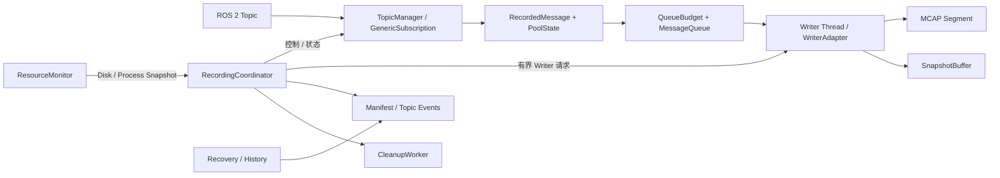
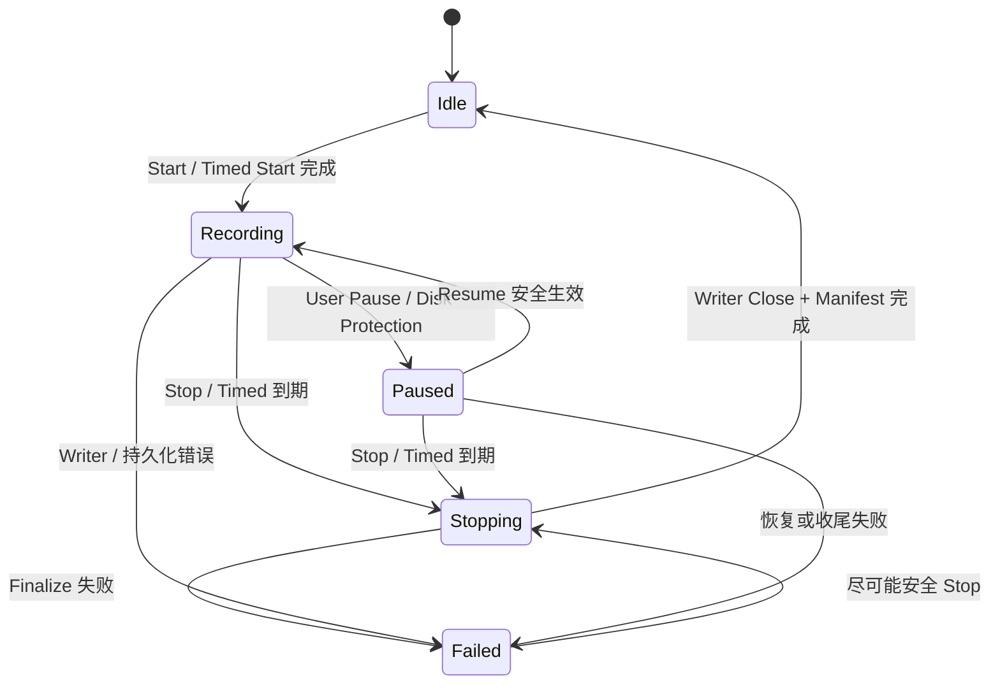

# ros2_bag Recorder 详细设计

| 属性 | 内容 |
|---|---|
| 文档版本 | v0.2.7 |
| 文档状态 | **DRAFT — V1.0 开发阶段，随时修订；规范尚未批准用于完整实施** |
| 范围 | C++17 Recorder 领域接口、录制数据面、持久化与恢复 |
| 上位规范 | docs/architecture.md、docs/requirements.md（开发稿，可直接联动修改） |
| 技术选型 | `docs/system_technology_selection.md` |

# 1. 定位、职责与接口

## 1.1 文档边界和设计原则

Recorder 是录制领域的单一事实来源，负责 ROS 2 Topic 发现与订阅、录制任务、消息准入、Writer/MCAP、Rolling、Snapshot、持久化记录、磁盘安全、恢复证据与录制诊断。V1.0 **一个 Recorder Runtime 管理一个 Recorder 实例，同一时刻最多一个活动录制任务**。Rolling 的多个 Segment 属于同一个任务。

本文定义应当实现的 Recorder V1.0 契约，**不记录开发进度、测试通过率或交付状态**，也不规定 Drogon 路由、HTTP JSON Schema、SSE、Client 和 UI。跨层所有权与关闭顺序以 `architecture.md` 为准；产品功能与验收门槛以 `requirements.md` 为准；版本/依赖选择以技术选型文档为准。**恢复状态、目录锁、只读取证与可删除条件全部由本文直接规定；测试与报告格式由 `verification.md` 承接。**

本设计限定 Recorder 的高频路径、Pool/Queue/Writer 所有权、Topic 事件、保守恢复与资源边界；**不定义** UDS/JSONL 网络控制协议、`operation_status` 服务、`status.json` 状态发布器、CLI/Web 或实施计划。Recorder Core 不依赖 HTTP、Python、UI 或独立 IPC。

核心约束：

1. 高频 ROS 回调路径必须有界，不做文件写入、网络 I/O、复杂 JSON 或无界阻塞。
2. `rosbag2_cpp::Writer` 的所有操作只能经由**单 Writer Thread** 执行。
3. `recording_generation + topic_id + topic_epoch` 隔离跨任务及动态 Topic 生命周期。
4. 成功的领域操作必须满足相应持久化/完成边界；证据不足绝不伪造成功。
5. Pool、Queue、Snapshot、Writer 控制与 Cleanup 的资源均有上限。
6. 恢复保守、可重复，未知结果保留原始数据与诊断。

## 1.2 组件分工和线程边界



| 组件或执行域 | 主要职责 | 禁止行为 |
|---|---|---|
| RecordingCoordinator | Task 状态、事务边界、组件生命周期与领域错误 | 持有状态锁等待 Writer/Executor/网络 |
| RecorderControlSequencer（内部执行域） | 恰好一个有界内部定时/安全事件执行序列；执行 Timed Stop、Rolling Rotate、Disk 收尾 | 在 ROS Executor Timer 中同步等待 Writer/Executor；重复执行已合并事件 |
| TopicManager / ROS Executor | 发现、QoS、订阅实例、Topic 事件、接收并入队 | ROS 回调直接调用 Writer 或删除文件 |
| PoolState / QueueBudget | 消息句柄唯一所有权及双配额 RAII | 容量耗尽时无界分配 |
| Writer Thread / WriterAdapter | Writer 独占、Topic 注册、写入、轮转、Finalize | 从其他线程并发访问 rosbag2 Writer |
| SnapshotBuffer | 持有有限的已写入消息用于 Segment 边界重放 | 无界缓存或跨 Epoch 重放 |
| ResourceMonitor | 磁盘安全、CPU/RSS/FD/线程遥测；提供 stop-request 与 finished Completion | 持有 Coordinator 锁执行 `statvfs`；未确认 Worker 退出就进入析构/join |
| CleanupWorker | 根据持久化授权串行删除完整 Segment；提供 stop-request 与 finished Completion | 持锁删除、自动删除 INCOMPLETE；未确认 Worker 退出就进入析构/join |
| Runtime | 输出根目录独占锁、Node/Executor/ROS Context、启动恢复与最终关闭 | 将进程锁当成 Recorder Core 内部自动行为 |

跨线程共享的非原子数据需 mutex 或可证明的 happens-before；短临界区不得包围 Writer I/O、Executor 等待或文件删除。Recorder Shutdown 依赖的 ROS Executor 与 Context 必须在收尾完成前保持可运行，不能在 Executor 自身回调中等待必须由该执行域推进的任务。

**Worker Shutdown 采用 request/finish 两阶段。** Writer、CleanupWorker、ResourceMonitor 的停止入口先设置 stopping gate/notify 并立即返回；线程函数退出时设置 finished 状态并通知 Completion。Recorder Sequencer 可以等待 finished，但 Runtime 的 shutdown deadline 必须在独立执行域继续运行。只有已经观察到 finished 的线程才执行 `join()`，使 join 成为线程资源回收而不是不可控的等待机制。析构函数只允许在所有受管 Worker 已 finished 的正常路径使用；不可恢复阻塞路径由 Runtime 保持对象存活并进入 `UNSAFE_TO_DESTROY`。

### 1.2.1 RecorderControlSequencer：唯一状态变更执行域

V1.0 不允许“每个调用线程拿 Coordinator mutex 后各自推进状态机”。Recorder 自己拥有一个**单线程、独立于 ROS Executor 与 Writer Thread 的领域控制执行域** `RecorderControlSequencer`，所有会修改 Task/Topic/Writer 生命周期的动作最终都在该执行域中决定线性化顺序：

- 外部 `Start/Stop/Pause/Resume/Add/Remove`：公共领域 API 构造拥有自身数据的 ControlRequest、尝试提交到有界外部队列并立即返回共享 `ControlHandle<Result>`。调用方可以等待 Handle，但**等待超时只结束调用方等待，不结束领域操作**；只有 Handle 的 `cancel_if_not_started()` 在线性化地完成 `PENDING -> CANCELLED_NOT_STARTED` 时才能证明没有进入 Recorder。Server 一旦把请求交给 Recorder，不得因为 HTTP Sink 超时调用该取消入口；取走后的请求必须继续到真实 DONE。
- 内部 `TimedStop/DiskSafety/RollingRotate/WriterFailure`：ROS Timer、ResourceMonitor、Writer 线程只提交**绑定 recording_generation 的内部事件**并立即返回，不在原执行域里等待 Sequencer。相同代际的 TimedStop、DiskReevaluate、Rotate 可以按事件种类合并，WriterFailure/Shutdown 不得被丢弃。
- Sequencer 是唯一可以把 Recorder State 从一个稳定/内部阶段推进到下一阶段、取得 Task Lease、关闭/开放 ingress、发起 Writer 控制事务的执行域；其他线程只读 immutable/原子状态或提交事件。
- Writer I/O、ROS Executor 上的 Subscription create/remove、fsync/Manifest Commit 可以由 Sequencer 发起并锁外等待，但 Completion 必须回到同一个 ControlRequest/Task Lease；等待期间不得让另一个变更请求越过尚未提交的领域事务。实现可以把当前请求标记为 `WAITING_NATIVE`，而不是持 Coordinator mutex。
- `status()/discover/history/evidence` 是只读调用，不经过变更队列，但必须取得自己的值对象/Lease，不得改变 Task 或 Cleanup 意图。

**有界与优先级。** 外部控制队列容量是配置项，满时在进入领域执行前返回 RESOURCE_EXHAUSTED/effects:NONE。内部安全事件不与外部请求争抢这部分容量：实现使用固定的内部事件槽/位图或单独小型有界系统队列，其中 Stop/WriterFailure/Shutdown 有保留位置；如果同一 Generation 已有同类事件，只合并唤醒而不无限增长。Shutdown 关闭外部 admission 后，Sequencer 仍处理已经 STARTED 的请求和必须完成的系统收尾，直到安全关闭或明确进入 UNSAFE_TO_DESTROY。

这层序列化**不能被 Server Control Worker 替代**：Recorder 需要在没有 Server 的库调用/测试环境中仍正确处理内部 Timer、Disk 与 Writer 事件；Server 的单 Worker 只是网络 Admission 和 Response 生命周期约束。相反，Recorder Sequencer 也不替 Server 承担 HTTP Deadline、认证或 SSE。

推荐请求状态：

```text
PENDING --Sequencer claim--> STARTED --> WAITING_NATIVE --> DONE
   │
   └--ControlHandle.cancel_if_not_started() CAS succeeds--> CANCELLED_NOT_STARTED
```

只有 `PENDING -> CANCELLED_NOT_STARTED` 成功才能确定本次没有进入 Recorder 副作用。`STARTED/WAITING_NATIVE` 后任意调用方停止等待，Sequencer 和相关 Task/Topic/Writer/Executor Lease 仍必须继续存活到真实 DONE；Handle 只在 DONE 后暴露最终 `Result`。不得把栈上的 `std::string* error`、Promise 或裸对象指针交给迟到回调，也不得把“某个 waiter 超时”编码成领域 `DRAIN_TIMEOUT`。

## 1.3 领域 API 与所有权

Recorder 的公共领域接口在 V1.0 采用以下**目标模型**。实现可调整文件拆分，但不得改变这里的字段语义、所有权和完成边界；Server 只依赖这些领域值对象，不依赖 Writer/TopicManager 内部类型。

```cpp
enum class RecordingMode { kNormal, kTimed, kRolling };
enum class TimestampPolicy { kReceive };
enum class CompressionMode { kNone, kLz4 };
enum class PauseReason : std::uint8_t {
    kUser = 1,
    kDiskCritical = 2,
    kDiskUnknown = 4,
    kDiskRecoveryPending = 8,
};

struct StartCommand {
    std::string recording_id;
    RecordingMode mode = RecordingMode::kNormal;
    std::optional<std::chrono::milliseconds> duration;
    std::optional<std::chrono::seconds> segment_duration;
    std::optional<std::chrono::seconds> retention_duration;
};

struct EffectiveTaskConfig {
    RecordingMode mode;
    std::optional<std::chrono::milliseconds> duration;
    std::optional<std::chrono::seconds> segment_duration;
    std::optional<std::chrono::seconds> retention_duration;
    CompressionMode compression;
    TimestampPolicy timestamp_policy = TimestampPolicy::kReceive;
};

struct RecordingTargetGuard { std::string recording_id; std::uint64_t recording_generation; };
struct TopicTargetGuard { RecordingTargetGuard recording; TopicId topic_id; std::uint64_t topic_epoch; };
enum class DomainEffects { kNone, kPossible, kConfirmedPartial };

enum class RecorderErrorCode {
    kInvalidArgument,
    kNotFound,
    kTopicNotFound,
    kTypeConflict,
    kTypeSupportUnavailable,
    kSchemaUnavailable,
    kUnsupportedQos,
    kInvalidState,
    kAlreadyPaused,
    kAlreadyFinished,
    kRecordingExists,
    kStaleRecording,
    kStaleTopicEpoch,
    kResourceExhausted,
    kDiskFull,
    kDiskStateUnknown,
    kWriterError,
    kStorageUnavailable,
    kEventCommitFailed,
    kDrainTimeout,
    kExecutorUnavailable,
    kGenerationViolation,
    kPoolFatal,
};

struct RecorderError {
    RecorderErrorCode code;
    RecorderPhase phase;
    DomainEffects effects;
    std::string message;
};

struct RecorderOperationResult { bool ok = false; std::optional<RecorderError> error; };

template <class Result>
class RecorderControlHandle {
public:
    bool wait_for(std::chrono::milliseconds timeout) const;
    bool done() const noexcept;
    std::optional<Result> result() const;  // value only after DONE
    bool cancel_if_not_started();          // only PENDING -> CANCELLED_NOT_STARTED
};

class RecorderShutdownHandle {
public:
    bool wait_for(std::chrono::milliseconds timeout) const;
    bool done() const noexcept;
    std::optional<RecorderOperationResult> result() const;
};
struct StartResult {
    bool ok = false;
    std::string recording_id;
    std::uint64_t recording_generation = 0;
    EffectiveTaskConfig effective_config;
    std::optional<RecorderError> error;
};
struct TopicOperationResult {
    bool ok = false;
    TopicId topic_id = kInvalidTopicId;
    std::uint64_t topic_epoch = 0;
    std::optional<RecorderError> error;
};

class RecordingCoordinator {
public:
    RecorderControlHandle<StartResult> start(const StartCommand&);
    RecorderControlHandle<RecorderOperationResult> stop(const RecordingTargetGuard&);
    RecorderControlHandle<RecorderOperationResult> pause(const RecordingTargetGuard&);
    RecorderControlHandle<RecorderOperationResult> resume(const RecordingTargetGuard&);
    RecorderControlHandle<TopicOperationResult> add_topic(
        const RecordingTargetGuard&, TopicInfo, const OperationId&);
    RecorderControlHandle<TopicOperationResult> remove_topic(
        const TopicTargetGuard&, const OperationId&);
    RecorderStatus status() const;
    TopicDiscoveryResult discover_topics(const TopicDiscoveryQuery&) const;
    HistoryPage query_history(const HistoryQuery&) const;
    TopicOperationEvidence lookup_topic_operation(
        const std::string& recording_id, const OperationId&) const;
    // Runtime lifecycle API: non-blocking, idempotent, shared completion.
    RecorderShutdownHandle request_shutdown();
};
```

**Recording ID 规范。** `recording_id` 同时是协议身份与任务目录单一组件，V1.0 统一采用 ASCII `^[A-Za-z0-9][A-Za-z0-9_-]{0,63}$`（1～64 字节，区分大小写）；不允许空格、点号、斜杠、反斜杠、百分号或 Unicode。Recorder 是最终权威校验者，Server/Client 可以提前执行同一校验但不能放宽。任务目录使用原值作为单层目录名；目录已存在一律返回 `RECORDING_EXISTS`，不做 Unicode/大小写/路径归一化后的“同名修正”。

**Shutdown 是 Runtime 生命周期控制，不是普通外部 Control。** `request_shutdown()` 必须 O(1)、幂等：关闭 Recorder 外部 mutation admission，对当前 Task generation 原子关闭 ingress gate，并向 RecorderControlSequencer 的保留系统槽提交一次 Shutdown；重复调用返回同一个共享 Completion。Runtime 持续强持有 Recorder，并在独立管理/deadline 执行域等待 `RecorderShutdownHandle`。Sequencer 合并已在途 Stop，随后向 Writer/CleanupWorker/ResourceMonitor 发停止请求；只有对应线程已真实退出后才 join/释放对象并完成 Handle。若 Worker 永久卡在 Writer I/O、`remove_all()` 或 `statvfs()`，Handle 保持未完成，Runtime 超时进入 `UNSAFE_TO_DESTROY` 并保留整个对象图，禁止进入 Recorder 普通析构。

`RecorderControlHandle` 是**进程内完成对象，不是 Operation Registry**：它不持久化、不提供跨进程查询，也不改变 Protocol 的 UNKNOWN 规则。Recorder 内部只对当前请求及其 Lease 保留共享 Completion；所有 waiter 消失后，已经 STARTED 的请求仍继续到 DONE。Server Control Worker 必须在取得 Handle 后继续观察其真实 DONE，网络 ResponseSink 可以更早超时/释放。

`StartCommand` 是**唯一任务模式输入**。Runtime `RecorderConfig` 不再保存“当前 recording.mode”；它只保存 output_root、Rolling 默认 segment/retention、允许范围、StorageProfile、QoS 默认及全局资源预算。Server 将 Protocol Start 解析为 StartCommand，Recorder 在 Sequencer 内验证并生成 `EffectiveTaskConfig`：

| Start mode | `duration` | `segment_duration / retention_duration` | 结果 |
|---|---|---|---|
| NORMAL | 必须 null | 必须 null | 有效 |
| TIMED | 必须正值 | 必须 null | 有效 |
| ROLLING | 必须 null | 可缺省；缺省取 Runtime 默认，最终均为正值 | 有效 |
| 任意非法组合 | — | — | INVALID_ARGUMENT / effects:NONE |

Compression、QoS 默认和 TimestampPolicy **不由 StartCommand 接受覆盖**。Recorder 从启动时验证通过的 Runtime Storage/QoS Profile 复制到新任务的 EffectiveTaskConfig；每个 Segment 都必须使用该 Task 的冻结 Profile。`CompressionMode` V1.0 仅允许 NONE/LZ4，默认 LZ4。若使用 rosbag2 storage config file，Runtime 必须在 Start 时把已解析、验证的 MCAP Profile 物化为任务目录内只读的 `storage_config.yaml`（或使用等价 Writer 原生 Options），后续 Rolling Segment 始终引用这个任务副本，避免全局 `config/mcap.yaml` 在任务中途变化。

`RecorderStatus.mode/duration/effective_config` 必须来自当前 Task 的 EffectiveTaskConfig，不再从进程级 RecorderConfig 推断。Manifest 同样持久化这些实际值，使 History/Recovery 能解释录制行为。RuntimeConfig 在进程启动时一次加载并保持不可变；修改磁盘上的 YAML **不会**影响当前或下一 Task，必须安全重启 Runtime 才重新加载。每次 Start 只从这份 immutable RuntimeConfig + StartCommand 形成新的 EffectiveTaskConfig。

只读接口使用拥有自身数据的有界值对象。`TopicDiscoveryQuery/Result`、`HistoryQuery/Page`、`TopicOperationEvidence` 均由 Recorder 定义。V1 History 与 Graph 统一使用 `limit + offset` 的 **BEST_EFFORT** 分页，不提供 Cursor/快照数据库语义；目录或 Graph 在跨页期间变化允许产生重复/漏项，调用方需要完整刷新时从 offset=0 重新扫描。Topic Evidence 返回 CONFIRMED_SUCCESS / CONFIRMED_FAILURE / UNCERTAIN / NOT_FOUND，并只读取受限事件文件。


**同步控制接口的通用前置和后置条件：**

| 条件 | 契约 |
|---|---|
| 输入身份 | 任务 ID、Topic 名称和 operation_id 的格式、长度和字符集合受限；空/非法身份不得有副作用 |
| 资源生存期 | 每个调用开始时取得合法的 Recorder/Task/Topic 所有权；Shutdown 一旦关闭入口，不允许获得新的任务句柄 |
| 成功返回 | 领域同步阶段完成；需要持久化的操作已有经验证终态，且成功不表示 HTTP 应答已送达 |
| 失败返回 | 不能假定“完全没有副作用”；必须说明是否留下 PREPARED、可能的半完成对象或已接纳消息 |
| 超时与取消 | 内部协作超时必须确保异步执行没有持有悬空栈参数/回调；不能让下一代 Task 复用未清理对象 |
| 异常边界 | 运行期第三方异常不得跨 ROS 回调和 Worker 线程边界泄漏；转换成域错误并安全关闭 |
| 诊断 | 错误携带代码与可读取说明；不要只返回模糊的 false，也不泄露任务数据或凭证 |

Stop 和 Shutdown 的“幂等”是**安全意义的幂等**：重复请求不执行第二次文件删除、Writer close 或任务提交；调用是否返回成功要根据“已经处于终态”和“此前是否发生失败”区分，不能用幂等掩盖第一次失败。对 `add_topic` 和 `remove_topic`，operation_id 是事件关联参数，**不自动提供任意重试去重保障**；若要求幂等重试，必须明确 identity 与持久化去重边界，不能仅依赖相同字符串。

**锁与回调生命周期。** 应明确 Coordinator 状态锁、TopicMap 锁、WriterRequest 同步原语、PoolState 锁各自保护范围。正常代码优先不嵌套持有不同子系统锁；确有跨状态更新时给出唯一锁顺序并用注释/测试固定。不得持有锁调用 `rclcpp::Executor::remove_*`、等待 ROS 回调组被执行、`writer.close()`、`fsync` 或 `remove_all`。在所有 Async/Executor 协作结构中，回调捕获应持有共享生命周期对象或受控弱引用，禁止捕获可能提前销毁的栈上 error 指针。

**并发操作的执行约束。** Server 外部变更串行化是一道入口约束，但 Recorder 内部 Timed Stop、磁盘保护和 Writer 失败不经过 Server。对一个 Task，只有 Recorder 自己的状态同步点可以裁定哪个转移生效；接收到互相冲突的内部/外部请求时，必须明确哪一个已经关闭 ingress、哪一个负责唯一的 Finalize、另一个如何观察已执行中的转移。不得将多个线程都从 Recording 变为 Stopping 并各自关闭 Writer。


### 1.3.1 原生控制目标守卫的线性化接口（跨 Server/Recorder 阻断项）

Server 的 Control Worker 可以在入队、出队、native 入口前反复验证 `expected_runtime_instance_id + recording_id + recording_generation`，**但仅在 Server 中前置读取 `status()` 不能构成 Recorder 层线性化目标守卫**：Timed Stop/Disk Protection/Stop 完成后，另一个 Task 可能在 Server 校验与实际 native mutation 之间切换。因此 V1.0 对 Server 暴露的 Stop/Pause/Resume/Add/Remove 领域 API **必须显式接收 Recording/Topic Guard**；不带目标代际的便利入口不得作为跨层正式接口。该 Guard 契约与 RecorderControlSequencer 是 Server 控制面实施的前置条件。

领域目标守卫使用 §1.3 已定义的 `RecordingTargetGuard / TopicTargetGuard`；其线性化要求如下：

目标身份、Recorder State 的允许转移与关闭 ingress 副作用必须在**同一 Recorder 域状态线性化临界区**里联合判定；若 Guard 失配，在**任何** Topic/Task 副作用前返回 `STALE_RECORDING / STALE_TOPIC_EPOCH / INVALID_STATE` 及确定的 effects:NONE。不得在业务变更期间持 Coordinator 锁等待 Writer/Executor；先在域内原子取得对正确 Task/Topic Epoch 的受控操作 Lease/状态转移，锁外等待子操作真实完成。Runtime UUID 属于 Runtime/Server 作用域，仍由 Server 的入口 gate 验证，Recorder 不新增 HTTP UUID 身份类型。

**Start 的守卫不同于已有任务的 Generation Guard。** Start 没有现存 Task 的 recording_id/generation 可校验。Server 校验 expected_runtime_instance_id 并放入唯一 Control Worker；Recorder 在自身状态线性化点联合判断 Idle、output_root/task_id 无冲突、没有正在初始化的 Task，原子取得启动权并分配新的 Task Generation。Start 不得凭之前读取的 status() 证明 Idle；两个并发 Start 只允许一个取得启动权。Writer/Manifest 初始化真正完成后才能对外宣称 Recording；失败保留真实产生的文件与诊断。request_id 和 operation_id 不构成 Start 幂等键。

**原生控制守卫的范围：** Stop/Pause/Resume/Add/Remove 的目标代际、Epoch、领域状态检查和正确 Task Lease 的取得必须作为同一个领域临界区进行；内部 Timed Stop/Disk Pause 也使用绑定该 Task Generation 的 Lease。已失效请求在接触新 Task 的 ingress/Writer/Topic 前返回确定的 STALE 错误；仅在没有本次副作用时才允许 effects:NONE，PREPARED durable 之后不得虚报 NONE。

兼容旧无 Guard C++ 方法的内部调用必须有不可与外部 HTTP 混淆的信任边界：仅由明确绑定 Task Lease 的内部 Timer/Disk/Writer 安全分支使用；直接调用无 Guard 方法不能绕过外部 API 的目标要求。Stop 过程中发生内部 Timer、Disk Pause、Writer Fail，仍只有领域状态机能裁定本次原生调用的真实效果，Server 不借 Status 反推。执行测试须在 Server 最后一次前置校验之后、Recorder 原子目标检查之前人为触发 Task Generation 改变；正确结果必须拒绝旧目标，不作用于新 Task。


## 1.4 配置生效边界

Recorder 配置分为两层：**RuntimeConfig** 管理 Executor、output_root、Queue/Pool/Writer/Cleanup/Disk 预算、Rolling 默认值以及 Storage/QoS Profile；**EffectiveTaskConfig** 是 Start 时形成的不可变任务行为。mode/duration/segment/retention 由 StartCommand 解析，Compression/QoS 默认/TimestampPolicy 从当前已验证 Runtime Profile 复制。活动任务只允许显式动态 Topic Add/Remove；磁盘、状态采样等安全参数可以按其独立 Runtime 生命周期工作，但不得改变已经冻结的 Task Storage/模式语义。

任务 ID 是安全单层名称，不得包含路径穿越或跨目录引用；**不得覆盖已有录制目录或旧恢复证据**。失败后遗留任务同样受保护。输出根目录应规范化并在恢复或写入前由 Runtime 取得独占锁；库调用宿主需履行等价所有权约束。

# 2. 状态机、Topic 与控制语义

## 2.1 Recorder 状态和操作完成边界

Recorder 稳定状态：`Idle / Recording / Paused / Stopping / Failed`。Writer 打开、准备新 Segment、等待 Producer 与 Finalize 均是内部阶段；未经上层架构/协议评审，不额外引入对外状态。



| 操作 | 允许条件 | 完成或拒绝的领域语义 |
|---|---|---|
| Start | Idle、合法 StartCommand、磁盘安全、StorageProfile 可用、任务目录不存在 | 原子生成 Generation + EffectiveTaskConfig，Writer/Manifest 初始化完成后才开放 ingress；失败不得宣称 Recording |
| Pause | Recording，或 Paused 且 reasons 中尚无 USER | 原子增加 USER；若本来 Recording 则先关闭 ingress，若已因系统原因 Paused 则保持关闭。已接纳数据不可静默丢弃；已有 USER 时返回 ALREADY_PAUSED/effects:NONE |
| Resume | Paused，且 reasons 中存在 USER 或 DISK_RECOVERY_PENDING | 先取得新鲜磁盘安全样本；移除 USER，并在磁盘已安全且稳定期满足时移除 DISK_RECOVERY_PENDING。活动的 DISK_CRITICAL/DISK_UNKNOWN **绝不由 Resume 清除**。清理后 reasons 为空且未进入 Timed deadline/Stopping/Failed 才开放 ingress；如果仅存在仍有效的系统保护原因且没有可清除的 USER/PENDING，则按保护原因返回 `DISK_FULL` 或 `DISK_STATE_UNKNOWN` / effects:NONE |
| Stop | Recording/Paused/可安全收尾的 Failed | 禁止新接入、在途 Producer 屏障、排空/故障诊断、Writer 关闭、持久化终态；反复 Stop 不得重放危险副作用 |
| Add/Remove Topic | Recording/Paused 且实例状态允许 | Topic 终态成功依据订阅实际状态与持久化证据，不能以 PREPARED 代替 |
| Status/Discover/History | 存活期 | 不改变录制状态、存储事实或清理意图 |
| Shutdown | 存活期任意可安全进入的状态 | 幂等并等待受管理线程；不得先终止必需 Executor 再等待其回调 |

状态转移必须在明确同步点生效；跨线程并发读到的 Snapshot 可以反映一个合法中间观察时刻，不应暴露半初始化的 Writer 指针或失效对象。失败后的重启应优先保留原始证据、进行安全收尾与新任务初始化；不得凭 `Failed` 直接覆盖失败任务目录。

暂停归因使用**集合/位掩码** `PauseReasons`，允许同时包含 `USER / DISK_CRITICAL / DISK_UNKNOWN / DISK_RECOVERY_PENDING`。RecorderStatus 对外始终转为 `paused_reasons[]`；没有原因时为空数组，不存在会覆盖其他原因的标量。
- 外部 Pause 在 reasons 尚无 USER 时增加 USER；Recording 状态先关闭 ingress，系统原因已使任务 Paused 时只增加归因，不重复执行关闭动作。已有 USER 的重复 Pause 明确拒绝且无副作用。
- Disk CRITICAL/UNKNOWN 分别表示**当前仍生效的危险条件**，绝不由用户 Resume 直接清除，也绝不覆盖 USER。
- 当磁盘重新达到安全阈值并持续 `resume_stable_sec`：若 `auto_resume=true`，Sequencer 移除已解除的 DISK_CRITICAL/DISK_UNKNOWN；若 `auto_resume=false`，Sequencer 将已解除的磁盘危险原因替换为 `DISK_RECOVERY_PENDING`，保持 ingress 关闭，明确表示“环境已安全但等待人工恢复”。
- 外部 Resume 可在 USER 或 DISK_RECOVERY_PENDING 存在时调用：先复核新鲜磁盘样本，再移除 USER；只有安全稳定条件仍成立时才移除 DISK_RECOVERY_PENDING。活动 DISK_CRITICAL/DISK_UNKNOWN 保持不变。若最终 reasons 为空且 Timed deadline 未触发、Task 未 Stopping/Failed，才重新开放 ingress。
- 仅存在仍有效的 DISK_CRITICAL/DISK_UNKNOWN 保护原因、没有 USER/PENDING 时直接 Resume 按保护原因返回 Recorder `DISK_FULL` 或 `DISK_STATE_UNKNOWN` / effects:NONE；Protocol 再统一映射为 `DISK_UNSAFE`。瞬时磁盘采样若已改善但稳定期尚未满足，不得把错误详情伪装成当前采样仍为 CRITICAL。用户无需先做一次人为 Pause 才能恢复系统暂停。
- Failed/Stopping 的收尾可清空集合，但绝不触发恢复。

**状态转移线性化与竞态矩阵**

**线性化点是“何时对其他线程生效”，不一定等于“所有文件已持久化”。** 控制接口必须分别指定：(a) 内存状态生效点，(b) ingress 边界，(c) Writer 完成屏障，(d) 持久化成功点。特别不能把“已经置为 Stopping”写成“Stop 已完成”。

| 操作 | 对并发线程生效的状态点 | 完成返回前必须完成 | 失败后允许看到 |
|---|---|---|---|
| Start | 新任务代际、Writer 和订阅准备后才开放 ingress | 初始化 Writer、合法任务记录、必要 Topic 准备、磁盘安全复核 | Idle 或 Failed + 安全保留，不能假装 Recording |
| Pause | 在 Topic 回调开始新消息准入之前关闭 ingress | 记录 Pause 原因；已接纳消息仍可写完 | Recording/Paused/Failed，按真实是否阻止新准入裁定 |
| Resume | 校验 USER/SYSTEM Pause 归因与磁盘后才开放 ingress | 确认 Writer 和 Topic 恢复条件 | Paused/Failed，不能提前开放后报告拒绝 |
| Stop | 一次性将 active Task 标识为关闭 ingress / Stopping | Producer Barrier、Queue/Writer Drain、Close/Manifest 终态 | Stopping/Failed 且仍可诊断原 Task |
| Add | 原任务 Topic 集合保留 ADDING/ARMED 的新 Epoch | Writer 注册、订阅有效、持久化 TOPIC_ADDED | FAILED/已回滚 ingress、UNCERTAIN Event |
| Remove | 对选定 Epoch 标记 REMOVING 并阻止新接入 | 在途 Producer Drain、订阅释放、Topic_REMOVED 持久化 | 可观测 REMOVING/FAILED，不能伪造 REMOVED |
| Timed Stop | steady 截止点使停止条件成立 | 同 Stop，且与手动 Stop 合并为一次收尾 | Stopping/Failed |
| 磁盘保护 | Disk CRITICAL/UNKNOWN 安全样本发布、禁止新的准入 | 关闭 ingress 与归因；必要时安全收尾 | Paused/Failed，不覆盖 USER Pause 意图 |

上述状态并非要求为所有内部步骤新增 RecorderState 枚举值；可以用 Task/Topic 内部标志、Generation 和操作结果字段表达阶段，但内部检查必须与相应同步点一致。

**竞态优先级。** 选择的判定规则应是确定性的，而不是依赖哪个线程“通常更快”：

- Stop 对同一任务是**终结性请求**。Start/Resume/Add 在 Stop 关闭 ingress 后必须拒绝或等待该 Task 安全终结，不能替 Stop 重新打开接入。
- Timed Stop 与手动 Stop 同时发生，由最先取得任务关闭权的调用完成唯一 Stop；后者获得可判断的 already-stopping/已结束结果，不第二次关闭 Writer。
- 外部 Pause 与磁盘 CRITICAL 同时发生，应同时保存 USER 与 SYSTEM 限制原因，不因为显示其中一个原因而忘记另一个。恢复必须要求所有仍生效的禁止条件解除。
- Remove Topic 与 Stop 重叠时，不能在同一订阅仍有在途回调时把 Topic 对象销毁。可由 Stop 统一回收，但需要保留 Remove 的真实完成或 UNKNOWN 证据。
- Add Topic 与 Rolling 边界重叠时，由一个受控的 Topic 注册状态决定该实例应注册在当前、新 Segment 或两者；不能在写入前让 Message 引用一个未注册的 Segment Channel。
- Writer 出错后，普通 Resume 或自动磁盘恢复不得使 Failed 进入 Recording。Rollback/Finalize 失败保留原有最早错误，并追加有界次要错误。
- Shutdown 对任何任务状态优先关闭新操作入口；不能通过等待一个已停止的 ROS Executor 来完成自己持有的控制线程请求。

**Topic 操作的持久化先后约束。** `TOPIC_*_PREPARED` 必须早于对应实际可能产生无法恢复副作用的操作；`TOPIC_ADDED/REMOVED` 必须晚于其可观察的领域完成条件。介于两者之间崩溃时“保留 UNCERTAIN”，而不是通过事后扫描猜测具体请求成功。包含相同 operation_id 的重复事件必须检查 Topic Identity、Event Seq、Terminal Kind；冲突的多个终态属于存储损坏/协议违反，不能选择最新一条作为成功。

**时间与状态区分。** Steady Clock 用于 Timed/Resume Stable/Timeout，Recorder RECEIVE 时间戳来自接收时刻的系统时钟（Unix epoch），映射至 MCAP log_time/publish_time；不读取 Header.stamp，也不采用可跳变的 ROS 仿真时间作为接收时间来源。Steady clock 用于 Timed/Rolling/Timeout；系统墙钟用于历史查询与持久化记录。不同时间域不能直接比较。若系统墙钟跳变，历史查询的时间筛选可能受影响，必须以 Manifest 所记录时间和可用性说明为准；Rolling 的进程内截止管理不得仅依赖可能倒退的 ROS Clock。

### 2.1.1 内部定时控制不得占用 ROS Executor 等待域

**实际代码问题：** 目前 `rolling_timer_` 的 rclcpp callback 直接执行 `rotate_segment()`，内部可等待 Writer/Producer；Timed Timer 也在 Executor 上发起 `stop_on_executor()`。默认仅 1 个 ROS Executor Worker 时，定时回调长期等待 Writer 或其他 Executor 协作会使订阅回调失去执行机会；更危险的是等待一个必须由同一 Executor 推进的控制请求，会发生自等待。即使某次测试没有死锁，也不能认为对高频负载无性能影响。

**唯一控制域规则：** Recorder 内部 Timed Stop、Rolling Rotate 与磁盘保护由**恰好一个 Recorder 内部 Control Sequencer** 串行执行真正可能阻塞的领域协作。它属于 Recorder 所有（不是 Server ControlDispatcher），在 Recorder-only 运行时也必须存在。V1.0 可用一个 C++17 受管线程及有界事件队列实现；线程不运行 ROS 订阅 Callback，不在 Reader/Writer/Pool 热路径中排队。Executor 的 wall timer 仅执行有界 O(1) 的 `steady_deadline -> event kind + TaskGeneration` 投递和必要的原子 ingress 安全闸，不执行 fsync、Writer close、Subscription Drain 或条件变量等待。多次同类 Timer 事件合并成同一 TaskGeneration 的一个 pending bit，不允许周期性积累无限 Rotate/Stop 命令。

**优先级与状态保护：** STOP/SHUTDOWN、安全磁盘暂停优先于普通 Rotate；在本次任务已经 Stopping/Failed 时 Rotate 必须跳过。涉及磁盘 CRITICAL/UNKNOWN 的保护**先以无阻塞原子 Gate 禁止新准入**，随后 Sequencer 完成领域状态/诊断，不能等普通 Rotate 结束才关闭 ingress。外部 Server ControlWorker 仍只串行外部请求；二者都需经过 Recorder 的 Task 线性化 Guard，任何同一 Task 的 Stop Finalize 只能有一个所有者，独立线程不意味着允许并发 Writer 关闭。Sequencer 生命周期受 Runtime 关闭屏障约束：先停止 Timer 产生新事件、清空或安全完成在途命令，等待它真实退出，然后才能析构 Topic/Queue/Writer 和停止必需的 Executor/Context。

**Timed 截止的硬准入边界。** Timed Task 的 generation-bound `TaskIngressState` 保存**不可变 steady deadline**。每个 Producer 在 `try_enter()` 的同一个准入线性化操作中联合检查 `accepting`、Task/Topic generation 与 `SteadyClock::now() < deadline`；一旦观察到 `now >= deadline`，该 Producer 必须拒绝准入，并以无阻塞方式将本代际 gate 标为 deadline-expired/`accepting=false`、提交或合并 `TimedStop(generation)`。因此 **Timer 只是提前唤醒/收尾触发器，不承担截止正确性**：即使 ROS Executor 忙碌导致 Timer 晚执行 5 秒，截止后的新 Producer 仍不能越过准入点。截止前已经成功取得 ProducerToken 的消息可以随后 enqueue/Drain，即使实际 Writer write 发生在 deadline 之后；截止语义按**准入线性化时刻**而不是最终写盘时刻裁定。旧代际 Timer 或 Producer 只能触碰旧 TaskIngressState，绝不能关闭新 Task。Timer 回调不做 Writer Close/fsync，也不直接把状态伪装成 Idle；最终 `Stopping/Idle/Failed` 仍由 Sequencer 根据真实收尾推进。

Rolling 的 `segment_duration` 不采用“硬停止 ingress”语义：它是**目标轮转周期**。deadline 到达只提交/合并 Rotate；若 Sequencer 正在执行更高优先级控制，当前 Segment 可以安全延长，宁可延迟轮转也不能并发关闭 Writer 或丢弃已接纳数据。状态/诊断应记录 rotation lag，不能把 `segment_duration` 宣传为物理文件严格最大时长。

**资源预算：** 内部事件不是用户操作结果注册表。事件存储是固定的 TaskGeneration+Kind/coalesced flags；事件总数至多与明确枚举的控制种类同阶，不引入每 Topic/每周期新任务的无界增长。非阻塞投递失败（例如 Sequencer 进入 Shutdown）必须保持安全入口关闭并记录诊断；不能静默恢复 Recording。

**必测：** 单 Executor Worker、10 Topics×1000Hz，在 Writer.Close 人为阻塞、Timed Stop 与 Rolling Timer 同时发生时仍有有界 ROS callback latency；在内部调度点前后注入 Stop、Pause、Shutdown、TaskGeneration 改变，验证无自等待、重复 Rotate、旧 Task 写入和悬空回调。具体线程与锁顺序要由代码审查和真实 Humble/Jazzy 执行证明。

### 2.1.2 ROS Executor Bridge：只允许取消尚未开始的调用

动态 Subscription 创建/移除如果必须在 ROS Executor 所属执行上下文中进行，使用 Heap-owned `ExecutorCallState`，至少包含 `PENDING / STARTED / DONE / CANCELLED_NOT_STARTED`、Task Generation、Topic ID/Epoch、Completion 和所需对象 Lease。

1. Executor 回调首先 CAS `PENDING -> STARTED`；看到 `CANCELLED_NOT_STARTED` 时直接退出，不执行任何领域动作。
2. Sequencer 等待预算到期时只能尝试 CAS `PENDING -> CANCELLED_NOT_STARTED`。成功才可确定“未执行”；CAS 失败说明回调已经 STARTED，不能返回普通 TIMEOUT 后释放 Task。
3. STARTED 后即使超过网络/调用方等待预算，也继续到 DONE；Runtime Shutdown 把它作为 active Executor Lease。若 Executor 永久不推进，则进入 `UNSAFE_TO_DESTROY`/进程监管退出路径，而不是析构 Node、TopicManager 或 Queue 后等待迟到回调。
4. `clear_task()` 必须返回明确 Completion。Stop 只有全部 Subscription/Producer 生命周期真实关闭且 ExecutorCall DONE 后，才能释放 Queue、Pool、TopicManager；“void clear_task() 超时后继续 Stop”不符合目标设计。
5. Executor 回调只捕获拥有自身生命周期的数据、共享 CallState 与受控 Owner Lease；不得依赖调用线程栈上的 error 指针、Promise 或可能提前析构的裸 `this`。

因此 Executor timeout 是**等待预算**，不是强制取消。它与 HTTP UNKNOWN 是不同层，但共同遵守“等待结束不能证明没有执行”。

## 2.2 发现、类型和 QoS

**可用 Topic 查询不是 Add Topic 的副作用。** 发现接口读取 ROS Graph，至少提供名称、已观测类型集合、可见发布端数量（或端点元数据）、查询时状态及失败诊断。Graph 当前未发现不等于 Topic 永不存在；仅在 ROS Graph 可见但发布端数量为零时报告“可见、无发布者”，不能把未发现伪装成零发布者。没有频率采样时返回未知，不伪造 Hz=0。

添加前校验绝对 Topic 名、ROS 类型字符串及**同名唯一类型**；存在多个已发现类型时拒绝自动选取。ROS 2 GenericSubscription 依赖运行环境可用的类型支持库；不需要将自定义消息静态编译进 Recorder，但类型支持缺失必须给出明确错误。Graph 与 Publisher QoS 可以在扫描后改变，创建订阅需自行处理竞态。

`TopicInfo` 为订阅实例不可变描述，至少包含 `topic_id`、name、type、serialization_format（cdr）、QoS、可选 type_hash、expected_hz 及 RepeatPolicy。支持的 QoS 字段为 reliability、durability、history、depth；用户显式配置优先，自动适配需从可见 Publisher 信息求兼容配置，不能声称一次适配能覆盖未来所有 Publisher。RMW 不支持 Incompatible QoS Event 时须采用诊断降级，而非错误推定订阅正常匹配。未知 type_hash 不得伪造为确定值。

推荐的容量边界沿用选型中的限制思路：活跃 Topic 数、任务中不同 Topic 数和最近移除实例数量分别受限，达到上限时以 RESOURCE_EXHAUSTED 拒绝，不自动删除其他 Topic 或清空历史身份计数。


### 2.2.1 QoS 决策矩阵、Type Hash 与动态变化

V1.0 对外 QoS 白名单严格为 `reliability`、`durability`、`history`、`depth`。不得接受并悄悄丢弃 `deadline`、`lifespan`、`liveliness`、`liveliness_lease_duration` 等未支持字段；明确返回字段路径和 `INVALID_ARGUMENT`。`reliability` 只允许 `RELIABLE/BEST_EFFORT`，`durability` 只允许 `VOLATILE/TRANSIENT_LOCAL`，`history` 只允许 `KEEP_LAST/KEEP_ALL`；KEEP_LAST 的 `depth` 必须为 **1..10000**，KEEP_ALL 不接受有意义的 depth。RepeatPolicy 与 TopicQoS 相互独立：`enabled=false` 不接受 max 字段；`enabled=true` 要求 `max_messages=1..65536`、`max_bytes=1..16777216`，且还受 `snapshot.max_total_bytes` 等 Runtime 更严格预算。Direct C++ Add 与 Protocol Add 必须执行同一归一化/验证，不能由 C++ 入口绕过网络值域。

**选取优先级**：显式用户 QoS > 当前发布者的兼容集合 > 已验证默认值。EXPLICIT 不因订阅连接不上而偷偷改成 AUTO。AUTO 在创建前使用 ROS Graph 发布端 endpoint profile 推断，与 RMW 的 requested/offered 兼容关系逐字段判断，而不是把所有发布者简单当相同服务端。典型优先策略：只要存在 BestEffort 发布者，应选 BestEffort 以兼容该组；只有当前全部已知发布者都提供 Reliable 时才可选 Reliable。TransientLocal 订阅只匹配能够提供相应 Durability 的 Publisher；存在 Volatile 时默认 Volatile。发布者集合为空、Unknown/系统默认 QoS 或有冲突策略时采用经配置验证的安全默认值并标注适配不确定性，不能返回伪造的确定兼容结论。History/Depth 的取值应在 Topic 创建时固定；不能仅依据 Publisher 当前 Offered History 推断实际 Buffer 不会溢出。

| Type 情形 | 行为 | 诊断 |
|---|---|---|
| ROS 类型名称不同 | 拒绝 Add，不注册 Writer Channel | INVALID_ARGUMENT / TYPE_CONFLICT |
| 规范及算法相同、双方 type_hash 已知且相等 | 允许进入后续 Schema/支持检查 | 记录可信 type_hash |
| 规范及算法相同、双方已知且哈希不同 | 拒绝；同名类型不能静默混写 | TYPE_CONFLICT |
| 一方 type_hash 不可取得、其余可验证基础属性相同 | 可以受控继续，但保留 Unknown Hash 和降级证据 | TYPE_DIAGNOSTIC |
| 双方未知、基础属性同一 | 可继续但不声称哈希一致 | TYPE_DIAGNOSTIC/UNKNOWN |
| 无法构造所需类型支持/Schema 闭包 | 拒绝打开 ingress；若 Writer 已注册则保存安全诊断 | TYPE_SUPPORT_UNAVAILABLE / SCHEMA_UNAVAILABLE |

Hash 比较前须确认规范、算法与值的可比性；跨发行版不同哈希方案**不得只因字节不同断言消息不一致**，应回退为无法比较并使用 Schema/基础类型核验。Topic name 上 Graph 多类型不能随便任选一个；用户指定 type 也必须与真实可用类型支持一致。创建后 Publisher 加入/离开、QoS Offered 变更不能假设最初兼容性永久成立：优先使用 Requested Incompatible QoS / matched 事件更新诊断；目标 RMW 不支持时用安全 Graph 重新观察与实测消息到达诊断，不从 0 消息直接断言 QoS 错误。诊断必须带 Topic ID/Epoch。


## 2.3 Topic 身份和生命周期

每条录制消息携带领域身份：

```text
(recording_generation, topic_id, topic_epoch)
```

`recording_generation` 区分连续任务；`topic_id` 标识任务内逻辑 Topic；`topic_epoch` 区分同名 Topic 的订阅创建世代。同名重添加可以复用 topic_id，但**必须有新的 topic_epoch**；Writer 统计、Snapshot、最近移除记录均按 ID/Epoch 关联。`operation_id` 则关联**一次 Topic 变更**，不自动等于 HTTP Request ID 或 SSE 事件 ID。

**同名 Topic 的任务级存储签名不可变化。** V1.0 在同一个 recording task 内，以 Topic name 维护 `TopicStorageSignature = normalized_type + serialization_format + schema_encoding + schema_sha256`。第一次通过 Schema preflight 的 Add 建立该 name 的绑定；之后即使旧 Epoch 已 REMOVED，同名重添加也只能使用完全相同的 StorageSignature。类型名变化、serialization format 变化、schema encoding 变化，或同一类型名解析出的完整 Schema SHA-256 变化，均在创建新 Subscription、注册新 Writer Channel、写 `TOPIC_ADD_PREPARED` 之前拒绝为 `TYPE_CONFLICT/SCHEMA_UNAVAILABLE`，不得依赖新的 topic_epoch 让不同 CDR/Schema 混入同一任务。V1.0 **不实现“换类型时自动切新 Segment”**；需要类型变化时必须结束当前 recording 并 Start 新任务。Type hash 仅作可用时的附加诊断，不替代完整 Schema SHA-256。

实例状态及其合法演进：

```text
ABSENT → ADDING → ACTIVE → REMOVING → REMOVED
                  ↘ ARMED（Paused 添加）
                  ↘ FAILED
```

**Add Topic：**

1. 验证参数/任务状态/容量，分配新 Topic 身份与 Epoch。
2. 写入 durable `TOPIC_ADD_PREPARED`，只表示操作意图。
3. 在 Writer Thread 注册 TopicMetadata 与所需 Schema；创建 GenericSubscription 与独立回调组。
4. Recording 下激活接入，Paused 下进入 ARMED；向 Writer/Executor 确认相关资源有效。
5. 写入 durable `TOPIC_ADDED` 后才能返回具有该持久化保证的成功；持久化失败须关闭 ingress 并进入安全失败处理。

**Remove Topic：**

1. 写入 `TOPIC_REMOVE_PREPARED`，关闭目标 Epoch 接入。
2. 等待本 Epoch 在途回调 Producer 退出，然后移除 GenericSubscription。
3. 旧 Epoch 已接纳的队列消息仍可按旧身份写完；清除对应 Snapshot，保留必要的最后诊断。
4. 写入 `TOPIC_REMOVED` 后提交成功，将实例记录于有界的已移除历史。

Writer 已注册 Schema 但订阅创建失败，不能调用无安全证明的 TopicMetadata 删除回滚，保留该 Segment 的元数据并持久化 `TOPIC_ADD_FAILED`。解除订阅失败时必须按实际是否仍在接入区分 ACTIVE/FAILED/REMOVED，不能从单个错误码推断实例已销毁。

**事件持久化是安全边界**：无法提交终态时不能报告成功；无法记录 Topic 意图或终态时应阻止新的不安全操作、停止接入并安全收尾。应用端变更串行化并不能排除 Timed Stop、Rolling Timer、Writer Error 和磁盘保护并发；由 Recorder 的同步与状态机判定最终效果。

**ROS 2 Executor 与动态订阅安全**

Recorder 支持动态添加/移除 GenericSubscription，因此对 Executor 的引用和销毁顺序必须比普通静态 Node 更严格。一个订阅是否“用户看不到了”与 Middleware WaitSet 是否已经不再引用它，是两个不同的完成点。

建议把与 Executor 交互的资源分成三类：Recorder 的 TopicRuntime 强所有权；Executor CallbackGroup/Node 注册关系；Fast DDS/RMW 内部 WaitSet/Reader 实体。销毁顺序必须首先禁止新消息回调，再让在途回调退出，随后在 Executor 协作点移除订阅及 CallbackGroup，最后释放 TopicRuntime 与其 SerializedMessage 相关生命周期。不能仅把 TopicMap 中的 `shared_ptr` erase 当作 DDS Reader 已无引用的证明。

| 调用线程 | 操作 | 必须保证的行为 |
|---|---|---|
| 非 Executor 控制线程 | Add/Remove | 通过受控 Executor 请求执行实际注册/移除；等待期间不持有 TopicMap/Coordinator 锁 |
| Executor 回调线程 | Topic 错误或定时 Stop | 不能同步等待需要本 Executor 继续 spin 才能完成的请求；采用直接安全分支或异步移交 |
| Writer Thread | Writer Error 需要 Stop | 发布失败意图给 Coordinator，不能在 Writer 线程中调用一个等待本 Writer 自己 Drain/Close 的同步 Stop |
| ResourceMonitor Worker | Disk Protection | 可发出保护状态和接入关闭信号，不能同步等待自己要间接触发的 Writer/Executor 回调 |
| Runtime 关闭线程 | Stop/Shutdown | 等待 Recorder 所需 Executor 协作结束后，才能 cancel Executor / shutdown ROS Context |
| 控制 HTTP 工作线程 | 同步 Recorder 方法 | 不直接运行在 Drogon I/O 线程；在途调用结束或安全隔离之前不得销毁 Recorder |

**Humble/Fast DDS 兼容约束。** 动态销毁订阅期间，多个 Executor 工作线程同时访问 RMW WaitSet 可能暴露第三方生命周期竞争。V1.0 的**保守运行配置默认使用单 Executor Worker**，Writer 仍由独立线程运行；这只是生命周期风险控制的配置选择，**不代表已经证明单 Worker 满足标准性能负载**。配置文件加载与直接构造 `RecorderConfig` 应采用一致的默认值（`executor.thread_count=1`），并显式允许在受控验证后调整。必须在 10 Topics × 1000 Hz × 1 KiB 的标准场景验证单 Worker 的丢失率、CPU、回调耗时和 Stop/动态 Topic 行为。如果单 Worker 不满足需求，应先评审队列/回调优化和线程数调整；使用多 Worker 前必须单独证明 Humble/Fast DDS 动态 Add/Remove、高频交错、停机、ASan/TSan 等安全性，不得把多 Worker 无条件宣称为性能模式。该验证结论决定实际发布配置，不能通过未经需求修订降低性能门槛规避。**如果单 Worker 经回调与 Queue 路径优化仍不能满足标准负载，同时多 Worker 的 Humble/Fast DDS 生命周期验证也无法按 V1.0 验收条件完成，则 V1.0 不得以该平台配置通过发布验收；只能推迟该平台/版本的发布，或同步修订 requirements.md 中的性能 Profile/发布范围并解释影响。Recorder 详细设计与实现均不得自行降低负载、损失率门槛或省略平台矩阵。**

**Executor 请求结构必须具备以下属性：** 请求提交时复制值参数与强生命期句柄，明确提交成功、执行开始、执行完成、调用方超时四个状态；如果控制线程超时，Executor 上的任务可能仍在运行，不能让 Executor 写入已经析构的回调栈变量。如果请求需要等待，完成事件应在 Executor 独立推进时可以被触发。Shutdown 关闭入口后所有在途请求须完成、取消且没有副作用，或者被明确归入未知并安全等待其对象引用结束；仅将 Future 从等待列表 erase 不等于底层回调已经退出。

**Stop 与销毁的可验证时序：**

```text
Runtime 禁止新外部变更
  → Coordinator 关闭录制 ingress
  → TopicManager close_ingress_and_drain（等待旧回调持有者退场）
  → Executor 协作：解除 Subscription/CallbackGroup 的注册/引用
  → Writer Drain（Queue/Pool 中仍有已接纳旧消息）
  → Writer Close / Segment Manifest 收尾
  → Cleanup 与其他 Recorder Worker 完成或安全退出
  → 所有 Executor 请求/对象强引用释放
  → Recorder 对象可以析构
  → Runtime 停止 Executor、Node、Context，并释放 output_root lock
```

这里的 Writer Drain 与 Executor 解绑顺序可以在实现中局部并行，条件是 Owner/ProducerBarrier/Writer Close 之间有清楚的 happens-before；不能因为“更快”而跳过任一屏障。测试要在 `remove_subscription` 即将执行、DDS 回调刚开始、Writer 正忙和 Shutdown 请求到达时挂起线程，按不同交错验证无无界等待及无悬空回调对象。

### 2.3.1 Topic Event 来源与外部 operation_id

`operation_id` 只标识**外部调用方主动发起的一次逻辑变更**。Client 对每个新的 Start/Stop/Pause/Resume/Add/Remove 意图生成新的 UUID；UNKNOWN 后用户明确再次尝试属于另一次逻辑操作，必须使用新 UUID，不能复用旧 ID 期待去重。

Topic Event 增加来源维度：

| 来源 | `origin` | `operation_id` | `cause` |
|---|---|---|---|
| 外部 Add/Remove | `EXTERNAL` | 必填 UUID | `CLIENT_REQUEST` |
| Stop/Shutdown 自动解除订阅 | `INTERNAL` | `null` | `TASK_STOP / RUNTIME_SHUTDOWN` |
| Writer/Recovery 安全收尾 | `INTERNAL` | `null` | `WRITER_FAILURE / RECOVERY` |

`lookup_topic_operation(recording_id, operation_id)` 只聚合 `origin=EXTERNAL` 且 UUID 精确匹配的 Add/Remove 链。多个 Topic 共用字符串 `"shutdown"`、`"timer"` 等 operation_id 是错误实现；内部生命周期事件仍保留 Topic ID/Epoch/Seq/cause 供恢复解释，但不进入 Client Topic Evidence。若外部 ID 在同一 recording_id 中被复用于不同 Topic、Epoch 或操作类型，Evidence 返回 UNCERTAIN/CONFLICT，而不是选择最新终态。

## 2.4 控制证据与 UNKNOWN

`topic_events.jsonl` 保存 `operation_id`、recording_id、Topic ID/Epoch 及事件终态，**仅 Topic Add/Remove 具备本协议的持久化领域证据能力**。确认具体请求已成功的条件为：请求身份可追溯到唯一的逻辑 Topic 操作；终态持久化可信且与事件身份、类型及结果一致。只有 PREPARED、QoS 诊断、时间窗口、序列先后或最终 Recorder 状态相符，均不构成“本次请求成功”的充分证据。

**Topic Evidence 查询的规范性边界：** Recorder 须提供 `lookup_topic_operation(recording_id, operation_id)` 或等价只读领域能力；仅依据受 output_root 所有权与路径边界限制的 `topic_events.jsonl`、必要的可信 Recovery 证据，以及当前 Recorder 已知的 Event 持久化提交结果作出裁定，不读取或修改 MCAP，也不触发 Recovery 写入或 Cleanup。须校验 recording_id、operation_id、事件类型、Topic ID/Epoch、序列/前后关系、终态冲突和不完整/损坏尾行；只返回有界值对象与诊断，不把整个文件暴露给 Server。查询可以按需扫描受限事件文件或使用可证明一致的只读索引，但不得持有 Recorder Writer/Coordinator 锁执行磁盘扫描。事件文件不可读取/损坏须明确 EVIDENCE_UNAVAILABLE 或 UNCERTAIN，不能谎称 NOT_FOUND。

**证据可信度、fsync 报错与重启的判定规则：** 必须区分两种事实：(A) **当时 HTTP/Native 调用得到了什么结果**；(B) **查询时可证实的领域持久化副作用**。如果当前 Recorder 已知终态事件 write/fsync 失败，即使完整行暂时可读，该进程内的查询也不得忽略该失败，返回 UNCERTAIN，原同步请求返回 EVENT_COMMIT_FAILED/effects:POSSIBLE。该失败不能被后来 status()==ACTIVE 擦除。

重启之后，原进程的 fsync syscall 返回值可能不再有独立可信记录：**仅凭重启后完整终态行存在，无法反推原来的 fsync 曾成功返回**。恢复读取必须重新校验文件完整性、事件链、操作身份和冲突；若持久文件确实保留了可信完整终态，可判定**领域副作用现已在恢复后的持久介质上得到确认**，但绝不倒填“原 HTTP 曾成功响应”或否认先前 EVENT_COMMIT_FAILED。若仅有 PREPARED、事件尾部损坏、终态身份冲突或缺少可信证据则为 UNCERTAIN。若产品未来要求跨重启证明“该次同步 fsync syscall 曾成功返回”，就必须新增独立可信事务回执机制；V1.0 不提供这种不可从 JSONL 反推的保证。仅完整可读行本身也不能替代全链的可信校验。

此接口不承诺相同 operation_id 的提交去重，也不提供 Start/Stop/Pause/Resume 持久化终态查询。确认领域副作用与同步控制返回结果是两个不同维度；Server/Client 必须分别展示。

Start/Stop/Pause/Resume 的同步返回可以证明本地调用完成；V1.0 不要求这些方法写入通用持久化操作事件，也不引入 Operation Registry。客户端超时或断线，若无法关联确切结果，只能表达 `UNKNOWN`；Recorder Snapshot 证明的是**当前状态**，不证明该状态由本次请求造成。Protocol 定义操作身份与证据映射，Client/Application 刷新状态后仍保留 UNKNOWN，不自动重试副作用不明的操作。

# 3. 录制数据路径与内存所有权

## 3.1 RecordedMessage、时间戳与复制边界

ROS 2 `GenericSubscription` 接收 `rclcpp::SerializedMessage`；Recorder 通过 `shared_ptr` 保有其 owner，回调返回后 Writer 延迟消费仍有效。`RecordedMessage` 至少包含：

```cpp
struct RecordedMessage {
    uint64_t recording_generation;
    TopicId topic_id;
    uint64_t topic_epoch;
    std::shared_ptr<const TopicInfo> topic_info;
    std::shared_ptr<rclcpp::SerializedMessage> serialized_message;
    size_t payload_bytes;
    int64_t recv_timestamp_ns;
    int64_t send_timestamp_ns;
    TimestampSource timestamp_source;
    bool is_replayed;
};
```

此为领域类型模型，不要求用户编写业务消息反序列化器。V1.0 **接收时间戳策略**：从 Recorder 接收时钟获取时间；`recv_timestamp_ns = send_timestamp_ns`，MCAP `log_time = publish_time = 接收时间`。`publish_time` 在这里是格式兼容赋值，**不是源端实际发布时间**。若使用 ROS 仿真时间，应说明其零值未初始化、跳变或倒退风险；不得承诺全局时间戳严格单调，也不能以内部 monotonic 定时器值写成 Unix Epoch 时间。

消息包装、队列和 WriterAdapter 适配层**不主动额外深拷贝整个 CDR payload**；这一目标不意味着 DDS→MCAP 全链路零拷贝，也不禁止 rosbag2/存储插件内部必要的复制。Writer 构造临时 `SerializedBagMessage` 描述符时必须保留原序列化 owner，禁止重复释放底层 rcutils buffer，不能让借用指针在 Writer 完成前悬空。`storage.max_cache_size=0` 用于控制同步写入及 owner 保留范围，具体 API 兼容性必须在 Humble/Jazzy 检查。

Writer 拒绝空 Payload、无效 TopicInfo、无效 TimestampSource、尚未注册 Topic 等情况，并记录可归因的失败。重放消息标记 `is_replayed`，保留最初的时间戳与身份，不当成新的 ROS 到达事件。

## 3.2 PoolState 与 MessageHandle

`RecordedMessagePool/PoolState` 负责**包装对象节点**，不拥有 rosbag2 Writer，也不重新复制业务消息 CDR 数据。以同一任务的 `PoolState` 作为共享生命周期根，`MessageHandle` 携带 `shared_ptr<PoolState>` 和 NodeIndex/回退身份；即使短生命周期 facade 已离开作用域，仍能合法释放在途句柄。不得在 Deleter 中解引用失效的裸 Pool 指针。

Pool 模型采用固定节点 + 有界备用分配。**V1.0 正式基线固定 `pool.mode=global_mutex`**：短临界区只维护固定节点 Free-List，不包围 DDS、Queue、Writer 或文件 I/O；Payload 仍由 SerializedMessage owner 持有，不复制进池。普通容量耗尽、登记失败或系统分配失败返回空句柄并增加计数，绝不因普通压力触发 abort。

现有 TLS Cache 只保留为开发实验，不属于 V1.0 发布能力，也不是默认配置。ROS Executor 工作线程长寿命且没有可靠的 per-task thread-exit hook，thread_local Cache 会让旧 PoolState 跨 Task 存活，使 Stop 静止条件难以证明。只有将来基准证明 global_mutex 无法满足已确定性能门槛，并且 Task Stop 主动 flush、线程退出、ARM64/TSan 生命周期验证全部通过，才允许重新把 TLS 列入正式配置。

Pool 生命周期：

```text
Running --begin_stop--> Stopping --守恒与屏障通过--> Stopped
```

- Running：允许 acquire/release；acquire 有清晰的准入线性化点。
- Stopping：阻止新成功借出，允许已在途 acquire 完成或回滚及全部合法 release/TLS flush。
- Stopped：没有在途消息、回退对象或 TLS Cache；不得发生合法的迟到 release。

停止的静止条件包含 `in_use = 0`、`fallback_in_use = 0`、回退登记表为空、无在途 acquire/release、全部 TLS Cache 已 flush，以及固定节点守恒。TLS 模式静止时应满足 `capacity = global_free`，运行时允许 `capacity = in_use + tls_free + global_free`（不含独立回退借出数）；global_mutex 模式的 `tls_free=0`。

回退指针集合只证明**此刻已登记**，不是任意 UAF/ABA 的全面防护。不能只依赖裸地址或释放后已复用的指针推断身份；所有权正确性依靠唯一句柄、同源 PoolState 与合法同步。确认 NodeIndex 越界、重复释放、跨 Pool 错误身份、Stopped 后释放等**内部不变量破坏**须立即 fail-fast；其路径不可分配、等待 Writer 或构建复杂诊断。Pool 统计区分 capacity、in_use、fallback、alloc_fail、TLS 命中及全局锁使用，并说明运行中统计可近似、静止时守恒必须精确。

容量配置例如：`pool.capacity_factor=1.25`、`pool.max_capacity=1000000`、`pool.max_fallback_in_use=1024`、`pool.local_capacity=64`。固定容量按 `ceil(queue.max_messages × capacity_factor)` 计算并检查溢出/上限。共享 SerializedMessage owner 模型不保留 CDR 字节在 Pool 节点的二次缓存：`max_cached_payload_bytes=0`、`max_per_node_buffer_bytes=0`。

**Pool/TLS、ABA 与失败语义**

Pool 的“低开销”不能建立在未定义行为之上。固定节点以稳定下标作为内部索引，借出时构造安全的 Handle；归还只允许唯一 Deleter 操作。Pool 每次复用必须重置 `topic_info`、serialized owner、Generation、Epoch、timestamp_source 和 `is_replayed`，防止上一次消息泄漏到下一次使用。

TLS Mode 要覆盖如下竞争：

- 同线程多次借出/归还可以命中 Local Cache；Global Free List 只在批量转移时触锁。
- 归还线程可能不同于借出线程，必须回收到**当前归还线程受支持的 cache**或直接 Global，不能假定 Writer 和 ROS Executor 是同一线程。
- 多个 PoolState 共用一个线程时，各 PoolState 的 Local Cache 不得混用 NodeIndex；缓存实体携带 Pool 身份或按实例存储。
- Worker/Executor 退出时必须 flush 它持有的 TLS Cache；主线程不能单凭在全局看到 `in_use==0` 就销毁 PoolState。
- PoolState 停止不可以等待已经退出且不再有机会 flush 的 TLS Owner；必要时通过设计明确共享缓存登记和关闭期回收。
- 回退对象必须在受限的登记表中严格占用名额。回退分配成功但登记失败要立即释放未公布的对象；对外返回 allocation_failed，不允许把孤儿指针当作已借出。

**ABA 风险与 V1.0 保护边界：** V1.0 必须保证合法 `MessageHandle` 使用路径中的唯一所有权、move 后源句柄失效、同源 `PoolState` 引用保护、释放恰好一次及跨线程 happens-before；在此契约下同一固定节点不得同时借给两个有效句柄。**V1.0 不承诺任意悬空裸指针、内存破坏后的 ABA 或非法重复释放都能被运行时完全检出**；回退指针登记表只能验证当下的登记身份。为更强的调试检测，可以增加节点借出 generation 并使验证信息受可靠句柄所有权保护，但这属于独立实现增强，单加 generation 仍不能解决野指针 UAF。确认的 NodeIndex/Pool 身份不变量损坏必须 fail-fast，不能误把普通容量耗尽当作 Fatal。

**V1.0 global_mutex Stop 屏障：** Queue/Writer 完全 Drain 后 Sequencer 必须调用 `PoolState::begin_stop()`，此后 acquire 一律失败而合法 release 继续；随后等待已有 Handle/fallback 归零并调用 `try_finish_stop()`。只有状态真实到 Stopped 才能释放 Recorder 持有的 PoolState。若 Queue 已空、Writer 已完成但 Pool 仍无法静止，视为生命周期不变量失败，Recorder 进入 Failed/UNSAFE_TO_DESTROY，而不是直接 `pool_state_.reset()`。TLS 实验模式还需额外 flush owner；正式 global_mutex 无该步骤。

**PoolState 关闭三阶段：**

| 阶段 | 允许 | 禁止 |
|---|---|---|
| Running | 有界 acquire、release、cache 转移 | 越界分配、未登记回退对象外泄 |
| Stopping | in-flight acquire 结束或回滚、release、TLS flush | 在关闭线性化点后获得新有效借出 |
| Stopped | 读取最终统计、销毁完全静止内存 | 合法 release、孤立 cache、跨 Pool 借出 |

Pool Fatal 仅用于**确认内部所有权/元数据结构破坏**，不是“内存紧张”的普通错误码。Fatal 处理须考虑不执行复杂分配、拿锁递归或向损坏的数据结构写日志。ASan/TSan、不同线程数量、TLS 与 Global Mutex 模式、固定节点与 fallback 路径都要覆盖，尤其需要验证弱内存序环境下的数据竞争。


### 3.2.1 Pool 失败原子性、回退登记表与 Plan B

固定池节点的正式状态转移为 FREE→IN_USE→FREE；只可由同源唯一 MessageHandle 使节点回收。固定 NodeIndex 是索引不是可解引用指针，release 应先验证 Pool 身份与 NodeIndex 合法性，再触及 Node 内成员；已确认重复释放、越界、Stopped 后释放为内部不变量故障，调用不分配/不获取锁的 `fail_fast(PoolErrorCode) noexcept`，尽力写原子首错后 `std::abort()`；容量满、malloc 失败、登记失败是**普通可恢复**资源失败，不能 abort，也不能仅依赖 Release 模式可能关闭的 assert。

备用分配必须存在有界 `fallback_registry`，其集合元素仅为**当前借出的 fallback 指针**。约束 `fallback_registry.size() <= max_fallback_in_use`，且停止静止时 `fallback_in_use=0`、`registry.size()=0`；`reserve(n)` 只是预留桶，不保证 `unordered_set::insert()` 不分配/不抛异常。申请顺序：取得 Pool acquire 准入→检查固定节点/备用配额→**锁外** RAII 构造 fallback 对象→获得 registry 短锁、重查容量和停止 gate→注册地址→计数+1→交付唯一句柄。任一步失败，包括 insert 抛 `std::bad_alloc` 或句柄构造失败，都必须取消登记（若已登记）、回退计数和对象所有权；不能返回部分构造的 Handle。release 时短锁验证当前 registry 成员、删除登记及扣计数，**锁外**销毁可能昂贵的 SerializedPayload；Pool 在 release 完成且所有引用退出前不得转 Stopped。

TLS 实验模式若保留，必须维护每 PoolState 的缓存登记/Owner 生命周期。容量守恒：运行期 `capacity = in_use + tls_free + global_free`，停止后 `in_use=fallback_in_use=tls_free=0` 且 `global_free=capacity`、无 in-flight acquire/release、无未结束 TLS Owner、无 registry 条目。跨线程释放回收到执行释放的线程合法缓存或 Global，不可写入已退出的原申请线程缓存。TLS 线程结束/Task 停止应使 Cache 注册表可安全 flush；不能让线程局部析构函数访问已销毁 PoolState。使用 acquire/release 原子序与互斥锁时必须明确每个计数及 Cache 的线性化点和 happens-before，在 ARM64 真机执行交错验证。

**正式基线：** `global_mutex` 取代 TLS 作为 V1.0 模式，但须保持容量、fallback_registry、RAII、Stop 与 Fatal 不变量，且 `tls_free=0`；不得为了 TSan 静默关闭 Pool/QueueBudget 或改为无界 new。切换模式为明确的受控构建/配置决策；正式选择依据 CPU/RSS/P99、锁操作次数、Fallback 命中、TSan 和 ARM64 数据，而非凭“Mutex 看起来安全”口头批准。固定节点不缓存 Payload 全包 Buffer，`max_cached_payload_bytes=max_per_node_buffer_bytes=0`，否则必须通过变更评审说明 RSS 和 Copy 次数。

### 3.2.2 Handle 与 Pool 生命周期注入表

| 注入 | 期望 | 证据 |
|---|---|---|
| Fixed pool 空、fallback 仍有额 | 注册成功，唯一 Handle，release 删除登记 | in_use、fallback_in_use、registry.size |
| fallback new / registry insert 分配失败 | acquire 失败、局部对象释放、计数不变 | malloc fault、unordered_set fault injection |
| handle 创建中途异常 | 撤销已建立注册与 BudgetLease，无孤儿对象 | RAII 生命周期跟踪 |
| NodeIndex 非法、确认 DoubleRelease/跨 Pool | fail_fast(对应代码)，非普通业务错误 | 子进程退出码/原子首错 |
| 一般 Pool 容量不足 | dropped_allocation_failure，Recorder 可继续安全运行 | 无 abort |
| 跨线程 release、TLS Worker 退出 | Cache 完整 flush，任务结束符合全守恒 | 线程退出 Barrier / TSan |
| Task Stop 后旧 Pool facade 提前析构 | Handle 持有 PoolState 直到真实释放 | ASan、weak_ptr 活性 |
| global_mutex 模式 | 与 TLS 完全相同的外部结果与守恒 | A/B 功能及性能 |


## 3.3 QueueBudget、ProducerToken 与消息准入

任务为 Queue 创建独立的 `QueueBudget` 与 `MessageQueue`，并使用 `QueuedMessage { MessageHandle, BudgetLease }` 传递所有权。QueueBudget 同时限制**在途消息数和序列化 payload 字节数**，必须在一个线性化操作内申请：

```text
0 <= used_messages <= max_messages
0 <= used_bytes    <= max_bytes
```

`BudgetLease` 为 move-only RAII 凭证；预算在申请成功后绑定到消息，入队前失败自动回滚；成功入队后随 Queue 移交 Writer，Writer 处理结束归还。无论入队失败、Writer 失败、队列退出还是成功写入，必须**恰好释放一次**。静止状态下 `acquire_count = release_count`，`used_messages=used_bytes=0`，double_release/invalid_release 为零。

接入流程：

```text
GenericSubscription(SerializedMessage owner)
  → ingress/Topic Epoch 检查
  → QueueBudget.try_acquire(payload_bytes)
       ├─ 失败 → dropped_capacity
  → PoolState.acquire()
       ├─ 失败 → BudgetLease 回滚 + dropped_allocation_failure
  → RecordedMessage 设置世代/时间戳
  → ProducerToken.try_enqueue(QueuedMessage)
       ├─ 失败 → RAII 回滚 + dropped_enqueue_failure
  → Writer Thread 消费
       ├─ 成功 → written
       └─ 失败 → write_errors + Recorder Failed/安全收尾
  → 释放 MessageHandle 与 BudgetLease
```

`ProducerToken` 与任务 Queue 绑定、仅由其规定的生产上下文使用，不逐条消息创建；Queue 重建必须重建 Token，并在销毁旧 Queue 前结束旧 Token 与在途回调。正常关闭应先**关闭 ingress → Producer Drain → Writer Drain → Writer Close → 释放 Queue/Pool**，再允许下一任务代际进入。

V1.0 默认溢出策略为 `drop_newest`：准入失败明确计数，不阻塞 ROS 高频回调、不无界排队；不能把 Queue 已接纳后的 Writer 故障统称为“正常接入丢弃”。Budget 不包含全部 RSS：Pool Node、DDS 缓冲、线程栈、Writer 和 Snapshot 仍须分别观测并纳入性能测试。

**准入协议、并发屏障与预算守恒**

**消息所有权只有一条单向路径：回调临时 Owner → 有效 Pool Handle + BudgetLease → Queue → Writer → Scope 退出自动释放。** 在任何失败路径上，回调不能同时拥有和转交同一 Handle，也不能把已移交的 `BudgetLease` 自行释放。伪代码仅说明同步与所有权，不冻结具体 Lock-Free Queue 实现：

```cpp
void on_serialized_message(
    std::shared_ptr<rclcpp::SerializedMessage> owner,
    const TopicInstanceToken& topic)
{
    // The admission linearization checks accepting + task/topic generation
    // + the immutable Timed steady deadline in one guarded operation.
    auto producer = task_ingress_.try_enter(topic, SteadyClock::now());
    if (!producer) { count_paused_or_stale(topic); return; }

    const auto bytes = serialized_size(*owner);
    auto budget = queue_budget_->try_acquire(bytes);
    if (!budget.valid()) { count_capacity(topic); return; }

    auto handle = pool_->try_acquire();
    if (!handle) { count_alloc_failure(topic); return; }

    initialize_recorded_message(*handle, std::move(owner), topic,
                                sample_receive_time());

    QueuedMessage item{std::move(handle), std::move(budget)};
    if (!producer.try_enqueue(&item)) {
        // item still owns the lease/handle and releases them on return
        count_enqueue_failure(topic);
        return;
    }
    count_enqueued(topic);   // count at the defined successful transfer point
}
```

此处必须定义 `producer.try_enqueue` 成功后的所有权转移线性化点。若底层 Queue 在并发关闭下只保证“入队可能成功、通知可能失败”，则不能简单通过布尔值判定消息已移交；接口必须区分“队列确实接收”和“调用失败仍由 Producer 拥有”。这也是关闭时 `Producer Drain` 必须存在的原因。

**Producer 进入/退出协议：**

1. ROS 回调入口先以 RAII 登记 Topic `producers_in_flight`；其捕获的 TopicRuntime 强持有本 TaskIngressState。只有 Task/Topic 两级 gate 都开放才进入 Budget/Pool/Queue。
2. `close_ingress()` 原子禁止新的 Producer 成功准入，并在明确同步点之后启动 Drain；此前已经取得 Token 的 Producer 可以完成其唯一入队或回滚。
3. 回调 RAII Guard 析构时释放在途 Producer 计数并唤醒 Drain Waiter；ProducerToken 仅封装 Queue producer identity 与 Queue 强所有权。Stop 不持 TopicMap/Coordinator 锁等待计数归零。
4. Drain 完成前，不允许销毁 `TaskIngress`、Queue、Pool 或订阅回调可能捕获的 TopicRuntime。
5. 队列确实排空且 Writer 不再引用 Handle 后，才可尝试 PoolState 完成停止；Stop 必须在释放 `TopicManager` 或 CallbackGroup 时尊重 Executor 协作屏障。
6. Task Generation 变化和 Queue 实例替换应原子地禁止旧 Token 进入新 Queue。观察到旧回调只允许安全拒绝并归类 stale，不允许隐式“重绑定”到新任务。

**预算预留与释放的计数平衡：** `QueueBudget` 的申请应在同一临界区检查两个阈值，并防止无符号加法溢出，推荐用 `bytes > max_bytes - used_bytes` 判定。`payload_bytes = 0` 的消息是否可入队需有明确策略；即使允许零字节，仍必须占用一个消息名额。严重 Writer 失败后已在 Queue 中的消息可以安全排空、转为失败诊断或在安全丢弃路径中被释放，但不能因清理而丢失其独立失败计数。

| 转移点 | 预算持有者 | Pool Handle 持有者 | 退出条件 |
|---|---|---|---|
| 接收时 | 无 | 无 | 状态/Topic Epoch 检查 |
| Budget 已成功申请、Pool 尚未获得 | 回调本地 Lease | 无 | Pool 成功或 Lease 回滚 |
| Queue item 未入队 | 回调本地 QueuedMessage | 同一 QueuedMessage | try_enqueue 成功时整体 move |
| Queue item 已入队 | Queue | Queue | Writer 弹出、Queue Abort 的受控清空 |
| Writer 写入中 | Writer 栈上的 Item | Writer | 写入成功、失败或不可恢复故障清理 |
| Writer 处理结束 | 无 | 无 | 资源析构，计数归零 |

**守恒验收：** 在可控测试里记录预算 acquire/release 的线性化事件，正常 drain 后必须 `used_bytes=0`、`used_messages=0`、`acquire_count=release_count`，而不是仅以平均 Queue 长度下降作为验收。Pool 应单独验证 `fixed_in_use + fixed_free = capacity`，并将 fallback in-use/registry 纳入守恒；TLS Cache 尚未 flush 时全局空闲数小于容量是合法的，完成 Shutdown 后则不应留下 TLS Cache 引用。


### 3.3.1 QueueBudget 与 ProducerToken 的可实现协议

双重预算的**单次原子入账**必须同时检查 `used_messages+1 <= max_messages` 与 `used_bytes+payload <= max_bytes`；先使用减法容量校验防止整数相加溢出。Producer 已获 BudgetLease 后任何 Pool/Queue/Topic Epoch/Writer 错误都必须通过唯一 owner 自动回滚，而不是存在多个失败分支手工重复扣减。入队成功是 BudgetLease + MessageHandle 的 move 转移；Writer 真实消费/拒绝或 Queue 在 Stop 时安全排空后 Lease 释放一次。队列消费者不能在没有合法 owner 的情况下访问 Payload。至少 10 个并发 Producer 和异常注入后静止必须 `used_bytes=used_messages=0`、`reserve_success=release_count`（按每个 Lease 计）。

V1.0 对 Queue 生命周期采用**显式强所有权**，不保留“裸指针但依赖另一个对象碰巧活着”的接口不变量：

```cpp
struct TaskIngressState {
    const std::uint64_t recording_generation;
    std::shared_ptr<MessageQueue> queue;
    std::shared_ptr<QueueBudget> budget;
    std::shared_ptr<PoolState> pool;
    std::atomic<bool> open{false};
};

class ProducerToken {
public:
    explicit ProducerToken(std::shared_ptr<MessageQueue> queue);
private:
    std::shared_ptr<MessageQueue> queue_;
    std::unique_ptr<moodycamel::ProducerToken> token_;
};
```

每个 TopicRuntime 保存 `shared_ptr<TaskIngressState>`，Subscription 回调捕获 `shared_ptr<TopicRuntime>`；因此迟到但尚未接纳的回调也能安全读取 closed gate，而不会访问已析构 Queue/Pool。回调进入第一步就增加该 Topic 的 `producers_in_flight` RAII 计数，然后检查 Task gate + Topic gate；失败则立即减计数并只记相应未接纳诊断。只有 gate 均开放才获取 Budget/Pool 并尝试 Queue transfer。

Task Stop/Remove 的固定生命周期顺序是：

```text
Task/Topic gate CLOSED
 → wait every affected Topic producers_in_flight == 0
 → ExecutorCall DONE and subscriptions/callback groups released
 → drain MessageQueue and Writer-owned QueuedMessage
 → PoolState.begin_stop()
 → prove in_use==0, fallback_in_use==0, registry empty, active acquire/release==0
 → PoolState transitions Stopped
 → release TopicManager / TaskIngressState / QueueBudget / Queue / Pool owners
```

任一步等待超过诊断预算只产生失败/UNSAFE_TO_DESTROY 证据，**不能越过该屏障继续 reset 资源**。新 Task 创建新的 TaskIngressState；旧回调只能看见旧 Generation 和 closed gate，绝不重绑定到新 Queue。


## 3.4 Generation 安全与数据损失分类

Writer 每次写入前检查 `recording_generation`，Topic 数据依照 `(topic_id, topic_epoch)` 保留写入和分段一致性；旧代际消息不得落入新任务 Writer，旧 Epoch 数据不得被归为新实例。发现 Generation 违规时拒绝写入、记 `dropped_stale_generation / GENERATION_VIOLATION` 并关闭接入进入安全失败，不能将它视为普通容量丢弃。

丢弃/错误按发生边界分类：

| 事件 | 计数/诊断 | 数据保证 |
|---|---|---|
| Paused 或 ingress 已关闭 | dropped_paused / 原因 | 未接纳；不是 Writer 写入失败 |
| QueueBudget 超额 | dropped_capacity | 未接纳、可归因预算保护 |
| Pool/回退分配失败 | dropped_allocation_failure | 未接纳、预算必须回滚 |
| 入队失败 | dropped_enqueue_failure | 未接纳、Lease 与句柄回滚 |
| 跨任务非法消息 | dropped_stale_generation + 严重错误 | 不能写入新 Segment |
| 已接纳消息 Writer 返回错误 | write_errors、Recorder Failed、持久化错误证据 | 不得虚报为成功写入，不得与接入丢弃混同 |

Camera/LiDAR 大载荷属于数据完整性 MUST：**成功写入的数据 MCAP、Schema、CDR、时间戳必须一致；未接纳丢弃可统计；已接纳后的失败独立诊断**。不承诺大载荷零丢弃或固定吞吐；独立吞吐 Profile 不覆盖替代 `requirements.md` 的 1 KiB 标准负载。

**消息统计口径、写入结果与公平性**

每个 Topic 统计既要能服务 UI，又必须帮助 AC-16/27 归因。推荐统计口径：

| 计数 | 增长点 | 不应包含 |
|---|---|---|
| received | GenericSubscription 回调收到的序列化消息 | 尚未进入回调的 Publisher/DDS 丢失 |
| enqueued | Queue 的确完成所有权转移 | Budget/Pool/入队失败 |
| dropped_capacity | 双配额申请被拒绝 | Writer 错误 |
| dropped_allocation_failure | Pool 固定节点/回退分配无法获得 | Queue 已写入失败 |
| dropped_enqueue_failure | enqueue 没有接受 item | enqueue 已接受但唤醒通知失败 |
| dropped_paused | ingress 确实在 Pause/Stop 阶段拒绝 | 单纯 ROS Graph 不匹配 |
| dropped_stale_generation | Generation/Epoch 检查拒绝旧回调 | 同任务普通失配 |
| written_live | Writer 确认来自 ROS 实时接入、非重放消息的成功写入次数 | Snapshot 跨 Segment 重放、Writer 失败后未成功写入、最终任务 COMPLETE 判定 |
| replayed_to_new_segment | 仅在新 Segment 成功写入 Snapshot 重放消息后增长，按 Topic ID/Epoch 归属 | ROS 接收量、live 写入量、接入丢弃量 |
| write_errors | 失败的具体写入操作，可分别关联 live/replay 的故障 | 普通容量溢出、尚未执行的请求 |

**V1.0 只定义两个写入计数：`written_live` 和 `replayed_to_new_segment`。** Recorder 内部原型中的 `written` 不是 V1.0 规范性字段，不因内部 C++ 结构存在而形成对外兼容承诺；实现应迁移统计与测试到两个明确字段，不在 Protocol 中新增混合语义或兼容别名。Task/Topic 累计的 MCAP 成功写入消息数可表达为 `written_live + replayed_to_new_segment`，但这不表示 Segment Close/Manifest 已 durable。**外部 Protocol 只公开两个独立的规范性字段，不提供 `written` 别名；若具体客户端自行显示总写入数，只能以两项之和作为派生展示值，并明确其不代表独立的实时接收消息。**按 Topic ID/Epoch 汇总，进入新任务时清零；快照采样与历史摘要的计数来源必须一致。对外 Protocol 数据模型明确区分，UI 不得把重放解释为 Publisher 新消息。**AC-16 使用每 Topic 发布序号在所有 Segment 去重后的可读录制集合；Snapshot 的重复写入不能额外增加成功序号，也不能掩盖真实缺失。**

Writer 公平性要用故障注入验证：在大量高速消息持续入队时发起 Stop/Register/Rotate，不得无界延迟；在持续大量 Topic 控制操作时写入线程仍应周期性消费队列。建议按 `max_control_batch` 交替服务数据批次而非简单“控制永远优先”，但无法及时安全完成的 Stop 必须通过关闭 ingress 与有界 Drain 保证收敛。控制队列满时不得让“必须关闭”的安全路径因为普通请求占满而永远无法进入；可通过保留关闭标志、单独停机唤醒或可证明等价机制，而不是额外新增一个无界控制队列。

# 4. 录制模式、MCAP、持久化与恢复

## 4.1 Normal、Timed 与 Rolling

**Normal：** 显式 Start/Stop。零消息可以合法结束；如没有形成实际 Segment，持久化记录准确表示空 Segment 集合；如果空 Segment 已打开，应安全关闭并如实记录。不得周期性生成无意义空 Segment。

**Timed：** 调用者给定正持续时间，以 steady/monotonic 时间计算不可变 deadline，暂停时间**仍计入期限**。**每次 Producer 准入都在 TaskIngressState 的线性化点检查该 steady deadline**；Timer 仅负责尽早提交 TimedStop，Timer 调度延迟不允许扩大录制接入窗口。截止前已经获得 ProducerToken 的消息允许完成 enqueue/write，随后 Sequencer 执行完整 Stop/Drain，因此任务进入 Idle 的时刻可以晚于 deadline。录制诊断区分 `elapsed_wall_sec`、`elapsed_active_sec`、`paused_total_sec`；它们不等于消息时间戳的 ROS Clock。到期行为完全由 Recorder 内部触发，不能因 UI/Client 断开失效。

**Rolling：** 单任务按分段时长轮转，形成可独立 rosbag2 读取的 Segment；retention 使用 Segment 完成时间计算清理资格。每次轮转在关闭前一个 Writer、打开新 Segment、重注册 Topic 与重放 Snapshot 后才重新开放 ingress。Writer 操作失败不得强行恢复接入或继续宣称正常 Recording。

Rolling **暂停期间保留窗口继续推进**，到期的 COMPLETE Segment 仍可被删除；暂停不代表冻结保留策略。用户需要保留现有片段时应选择 Stop；Web/TUI/CLI 提示由 Application 负责。保留决策不能删除当前打开、FINALIZING、INCOMPLETE 或缺失可靠终态的 Segment。

每个 Segment 是一个**独立 Bag 目录**，任务根目录不是单个 Bag：

```text
output_root/
  <task_id>/
    manifest.json
    topic_events.jsonl
    recovery.json                 # 仅在异常恢复/诊断需要时
    segment_000000/
      metadata.yaml
      segment_000000_0.mcap
    segment_000001/
      metadata.yaml
      segment_000001_0.mcap
```

任务命名、Segment 命名和路径校验必须保证没有绝对路径注入、跨根目录穿越或不安全符号链接目标。历史索引只允许访问配置根目录及受认可的任务结构，不应遍历任意系统目录。

**Rolling 长期保留与磁盘容量边界**

Rolling 的保留策略需要明确三个时间概念：**分段时长**决定何时尝试创建新 Segment；**完成时刻**记录可展示的 UTC 事实并建立本进程的 steady 完成点；**保留时长**决定 Cleanup 的最早删除资格。超时并不立即保证文件删除完成，删除由 CleanupWorker 的有界工作队列与持久化意图推进。

**Retention 删除授权不使用墙钟差值。** Segment 在本进程完成时同时记录 `completed_at_utc_ns`（持久化/展示）和内存中的 `completed_at_steady`；只用 `completed_at_steady + retention_duration` 判断本进程内何时可从 COMPLETE 授权为 DELETING。系统 UTC 前跳、回跳、NTP 校时或 ROS/use_sim_time 变化均不得提前产生删除授权。跨 Runtime 重启时 steady 时间不可比较：对尚为 durable COMPLETE 的 Segment，Recovery **从本次启动发现该 Segment 的 steady 时刻重新计满一个完整 retention_duration** 后才允许新建 DELETING 授权，因此可能保留更久但绝不因墙钟跳变提前删除；对崩溃前已经 durable DELETING 的 Segment，删除授权已经持久化，Recovery 可以按幂等规则继续删除，不重新等待 retention。墙钟只用于 History 显示/筛选，不是 Cleanup 权限来源。

**保留窗口示例：** Segment 时长 60 s、保留 600 s 的任务运行 20 分钟。一个 Segment 在第 60 秒完成后，直到达到所记录完成时间加 600 秒才有删除资格；它进入 DELETING 之前必须仍处于 COMPLETE。暂停第 5 分钟并不暂停此窗口，因此第 11 分钟以后该已完成 Segment 可以被删除；处于当前打开的 Segment 不具备清理资格。保留策略不能直接用“目前 Segment 总数 × 时长”来推断所有分段可删。


### 4.1.1 Rolling 逻辑窗口与物理 Segment（唯一规则）

**Segment 时长是 Rolling 对物理文件的目标轮转上限，而不是必须每隔固定时长创建一份空 MCAP 的命令。** 明确定义两个概念：

- `window_deadline` 使用 steady clock；仅用于确定已写数据的 Segment 何时应封存，以及在空闲期间推进逻辑时间。不能使用 ROS 仿真时钟推进此 deadline。
- `segment_id` 只为**真正创建过的物理 Segment** 分配，并在任务内从 **0 开始连续递增**；物理目录名固定为 `segment_%06d`（使用同一个 segment_id，不偏移 1）。Manifest 的 `segments[]` 只列真实打开过的 Segment；逻辑上跳过的空窗口不得伪造 COMPLETE/DELETING 或空目录。

**V1.0 实施规则：**

1. Start 对于没有 Topic 数据的任务允许打开**最多一个空的 Writer Segment**以完成元数据/Channel 注册；其物理 Segment 是否存在必须在 Manifest 如实记录。空 Segment 不等于本 Task 已录入消息。
2. `window_deadline` 到期，如果当前 Segment **从未成功写入 Live 消息，且不存在必须独立持久化的 Topic Event/Schema 证据**，只按 steady clock 推进逻辑窗口（可一次跳过多个过期窗口，时间复杂度 O(1)）；不 close/open Writer，不分配新的 segment_id，不对单纯 Snapshot 重放创建物理空段。保留这个已打开的空 Segment 最多一份，避免长时 Pause/零消息导致磁盘无限增长。
3. 第一条可合法接纳的 Live 消息抵达时，若仍有空 Writer，则将它作为该物理 Segment 的第一条 Live 数据，**同时把有效 Segment 窗口起点重置为首条 Live 写入时刻**；不能拿 Start 时刻作为其唯一有效数据窗口而在这条消息写入前立即旋转。若没有已打开 Writer，先在 Writer Thread 安全 open/register 再 write，不能让回调直接进入 rosbag2。
4. 对已有至少一条 Live 消息的 Segment，到期需要关闭 ingress → 等 Producer Drain → Writer Queue Drain → Finalize/Close + Manifest 完成持久化 → 新 Segment 的 open/register/Snapshot Replay → 开放 ingress。下一段可以延迟到首条新 Live 消息再打开；若采用延迟打开，不得在无 Writer 时接纳任何无法保证写入的消息。**最简单的 V1.0 路径是：关闭旧段后只建立一个空的后继 Writer，后续空窗口继续抑制轮转。**
5. Snapshot Replay 只在真实创建一个新物理 Segment 后执行一次，必须保持 Topic Epoch/原始接收时间戳；**禁止为了在空闲期反复重放 Snapshot 而每个周期创建新 Segment**。Replay 后没有新的 Live 消息也不应再次因到期创建 Segment。对“只有 Replay 的后继段”应记录它曾写入 Replay，但空闲判定仍以 `written_live` 为准，并确保不会误删携带真实可读 Replay 数据的物理段。
6. Stop、Topic Remove/ARMED、Pause/Resume、Writer 故障必须以真实 Writer/Manifest/Event 文件状态收尾；物理 Segment 未持久化 COMPLETE 不得出现虚构的逻辑完成项，完成文件为空也不得伪造 written_live。

**验证要求：** 必须以 FakeSteadyClock 和实际 MCAP Reader 验证零消息持续 1000 个窗口、暂停 1000 个窗口、首次消息在长空闲之后、Replay-only 段以及时限边界与 Stop 交错；物理 Segment ID 必须从 0 连续递增且目录名与 ID 一致。Timer 回调只能提交受控控制请求，不在 Executor 回调或 Coordinator Mutex 中同步等待 Writer 的同一执行域。

## 4.2 WriterAdapter、控制公平性与 Segment 边界

WriterAdapter 是 rosbag2 的 C++17 封装，负责 `open_segment`、`register_topic`、`write`、`close`、同步统计和 Humble/Jazzy API 差异。所有 Writer 状态变更必须在 Writer Thread 执行，其他线程通过有界 Writer 控制队列请求，不能直接修改 rosbag2 Writer 的内部状态。

| 操作 | 必须满足的条件 |
|---|---|
| OPEN_SEGMENT | 一个线程持有 Writer；Segment 未打开；配置可解析，路径正确 |
| REGISTER_TOPIC | Topic 类型明确，Schema 可读，Channel 与序列化格式一致；同一 Segment 内重复请求可按一致性检查幂等 |
| WRITE | Topic 已注册；RecordedMessage owner 有效；任务代际正确；错误可归因 |
| FINALIZE / CLOSE | 在入队接纳停止与队列 Drain 后关闭，确认终态并可读；失败保留 INCOMPLETE 证据 |

Writer 同时服务数据队列和控制请求，必须**有界公平调度**：连续控制批量不能导致 Writer 数据永久饥饿，持续数据到达不能使 Stop、Topic 注册或 Rolling 永远等待。`writer.control_queue_capacity`、`writer.max_control_batch`、`queue.batch_size` 和等待周期应受配置限制；资源满时显式失败，安全 Stop/Shutdown 必须有可到达的控制路径。不能只依赖无限等待或抢占无法中断的底层 MCAP I/O。

停止顺序是：关闭接入 → 等待 Producer → Drain 已接纳消息 → 完成必要 Writer 控制 → Writer Close → 更新 Segment 与任务持久化终态 → 释放任务级 Queue/Pool。**队列已经接纳的数据不允许为了加快关闭而无诊断丢弃并报告成功。**

Rolling 轮转时保存 Snapshot 的 Topic 世代，先完成旧 Segment 排空，再新建并注册有效 Topic。原始消息接收时间戳不得因重放被伪造为新的接收时刻。每个新 Segment 都应包含完整的读取/解码元信息，不依赖前一 Segment 才能解码。

**WriterRequest 生命周期与队列关闭协议（补充）。** 控制请求与数据消息不是同一类所有权：数据消息移动携带 `BudgetLease`；控制请求可能携带回调、等待条件和结果，其完成方必须保证等待者仍然活着。因此 WriterRequest 需要独立的受控状态，而不能在 WriterThread 执行一个指向调用者栈的裸 `std::function` 后异步写入错误字符串。

一个合理的 Writer 控制请求模型包含 RequestKind、TaskGeneration、必要的 Topic/Segment 参数副本、完成标志、结果和等待/通知状态，所有等待对象在 Writer 退出之前被安全完成或以可识别的 canceled/stopped 状态终结。控制线程超时**不允许直接销毁正在执行的 request 所需参数**。Writer Loop 退出后，对尚未执行的请求必须逐一通知，不能在析构中丢弃等待队列而让 Future 永远 pending。

```cpp
// 领域控制请求示意；类型名称不是必须保持的公共 API。
enum class WriterCommand {
    OpenSegment, RegisterTopic, Drain, Rotate, Close
};

struct WriterCommandResult {
    bool ok;
    RecorderErrorCode code;
    std::string detail;
};

struct WriterRequest {
    WriterCommand command;
    std::uint64_t recording_generation;
    // Arguments are owned values or independently ref-counted objects.
    std::shared_ptr<CompletionState> completion;
    bool drain_before_command = false;
};
```

**Writer 控制请求提交前置检查：** Coordinator 拥有的 Task/Writer 处于允许状态，所指 Generation 未失效，控制 Queue 尚未关闭。队列满时普通 Topic 注册可以返回 RESOURCE_EXHAUSTED；安全关闭操作不能仅因为队列满而成为永久不可达。优先安全关闭可采用一个独立 stop flag/唤醒机制，但不意味着允许绕过消息 Drain。Writer 运行期间只允许一个线程执行具体 `open_segment/register_topic/write/close`。

**Drain 前后语义区别：**

| 请求 | 是否等待前序队列数据 Drain | 为什么 |
|---|---|---|
| Register Topic | 视 Channel/消息入队顺序的保证决定；未注册前绝不允许消息先写入 | 防止 Writer 看到未知 Topic |
| Pause | 关闭 ingress 后可选择不立即强制 Drain，只要求不再接纳新消息 | 让 Pause 快速生效，但不丢失已经接纳的数据 |
| Remove Topic | 必须至少等待该 Epoch 的 Producer 离开；Writer 中已接纳旧 Epoch 消息需仍可安全消费 | 解除订阅不能损坏队列所有权 |
| Stop/Close | 必须 Drain 或明确进入 Failed 且报告未能成功写入的数据 | Stop 成功必须具备可靠完成边界 |
| Rotate | 旧 Segment Drain 完成后才能 Finalize；新 Segment 注册/必要 Snapshot 成功后重新开放 ingress | 防止一条消息跨关闭边界被写入错误 Segment |
| Writer Failure | 可进行有限度错误恢复/释放；不能重复写入导致消息数虚增 | Failed 优先保护已持久化数据 |

**Stop 性能与有界性**不是给 Stop 任意设置很短的超时然后丢弃队列。应先在上游关闭 ingress，终止新增负载，再让 Writer 按批次推进直到 Queue 空或遇到明确异常。Stop Duration 可测量并告警。**在没有证据证明 Writer Close、Drain 与 Manifest 收尾完成时，Recorder 必须保留 `Stopping`（操作仍可能完成）或在已经确认不可恢复的领域故障后进入 `Failed`，并附 `DRAIN_TIMEOUT/WRITER_ERROR` 等诊断；不得转为 Idle/COMPLETE。** 底层同步 MCAP I/O 可能永久阻塞，同进程不能安全强制抢占；超时不能释放仍被使用的 Writer/Pool、不能伪造退出。Server 已确认 Recorder 返回 DRAIN_TIMEOUT 时可报告明确失败；**HTTP 超时、取消或失联而没有本次请求结果证据时仍返回操作 `UNKNOWN`**，后续状态刷新不能替代终态。不可自动重试有副作用的 Stop。**Runtime Shutdown 跨层约束：** Recorder 的 Stop/Shutdown 若在预设有限等待预算内仍停留 `Stopping`，应记录 `DRAIN_TIMEOUT`、关闭新的控制入口，并把“Recorder 尚未安全终结”明确上报 Runtime；可以独立收尾不再被 Writer/Recorder 引用的 Server 连接与诊断资源（仅指不持有 Recorder 对象引用、不依赖 Writer/Queue/Pool 生命周期的 Server 侧日志、连接和已脱离 Recorder 的缓存快照）；**正在执行的 `status()` 或其他持有 Recorder 对象引用的调用，必须在 Recorder 析构前完成或满足可验证的安全隔离/生命周期保护条件**，不得仅关闭 HTTP 连接就释放 Recorder。**不允许因为超时就 detach 仍使用 Recorder 数据的 Writer 线程、销毁其 Pool/Task/Writer 对象、停掉其仍依赖的 Executor/ROS Context，或释放仍可能写入的输出根目录锁**。若同步 Writer I/O 永久不可中断，不能承诺同进程内安全继续完成全部对象析构；Runtime 的有限等待、失败退出和受控异常进程终止策略由 `architecture.md` 的关闭屏障与 `server.md` 具体定义。正常清理无法完成时不得写 COMPLETE/EXITED；异常进程终止的未完成文件交由下次启动 Recovery 保守处理。

**Writer Close 的“成功”分级**：完成 `rosbag2_writer.close()`、完成必要 metadata、数据/目录同步、Manifest 持久化终态，四者不可互相替代。Metadata 成功但 Manifest 持久化失败时，Segment 的数据可能完整，但任务完成事实仍未知；反过来 Manifest 预写成功却 Writer Close 或数据同步失败时，不能用 Manifest 声称 MCAP 完整。只有所有必要阶段完成才能由 Recorder 返回成功的 Stop。

**V1.0 `COMPLETE` 是有条件的断电持久化承诺。** 支持范围限定为本地 POSIX 文件系统及存储栈正确实现 `fsync`/目录 `fsync`/原子 rename 和写屏障的部署；不对违反这些语义的硬件、控制器缓存或网络文件系统作额外保证。Segment 从 FINALIZING 提交 COMPLETE 的顺序固定为：① 停止准入并 Drain 已接纳消息；② Writer Thread 成功 `close()`，取得最终 MCAP/metadata 文件集合；③ 对该 Segment 所有必须持久化的普通文件执行平台适配的 `fsync`（可在 Writer close 后重新安全打开文件描述符），任一失败即不得 COMPLETE；④ `fsync(segment_directory)` 固化文件名/metadata 目录项；⑤ 若 Segment 目录是新创建项，先 `fsync(task_directory)` 固化该目录项；⑥ 才按 §4.5 的 temp-file → file fsync → rename → task-directory fsync 提交 Manifest 中该 Segment 的 COMPLETE。Start 创建新的 task 目录后，在首个 durable Manifest 引用它之前还必须 `fsync(output_root)`。任何 data/metadata/directory sync 失败都进入 FAILED/INCOMPLETE 证据路径，不删除相关文件，也不以 Reader 暂时可打开替代持久化证明。


## 4.3 MCAP Schema、CDR、时间戳和独立分析

V1.0 使用 `rosbag2_cpp`、Storage Plugin `mcap` 与 `cdr` 序列化。可使用 LZ4 等受支持的插件压缩配置；压缩策略在任务开始时固定，改变压缩属于新任务配置，不能破坏正在写入的 Segment。Writer 与 Storage Plugin 的缓冲和并发关系必须明确，尤其不能让临时 Payload owner 在底层读取完之前释放。

MCAP 的 Topic/Channel 与 Schema 要求：

1. 每个实际写入消息的 Channel 必须有正确 Topic 类型、Serialization Format 和有效 Schema 引用。
2. 自定义消息需保存完整定义及**传递依赖闭包**，覆盖嵌套自定义消息、标准类型引用和数组/有界序列的真实字段。
3. 在**分析端没有原始自定义消息包**时，指定分析工具仍须能解析消息结构和字段值；录制端写入成功不足以证明闭包完整。
4. Humble/Jazzy 所使用的 rosbag2/MCAP 接口可能不同：MessageDefinition 是否由 Storage Plugin 完整保存须逐平台验证，必要时 Recorder Adapter 补足，而不是通过降级验收回避。
5. 校验写入 CDR 的 Topic 类型与附带 Schema 语义匹配；无法取得完整闭包应返回明确错误或保存失败证据，不能谎报完全自包含。

**时间戳：** Recorder 取接收时刻写入 MCAP `log_time`，并将相同值填入 `publish_time`（兼容赋值，**不代表真实 Publisher 发出时间**）；不从业务 `Header.stamp` 提取源时间。若 ROS 时钟使用仿真时间，零时间/跳变必须可解释。分析端不能根据字段名误以为 Publish Time 是业务消息的源时间。

兼容性验收覆盖 Humble/Jazzy 录制端与分析端的 2×2 组合，以及两者在 AMD64/ARM64 的原生使用约束；须验证独立 Segment 可读、字段值一致，并记录插件/Schema 依赖版本。

**MCAP 自包含解析与跨发行版适配决策**

**单个 Segment 的读回闭包。** 对于每个 Channel 及写入的 SerializedMessage，分析端至少需要：

| 信息 | 来源与检查 |
|---|---|
| Topic 名称 | rosbag2 TopicMetadata/MCAP Channel，与实际 Publisher 语义对应 |
| ROS 消息类型 | 完整 package/msg/Type 名称，符合解码器预期 |
| Serialization Format | `cdr`（或明确定义的匹配格式），不能随任务静默混用 |
| Schema 编码 | ROS 2 消息定义及依赖表示，分析端能识别 |
| 传递依赖 | 引用的自定义消息、嵌套类型和数组元素类型均可获得 |
| 数据帧 | 与 Schema 同类型的序列化 payload，Writer 没有丢失长度/owner |
| 时戳 | `log_time` 与兼容填充的 `publish_time` 使用 Recorder 接收时刻 |
| 压缩与索引 | 与所选 MCAP Plugin/分析器兼容，关闭后可独立读取 |

**类型定义来源与唯一适配方案。** GenericSubscription 只提供序列化 CDR，Recorder 必须在 Topic 进入 Writer/Subscription 之前完成 Schema preflight，并形成不可变的 `ResolvedMessageDefinition`：规范类型名、schema encoding（ros2msg/ros2idl）、完整传递依赖文本、可用 type hash，以及完整文本的稳定 SHA-256。该值属于 Topic Epoch 的冻结定义；Rolling 新 Segment 必须注册相同定义/hash，不能只保存类型名后每段重新接受不同定义。

V1.0 对两个 ROS 发行版采用**明确的两个 Adapter 后端，而不是让实现者自行选择**：

- **Jazzy：** 使用 `rosbag2_cpp::LocalMessageDefinitionSource::get_full_text()` 完成 preflight；空/异常定义直接返回 `SCHEMA_UNAVAILABLE`。Writer 注册时使用支持 `MessageDefinition` 的 `create_topic(metadata, definition)`，把**同一份冻结定义**显式交给 rosbag2。
- **Humble 0.15.x：** `rosbag2_cpp::Writer` 只有 `create_topic(TopicMetadata)`，但 `rosbag2_storage_mcap` 自身导出了其内部使用的 `rosbag2_storage_mcap::internal::MessageDefinitionCache::get_full_text()`。Humble Adapter 依赖与运行 MCAP Plugin **完全相同且锁定版本**的该 Resolver 做 preflight；`Format::UNKNOWN`、空定义、`DefinitionNotFoundError` 或解析异常均拒绝 Topic。随后调用标准 `Writer::create_topic(metadata)`，由同版本 MCAP Plugin 使用同一 Resolver 将 Schema 写进文件。Recorder 不复制该 Resolver 的 .msg/.idl 递归解析器，也不自研第二套 MCAP Writer。

Humble 的 resolver 位于插件 `internal` namespace，因而这不是跨版本稳定 ABI：构建系统必须将 `rosbag2_storage_mcap` 作为**编译+运行时锁定依赖**，以目标 Humble 包版本编译 Adapter；版本或接口变化导致构建失败应视为显式兼容性问题，不能退回“跳过 Schema preflight”。Runtime 生命周期内 ROS package share 中用于 Schema 的类型定义被视为**部署只读依赖**，不得热替换/删除。Humble 在每次物理 Segment 注册前重新 preflight，并核对 encoding/full-text hash 与 Topic Epoch 冻结值；不一致或读取失败则不调用 Writer 注册、不开放该 Segment ingress。Jazzy 直接复用冻结 MessageDefinition，无此二次文件读取依赖。

这条设计仍需 Humble/Jazzy 的真实 MCAP 独立解析验证：Writer API 返回成功只能说明 Channel 注册调用未抛异常，不能单独证明 Schema 已完整持久化。

Schema 编码范围至少应覆盖：
- `std_msgs` 与传递依赖的标准消息，必要时解析嵌套 builtin_interfaces；
- 多层自定义 package 消息以及同名类型不同 package；
- 固定数组、无界/有界动态序列、字符串与复杂嵌套；
- 类型定义资源缺失、循环依赖或无法解析时明确失败或标记不完整；
- 同一 recording task 内 Remove A → 同名 Add A 仅在完整 StorageSignature 相同才允许；Remove A → 同名 Add B、以及同类型名但 Schema SHA-256 变化均必须在新 Writer/Subscription 副作用前拒绝。

**验证策略必须同时覆盖两类失败。** 录制端创建 Writer/Topic 时的失败，应直接阻止不安全写入；分析端独立解码失败，说明系统没有满足 FR-DAT-02，即便录制端 Writer 没有返回错误也不能算通过。Humble/Jazzy 的 2×2 录制端×分析端验证需要保存原 MCAP、Topic 元数据、解码结果及消息字段对照，以避免依赖分析设备偶然安装了原始消息包。

**Compression 与 durability。** LZ4 Chunk、Message Index、Summary 的开启策略不能破坏 Segment 可读性。压缩算法应由插件配置固定于任务开始；未完成 Segment 的 Chunk/索引可能不完整，所以 Recovery 只报告可证明的内容，不能通过原始 MCAP 的局部 Header/Channel 解析声称数据都完整。可使用 rosbag2 Reader 对每一 Segment 做元信息检查与样本消息读取，异常时记录层级：打不开、Schema 不完整、消息部分可读、全部可读、可证明 durable 完成等。


### 4.3.1 自包含 MCAP Schema 解析闭包与 Writer 失败决策

仅用 GenericSubscription 的序列化 CDR Bytes 和 type 字符串无法自动推出自定义消息定义闭包。Topic 的正式可录制条件应包括**可解析且可验证的类型定义来源**，包括根消息字段、嵌套自定义 package/msg、标准依赖、数组和 bounded sequence、time/duration 等基础类型。在 ROS 2 安装环境中应从受控类型支持与消息定义资源取得类型描述并递归枚举传递依赖；按规范完整类型名标识去重，并对循环/重复包含检测；不通过文本里偶然出现一个名字就假设定义已完整。MCAP Channel Schema encoding、type name、CDR serialization format 和 payload 必须同源相容。

验证用 fixture 至少三层嵌套：自定义 Outer 包含 Inner 数组和标准 Header，Inner 再引用另一个自定义类型/有界序列以及常见原生 primitive；录制端须能够生成真实 SerializedMessage；分析端在**没有原始自定义 ROS 包、没有其 Python/C++ 编译产物**的干净环境中用已选 PlotJuggler/MCAP 解码器还原每个字段和值。另设类型哈希不同、定义缺失、依赖缺失、错误 serialization format 和 Segment 滚动后新增 Channel 的负例。

| 阶段失败 | 领域行为 | 持久证据 |
|---|---|---|
| Add 前无法发现/读取类型支持 | 拒绝 Add、无 ingress | TYPE_SUPPORT_UNAVAILABLE/TYPE_DIAGNOSTIC |
| 传递依赖闭包无法构成 | 不能承诺 MCAP 自包含成功，拒绝允许数据流入该 Channel | SCHEMA_UNAVAILABLE 或可证明的不完整结果 |
| Writer 已注册 Channel，但订阅失败 | 不删除未验证可安全回滚的 Schema 元数据 | durable TOPIC_ADD_FAILED、保留 Segment |
| 一个新 Segment 注册 Schema 失败 | 不重新开放新 Segment ingress；Rolling 进入安全 FAILED/需恢复状态 | Segment/Task 失败证据 |
| 独立分析端缺 Schema/Channel | 验收失败，即使 Recorder 写入 API 返回 true | MCAP 文件、Parser 诊断、字段差异 |

Humble/Jazzy 的 WriterAdapter 必须按上面的固定 Adapter 路径实现，并锁定每平台 rosbag2/MCAP Plugin 版本。Humble 的 preflight resolver 与插件版本不一致、Jazzy 无法生成 MessageDefinition、或任意 Segment 的冻结 Schema hash 不一致均为阻断错误。2×2 录制端×分析端逐个 Reader/字段级比较；只有 Writer Close、metadata、Manifest durable 与独立 Schema 解码均满足各自证据边界，才允许相应验收通过。Reader 能打开文件不代表全部压缩 Chunk/Schema 闭包完整。


### 4.3.2 启动恢复检查与证据边界

Runtime 在构建 Recorder、开放外部控制入口之前，须先对规范化输出根目录取得**非阻塞 POSIX advisory 独占锁**。锁文件 `.ros2_bag_recorder.lock` 留在文件系统中，持有锁的 fd 覆盖整个 Runtime/Recorder/Recovery 写入生命周期；进程退出只关闭 fd，不 unlink 该锁文件（删除/重建 inode 会使并发进程分别锁住不同 inode）。锁只能防止遵循相同协议的本地协作进程，不能代替网络存储、非协作进程或恶意写入者的访问控制。Recorder 直接库调用方如果绕过 Runtime，必须显式提供等价目录所有权证明；否则 Recovery 写入与 Cleanup 必须拒绝。

Recovery 对突然终止的 WRITING/FINALIZING Segment 标记为 `INCOMPLETE` 并保留文件；对 durable `DELETING` 但未删完的 Segment 执行安全、幂等删除（只能在 Manifest 指向 output_root 内已授权 Segment 且无正在写入的 Lease 时）；真正删除成功后才写 durable `REMOVED`。相同记录再次启动 Recovery 不得重复毁损仍在保留期的 Segment。

每个 `INCOMPLETE` 的只读取证必须区分三个层级：

1. **元数据/Reader 检查**：用 `rosbag2_cpp::Reader` 尝试打开该 Segment，枚举 Topics、尽可能读取可读消息，记录 `reader_opened`、message_count、metadata、异常阶段；Reader 失败不能把消息数伪造成 0。
2. **直接 MCAP 记录检查**：扫描该 Segment 下每个 MCAP 文件可安全读取的 Schema/Channel 原始记录，检查非零 Schema ID 的引用是否存在。记录可见的 Schema/Channel 数与缺失引用。
3. **完整解码验证（不同层级）**：直接记录与 Summary 扫描**不证明压缩 Chunk 内的所有 Schema、Channel 与 Payload 完整**。只读检查不能因前两步看似正常就把 `INCOMPLETE` 升格 `COMPLETE`；完整的跨平台 Schema/数据测试由验证规范执行。

`recovery.json` 保存源 Manifest/Event/Segment 的身份、每个检查阶段的成功/失败/缺失、Topic PREPARED 没有可信终态的 operation_id 与文件异常诊断；无法关联确定终态的操作为 UNCERTAIN。禁止通过删除损坏 Event 尾行、修补伪造 TOPIC_ADDED 或仅凭 MCAP Channel 存在推断客户端那次 Topic Add 成功。针对任何故障，启动读取原始 `manifest.json`、`topic_events.jsonl`、`recovery.json` 和受影响 Segment 时应最大限度保留证据。读取/校验失败既不表示文件为空，也不构成自动删除授权。


## 4.4 Snapshot 与分段重放

`SnapshotBuffer` 只持有**成功写入**且 `RepeatPolicy.enabled` 的消息，使用共享序列化 owner，避免完整 CDR 复制。按 Topic 的 `max_messages/max_bytes` 与全局 `snapshot.max_total_bytes` 同时限界，超过配额时按确定顺序驱逐旧数据；不允许 Snapshot 绕过 Queue/Pool 的寿命边界。

重放限于 Rolling 的**新 Segment 边界**：先筛出仍然 ACTIVE/ARMED 且身份匹配的 Topic，删除已移除 Epoch 的缓存；再按保存顺序重放并标记 `is_replayed`。重复消息的时间戳保持原始接收时间，跨 Segment 的“重复”是有意的上下文延续，而不是 Recorder 对同一 Segment 重复接入。Snapshot 的重放统计须与实际 ROS 接收/接入计数区分。

若 Snapshot 重放失败，须按 Writer 失败处理，不能一边报告 Segment 完成、一边继续开放新接入。空缓存/Topic 未启用 RepeatPolicy 应不产生重放消息。

**Snapshot 跨 Segment 重放与资源边界**

Snapshot 重放需要与 Rolling 语义一致：

1. Snapshot 仅缓存符合 RepeatPolicy 的**实际写入成功消息**，保存其 owner、Topic ID/Epoch 和接收时间戳；不缓存未被 Writer 确认接纳的数据。
2. 每 Topic 限额与全局 byte 限额分别执行，不能只保证全局之和；单条消息大于限额时按确定策略拒绝缓存，**不影响其正常 MCAP 写入**。
3. 轮转时临时停止 ingress、Drain 当前 Queue，在旧 Segment Finalize 之后创建新 Segment。无法证明新 Segment Schema 完整前不得写入重放数据。
4. 过滤已 REMOVED 或 Epoch 已改变的 Topic，避免把历史同名 Topic 数据注入新实例。
5. 重放会在多个 Segment 保留同一原始时间戳，这不属于 Topic 原始接收序列新增事件。对外统计应能识别该重复，不把它当成下游数据丢失或额外发布。
6. 若 SnapshotBuffer 的长期占用使内存预算无法满足，需要丢弃或驱逐缓存并记录原因，不允许为了保持重放而突破总预算。
7. Writer 已打开、旧 Segment Finalize 成功、新 Segment Open 失败，任务应保留旧完整 Segment 与新失败证据，进入安全失败，不从旧 Segment 重新无限追加消息。

**保留压力与磁盘保护的优先级。** Rolling Cleanup 本质上是回收**已经完成且允许删除的数据**，磁盘保护是阻止进一步危险写入。磁盘 CRITICAL 时不能靠“必须先多写一些 MCAP 才能轮转释放磁盘”的循环自救；应先关 ingress，然后允许符合清理授权的完整旧 Segment 异步删除。若空间恢复，由新鲜安全样本经 Sequencer 移除 DISK_CRITICAL/DISK_UNKNOWN；USER 原因绝不因 Cleanup 成功自动解除。

## 4.5 Manifest 与 Topic Event 的持久化契约

每个任务至少包括 `manifest.json` 与 `topic_events.jsonl`，异常恢复按需要产生 `recovery.json`。其数据是录制领域的**持久化事实**，不是 HTTP 控制回执或 SSE 消息缓存。

Manifest 至少表达：`schema_version`、`recording_id`、`recording_generation`、`effective_config`、recording_state、topic_events_file、last_error、secondary_errors、segments、cleanup_pending；Segment 至少包含 segment_id、path、state、完成时刻（允许未知值）。要支持历史索引的起止时间、消息统计等信息时，应由 Recorder 确保来源可验证；缺失字段返回 Unknown/Absent 而不伪造零。若新增字段，应做版本和向后可读性评审。

Manifest 持久化采用**写临时文件 → fsync 文件 → atomic rename → fsync 父目录**的 POSIX 模式，并保持同目录/同文件系统约束；不能将 rename 单独等同于完整断电持久化。**Manifest 的 COMPLETE 只能在对应 Segment 的 MCAP、metadata 与必要目录项已经按 §4.2 成功同步之后提交**；Manifest fsync 只证明 Manifest 自身提交，不替代数据文件的 fsync。同步状态更新与磁盘写入失败须有确定处理，不允许旧异步写入覆盖较新的 Segment 状态。

Topic Events 使用按行独立 JSON 的 append-only 形式，关键字段包括：

```text
schema_version, event, event_seq, recording_id, origin, operation_id, cause,
topic_id, topic_epoch, name, type, error_code, error_message,
details, at_ns
```

正式事件至少覆盖 `TOPIC_ADD_PREPARED / TOPIC_ADDED / TOPIC_ADD_FAILED`、`TOPIC_REMOVE_PREPARED / TOPIC_REMOVED / TOPIC_REMOVE_FAILED`，以及必要 QoS/类型诊断。外部请求 `origin=EXTERNAL` 且 operation_id 为 UUID；内部 Stop/Shutdown/Recovery 使用 `origin=INTERNAL`、`operation_id=null` 与固定 cause。Event Seq 在任务内单调递增，但**Seq 和时间不是请求成功证明**；按 recording_id + operation_id + Topic 身份聚合验证事件合法性，不能简单从“最后一条”推断操作成功。

Event 写入要检查 short write、fsync 与 close 失败，避免把部分记录当成可信终态。只有 PREPARED 无 durable 终态时恢复为 UNCERTAIN；终态矛盾或 JSONL 截断均标记诊断并保留所有原始证据。

**持久化文件的最小结构示例。** 以下字段用于明确 Writer、Recovery 和 History 共享的语义，数值只是示意；Manifest Schema 的版本变更必须由 Recorder 统一管理，不能让 Server 依据示例直接实现另一套解析器。

```json
{
  "schema_version": 1,
  "recording_id": "robot_test_001",
  "recording_generation": 12,
  "effective_config": {
    "mode": "ROLLING",
    "duration_seconds": null,
    "segment_duration_seconds": 60,
    "retention_duration_seconds": 600,
    "compression": "LZ4",
    "timestamp_policy": "RECEIVE"
  },
  "recording_state": "RECORDING",
  "topic_events_file": "topic_events.jsonl",
  "last_error": null,
  "secondary_errors": [],
  "segments": [
    {
      "segment_id": 0,
      "path": "segment_000000",
      "state": "COMPLETE",
      "completed_at_ns": 1790000000000000000
    },
    {
      "segment_id": 1,
      "path": "segment_000001",
      "state": "WRITING",
      "completed_at_ns": 0
    }
  ],
  "cleanup_pending": []
}
```

```json
{
  "schema_version": 1,
  "event": "TOPIC_ADDED",
  "event_seq": 12,
  "recording_id": "robot_test_001",
  "origin": "EXTERNAL",
  "operation_id": "bc32561c-7d35-4f40-9d71-d7c28d6de781",
  "cause": "CLIENT_REQUEST",
  "topic_id": 7,
  "topic_epoch": 2,
  "name": "/robot/joint_states",
  "type": "sensor_msgs/msg/JointState",
  "error_code": "",
  "error_message": "",
  "details": {},
  "at_ns": 1790000000000000000
}
```

**字段解释与强约束：**
- `recording_id` 在输出根目录中的作用域必须明确，不能一份任务用 task_id、一份用 session_id，却没有确定的身份映射。
- `recording_state` 表示整个 Task 的持久化状态，`segments[].state` 表示 Segment 状态，二者不能直接互相覆盖；正常运行允许 Task 为 RECORDING 且某个 Segment 为 COMPLETE。
- `completed_at_ns=0` 若表示“尚无完成时间”，History 必须将其表达为 Unknown/Absent，而不是展示为 Unix Epoch 0 时录制完成。未来设计优先显式 null/optional，不以合法时间数值承担哨兵语义。
- `cleanup_pending` 不是“想删除就能删除”的路径清单；它只允许引用同一 Manifest 已授权、路径安全且处于 durable DELETING 的 Segment。
- `topic_events.jsonl` 是**每行完整独立 JSON 对象**。若尾行被部分写入，Recovery 必须报告截断/不确定，不能把这条半行修补为成功事件。
- Event `operation_id` 必须与可关联的控制请求身份建立明确规则；如果只由 Recorder 内部生成且 Server 不持有映射，则 Client 超时后不能仅凭同一名称的 TOPIC_ADDED 判断自己那一次 Add 成功。
- Topic 事件的 `details` 可以保留有界诊断对象（如 QoS/type_hash/错误上下文），不得存储未脱敏凭证或大体量 CDR 原始消息。
- 新版本对早期原型本的读取、未知字段跳过还是拒绝、新字段默认值等由 Recorder 的 Schema 兼容规则决定；**未知关键状态和超出安全范围的 Segment 路径一律不能通过“默认 COMPLETE”降级。**

**日志与数据文件的写入顺序**必须形成可恢复的先后依赖。例如 Topic Add 先 durable PREPARED，再准备订阅并提交 durable ADDED；Segment Close 先确认 Writer/metadata 完整，再 durable COMPLETE；Cleanup 先 durable DELETING，再执行删除，最后 durable REMOVED。错误报告中若某步无法 durable，则不能假定前后步骤的文件一定在断电后同时存在。事务不要求引入数据库，但要求这些原子文件与 Event Log 之间的恢复解释规则稳定。

**持久化事务的失败点与恢复决策**

**持久化不是“写 JSON 成功”这一单个动作。** Recorder 至少涉及三种不同级别的事实：

1. *Memory fact*：Recorder 内存已经转到某状态，例如 ingress 已关闭。
2. *Filesystem fact*：任务目录、MCAP 或 Manifest 当前可在本进程读到。
3. *Durable fact*：在 POSIX 约定下完成 fsync/rename/目录同步等所需步骤，并记录可恢复的终态。

HTTP 端看到 Recorder 状态不等于文件在异常断电后持久存在；普通 `writer.write()` 返回也不等于整个 Segment 的 MCAP/索引和 Manifest 已经完成最终提交。Recorder 的 Stop 成功终态必须明确自己承诺到哪个持久化级别，不能“仅 Queue 为空”就宣称任务 COMPLETE。

**Manifest 原子替换的安全序列：**

```text
旧 manifest.json 有效
       |
序列化新 Manifest 并完整写入同目录临时文件
       |
fsync(temp_fd) 及错误检查
       |
close(temp_fd) 错误检查；确保写入语义可判定
       |
rename(temp, manifest.json) （单文件系统）
       |
fsync(parent_directory_fd)
       |
新版本进入 durable 事实范围
```

若临时文件写入或 fsync 失败，旧 Manifest 不应被覆盖；若 rename 后目录 fsync 失败，磁盘可能实际包含新版本，但**持久化完成性未知**，必须记录诊断而不是把它当成功。启动 Recovery 读取磁盘上的版本仍应以字段和路径合法性为准，不能凭先前进程的主观返回值。临时文件残留只允许通过明确规则清理，绝不覆盖被保护的任务数据。

**Topic 事务与文件提交的崩溃注入点：**

| 故障位置 | 磁盘可能出现的证据 | Recovery / 对外语义 |
|---|---|---|
| PREPARED 写入前 | 无该操作事件；某些预校验可能已执行 | 不构造虚假的成功记录 |
| PREPARED 完整持久化后、订阅动作前 | 只有 PREPARED | UNCERTAIN；没有终态 |
| Writer 已注册 Topic、订阅未创建 | PREPARED + Channel 元数据 | 不以 Channel 存在证明 Topic 加入成功 |
| Subscription 已创建、TOPIC_ADDED 提交前 | PREPARED + 可能出现该 Topic 的消息 | UNCERTAIN；停止残余接入、保留 MCAP |
| TOPIC_ADDED 行已写出但 fsync 失败 | 文件可能可读或被截断 | 不承诺 durable success；Recovery 检查完整行和上下文 |
| TOPIC_ADDED durable 后调用端断线 | 完整终态事件 | 仅在请求身份可可靠映射到 operation_id 时，能作为该操作的证据 |
| REMOVE_PREPARED durable、Producer 尚未 Drain | PREPARED + 旧 Epoch 数据 | 不删除旧数据，解除订阅状态不可凭空确定 |
| Subscription 已解除、REMOVED 未 durable | REMOVE_PREPARED + 可能无 Writer 后续消息 | UNCERTAIN；不把“目前 Graph 无订阅”作为持久成功证明 |
| REMOVED durable、历史索引更新前 | 终态证据存在，内存缓存可能陈旧 | Recorder 下一次读取/重启应以可验证的终态证据恢复一致 |

Topic Event 的单调 `event_seq` 是**任务内排序辅助**。同一任务出现重复序号、终态先于 PREPARED、不匹配的 recording_id/Epoch/operation_id 或冲突终态，必须标记为事件历史异常。解析器对 JSONL 最后不完整行采用保守截断诊断，不得在读取时重写原文件以“自动修复”。

**Segment 清理的崩溃矩阵：**

| 阶段 | 恢复依据 | 动作 |
|---|---|---|
| COMPLETE 且 retention 已超时 | 持久化完成记录，但没有 DELETING | 下次安全调度时可进入 DELETING |
| DELETING 刚写入、目录尚未删 | durable 清理意图 | 验证路径归属后重试删除 |
| 文件删除部分成功、进程崩溃 | durable DELETING + 残余文件 | 幂等重试，不能标记 COMPLETE |
| 目录已不存在、REMOVED 未 durable | durable DELETING + 路径缺失 | 在保证路径身份匹配后记录 REMOVED |
| REMOVED durable 但文件目录仍存在 | 事实矛盾 | 保留诊断；不得在未知情况下继续删除任意路径 |
| INCOMPLETE/未知 Segment | 没有合法 DELETE 授权 | 保留，不自动删除 |

重试删除前必须确认 `segment_path` 是对应任务根目录下**由该任务 Manifest 登记的可删除 Segment**，不能只检查字符串前缀；应使用规范化路径和安全文件系统访问策略排除 `../` 与符号链接逃逸风险。对出现同名目录再创建的情况，单靠 pathname 可能发生路径身份混淆，设计要么禁止运行中复用相同 Segment 名，要么增加不可混淆的身份校验。

## 4.6 Segment 清理授权与异常恢复

Segment 生命周期：

```text
WRITING → FINALIZING → COMPLETE → DELETING → REMOVED
             │
             └─(关闭失败/崩溃)→ INCOMPLETE
```

**删除必须遵守先授权、后动作、再确认：**

1. 仅完整的 `COMPLETE` Segment 有自动保留清理资格。
2. 在 Manifest durable 记录 `DELETING` 及待清理意图；确认成功后才向有界 CleanupWorker 提交删除。
3. 文件系统删除成功后才能更新 `REMOVED`，并 durable 提交成功结果；删除失败/超时则保留可恢复的 DELETING 意图和诊断。
4. CleanupWorker 单线程顺序处理，不在 Coordinator 锁下调用 `remove_all`。**待处理队列容量默认为 16（`cleanup.queue_capacity` 可配置，必须为正）**；满队列采用非阻塞拒绝，不能阻塞 Coordinator，也不能丢弃最旧删除意图。超时阈值只是**观测告警**，不是可安全取消文件系统调用的承诺，不自动并发重试同一路径。
5. **INCOMPLETE、WRITING、FINALIZING、无法确认目录归属或状态的片段绝不自动清理。** 数据安全优先于磁盘占用优化。

**Cleanup 待删意图与执行队列的分离（V1.0 唯一实施路径）：**

1. Coordinator 只将已 durable 提交为 DELETING/cleanup_pending 的 Segment 标记为待删；该集合是事实来源，CleanupWorker 队列仅为有界执行缓存。
2. 初次排队、Recovery 后恢复、Worker 完成、Worker 定时重新唤醒，都只能从授权 pending 中**按 Segment 稳定身份 claim 一次**；已排队、正在执行或未到 retry_deadline 的项目不可重复排队。容量默认 16，满队列立即返回 false 并累计 cleanup_queue_full_count，不撤销 durable pending。
3. **不创建 Coordinator 维护 Timer、不复用磁盘采样回调，也不新增线程。** 复用现有 CleanupWorker 单线程：使用 condition_variable 的有界定时等待（默认 retry_interval_sec=2）作为仅在存在待处理意图时的重试唤醒；新提交、完成/失败或 Runtime Shutdown 以 notify 唤醒 Worker。Worker 不能在自己的 Queue Mutex 下进入 Coordinator，也不能在 Coordinator Mutex 下执行文件删除。Callback 必须以独立、短临界区取得有限量 claim。
4. 删除成功时 Coordinator 先提交 durable REMOVED，再移除 durable cleanup_pending；若 REMOVED 提交失败，仍保留未完成持久化证据和诊断，不能借已不存在的目录推断持久化成功。删除失败、路径检查失败、系统调用超时告警时保留 DELETING/pending，记录 last_error、attempt_count 和 next_retry_at，并在下一个 retry deadline 之后允许重试。
5. 当已完成的 Segment 长度超过队列容量时，Worker 在完成一项后按稳定顺序补充一个合法 pending，避免早期失败 Segment 持续占据队列；重启后的 DELETING 也由同一恢复队列机制处理。Shutdown 先停止新增 claim，再等待真实进行中的删除返回；永久阻塞文件系统不能通过 detach/强制释放对象伪装为已退出。

`cleanup.retry_interval_sec` 必须正数，代表最低重试退避，不再与不存在的 Coordinator Timer 周期关联。CleanupWorker 的 bounded queue、durable pending 总数、active 删除数和 full 计数必须有独立诊断；如果没有待删意图，Worker 可以无限期等待 notify，避免空转。凡需要访问 Coordinator/Manifest 的 Worker 回调必须保证 Recorder 生命周期引用有效并有安全关闭屏障。

**多任务待删索引与生命周期。** CleanupWorker 的待执行集合不能只引用 Coordinator 的 `task_directory_`、`segments_` 和 `cleanup_pending_` 当前任务字段：Stop/Start 切换任务后，旧 Rolling Task 仍可能保留合法的 DELETING pending。Runtime/Recorder 须提供由 output_root 独占锁保护的**跨任务持久化待删索引/有界游标**，每条 claim 包含 recording_id、Segment ID、真实任务目录与可验证 Manifest 版本；Worker 每次只取 queue 剩余容量允许的有限批次，首次启动 Recovery 与新的过期 COMPLETE 事件共同更新可见待删集合。内存中不能无限保留全部历史 Task/Segment；跨任务查找可按增量游标读取 Manifest，但不得从任意网络字符串拼路径。Shutdown 必须让 Worker 的 Coordinator 回调和目录/Manifest Lease 全部真实退出；完成回调中不应递归取得 CleanupWorker Mutex/调用自身 enqueue()，下一轮 claim 由 Worker 主循环完成。

**阻塞与持续满队列：** Cleanup 长时间卡在某个文件系统调用时，不增加 Worker 数、不从 Writer 或 Coordinator 线程执行 `remove_all` 兜底；后续完整 Segment 可以滞留 COMPLETE 或 durable DELETING，保留窗口因此可能延长，绝不通过冒险删除其他状态数据强行追求容量目标。应报告 `cleanup_active_path`、`cleanup_queue_depth`、`cleanup_pending_total`、`cleanup_queue_full_count` 和超时告警；如果磁盘达到 CRITICAL/UNKNOWN，录制入口依然按磁盘保护规则暂停。Worker 恢复后通过有界重试继续推进；进程重启后 Recovery 依据 durable pending 幂等恢复。

Runtime 应在取得 output_root 进程独占锁后执行 Recovery，Recorder/Recovery 只承担领域文件检查和保守持久化。恢复应区分：

| 情况 | 规则 |
|---|---|
| 有 durable DELETING 意图 | 在路径安全且权限明确前提下幂等重试；成功才 REMOVED |
| 异常中断的 WRITING/FINALIZING | 标记 INCOMPLETE，保留原 Segment，不自动删除 |
| PREPARED 但缺少可信终态 | 记录 UNCERTAIN，不推断 Topic Add/Remove 成功 |
| MCAP 能读取部分消息但元信息或操作事件缺失 | 保留数据与独立证据，不能推断录制完成 |
| Manifest/JSONL 损坏、Schema 版本未知、访问受限 | 保留文件与错误，不在错误不明时清理 |
| 输出目录锁冲突/根目录不可安全访问 | 致命启动条件，不开放 Recorder/Server 变更能力 |
| 单个旧任务恢复失败但安全可隔离 | 保存 Recovery Finding，允许其他任务安全运行；不可隐藏异常 |

恢复检查应通过 rosbag2 Reader 读取可用 Topic 元数据和消息，并按能力检查 MCAP Schema/Channel 关联。**只读取未压缩的直接/摘要 MCAP 记录不能证明压缩 Chunk 内全部 Schema 闭包完整**；恢复报告需明确证据范围，不能以“Reader 能打开”当作完全成功。`recovery.json` 记录 UNEXPECTED_TERMINATION、Segment 证据、UNCERTAIN 操作和各项恢复错误。

启动恢复与历史查询复用相同的 Manifest/Recovery 解析规则，但**历史只读查询不能自动执行恢复、修改 Manifest 或清理文件**。恢复行为可重入且幂等，第二次运行不应重复删除、重写错误状态或把未知证据变成成功事实。

# 5. 资源保护、状态快照与配置

## 5.1 ResourceMonitor 与磁盘保护

ResourceMonitor 提供**磁盘安全**与**进程遥测**两组独立语义，可共用采样 Worker；即使 `resource.enabled=false`，也必须继续提供磁盘采样、CRITICAL 与 UNKNOWN 保护。普通指标包括 CPU、RSS、线程、FD、CPU 核数和内存可用量；磁盘包括总容量、可用空间、使用率、成功采样/最近尝试时间及连续失败次数。进程 CPU 可超过 100%（使用多个核心），应明确原始进程百分比与单核归一化口径；首次采样无法计算差分时返回无效/未知。未采集、无效和数值零必须区分。

磁盘可用空间按 `statvfs.f_bavail × f_frsize` 计算，而不是所有用户可能无法使用的 `f_bfree`。磁盘状态：

| 状态 | 条件与行为 |
|---|---|
| NORMAL | 有效样本，使用率、可用字节数均处于安全范围 |
| WARNING | 达到警告阈值，但未达到暂停阈值；报告警告，不覆盖用户控制意图 |
| CRITICAL | 使用率过高或剩余空间低于下限；阻止不安全的 Start/Resume，活动任务关闭 ingress |
| UNKNOWN | 无有效样本、连续失败超过阈值或最近成功样本过期；按 fail-safe 行为保护 |

磁盘采样失败保留最近可用数字作为历史诊断，但状态可能因陈旧变为 UNKNOWN，不能伪造“空间为 0”。磁盘状态年龄和保护超时使用 steady clock；Recorder 不应在持有状态锁时等待 `statvfs`。采样系统调用被底层磁盘拖住时，控制线程依然能够检测样本过期，避免将旧安全样本当成最新状态。

**保护性暂停：** CRITICAL/UNKNOWN 时先阻止新接入，再通过 Producer/Writer 的安全边界处置已接纳消息；安全最终关闭无法完成时保留 INCOMPLETE/FAILED 证据，不能虚报 COMPLETE。USER Pause 不因磁盘变好自动解除；人工 Resume 必须重新检查有效磁盘样本。仅系统原因暂停在安全持续 `resume_stable_sec` 后进入“可恢复”阶段：`auto_resume=true` 时移除系统危险原因并在无其他原因时自动恢复；默认 `auto_resume=false` 时把已解除的危险原因转换为 `DISK_RECOVERY_PENDING`，继续保持 ingress 关闭，等待用户**一次直接 Resume** 清除此 pending latch。Resume 永不清除仍处于 CRITICAL/UNKNOWN 的活动危险原因。

参考默认配置（用于工程配置，不是适用于任意硬件的性能保证）：

| 参数 | 默认 | 作用 |
|---|---:|---|
| resource.sample_interval_sec / disk.check_interval_sec | 2 / 2 s | 普通/磁盘采样周期 |
| disk.max_sample_age_sec / unknown_after_failures | 10 s / 3 | 过期/连续失败转 UNKNOWN |
| disk.warning_percent / pause_percent / resume_percent | 80 / 90 / 85 | 安全滞回 |
| disk.min_free_gb | 2 | 剩余空间下限 |
| disk.auto_resume / resume_stable_sec | false / 10 s | 默认人工恢复 |

首次 Start 未取得有效安全样本时直接拒绝。恢复历史任务的个别异常如可安全隔离，允许保留 Recovery Finding 并继续服务；输出根目录不可安全占有属于致命启动错误。

**磁盘保护状态的滞回、采样和并发协议**

ResourceMonitor 的采样可能正常返回，也可能出错、阻塞或得到异常数据。应将“当前磁盘判定”与“最后一次成功样本”分开保存。即使 statvfs 后一次异常，诊断仍可看到之前的可用字节数及采样时间，但决策状态必须能因为样本失效转为 UNKNOWN。

**磁盘阈值判断应以 Recorder 可实际使用的空间为准：**

```text
usable_bytes = f_bavail * f_frsize
total_bytes  = f_blocks * f_frsize
used_percent = 100 * (total_bytes - usable_bytes) / total_bytes
```

乘法和百分比必须检查溢出/除零；零容量、API 错误、负值或值不一致不得被解释为 NORMAL。由于 reserved blocks、quota、overlayfs/容器卷和权限差异，`used_percent` 与用户在文件管理器看到的全盘使用率可能不同；当可用字节下限与使用率阈值冲突，**较危险的判定优先**。

| 前状态 | 输入/条件 | 后状态及动作 |
|---|---|---|
| 任意 | 读取失败且尚未超过失败阈值、上一成功样本仍有效 | 可保留上一安全状态，但继续累计错误和尝试时间 |
| 任意 | 失败达到阈值、或成功样本年龄大于 max_sample_age | UNKNOWN，安全禁止 Start/Resume；活动 Recording 关闭 ingress |
| NORMAL | 使用率超过 warning_percent | WARNING，记录持续状态与警告 |
| NORMAL/WARNING | 使用率达到 pause_percent、或 usable_bytes 低于 min_free_bytes | CRITICAL，执行保护性暂停 |
| CRITICAL | 采样恢复正常但尚未低于 resume_percent 或稳定期不足 | 继续 CRITICAL/系统暂停，不允许抖动式反复 Resume |
| CRITICAL/UNKNOWN | 安全恢复并满足稳定期 | Resource 状态可转 NORMAL；`auto_resume=true` 时移除对应系统原因，`auto_resume=false` 时替换为 DISK_RECOVERY_PENDING。只有 reasons 为空才自动重开 ingress；否则等待显式 Resume |
| Paused(USER) | 任意磁盘恢复 | 保留 USER 暂停意图，不能仅凭恢复样本自动 Resume |

采样有效性通常由 steady clock 的最近成功单调时间计算；磁盘样本展示给外部的时间戳可使用墙钟。若系统进入 suspend/resume 或 ROS 仿真时间改变，数据采样新鲜度不应依赖仿真时钟。ResourceMonitor 停止或挂死时，Controller/Status 不得无限等待其 mutex；应有可读的最近快照和显式有效性。

**磁盘保护与 Writer 的最小保证**：磁盘 CRITICAL 不能凭空撤销已经通过 Queue 的写入。处置时应关闭新接入并尽力按安全关闭序列排空已接纳数据；如果硬件容量不允许安全完成写入，必须保留失败/不完整证据，而不是向调用方承诺数据无损。恢复资源后仍需重新确认 Writer 是可继续工作的实例，不能从 Failed 任意回到 Recording。


**首个磁盘样本与 Start Gate。** ResourceMonitor 在 Recorder 初始化后立即启动采样 Worker，通过条件变量发布“首个磁盘采样尝试完成”。Start **不得自己同步调用 statvfs()**：它最多等待配置的首采样就绪预算；得到 CURRENT NORMAL/WARNING 才继续，CRITICAL 明确拒绝，预算内仍无结果或结果 UNKNOWN 则返回 DISK_STATE_UNKNOWN。这样不可取消的文件系统调用只可能阻塞 ResourceMonitor Worker，不占用 RecorderControlSequencer、Server Control Worker 或 ROS Executor。

ResourceMonitor 永久阻塞在 statvfs 时，已有样本超过 steady freshness 后转 UNKNOWN；Shutdown 不能强杀该线程或析构仍被其访问的对象，最终按 Runtime 的 UNSAFE_TO_DESTROY/进程监管策略处理。同步 `sample()` 只保留给测试/诊断，不属于正式 Start 热路径。

**Task 目录必须 no-replace。** output_root 在 Runtime 持有独占锁后预先创建；Start 使用单层 `create_directory(task_directory)` 或等价 no-replace 语义。目录已经存在——无论为空、FAILED、INCOMPLETE 或来自之前未完成 Start——都返回 RECORDING_EXISTS 并保留原证据；不能以 `create_directories()` 对已有目录返回成功来继续写入。ControlSequencer 又保证同进程两个 Start 不会同时声明同一个目录。

### 5.1.1 磁盘监测失效与恢复矩阵

磁盘采样与普通 CPU/RSS 遥测开关**相互独立**：禁用 CPU 监控不得禁用强制的 Disk Protection；磁盘阈值比较必须使用受保护的最近成功 `statvfs` 样本和 steady age，避免 Writer/Coordinator/Topic 回调持锁运行 statvfs。Start/Resume 在从未取得可信磁盘样本、样本过期、连续失败超过上限或采样线程故障时拒绝 `DISK_STATE_UNKNOWN`，不能让未知磁盘状态当空闲安全。

| 环境变化 | 领域保护 | 采样/恢复证据 |
|---|---|---|
| 首次磁盘采样失败、完全无安全样本 | Start/Resume 拒绝；活动接入按 Unknown 保护策略处理 | UNKNOWN、attempt timestamp、failure count |
| 连续失败及年龄超过 max_sample_age | 不把最后一次正常值永久当 CURRENT | last_success/age/failure reason |
| statvfs 阻塞超过预设等待预算 | 不能卡住 Coordinator 热锁；可能在独立 Worker 中继续阻塞 | 采样 Worker/Shutdown lease 保护、UNKNOWN |
| Disk WARNING→CRITICAL | 关闭危险新接入；已接纳消息 Drain 如实报告 Writer 错误 | Paused/System、ErrorCode |
| CRITICAL→恢复安全、稳定期未满足 | 保持系统暂停 | steady stable_since |
| 恢复安全、稳定期满足、仅 SYSTEM Pause | 允许受控自动恢复（须配置 auto_resume），再次确认 Writer 与 Epoch | RESUME PREPARED/效果 |
| 用户仍为 USER Pause | 不自动恢复，即使磁盘正常 | paused_reasons 含 USER |
| Writer 已 Failed | 不因空间恢复进入 Recording | 失败终态/Recovery |

相同状态与错误应通过 RecorderStatus 表达，Server/Client 不自行推断 Unknown 为 Normal。磁盘 min_free_gb 与百分比阈值同时约束，按更保守条件处置；升降阈值与恢复等待采用明确定义的 Steady Clock，拒绝因短暂瞬间采样改善而振荡。


## 5.2 RecorderStatus：线程安全、语义与成本

`RecordingCoordinator::status()` 提供按值返回的**只读 Recorder Snapshot**，包括：稳定状态、任务 ID/Generation/目录、不可变 `EffectiveTaskConfig`、错误与有界二级错误、`PauseReasons`、运行/活动/暂停时长、Queue/Pool、磁盘/进程样本、活跃 Topic、有限最近移除 Topic、Topic 收发/写入/丢弃、QoS/Publisher 与频率状态。V1.0 `secondary_errors` 最多保留最近 8 项；单个 ErrorRef 的字符串/details 必须满足 `protocol.md` 的有界网络结构，Recorder 内部更详细的第三方异常只能进入受保护日志，不能让 Status 无界增长。

跨层一致性分为：

1. **无数据竞争：** Coordinator 受锁字段、Topic/Writer 统计、Pool 与 Resource 快照各自受正确同步保护；不会复制失效地址。
2. **局部一致：** Topic ID/Epoch、相应状态和计数不会关联到错误的订阅实例。
3. **不承诺全局瞬时原子：** 分别采样 Coordinator、Topic、Writer、Resource 时可能跨过一次 Stop 或 Rolling 轮转；不能将跨来源瞬时数字差异直接作为数据丢失或操作成功证据。

调用成本需受控：在 Coordinator 锁下只复制必要值与共享所有权，随后锁外拼装子快照；**不得同步调用 statvfs、读 MCAP、扫描历史任务目录、序列化 HTTP JSON 或网络请求**。读取 Topic 数随活跃数/最近移除实例数增长；Writer 统计与 Topic 关联宜按身份索引到 `O(T+W)` 或等价有界成本，不宜形成不可控的 `O(T×W)` 轮询放大。Publisher Count/频率信息若涉及 ROS Graph，应隔离调用成本，不能由每位 SSE 用户轮询直接驱动频繁重计算。

`actual_hz` 和 `gap` 基于有界频率窗口/时间桶；初始预热、无 Publisher、无有效样本时表达 Unknown，而非武断写为零。`expected_hz` 是配置期待，不等于实际频率。Recorder Snapshot 是状态观察，不是 durable Topic Event 或操作终态记录。

Server 可以有界周期采样 RecorderStatus 并对变化推送 SSE；采样频率、状态版本、跨请求合并、连接数由 Protocol/Server 负责。Recorder 应提供可稳定关联的 recording_generation 与 Topic 世代，以及样本有效性。**不能直接以 recording_generation 代替所有状态变化的版本号。** Server 设计须结合测量到的 status() 成本确定采样周期，并验证长时间录制与动态 Topic 并发查询。

**status() 快照字段的一致性分层**

状态字段应明确来源及同步代价，以免 Server 把每次 SSE Poll 当作一整轮资源查询：

| 字段族 | 来源与获取 | 一致性/时效边界 |
|---|---|---|
| recording_state、task_id、generation、EffectiveTaskConfig、PauseReasons | Coordinator/TaskSnapshot 短临界区 | 同一 TaskSnapshot 内一致；Task 切换时不混入上一代配置/原因 |
| elapsed/active/paused | 稳态时间基于缓存的 steady 起点计算 | 各字段需同一采样时间避免负数或互相矛盾 |
| Topic ID/Epoch、生命周期、QoS | TopicManager Snapshot | 同一 Topic 实例内一致；与 RecorderState 不一定同一瞬间 |
| received/enqueued/dropped/written_live/replayed_to_new_segment | TopicManager + Writer Counter | `written_live` 为原始消息的成功写入，`replayed_to_new_segment` 为新 Segment 的成功重放；都可能滞后于接入计数，不能把两者之和视为不重复的接收序列 |
| Queue/Pool 占用 | QueueBudget + PoolStatistics | 运行中是瞬时观察；静止后需通过守恒断言 |
| Cleanup 队列与进度 | CleanupWorker 的最近只读快照 + Recorder durable pending | `cleanup_queue_depth`（等待中的，不含 active）、`cleanup_pending_total`（含未入队/在途）、`cleanup_queue_full_count`、active/超时诊断须分别定义，不能把排队数当已删除数 |
| disk | 最近发布的 DiskSample | 带 sampled_at、attempt_at、age、valid/state |
| CPU/RSS/FD/thread | 最近 ProcessSample | sampling disabled 和尚未预热明确 Unknown |
| matched_publishers、actual_hz | ROS Graph 缓存/频率桶 | 带刷新或观察时刻，不能把未测量等同于 0 |
| error / secondary_errors | Coordinator/Worker 错误缓存 | 首次严重错误不被新警告覆盖；次要错误有界 |

对于任务停止后重新开始，Server 在某一个 status() 响应中不能同时拿到新 generation 与旧 Topic 列表却毫无标记。可采用读取前后两次 Generation 检查、在 Task Snapshot 中持有强引用或者发现代际变更时重试一次/标记不稳定；关键是**响应能让下游正确识别不同代际的数据**。这不强制 Recorder 持一把全局大锁制作瞬时原子状态。

**推荐成本预算设计：** status() 不能同步访问磁盘和历史目录；它复制活跃 Topic 数 `T`、最近移除上限 `R` 与 Writer 计数规模 `W` 所对应的数据。结果大小 `O(T+R+W)`，不应随历史完整 Topic 事件数或已完成 Segment 总数无限增长。对于 `status().topics_removed`，仅返回有界最近记录与单独的累计数量；完整历史通过 History 查询和日志获得。应分别在 Idle、空录制、64 Topic 高负载、Rolling 频繁轮转中用 `std::chrono::steady_clock` 或测试专用计时器记录 `status()` 入口/出口时间，在固定观察窗口计算 P50/P95/P99，并用 `perf` 或计时探针测量 Coordinator 锁等待时间与 CPU 开销。**采样开销 P95 接近或超过 Server 采样周期的 10% 可作为调整采样周期/拆分查询的调查触发值，不是新的发布门槛**；最终频率应同时满足 §4.3 的重同步需求与录制性能隔离，不在本设计臆定固定毫秒数。


### 5.2.1 actual_hz / gap 的有界计算契约

输入只能是 **Recorder 回调的 `steady_clock` 到达时刻**；绝不取 ROS Header.stamp、墙钟或 MCAP publish_time 来计算频率。配置默认 `W=1 s`、`bucket=10 ms`；合法窗口 `W>=0.1 s`、bucket≥1 ms、bucket≤window_ms、有效槽数≤1000（若边界余量导致超界，配置拒绝或明确调整容量）。对每 Topic Epoch 使用独立的固定 Ring；逻辑 slot = `floor(steady_elapsed_ms / bucket_ms)`，slot 带绝对单调代际，重用物理位置时清空旧计数。容量至少 `ceil(W / bucket)+2`，包含边界余量；未过期的 slot 在对应采样之前不可被覆盖。读取窗口时必须校验绝对 slot，不能将过期桶混入当前窗口；读路径不得持锁扫描无限逐消息 timestamp。

**准确度边界**：完整窗口定义为当前 `t` 前长 `W` 的时间区间，期望精确参考为 `N_exact(t-W,t]/W`；桶实现必须定义首尾边界的包含/排除和离散化偏差，不以“桶容量足够”代替测量。初次消息前/采样有效时长不足 W/Publisher 状态 Unknown → `actual_hz=null`、`gap=null`。有效观测不足 W、但已具非零 elapsed 时可报告明示为 **provisional** 的 `N/elapsed`，不可冒充完整 actual_hz 或参与 gap。窗口成熟后的 `actual_hz = N_bucket(t,W)/W`，空消息但已完成有效监测窗口可以为 0；Publisher 是否可用与监测是否有效须分别表示。

**Gap 迟滞**：只有设置正的 `expected_hz`、Topic ACTIVE、Recorder 未暂停/未移除、已有完整有效窗口、Publisher 观察足以评价时才判定。阈值 `H=expected_hz×0.5`。连续**两个独立完整评估周期**（采用每 W=1s 一次，不能每 10ms/每次 status() 调用重复计数）实际值严格低于 H → gap=true；恢复到 ≥H 后最新完整有效周期→gap=false；尚未满足初次两个完整周期时 gap=null，不能默认 false；任一评价条件失效需清除或冻结相应累计并呈 Unknown，不在恢复后错误沿用旧计数。只允许固定评估调度或按完整窗口代际推进计数，不能将“前后两个高度重叠的 10ms 快照”当两个周期。

**误差验证而非宣称已达标：** 频率精度专项验证在精确 timestamp 参考下要求稳态平均相对偏差 <2%、P95 <5%、保留最大误差；低频接近零时用绝对误差，测试应先冻结参考频率/采样窗口/边界处理。使用确定性 FakeSteadyClock 注入桶边界、空闲、时间间隔变化和 Epoch 复用；实测前不得宣称现有 TopicManager 已通过。本节与 Protocol Status 一致：对外使用 actual_hz、frequency_validity 和显式可空的 gap。预热期 provisional 仅作内部诊断，Server 原样映射 Recorder 的 nullable gap，Client 不重新计算。


## 5.3 历史录制只读索引

Recorder 领域对 output_root 内任务提供只读列表、按 ID/名称/时间范围查找、单任务摘要查询。Server 只负责鉴权、调用和 Protocol 映射，不得单独实现 Manifest/Recovery 的解析和状态推断。

| 事项 | Recorder 设计契约 |
|---|---|
| 根目录 | 只识别受 Runtime 所有权保护的配置根目录，拒绝路径穿越/符号链接逃逸 |
| 发现 | 基于 Manifest/Recovery 与安全的任务目录识别；缺失或损坏的元数据要有诊断，不冒充有效任务 |
| 返回 | recording_id、位置、模式、完成/失败/不完整/未知状态、可得起止时间、Segment 摘要与消息计数 |
| 缺失值 | 没有起止时间或真实计数时返回缺失/未知，不填造零，不把无异常证据等同于 COMPLETE |
| 性能 | 有界结果量、确定排序、过滤/分页；不在每次列表请求中扫描所有 MCAP 大文件 |
| 一致性 | 并发 Rolling Cleanup/Recovery 时返回安全快照或结构化“正在变化/不可读”，不修改任何文件 |
| 数据安全 | 查询不得恢复、修改 Manifest、删除 Segment 或自动纠正异常状态 |

历史索引可共享 Recovery 的只读解析能力，但不能把读取操作和恢复写入操作混在同一调用。新增的查询接口需由 Recorder 设计承载，具体 C++ 返回类型、分页信息和错误规则应在 `protocol.md` 细化前审查确定。**V1.0 默认不保留跨请求的 History 元数据缓存**；每次查询重读本次必要的 Manifest/Recovery，保证 Recording→COMPLETED、FAILED、DELETING→REMOVED 等状态变化不会因为缓存滞留而继续返回旧事实。仅允许一次查询内部复用已解析值；未来如引入跨请求缓存，必须通过可验证的 Manifest 文件身份/内容版本进行失效（仅凭秒级 mtime 不足以保证原子替换可观察），并在查询无法证明新鲜度时重新读取。

**历史只读索引的边界与分页一致性**

历史索引接口必须回答“用户怎样安全找到已录数据”，而非把它做成一个新的任务管理数据库。**V1.0 采用按查询范围读取与解析 Manifest/Recovery，不持有跨请求状态缓存**；允许本次请求内复用解析结果并使用有界过滤、分页或扫描预算，不能因历史任务多而占用录制热路径。**Manifest/Recovery 是唯一事实来源**；未来若引入跨请求缓存只能作为优化，不得改变状态或取代 Recorder 权威事实。

**查询顺序建议：**

1. 使用 Runtime 限定的 output_root，并验证目录仍处于该 Runtime 已取得的所有权边界。
2. 只遍历合法任务目录，跳过/单独报告符号链接、路径逃逸及非目录项；对非法输入 ID 不生成拼接路径后盲目打开。
3. 读取 Manifest 和必要 Recovery Evidence，校验版本/字段/Segment 路径，形成独立 HistoryEntry。
4. 对损坏条目输出诊断结果，不用“读取失败即不存在”掩盖数据；对缺失 end_at/message_count 返回 optional Unknown。
5. 排序唯一规则：有可信 start_time 的任务按 start_time 降序、同时间按 recording_id 字典序；无可信 start_time 的任务排在所有已知时间任务之后，并按 recording_id 字典序。若请求包含 started_after 或 started_before，未知 start_time 的任务从结果中排除，并在 diagnostics 中返回被排除数量。
6. 返回本次 BEST_EFFORT 查询的 limit/offset/has_more；目录在扫描或跨页期间变化允许重复/漏项，不创建稳定快照、Cursor 或 Generation Token。
7. 释放临时目录句柄、Reader 与缓存 Owner；不运行 Recovery 和 Cleanup。

**并发访问语义：** 正在 Recording 的 Task 可能更新 Manifest，Rolling 可能把 Segment 从 COMPLETE 转成 DELETING/REMOVED。历史查询不允许在无锁/无版本验证条件下混合两个 Manifest 版本的字段；原子 rename 后一次文件打开要么读到完整前一版本，要么读到完整新版本，不应拼成半个 JSON。对同一 Page 内多个 Task，不保证全局单一时刻一致，但每条 Entry 的来源与有效性必须自洽。

**分页规则：** V1.0 任务列表只支持 offset/limit BEST_EFFORT 分页，不提供 Cursor。目录增删可能导致跨页重复/漏项，Client 需要一致列表时从 offset=0 完整刷新。单任务 Segment 详情同样必须分页：`segment_offset` 非负、`segment_limit` 默认 100/最大 200；一次 `get_history()` 不得物化无限 `segments[]`。Recorder 不维护常驻历史数据库或分页快照。搜索过滤、最大扫描条目/字节、排序结果和 diagnostics 都必须有上限，防止远程请求迫使 Recorder 分配或扫描无界历史。

**长期 Rolling 的 Manifest 元数据也必须有界。** RuntimeConfig 提供 `history.max_segment_records_per_task`（V1.0 初始默认 4096）。在创建下一物理 Segment 前，Recorder 可以只压缩**最老且已 durable REMOVED 的连续前缀记录**，将其归并为 `segment_history_summary = {segments_created_total, segments_removed_total, removed_segments_compacted_total, compacted_through_segment_id}`；任何 WRITING/FINALIZING/COMPLETE/DELETING/INCOMPLETE/FAILED 记录都不得为节省空间而丢弃。`segments[]` 因而只保存未压缩的真实 Segment 记录，详情 API 明确返回 compacted summary，不能假装这些历史从未存在。若达到上限且没有足够 REMOVED 前缀可安全压缩，则**禁止创建下一 Segment、关闭 ingress 并返回 Recorder `RESOURCE_EXHAUSTED`，诊断 `message/details` 明确 `METADATA_CAPACITY`**，而不是让 Manifest/Recovery 内存无界增长或丢弃仍有意义的记录。

**只读契约严格性：** `list_history()`、`get_history()` 必须不触发写入、fsync、Recovery 或 Segment 删除；如果需要读取很大的历史目录，应与 status() 分离，由有界查询执行环境完成，而不是占用 ROS Executor 或 Writer Thread。Server 可施加超时和请求容量限制，但不能为方便 Web 查询自行解码完整 MCAP 来补造 Manifest 缺失的数据。

## 5.4 错误、诊断与配置验证

Recorder 的失败分类须使操作结果可诊断且保持安全：

| RecorderErrorCode | 典型含义 | 必要效果 |
|---|---|---|
| `INVALID_ARGUMENT` | 参数/closed-schema/范围非法 | 副作用前拒绝，effects:NONE |
| `NOT_FOUND / TOPIC_NOT_FOUND` | 任务或目标 Topic 不存在 | 副作用前拒绝，effects:NONE |
| `TYPE_CONFLICT / TYPE_SUPPORT_UNAVAILABLE / SCHEMA_UNAVAILABLE / UNSUPPORTED_QOS` | Topic 类型、类型支持、完整 Schema 或 QoS 不满足 | Add 副作用前拒绝，effects:NONE |
| `INVALID_STATE / ALREADY_PAUSED / ALREADY_FINISHED` | 当前状态或重复操作不允许 | 不伪造幂等成功；无新副作用时 effects:NONE |
| `RECORDING_EXISTS / STALE_RECORDING / STALE_TOPIC_EPOCH` | 任务目录已存在或目标身份过期 | 必须在本次 mutation 副作用前拒绝 |
| `RESOURCE_EXHAUSTED` | Queue/Pool/Topic/控制/历史元数据容量耗尽 | 有界拒绝或安全停止接入；普通资源压力不一律 fail-fast |
| `DISK_FULL / DISK_STATE_UNKNOWN` | 磁盘不安全或样本不可信 | Start/Resume 禁止；活动任务按保护规则关闭 ingress |
| `WRITER_ERROR / STORAGE_UNAVAILABLE` | Writer/MCAP/metadata/fsync/目录持久化失败 | 关闭危险路径，保留 INCOMPLETE/FAILED 与恢复证据 |
| `EVENT_COMMIT_FAILED` | Topic Event durable 终态提交失败 | 不把可见但未可信提交的 Event 当成功；effects 可为 POSSIBLE/CONFIRMED_PARTIAL |
| `DRAIN_TIMEOUT / EXECUTOR_UNAVAILABLE` | 已开始操作无法在领域安全边界内确认 Drain/Executor 完成 | 返回明确 FAILURE 与真实 effects；不得伪造完成，且不等同 HTTP 504 |
| `GENERATION_VIOLATION / POOL_FATAL` | 严重身份/所有权协议破坏 | 拒绝污染数据；确认的 Pool 结构损坏使用 fail-fast |

上述集合是 **V1.0 RecorderErrorCode 的穷尽集合**。新增枚举必须同时更新 `protocol.md` §4.2.1、Server Mapper、Client Parser/错误模型和参数化契约测试；不得在网络层使用“default: INTERNAL_ERROR”隐藏新增领域码。

诊断至少带时间、组件、严重度、关键任务/Topic 身份、相关错误；凭证及敏感 payload 不写入普通状态、API 或日志。二级错误日志/状态有界，不能覆盖首个关键失败原因。Recorder 不直接构造 HTTP 错误模型。

配置采用分组：`recording`、`executor`、`control`、`topics`、`queue`、`pool`、`writer`、`cleanup`、`storage`、`snapshot`、`history`、`resource`、`disk`、`status`。不支持的 YAML 键或不安全取值应校验拒绝，避免悄悄忽略影响数据正确性的参数。

| 分组 | 重点边界 |
|---|---|
| recording | output_root、Rolling 默认 segment/retention 时长正数及允许范围；**不含当前 mode**，任务 mode 只来自 StartCommand |
| control | RecorderControlSequencer 外部请求队列容量，默认 64；内部安全事件使用独立固定槽，不由该容量挤占 |
| topics | discovery timeout、max_active_topics、max_distinct_topics、recent_removed_instances |
| queue | max_bytes、max_messages、batch_size、wait_timeout_ms、overflow_policy=drop_newest |
| pool | global_mutex 正式模式的 capacity_factor/max_capacity/max_fallback；TLS/local/batch 仅实验配置，不进入正式 YAML |
| writer/cleanup | 有界控制容量、控制/数据公平性、单线程清理告警；`cleanup.queue_capacity=16`、`cleanup.retry_interval_sec=2` 由已有 CleanupWorker 线程完成定时退避 |
| storage/snapshot | storage_id=mcap、config_file、max_cache_size=0、全局/Topic Snapshot 限额 |
| history | `max_segment_records_per_task` 默认 4096，Segment detail limit 默认 100/最大 200；只压缩 durable REMOVED 前缀 |
| resource/disk/status | 普通遥测与磁盘安全独立，采样时间、有效性、频率窗口 |

参考配置为 `queue.max_bytes=64 MiB`、`max_messages=65536`、`batch_size=256`、`writer.control_queue_capacity=64`、`snapshot.max_total_bytes=16 MiB`、`recording.default_segment_duration_sec=60`、`recording.default_retention_duration_sec=600`。这些是可调整的初始参数，**不是任意 Camera/LiDAR 载荷或 CPU/RSS 的统一性能保证**。相对配置文件与输出路径须规定解析基准；任务运行中不热应用模式、保留、压缩或默认 QoS。

**配置合法性不应只检查单字段是否为正数。** V1.0 需统一验证参数间相互关系，并且既验证 YAML 加载路径，也验证程序构造 `RecorderConfig` 的入口；否则相同配置可能经文件被拒绝、经 C++ API 却绕过检查。

| 参数组合 | 约束 | 违反后的行为 |
|---|---|---|
| `StartCommand.mode/duration` | NORMAL duration=null；TIMED duration>0；ROLLING duration=null；只存在一个 `start(StartCommand)` 入口 | INVALID_ARGUMENT / effects:NONE |
| `StartCommand.segment_duration / retention_duration` | 仅 ROLLING 有意义；缺省取 Runtime defaults，最终均>0 且在 chrono 范围 | INVALID_ARGUMENT；任务启动后不可更改 |
| `queue.max_messages / max_bytes` | 均为正；批次上限不大于有界处理范围；计算预估容量防溢出 | ConfigError |
| `history.max_segment_records_per_task / segment_detail_*` | records 上限 >0；detail default/max 均 >0 且 default<=max<=records 上限 | ConfigError |
| `pool.capacity_factor × max_messages` | 计算需检查浮点有效、ceil、整型转换溢出和 max_capacity；固定节点容量不足时明确 fallback/拒绝策略 | ConfigError；绝不无界分配 |
| TLS 实验参数 `pool.local_capacity / batch_size` | 正式 global_mutex 配置不得依赖这两个值；实验构建启用 TLS 时二者须为正且有界 | 正式 V1.0 配置出现 TLS-only 参数直接 ConfigError；实验配置非法同样 ConfigError，不允许静默忽略 |
| `topics.max_active / max_distinct` | active 不超过 distinct 且有上限；最近移除记录有独立固定界 | ConfigError |
| `writer.max_control_batch` | 大于零，控制队列容量和停止唤醒策略配套 | ConfigError |
| `cleanup.queue_capacity / retry_interval_sec` | 容量正数，重试间隔正数，作为已有 CleanupWorker 唤醒/退避周期；待删 claim 批量不得超过 Queue 剩余容量，不新增线程/Coordinator Timer | ConfigError |
| `snapshot.max_total_bytes` | 不可超过数值范围、必须有确定的单 Topic 限额和驱逐策略 | ConfigError/禁用说明 |
| `disk.resume_percent / pause_percent / warning_percent` | warning < pause，resume < pause，且百分比属于 0–100；避免恢复/暂停同阈值抖动 | ConfigError |
| `disk.max_sample_age / check_interval` | 最大年龄必须大于可实际取得稳定样本的最小有效区间；连续失败阈值为正 | ConfigError |
| `status.frequency_window / bucket_ms` | 窗口非零、桶数有限且有明确取整/边界策略，不创建无限桶数组 | ConfigError |
| `storage.storage_id / config_file` | 选择 MCAP；插件可用、配置文件受信任且格式可解析；相对路径基准一致 | STORAGE_UNAVAILABLE / ConfigError |
| `recording.output_root / task_id` | Root 规范化、安全文件路径、任务名不穿越且不覆盖历史 | INVALID_ARGUMENT / 安全启动失败 |

**配置失败阶段：** 启动前验证静态类型与枚举、路径和基本范围；启动时取得独占锁并重新检查目录所有权/磁盘/插件；每次 Add Topic 验证动态类型支持与 QoS；每次 Resume 重验安全条件。不能因为启动通过就保证磁盘空间、DDS 类型支持或 Publisher QoS 永远不变。

**错误副作用与诊断精度。** 当错误发生在没有打开 Writer 之前，可原样保留 Idle；当已经创建任务目录或写入 PREPARED 时，失败的任务目录和 Event 不应一概自动删除。Recorder 的错误结果除了可读 message，还应提供阶段分类（例如 preflight、writer_open、subscription_create、event_commit、drain、writer_close、cleanup）和 Task/Topic 身份，以便 Server 正确提示“未开始”与“开始过程中失败，仍有数据需要检查”的差异。

**异常清理顺序不能掩盖第一错误。** 例如 MCAP Close 返回错误，然后 Manifest 写入错误，最后 Cleanup Worker Shutdown 超时：对外根因仍应保留最早且最直接导致数据安全问题的 Writer/Close 故障，后两者进入有界 secondary_errors；不能因为最后一个异常被捕获就覆盖所有较早事实。错误串和路径长度必须有上限，防止错误自身导致日志内存占用不可控。

**恢复接口与目录所有权**应支持 Runtime 的启动顺序而不要求 Recorder 自己重新获取进程锁：Runtime 取得锁后调用只读 Inspect、按结果分级选择允许写入的 Recovery Action，再构建或开放 Recorder 接入。在没有锁或无法保证目录所有权时，Recovery Write 与 History Cleanup 不能执行。对于同一任务目录，Recovery 必须可重复调用，并能安全处理第一次已经写出部分诊断/完成部分清理的情况。


### 5.4.1 RecorderConfig 完整初值表与双入口验收

以下是 **V1.0 规范性默认值**。C++ 直接构造与 YAML 装载必须形成同一个归一化 `RecorderConfig`，并通过共用校验逻辑；任一实现入口与本表不一致均视为未满足设计。配置表的具体名称以代码构造/YAML 映射的统一规则定义；不能凭本表自动变更录制中 Task 的冻结配置。

| 组 | 配置与默认 | 必须验证 |
|---|---|---|
| recording | `output_root=./recordings`、`default_segment_duration_sec=60`、`default_retention_duration_sec=600` | Runtime 不保存 active mode；StartCommand 决定 mode，Rolling 缺省值从这里复制到 EffectiveTaskConfig；Output Root 正规化且进程独占 |
| control | `queue_capacity=64`；内部 Stop/WriterFailure/Shutdown 使用固定系统事件槽 | 外部 admission 有界；内部安全事件不因外部队列满而丢失 |
| executor | `thread_count=1` | YAML/Direct C++ 一致、Humble RMW 多 Worker 前安全验证 |
| topics | `discovery_timeout_ms=2000`、`allow_empty_topics=false`、`max_active_topics=64`、`max_distinct_topics=256`、`recent_removed_instances=32` | 容量/身份不可复用、未知发布端不伪造；QoS/RepeatPolicy 采用 §2.2.1 的 V1.0 硬值域 |
| queue | `max_bytes=67108864`、`max_messages=65536`、`batch_size=256`、`wait_timeout_ms=20`、`overflow_policy=drop_newest` | 双预算不会溢出，失败一次性归还 |
| pool | `enabled=true`、`mode=global_mutex`、`capacity_factor=1.25`、`max_capacity=1000000`、`max_fallback_in_use=1024`、两个 Payload Cache=0；TLS 参数只用于实验构建 | pool capacity ceil 后检查 overflow/NaN/Inf/Index 上限；正式配置不接受 TLS，除非未来重新通过设计与性能准入 |
| writer | `control_queue_capacity=64`、`max_control_batch=8` | Stop/Rotate 控制公平；数据继续被消费 |
| cleanup | `queue_capacity=16`、`warning_timeout_sec=30`、`retry_interval_sec=2`（需同步实现 C++/YAML） | 使用 CleanupWorker 线程 wait_for 退避；durable pending 每次失败保留 |
| storage | `storage_id=mcap`、`compression=LZ4`、`compression_level=FASTEST`、`chunk_size=786432`、`max_cache_size=0`；启动时解析 `config/mcap.yaml` | 仅 NONE/LZ4；Start 时物化 task-local storage_config，后续 Segment 不重新读取全局文件 |
| snapshot | `max_total_bytes=16777216` | 加单 Topic max_messages/max_bytes 双约束 |
| history | `max_segment_records_per_task=4096`、`segment_detail_default_limit=100`、`segment_detail_max_limit=200` | 仅 durable REMOVED 连续前缀可压缩；达到上限且无法安全压缩时拒绝继续创建 Segment |
| resource | `enabled=true`、`sample_interval_sec=2` | 只决定普通遥测；Disk Protection 仍强制工作 |
| disk | `check_interval_sec=2`、`initial_sample_timeout_ms=2000`、`max_sample_age_sec=10`、`unknown_after_failures=3`、`warning_percent=80`、`pause_percent=90`、`resume_percent=85`、`min_free_gb=2`、`auto_resume=false`、`resume_stable_sec=10` | 首采样等待有界；升降阈值、steady 稳定时间、磁盘真实 age，UNKNOWN 拒绝 |
| status | `frequency_window_sec=1.0`、`frequency_bucket_ms=10` | Ring slot+2 后容量 ≤1000；gap 独立 W 周期评价 |

**配置来源与一致性测试：** ① 使用空/最小 YAML 装载所有默认；② 直接构造 `RecorderConfig{}` 并调用统一 validate；③ 对每个支持字段配置相同覆盖值并比较归一化后的值对象；④ 对未知键、负数转 unsigned、整数溢出、NaN/Inf 容量因子、时长/百分比关系、UTF-8/文件路径穿越分别注入 ConfigError；⑤ Runtime 启动后修改磁盘 YAML 不得改变当前或下一 Task；安全重启 Runtime 后才重新加载并影响新 Task。Path 规则需明确：Output Root 相对 Runtime 工作目录，Storage 插件 config_file 相对配置文件自身目录，二者不可混淆；无配置文件的 C++ 直接构造须有确定、可验证的 Storage Path 基准。

**双入口一致性是强制验收项**：`ExecutorConfig.thread_count`、Cleanup 重试字段、非有限/溢出数值校验、Frequency Window/Gap 等所有配置都必须在直接构造与 YAML 路径得到同一归一化结果和同一错误语义；不得以某一个入口“默认正确”替代逐字段测试。

# 6. 可靠性验证与契约追踪

## 6.1 验证范围与通过原则

Recorder 详细设计的验收来自当前 `requirements.md`，此处规定**设计必须覆盖的机制**，不记录具体执行进度或历史 PASS 数。端到端性能、Server 控制和 UI 交互的产品验收仍以 FR/NFR/AC 为准，不能用单元测试替代跨平台 MCAP 读回。

| 设计域 | 需求与验收场景 | 必要验证 |
|---|---|---|
| Topic 发现/QoS/类型 | FR-REC-01～04、12；AC-01～03、22 | ROS Graph 快照、无发布者、缺失/多个类型、类型支持缺失、QoS 兼容/错误、同名重添加/旧 Epoch 隔离 |
| 状态/模式 | FR-REC-05～08、14；AC-04/05/25 | Normal/Timed/Rolling、无数据、Paused、Timed 到期、Stop 交错、活动任务配置冻结 |
| 数据路径与资源 | FR-REC-09～11、FR-DAT-11；AC-07/16/27 | QueueBudget 计数守恒、Pool TLS/回退、压测、Generation 违规、Writer 故障、Snapshot 不越界、Camera/LiDAR 数据与丢弃分类 |
| MCAP/Schema/时间戳 | FR-DAT-01/02、FR-REC-13；AC-06/20/24 | 嵌套自定义消息独立分析、Humble/Jazzy 2×2、`log_time/publish_time`、仿真时钟跳变、分段独立可读 |
| 事件、Cleanup 和 Recovery | FR-DAT-03/04/08/09；AC-05/09/23 | Manifest durable 边界、PREPARED/终态、DELETING/REMOVED、INCOMPLETE/UNCERTAIN、幂等恢复、历史列表无伪造 |
| 状态/资源/磁盘 | FR-DAT-05/06/07/10；AC-08/10/26 | 样本 UNKNOWN、滞回与 USER 优先、状态读取线程安全/成本、诊断日志与未采集字段 |
| 控制相关性和关闭 | FR-CTL-02/03/08、NFR-REL-01/04/05；AC-11/14/17 | Topic 证据关联、Stop 超时 UNKNOWN、Executor/Stop/Shutdown 交错、重复关闭、无死锁/UAF |
| 平台/部署 | NFR-COMP-01～04；AC-19～21 | Ubuntu 22.04 Humble、24.04 Jazzy × AMD64/ARM64；ROS 2/MCAP 依赖、原生运行及干净环境使用 |

**消息正确性 PASS 边界：** 成功写入的消息 CDR/Schema/时间戳正确；大载荷**允许按已定义接入预算策略丢弃尚未接纳的消息，但丢弃计数必须准确且可归因**；已接纳消息发生 Writer/存储错误时必须独立报告，**不能静默丢失或将其计作正常预算丢弃，更不能报告写入成功**。大载荷不要求零丢弃或固定吞吐。标准负载仍以 `requirements.md` 的 10 Topic × 1000 Hz × 1 KiB × 600 s 和每 Topic 丢失率小于 1% 为发布门槛；发布者实际频率不达既定有效范围时不能宣布测试通过。**AC-16 的 distinct_recorded_sequences 逐 Topic 在所有 Segment 中按原始发布序号去重；Snapshot Replay 不额外计入有效发布消息。**

**并发与生命周期 PASS 边界：** 无重复释放、UAF、跨 Task/Epoch 混写、持锁等待死锁；Stop 完成时 Writer 不再持有该任务队列数据；运行时信号处理不抢先关闭仍被 Recorder 操作依赖的 ROS Executor/Context。Pool 完整性竞争使用 ASan/TSan 与实际 ARM64 验证；不能用某个单架构结果替代弱内存序验证。

## 6.2 故障注入矩阵

| 注入点 | 预期领域行为 |
|---|---|
| QueueBudget、Pool 与 try_enqueue 分别失败 | 接入拒绝/计数准确；BudgetLease 与 MessageHandle 恰好释放一次，无 Writer 错误误归因 |
| Writer Open/Register/Write/Close 失败 | 关闭危险接入、拒绝成功结果；保留 Manifest/恢复诊断，停止或回收不覆盖坏数据 |
| Topic PREPARED 已写、终态写入失败 | UNKNOWN/UNCERTAIN，不能仅凭订阅存在或记录里的 PREPARED 认定成功；同步 API 不能返回成功 |
| Topic Evidence 只读查询 × 事件持久化失败/崩溃 | 正常 durable PREPARED + TOPIC_ADDED/REMOVED 返回 CONFIRMED_SUCCESS；终态事件已写但 fsync 失败、当前进程已知不可信时必须 UNCERTAIN；冲突身份/事件顺序错误/截断尾行不能报成功；重启依据完整可验证恢复证据作保守判断；查询不修改文件或调用 Recovery/Cleanup |
| TOPIC_ADDED fsync 注入失败，随后 Server 超时查询 `status()` | 先 durable PREPARED，订阅可短暂存在，但终态事件 fsync 失败：`add_topic()` **如能同步返回**，给出 `EVENT_COMMIT_FAILED`（或等价领域错误）及“终态未持久化/副作用可能已发生”的诊断，**不是成功确认，也不表示副作用必然未执行**；关闭该 Epoch ingress，Recorder 不得展示“已确认 ACTIVE”。Recovery 重新校验重启后持久 Event 链：仅 PREPARED/损坏时仍 UNCERTAIN，真实完整终态若幸存则只确认**现存领域持久化副作用**、不能倒填原 fsync 返回成功；**如调用方在获得结果前 HTTP 超时/失联，则该具体请求仍为 UNKNOWN**。Server/Client 不得因后续 `status()` 显示 ACTIVE 或其他符合预期的状态而推断 SUCCESS |
| Add 已注册 Writer Channel、订阅创建失败 | 记录失败；不使用无依据的 Writer 回滚删除；不能打开该实例接入 |
| Remove 与 Stop/Timed Stop/磁盘 Pause 交错 | 终态依据真实实例身份和事件；不因最终状态碰巧一致伪造请求成功 |
| Rolling Close/Open/Schema 注册/Snapshot Replay 失败 | 新 Segment 不可伪报 COMPLETE，未准备好不得继续开放接入 |
| Cleanup 队列满、删除失败、阻塞超过告警时长 | 容量 16（或配置上限）时非阻塞拒绝且 `cleanup_queue_full_count` 增长；durable DELETING/pending 保留，Worker 恢复后有界重调度且无重复入队；永不伪造 REMOVED |
| Recovery Manifest/JSONL 截断、未知版本、MCAP Reader 错误 | 保留原始文件、输出部分证据与错误，不自动删除也不归因成功 |
| 磁盘采样永久阻塞、连续失败、样本过期 | 保护性 UNKNOWN，状态查询可读，Start/Resume 拒绝不安全操作 |
| 长时间 Server 并发 status() 查询 | 不持 Recorder 锁做磁盘或网络 I/O，Writer/ROS 热路径不被轮询饿死 |
| 重复 Shutdown、Executor 停机竞争 | 无自等待、无重复析构；未完成步骤明确失败，不能假装顺利关闭 |

**竞争测试与故障注入的确定性设计**

压力测试不能替代确定性的竞态测试。对于 Start、Stop、Topic Add/Remove、Timed Stop、Disk Pause、Rolling Rotation、Cleanup、Shutdown，必须在**关键线程同步点**注入可控屏障，验证不同顺序下的资源所有权和持久化事实。采用测试 Hook 时只能在测试构建中启用，不应让生产 Recorder 的热路径承担长期的条件变量协调成本。

| 用例族 | 注入同步点 | 重点断言 |
|---|---|---|
| Start × Stop | Writer Open 后、订阅开放前、Manifest durable 后 | 同一任务不重复 Start；Stop 能收敛或保留明确失败，无重叠 Writer |
| Add × Stop | ADD_PREPARED durable 后、Writer 注册后、订阅建立后、ADD 终态前 | 不创建悬空 TopicEpoch，消息仍进入正确 Task，未知终态不报成功 |
| Remove × ROS Callback | ingress 关闭前/后、Producer 计数增加后、Queue move 前 | Callback Group/TopicRuntime 不早于 Producer 结束析构 |
| Remove × Add same name | REMOVING 前、Producer Drain 后、REMOVED 提交前 | 新 Epoch 无旧 CDR，旧 Topic 的 Writer 统计不归新 Epoch |
| Timed Stop × manual Stop | steady 截止触发前后、Coordinator 标记 Stopping 前后 | Finalize/close 只进入一次，重复 Stop 结果可解释 |
| Disk Pause × Resume | 采样从 NORMAL 转 CRITICAL、USER Pause 切换、稳定时间边界 | 所有禁止条件未解除前 ingress 不重开 |
| Rolling × Dynamic Topic | old Segment Drain 后/new Segment 注册前 | Topic Schema 在目标 Segment 中匹配；Snapshot 不跨 Epoch |
| Cleanup × Crash | DELETING durable 后、remove_all 中途、路径已不存在但 REMOVED 未 durable | Recovery 幂等且不误删，不把不完整清理称 REMOVED |
| Shutdown × Executor | stop_on_executor 请求已入队但未执行、Executor 线程退出前后 | 不在自等待中死锁；必要 Executor 协作前 Context 保持可用 |
| Pool Stop × TLS flush | Node 已借出、回退登记后、跨线程归还、线程退出时 | 所有 Handle/Lease 释放；计数守恒、无 UAF、无假 Fatal |
| Budget acquire × Queue Close | 成功预算申请后、入队线性化前后 | 同一消息不既被 Queue 拥有又被回调释放 |
| Status × Task teardown | Coordinator 标量拷贝后、TopicManager 替换前后 | 合法快照、无死指针，不混用未标记 Generation |

**故障注入必须验证有副作用的失败**。例如 Add Topic 在 Writer 注册后失败，不应只断言返回 false，还应检查该 Topic 是否仍 ACTIVE、Event 文件是否只有 PREPARED、是否误被后续消息写入、是否残留无法销毁的回调组。Stop 在 Writer Close 失败时，既要检查 Recorder Failed，也要验证未能确认写入的数据没有被表示为 COMPLETE。错误转换、状态恢复、内存释放与持久化证据四个维度缺一不可。

**覆盖策略：** 单元测试测试本地不变量；ROS 2 集成测试验证 Executor 与 GenericSubscription 生命周期；故障注入测试验证磁盘与 Writer 的中断点；MCAP 独立 Reader 验证 Schema 闭包；端到端性能另按需求的标准负载执行。ASan 发现 UAF 和重复释放，TSan 用于数据竞争，但不能把特定 ROS 2/RMW 组合已知的第三方警告一概忽略或算作项目代码通过。Humble/Jazzy 与 AMD64/ARM64 均须保留目标环境证据。

## 6.3 细化接口与规范维护

在 `protocol.md` 与 `server.md` 定稿前，Recorder API 评审必须交付下列明确契约，而不是要求下游猜测：

1. **Topic 发现结果模型：** ROS Graph 的类型集合、Publisher 数量、未发现/无发布者与 Unknown 的表达方式，以及大结果集的限制策略。
2. **历史任务查询：** 任务识别、过滤和分页语义、Manifest 元数据缺失/异常处理、与 Rolling 清理并发的一致性。
3. **status() 快照保证：** 各字段一致性等级、线程安全、耗时/锁竞争与 Graph/Writer 统计成本，以支持 Server 周期采样。**Protocol 必须分别公开 `written_live` 与 `replayed_to_new_segment`；不规定 `written` 对外别名。Recorder 内部旧统计字段需要在实现与测试中迁移，不构成公开兼容性要求。**
4. **Topic 事件证据：** operation_id 的来源和域、`lookup_topic_operation(recording_id, operation_id)`（或等价只读领域能力）的返回/线程/磁盘扫描上限、可信持久终态与 fsync 失败/冲突/截断判定；同步结果和无法关联的网络 UNKNOWN 必须区分。**该接口由 Recorder 实现，不允许 Server 另写 JSONL 解析器。**
5. **平台 Schema 闭包：** Humble/Jazzy 对完整自定义消息定义的存储/读取路径与失败处理；不许把“MCAP 可打开”混同为 Schema 完整。
6. **Writer/Recovery 关闭屏障：** 哪些操作依赖 Executor、何时停止接入、Drain 的真实终结条件、有限等待触发 `DRAIN_TIMEOUT` 时的安全保留及异常退出边界，供 Runtime Shutdown 使用。**不以等待预算超时替代 Writer 已退出的证据，不以 `Stopping` 或 `Failed` 推断资源可安全析构。异常进程终止由 `architecture.md` 的关闭屏障与 `server.md` 的 Runtime 退出策略联合定义；Recorder 负责安全收尾尝试、上报 `DRAIN_TIMEOUT` 与未终结资源依赖，不自行决定 abort、detach 或提前销毁。**

本文件定义 Recorder 的规范性机制；下游 Protocol/Server/Client 只能进行协议映射、网络调度或 UI 展示，不得绕开这些领域安全边界。需求等级或验收规则改变须先更新 `requirements.md`；单进程、状态所有权与通信边界改变须先评审 `architecture.md`。普通内部实现优化在不破坏上述契约前提下可以独立进行，不得通过性能优化放松数据正确性和保守恢复原则。

**实现与 Code Review 检查表**

这份设计应足以指导开发，但不能用“代码看起来符合原则”代替可审查契约。下面的检查点是开始 C++ 修改或调整 Recorder API 时必须回答的问题。

| 范围 | 需检查的具体事实 | 不可接受的实现 |
|---|---|---|
| API | 读取函数是否按值/不可变所有权返回？错误是否区分失败与未知？ | 暴露 Writer/Topic 容器引用；boolean 成功掩盖持久化失败 |
| 状态 | 每次状态转移的线性化点与完成屏障在哪里？ | 仅靠多个 atomic bool 推测跨对象一致性 |
| Topic | TopicID/Epoch、operation_id、recording_generation 的作用域是否明确？ | 同名 Topic 重添加复用旧 Epoch 或忽略类型冲突 |
| QoS | 发布端变化、类型支持缺失、Incompatible QoS 如何诊断？ | 无法匹配时静默宣称已成功订阅 |
| Message | SerializedMessage owner 的最后一个引用在哪个线程释放？ | 借用 ROS 回调栈或 rcutils payload 原始指针越过所有权寿命 |
| Budget | 申请和归还是否唯一且双配额原子？ | Queue 满了后仍持有 Lease；计数 overflow |
| Pool | TLS/回退/跨线程释放/Stop 三阶段静止如何证明？ | 在仍有 TLS Cache 时销毁 PoolState |
| Writer | 所有 rosbag2 API 是否由 Writer Thread 唯一进入？ | ROS Callback 与 Writer 同时调用 create_topic/write/close |
| MCAP | 独立自定义消息分析工具是否解析嵌套 Schema？ | 用“Writer.open 成功”代替闭包验证 |
| Segments | 每个 Segment 独立可读，Rolling 切换时是否发生消息跨段混写？ | 上一 Segment 已关闭后仍向它写入 |
| Events | PREPARED/终态是否 durable，Event Seq 冲突怎么办？ | 删除事件损坏行后继续声称完整事务 |
| Manifest | rename 与目录 fsync 失败如何诊断？ | rename 返回零即无条件标记 durable |
| Recovery | INCOMPLETE、UNCERTAIN、DELETING 能否重复安全处理？ | 文件状态未知时自动删除 |
| Disk | 样本陈旧或阻塞时 Start/Resume 能否错误通过？ | 停止普通指标采样就关闭磁盘保护 |
| Status | 每次查询是否读取磁盘/扫 MCAP，是否长持锁？ | SSE Client 变多导致 Recorder 回调被阻塞 |
| History | 是否只读、受 root 限制、分页有界、元信息缺失不伪造？ | Server 重新写一套 Manifest 解析器 |
| Shutdown | 在途 Server 调用是否都结束对 Recorder 的引用？ | Executor 先被关闭，Stop 仍等待其任务执行 |

**审查输出要求：** 每个有争议的同步点给出 `类/方法 + 保护状态 + 先后关系`；每个持久化终态给出 `文件 + 字段/事件 + fsync 边界 + 失败语义`；每个“有界”资源给出 `容量来源 + 达上限行为 + 停止释放条件`。这些是开发者能够实际实现、Reviewer 能够逐项检查的规格，而不是额外开发阶段或新子系统。

**变更控制**

增加字段或重排内部类通常不影响跨层契约；但以下变更涉及多个模块，必须同步更新有关设计/需求/测试：

- 改为多任务并行录制或创建多个 Writer 进程；
- 允许 Server/Client 直接读写 Manifest 或修改 Recorder 数据面；
- 将同步 Stop 的成功语义降级为“已发起但无需等待”；
- 把有界 Pool/Queue 改为无限回退/内存缓存；
- 用最终状态推断未知 HTTP 操作请求 SUCCESS；
- 改变 MCAP 时间戳来源、Schema 兼容性或大载荷数据完整性承诺；
- 使 INCOMPLETE/UNCERTAIN 变为自动删除候选；
- 修改当前需求中的 MUST 或 AC PASS 判定。

这些必须同步修订 `architecture.md` 和/或 `requirements.md`；不能通过改变配置默认值或内部 API 名称规避设计契约。反之，优化 hash 索引、批处理、缓存/原子类型选择、减锁和 Writer 内部调度，只要遵守语义、资源边界并通过对应验证，可作为 Recorder 内部改进独立实施。

**开发阶段决策：** 本文可直接改进；可靠性验收依据真实代码、测试和产物。不得用历史冻结状态替代验证。任何涉及 C++ API、身份、文件持久化、统计字段的修订，应同步调整依赖它的协议/Server/Client。
