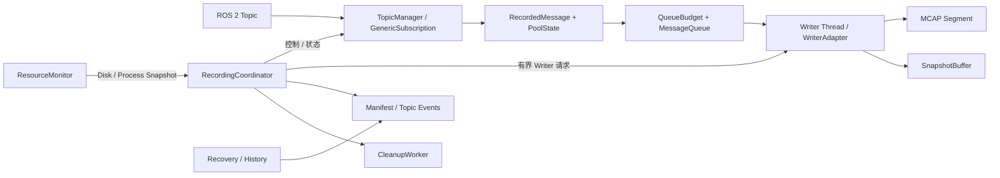
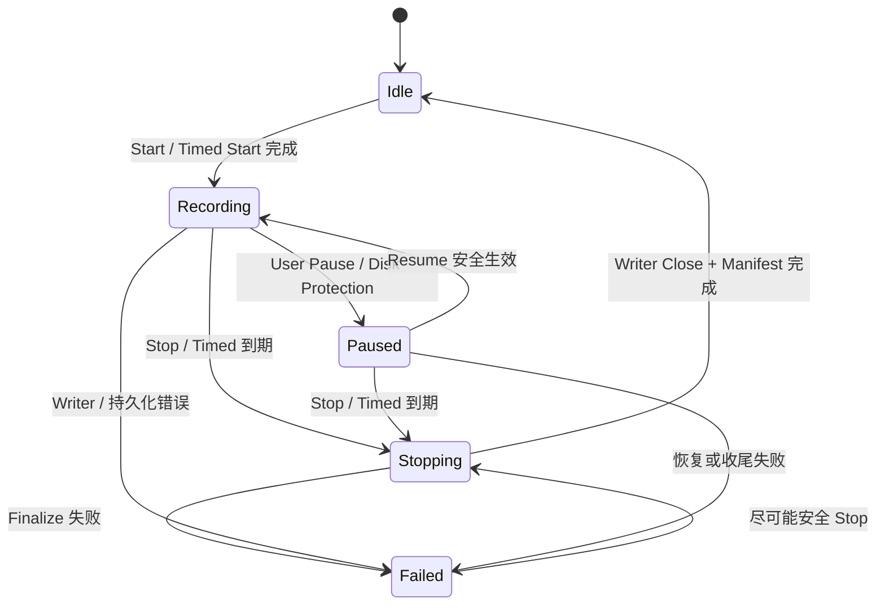

# ros2_bag Recorder 详细设计

| 属性 | 内容 |
|---|---|
| 文档版本 | v0.2.10 |
| 文档状态 | **DRAFT — V1.0 开发阶段，随时修订；规范尚未批准用于完整实施** |
| 范围 | C++17 Recorder 领域接口、录制数据面、持久化与恢复 |
| 上位规范 | `docs/architecture.md`、`docs/requirements.md`（开发稿，可直接联动修改） |
| 技术选型 | `docs/system_technology_selection.md` |

# 1. 定位、职责与接口

## 1.1 文档边界和设计原则

Recorder 是录制领域的单一事实来源，负责 ROS 2 Topic 发现与订阅、录制任务、消息准入、Writer/MCAP、Rolling、Snapshot、持久化记录、磁盘安全、恢复证据与录制诊断。

V1.0 **一个 Recorder Runtime 管理一个 Recorder 实例，同一时刻最多一个活动录制任务**。Rolling 的多个 Segment 属于同一个任务。

本文定义应当实现的 Recorder V1.0 契约，**不记录开发进度、测试通过率或交付状态**，也不规定 Drogon 路由、HTTP JSON Schema、SSE、Client 和 UI。

跨层所有权与关闭顺序以 `architecture.md` 为准；产品功能与验收门槛以 `requirements.md` 为准；版本、第三方依赖和并发队列等技术选择以 `system_technology_selection.md` 为准。

**恢复状态、目录锁、只读取证与可删除条件全部由本文直接规定；测试与报告格式由 `verification.md` 承接。**

本设计限定 Recorder 的高频路径、Pool/Queue/Writer 所有权、Topic 事件、保守恢复与资源边界；**不定义** UDS/JSONL 网络控制协议、`operation_status` 服务、`status.json` 状态发布器、CLI/Web 或实施计划。

Recorder Core 不依赖 HTTP、Python、UI 或独立 IPC。

核心约束：

1. 高频 ROS 回调路径必须有界，不做文件写入、网络 I/O、复杂 JSON 或无界阻塞。
2. `rosbag2_cpp::Writer` 的所有操作只能经由**单 Writer Thread** 执行。
3. `recording_generation + topic_id + topic_epoch` 隔离跨任务及动态 Topic 生命周期。
4. 成功的领域操作必须满足相应持久化/完成边界；证据不足绝不伪造成功。
5. Pool、Queue、Snapshot、Writer 控制与 Cleanup 的资源均有上限。
6. 恢复保守、可重复，未知结果保留原始数据与诊断。
7. Runtime 当前状态、历史持久化事实和单次控制请求结果属于三个不同维度，不能互相反推。
8. 为实现有界资源而采用的保守降级必须明确可观察，不能静默把“不知道”表达成“成功”。
9. V1.0 优先采用简单、确定、可验证的单进程机制，不为了预防尚未观察到的性能问题引入数据库、额外调度线程或复杂持久化索引。

## 1.2 组件分工和线程边界



| 组件或执行域 | 主要职责 | 禁止行为 |
|---|---|---|
| RecordingCoordinator | Task 状态、事务边界、组件生命周期与领域错误 | 持有状态锁等待 Writer/Executor/网络 |
| RecorderControlSequencer（内部执行域） | 唯一 Task/Topic/Writer/Manifest mutation 线性化域；执行外部控制及 Timed Stop、Rolling Rotate、Disk Safety、Writer Failure、Shutdown 收尾 | 在 ROS Executor Timer 中同步等待 Writer/Executor；让 Cleanup/Writer/Server 成为第二个状态或 Manifest 裁决点 |
| TopicManager / ROS Executor | 发现、QoS、订阅实例、Topic 事件、接收并入队 | ROS 回调直接调用 Writer 或删除文件 |
| PoolState / QueueBudget | 消息句柄唯一所有权及双配额 RAII | 容量耗尽时无界分配 |
| Writer Thread / WriterAdapter | Writer 独占、Topic 注册、写入、轮转、Finalize | 从其他线程并发访问 rosbag2 Writer |
| SnapshotBuffer | 持有有限的已写入消息用于 Segment 边界重放 | 无界缓存或跨 Epoch 重放 |
| ResourceMonitor | 磁盘安全、CPU/RSS/FD/线程遥测；提供 stop-request 与 finished Completion | 持有 Coordinator 锁执行 `statvfs`；未确认 Worker 退出就进入析构/join |
| CleanupWorker | 根据 Manifest 中 durable `DELETING` 授权串行执行文件系统删除；向 Sequencer 回报结果；提供 stop-request 与 finished Completion | 直接提交 Manifest 终态、持锁删除、自动删除 INCOMPLETE；未确认 Worker 退出就进入析构/join |
| Runtime | 输出根目录独占锁、Node/Executor/ROS Context、启动恢复与最终关闭 | 将进程锁当成 Recorder Core 内部自动行为 |

跨线程共享的非原子数据需 mutex 或可证明的 happens-before；短临界区不得包围 Writer I/O、Executor 等待或文件删除。

Recorder Shutdown 依赖的 ROS Executor 与 Context 必须在收尾完成前保持可运行，不能在 Executor 自身回调中等待必须由该执行域推进的任务。

**Worker Shutdown 采用 request/finish 两阶段。**

Writer、CleanupWorker、ResourceMonitor 的停止入口先设置 stopping gate/notify 并立即返回；线程函数退出时设置 finished 状态并通知 Completion。

Recorder Sequencer 可以等待 finished，但 Runtime 的 shutdown deadline 必须在独立执行域继续运行。

只有已经观察到 finished 的线程才执行 `join()`，使 join 成为线程资源回收而不是不可控的等待机制。

析构函数只允许在所有受管 Worker 已 finished 的正常路径使用；不可恢复阻塞路径由 Runtime 保持对象存活并进入 `UNSAFE_TO_DESTROY`。

### 1.2.1 RecorderControlSequencer：唯一状态变更执行域

V1.0 不允许“每个调用线程拿 Coordinator mutex 后各自推进状态机”。

Recorder 自己拥有一个**单线程、独立于 ROS Executor、Writer Thread、CleanupWorker 和 Server ControlWorker 的领域控制执行域** `RecorderControlSequencer`。

所有会修改 Task/Topic/Writer/Manifest 生命周期的动作最终都由该执行域决定线性化顺序；其他线程只能读取 immutable/原子快照、执行已授权的原生工作，或提交拥有自身生命周期的数据/Completion。

- 外部 `Start/Stop/Pause/Resume/Add/Remove`：公共领域 API 构造拥有自身数据的 `ControlRequest`、尝试提交到有界外部队列并立即返回共享 `ControlHandle<Result>`。调用方可以等待 Handle，但**等待超时只结束调用方等待，不结束领域操作**。只有 `cancel_if_not_started()` 在线性化地完成 `PENDING -> CANCELLED_NOT_STARTED` 时，才能证明该请求没有进入 Recorder 副作用。
- `cancel_if_not_started()` 供直接 C++/库调用方在尚未交付语义的场景以及确定性测试使用；它是线程安全的 CAS 操作，同一 Handle 多个并发调用者至多一个返回 true。**Server 一旦成功把请求提交给 Recorder，就不得因为 HTTP ResponseSink 超时、客户端断连或网络取消再调用该接口**；Server 必须继续持有外部 mutation 槽直到 Handle 进入终态。
- 内部 `TimedStop/DiskSafety/RollingRotate/WriterFailure/Shutdown`：ROS Timer、ResourceMonitor、Producer hard gate、Writer Thread 和 Runtime 只提交**绑定 recording_generation 的内部事件**并立即返回，不在原执行域里等待 Sequencer。相同代际的 `TimedStop`、`DiskSafety`、`RollingRotate` 可以按事件种类合并；`WriterFailure/Shutdown` 不得因普通队列容量而丢弃。
- Sequencer 是唯一可以把 Recorder State/Task Persistent State 从一个稳定或内部阶段推进到下一阶段、取得 Task Lease、决定 ingress 是否允许重新开放、发起 Writer/Executor 原生事务以及提交运行期 Manifest mutation 的执行域。
- Producer 的 Timed/Disk hard gate 只允许执行受本文明确允许的无阻塞准入判断和 gate 关闭，不允许直接执行 Writer Close、Topic 状态提交或 Manifest 终态。
- Writer I/O、ROS Executor 上的 Subscription create/remove、文件同步、Cleanup `remove_all()` 等可以在专有执行域进行；Sequencer 发起后不得持 Coordinator/TopicMap 锁等待。Completion 必须绑定到原 `ControlRequest`、Task/Topic Lease 和 Generation，不能使用调用线程栈地址。
- `status()/discover/history/evidence` 是只读调用，不进入 mutation 队列，但必须取得独立值对象/Lease；History/Evidence 的磁盘读取不得持有 Sequencer/Writer/Topic 热路径锁，也不得变更 Manifest/Cleanup 授权。

**有界与优先级。**

外部控制队列容量是配置项，满时在进入领域执行前返回：

```text
RESOURCE_EXHAUSTED
effects:NONE
```

内部安全事件不与外部请求争抢这部分容量：实现使用固定的内部事件槽/位图或独立小型有界系统队列，其中：

```text
WriterFailure
Shutdown
```

有保留位置。

同一 Generation 的同类可合并事件只保留一次 pending 标记。

Shutdown 关闭外部 admission 后，Sequencer 仍处理已经 STARTED 的请求和必须完成的系统收尾，直到安全关闭或 Runtime 明确进入 `UNSAFE_TO_DESTROY`。

这层序列化**不能被 Server ControlWorker 替代**。

Recorder 在没有 Server 的库调用/测试环境中仍必须正确处理 Timer、Disk、Writer 和 Cleanup completion。

Server 的单 Worker 只负责：

```text
网络 Admission
外部 FIFO
Response 生命周期
Recorder Handle 持续观察
```

相反，Recorder Sequencer 也不承担：

```text
HTTP Deadline
认证
SSE
```

推荐 ControlHandle 状态：

```text
PENDING --Sequencer claim--> STARTED --> WAITING_NATIVE --> DONE
   │
   └--cancel_if_not_started() CAS succeeds--> CANCELLED_NOT_STARTED
```

`DONE` 与 `CANCELLED_NOT_STARTED` 都是**Handle 终态**，但只有 `DONE` 携带领域 `Result`。

`CANCELLED_NOT_STARTED` 表示请求在进入 Recorder 副作用之前被确定取消，不能伪造一个 Recorder 失败 Result。

`done()` 的 V1.0 语义是：

> Handle 已进入任一终态。

调用方需要区分成功完成与未开始取消时必须读取 `state()`。

`result()` 仅在：

```text
state() == DONE
```

时有值，其余状态返回 `nullopt`。

**WAITING_NATIVE 与等待预算。**

`WAITING_NATIVE` 不是让 Sequencer 线程在一个不可取消的 `future.get()` 上永久睡眠。

实现必须使 Sequencer 在不持领域锁的情况下观察 Completion，并让 Runtime 的 shutdown deadline/诊断执行域独立继续推进。

`control.native_wait_warning_ms` 只定义**诊断/监管预算**：

超过该预算应：

```text
记录当前 phase/native operation
通知 Runtime/Status
必要时关闭新的危险 mutation admission
```

但如果 Writer/Executor/Cleanup 原生操作已经 STARTED 且仍可能访问 Recorder 对象，**等待预算耗尽不等于领域操作 DONE**。

ControlHandle 仍保持：

```text
STARTED
或
WAITING_NATIVE
```

相关 Lease 和对象图必须继续存活。

`DRAIN_TIMEOUT` 只有在 Recorder 已经取得**真实可终结证据**时才能作为最终 `Result` 返回，例如：

- 原生调用已经返回；
- 或被证明未开始且成功取消；
- 但 Drain 的领域完成条件在规定的受控边界内失败。

若同步 Writer I/O、STARTED ExecutorCall、`remove_all()` 或 `statvfs()` 永久阻塞且无法证明其已经退出，则只能记录 timeout/watchdog 诊断并让 Shutdown Handle 保持未完成。

Runtime 依据 `architecture.md` 的独立 deadline 进入：

```text
UNSAFE_TO_DESTROY
```

不得用一个伪造的：

```text
DRAIN_TIMEOUT
DONE
```

释放对象。

只有：

```text
PENDING -> CANCELLED_NOT_STARTED
```

成功才能确定本次没有进入 Recorder 副作用。

`STARTED/WAITING_NATIVE` 后任意 waiter 停止等待，Sequencer 和相关 Task/Topic/Writer/Executor/Cleanup Lease 仍必须继续存活到真实终点。

不得把栈上的：

```text
std::string* error
Promise
裸对象指针
```

交给迟到回调。

也不得把“某个 waiter/HTTP/Runtime observer 超时”编码成已经完成的领域结果。

## 1.3 领域 API 与所有权

Recorder 的公共领域接口在 V1.0 采用以下**目标模型**。

实现可调整文件拆分，但不得改变这里的字段语义、所有权和完成边界；Server 只依赖这些领域值对象，不依赖 Writer/TopicManager 内部类型。

```cpp
enum class RecordingMode {
    kNormal,
    kTimed,
    kRolling
};

// V1.0 只支持 Recorder receive time；
// 保留枚举用于未来受评审的扩展。
enum class TimestampPolicy {
    kReceive
};

enum class CompressionMode {
    kNone,
    kLz4
};

enum class DiskSafetyState {
    kNormal,
    kWarning,
    kCritical,
    kUnknown
};

enum class PersistentTaskState {
    kInitializing,
    kRecording,
    kFinalizing,
    kCompleted,
    kFailed,
    kIncomplete
};

enum class PauseReason : std::uint8_t {
    kUser = 1,
    kDiskCritical = 2,
    kDiskUnknown = 4,
    kDiskRecoveryPending = 8,
};

enum class RecorderPhase {
    kValidation,
    kTaskCreate,
    kSchemaPreflight,
    kWriterOpen,
    kTopicRegister,
    kSubscriptionCreate,
    kIngress,
    kProducerDrain,
    kExecutorDetach,
    kWriterDrain,
    kWriterClose,
    kDataSync,
    kManifestCommit,
    kTopicEventCommit,
    kCleanup,
    kRecovery,
    kShutdown,
};

enum class ControlHandleState {
    kPending,
    kStarted,
    kWaitingNative,
    kDone,
    kCancelledNotStarted,
};

struct StartCommand {
    std::string recording_id;
    RecordingMode mode = RecordingMode::kNormal;
    std::optional<std::chrono::milliseconds> duration;
    std::optional<std::chrono::seconds> segment_duration;
    std::optional<std::chrono::seconds> retention_duration;
};

struct EffectiveTaskConfig {
    RecordingMode mode;
    std::optional<std::chrono::milliseconds> duration;
    std::optional<std::chrono::seconds> segment_duration;
    std::optional<std::chrono::seconds> retention_duration;
    CompressionMode compression;
    TimestampPolicy timestamp_policy = TimestampPolicy::kReceive;
};

struct RecordingTargetGuard {
    std::string recording_id;
    std::uint64_t recording_generation;
};

struct TopicTargetGuard {
    RecordingTargetGuard recording;
    TopicId topic_id;
    std::uint64_t topic_epoch;
};

enum class DomainEffects {
    kNone,
    kPossible,
    kConfirmedPartial
};

enum class RecorderErrorCode {
    kInvalidArgument,
    kNotFound,
    kTopicNotFound,
    kTypeConflict,
    kTypeSupportUnavailable,
    kSchemaUnavailable,
    kUnsupportedQos,
    kInvalidState,
    kAlreadyPaused,
    kAlreadyFinished,
    kRecordingExists,
    kStaleRecording,
    kStaleTopicEpoch,
    kResourceExhausted,
    kDiskFull,
    kDiskStateUnknown,
    kWriterError,
    kStorageUnavailable,
    kEventCommitFailed,
    kDrainTimeout,
    kExecutorUnavailable,
    kGenerationViolation,
};

struct RecorderError {
    RecorderErrorCode code;
    RecorderPhase phase;
    DomainEffects effects;
    std::string message;
};

struct RecorderOperationResult {
    bool ok = false;
    std::optional<RecorderError> error;
};

template <class Result>
class RecorderControlHandle {
public:
    bool wait_for(
        std::chrono::milliseconds timeout) const;

    ControlHandleState state() const noexcept;

    bool done() const noexcept;

    std::optional<Result> result() const;

    bool cancel_if_not_started();
};

struct ShutdownCompletion;

class RecorderShutdownHandle {
public:
    bool wait_for(
        std::chrono::milliseconds timeout) const;

    bool done() const noexcept;

    std::optional<RecorderOperationResult>
        result() const;

private:
    std::shared_ptr<ShutdownCompletion>
        completion_;
};

struct StartResult {
    bool ok = false;
    std::string recording_id;
    std::uint64_t recording_generation = 0;
    EffectiveTaskConfig effective_config;
    std::optional<RecorderError> error;
};

struct TopicOperationResult {
    bool ok = false;
    TopicId topic_id = kInvalidTopicId;
    std::uint64_t topic_epoch = 0;
    std::optional<RecorderError> error;
};

class RecordingCoordinator {
public:
    RecorderControlHandle<StartResult>
    start(const StartCommand&);

    RecorderControlHandle<RecorderOperationResult>
    stop(const RecordingTargetGuard&);

    RecorderControlHandle<RecorderOperationResult>
    pause(const RecordingTargetGuard&);

    RecorderControlHandle<RecorderOperationResult>
    resume(const RecordingTargetGuard&);

    RecorderControlHandle<TopicOperationResult>
    add_topic(
        const RecordingTargetGuard&,
        TopicInfo,
        const OperationId&);

    RecorderControlHandle<TopicOperationResult>
    remove_topic(
        const TopicTargetGuard&,
        const OperationId&);

    RecorderStatus status() const;

    TopicDiscoveryResult discover_topics(
        const TopicDiscoveryQuery&) const;

    HistoryPage query_history(
        const HistoryQuery&) const;

    TopicOperationEvidence
    lookup_topic_operation(
        const std::string& recording_id,
        const OperationId&) const;

    RecorderShutdownHandle request_shutdown();
};
```

### Recording ID 规范

`recording_id` 同时是协议身份与任务目录单一组件。

V1.0 统一采用：

```text
^[A-Za-z0-9][A-Za-z0-9_-]{0,63}$
```

即：

```text
1～64 字节
ASCII
区分大小写
```

不允许：

```text
空格
点号
斜杠
反斜杠
百分号
Unicode
```

Recorder 是最终权威校验者。

Server/Client 可以提前执行同一校验，但不能放宽。

任务目录使用原值作为单层目录名。

目录已存在一律返回：

```text
RECORDING_EXISTS
```

不做 Unicode、大小写或路径归一化后的“同名修正”。

### Shutdown

Shutdown 是 Runtime 生命周期控制，不是普通外部 Control。

`request_shutdown()` 必须：

```text
O(1)
幂等
```

行为：

1. 关闭 Recorder 外部 mutation admission；
2. 对当前 Task generation 原子关闭 ingress gate；
3. 向 RecorderControlSequencer 的保留系统槽提交一次 Shutdown；
4. 重复调用返回指向同一个 `ShutdownCompletion` 的轻量句柄。

实现可用：

```text
std::once_flag
```

或等价原子发布保证只创建一次 Completion。

不能为每次调用创建互不关联的关闭事务。

Runtime 持续强持有 Recorder，并在独立管理/deadline 执行域等待 `RecorderShutdownHandle`。

Sequencer 合并已在途 Stop，随后向：

```text
Writer
CleanupWorker
ResourceMonitor
```

发停止请求。

只有对应线程已真实退出后才 join/释放对象并完成 Handle。

若 Worker 永久卡在：

```text
Writer I/O
remove_all()
statvfs()
```

Handle 保持未完成。

Runtime 超时进入：

```text
UNSAFE_TO_DESTROY
```

并保留整个对象图，禁止进入 Recorder 普通析构。

### Control Result 的值语义

`RecorderControlHandle` 是**进程内完成对象，不是 Operation Registry**：

- 不持久化；
- 不提供跨进程查询；
- 不改变 Protocol 的 UNKNOWN 规则。

Recorder 内部只对当前请求及其 Lease 保留共享 Completion。

所有 waiter 消失后，已经 STARTED 的请求仍继续到 DONE。

Server Control Worker 必须在取得 Handle 后继续观察其真实 DONE，网络 ResponseSink 可以更早超时/释放。

`RecorderOperationResult`、`StartResult`、`TopicOperationResult` 均为**有界轻量值对象**。

V1.0 不允许 Control Result 持有：

```text
大型 Payload
完整 Topic 列表
完整 Segment 列表
无界诊断
```

因此：

```cpp
std::optional<Result> result() const;
```

按值返回快照是正式 API 语义，不引入第二层 `shared_ptr<const Result>` 生命周期。

### StartCommand 与 EffectiveTaskConfig

`StartCommand` 是**唯一任务模式输入**。

Runtime `RecorderConfig` 不保存“当前 recording.mode”。

它只保存：

```text
output_root
Rolling 默认 segment/retention
允许范围
StorageProfile
QoS 默认
全局资源预算
```

Server 将 Protocol Start 解析为 StartCommand。

Recorder 在 Sequencer 内验证并生成 `EffectiveTaskConfig`：

| Start mode | `duration` | `segment_duration / retention_duration` | 结果 |
|---|---|---|---|
| NORMAL | 必须 null | 必须 null | 有效 |
| TIMED | 必须正值 | 必须 null | 有效 |
| ROLLING | 必须 null | 可缺省；缺省取 Runtime 默认，最终均为正值 | 有效 |
| 任意非法组合 | — | — | INVALID_ARGUMENT / effects:NONE |

Compression 和 TimestampPolicy **不由 StartCommand 接受覆盖**。

它们从启动时验证通过的 Runtime Storage Profile 复制到新任务的 `EffectiveTaskConfig`。

每个 Segment 都必须使用该 Task 的冻结 Storage Profile。

**QoS 不属于 EffectiveTaskConfig。**

Runtime QoS Default 只参与每次 Add Topic 的 QoS 归一化。

最终实际使用 QoS 冻结在该 Topic ID/Epoch 的：

```text
TopicInfo
TopicRuntime
```

中。

动态 Add 之间互不借用“任务级 QoS”。

`CompressionMode` V1.0 仅允许：

```text
NONE
LZ4
```

默认 LZ4。

如果使用 rosbag2 storage config file，Runtime 必须在 Start 时把已解析、验证的 MCAP Profile 物化为任务目录内只读：

```text
storage_config.yaml
```

或使用等价 Writer 原生 Options。

后续 Rolling Segment 始终引用这个任务副本，避免：

```text
config/mcap.yaml
```

在任务中途变化。

`RecorderStatus.mode/duration/effective_config` 在存在当前 Task 时必须来自该 Task 的 EffectiveTaskConfig。

**Idle 且不存在当前 Task 时这些字段为 `nullopt`**。

Protocol 映射为：

```text
null
```

不得用：

```text
NORMAL
Runtime 默认值
```

伪装活动任务配置。

Manifest 同样持久化这些实际值，使 History/Recovery 能解释录制行为。

RuntimeConfig 在进程启动时一次加载并保持不可变。

修改磁盘上的 YAML **不会**影响当前或下一 Task。

必须安全重启 Runtime 才重新加载。

每次 Start 只从：

```text
immutable RuntimeConfig
+
StartCommand
```

形成新的 EffectiveTaskConfig。

### 只读接口

只读接口使用拥有自身数据的有界值对象。

`TopicDiscoveryQuery/Result`、`HistoryQuery/Page`、`TopicOperationEvidence` 均由 Recorder 定义。

V1 History 与 Graph 统一采用：

```text
limit + offset
```

的 **BEST_EFFORT** 分页。

它不提供：

```text
数据库式 Cursor
稳定跨请求快照
全局稳定 offset
```

Topic Evidence 返回：

```text
CONFIRMED_SUCCESS
CONFIRMED_FAILURE
UNCERTAIN
NOT_FOUND
```

并只读取受限事件文件。

同步控制接口通用契约：

| 条件 | 契约 |
|---|---|
| 输入身份 | recording_id、Topic 名称和 operation_id 的格式、长度和字符集合受限；空/非法身份不得有副作用 |
| 资源生存期 | 每个调用开始时取得合法 Recorder/Task/Topic 所有权；Shutdown 一旦关闭入口，不允许获得新的任务句柄 |
| 成功返回 | 领域同步阶段完成；需要持久化的操作已有经验证终态，且成功不表示 HTTP 应答已送达 |
| 失败返回 | 不能假定完全没有副作用；必须说明是否留下 PREPARED、可能的半完成对象或已接纳消息 |
| 超时与取消 | 内部协作超时必须确保异步执行没有持有悬空栈参数/回调；不能让下一代 Task 复用未清理对象 |
| 异常边界 | 运行期第三方异常不得跨 ROS 回调和 Worker 线程边界泄漏；转换成域错误并安全关闭 |
| 诊断 | 错误携带代码与可读取说明；不要只返回模糊 false，也不泄露任务数据或凭证 |

Stop 和 Shutdown 的“幂等”是**安全意义的幂等**：

重复请求不执行第二次：

```text
文件删除
Writer close
任务提交
```

调用是否返回成功要根据：

```text
已经处于终态
此前是否发生失败
```

区分。

不能用幂等掩盖第一次失败。

对 `add_topic` 和 `remove_topic`：

```text
operation_id
```

是事件关联参数。

**不自动提供任意重试去重保障。**

若要求幂等重试，必须明确 identity 与持久化去重边界，不能仅依赖相同字符串。

### 锁与回调生命周期

应明确：

```text
Coordinator 状态锁
TopicMap 锁
WriterRequest 同步原语
PoolState 锁
```

各自保护范围。

正常代码优先不嵌套持有不同子系统锁。

确有跨状态更新时给出唯一锁顺序并用注释/测试固定。

不得持有锁调用：

```text
rclcpp::Executor::remove_*
Writer close
fsync
remove_all
等待 ROS Executor 回调
```

在所有 Async/Executor 协作结构中，回调捕获应持有：

```text
共享生命周期对象
或
受控 weak reference
```

禁止捕获可能提前销毁的：

```text
栈上 error 指针
Promise
裸 this
```

### 并发操作

Server 外部变更串行化是一道入口约束，但 Recorder 内部：

```text
Timed Stop
Disk Protection
Writer Failure
Rolling Timer
```

不经过 Server。

对一个 Task，只有 Recorder 自己的状态同步点可以裁定哪个转移生效。

不得让多个线程都从：

```text
Recording → Stopping
```

并各自关闭 Writer。

### 1.3.1 原生控制目标守卫的线性化接口

Server 的 Control Worker 可以在：

```text
入队
出队
native 入口前
```

反复验证：

```text
expected_runtime_instance_id
recording_id
recording_generation
```

但仅在 Server 中前置读取 `status()` 不能构成 Recorder 层线性化目标守卫。

Timed Stop、Disk Protection 或 Stop 完成后，另一个 Task 可能在：

```text
Server 校验
与
实际 native mutation
```

之间切换。

因此 V1.0 对 Server 暴露的：

```text
Stop
Pause
Resume
Add
Remove
```

领域 API **必须显式接收 Recording/Topic Guard**。

不带目标代际的便利入口不得作为跨层正式接口。

目标身份、Recorder State 的允许转移与关闭 ingress 副作用必须在**同一 Recorder 域状态线性化临界区**里联合判定。

Guard 失配时，在**任何** Topic/Task 副作用前返回：

```text
STALE_RECORDING
STALE_TOPIC_EPOCH
INVALID_STATE
```

以及：

```text
effects:NONE
```

不得在业务变更期间持 Coordinator 锁等待 Writer/Executor。

先在域内原子取得：

```text
正确 Task/Topic Epoch Lease
状态转移权
```

然后锁外等待子操作真实完成。

Runtime UUID 属于 Runtime/Server 作用域，由 Server 入口 gate 验证。

Recorder 不新增 HTTP UUID 身份类型。

### Start 守卫

Start 没有已有 Task generation 可校验。

Server 校验：

```text
expected_runtime_instance_id
```

并放入唯一 Control Worker。

Recorder 在自身状态线性化点联合判断：

```text
Idle
output_root 无冲突
recording_id 无冲突
没有正在初始化 Task
```

原子取得启动权并分配新 Task Generation。

Start 不得凭之前读取的：

```text
status()==Idle
```

证明 Idle。

两个并发 Start 只允许一个取得启动权。

Writer/Manifest 初始化真正完成后才能对外宣称 Recording。

失败保留真实产生的文件与诊断。

`request_id` 和 `operation_id` 不构成 Start 幂等键。

### 1.4 配置生效边界

Recorder 配置分两层：

**RuntimeConfig**

管理：

```text
Executor
output_root
Queue
Pool
Writer
Cleanup
Disk
Rolling 默认值
Storage Profile
QoS Profile
```

**EffectiveTaskConfig**

是 Start 时形成的不可变任务行为。

mode/duration/segment/retention 由 StartCommand 解析。

Compression/TimestampPolicy 从当前已验证 Runtime Storage Profile 复制。

QoS Default 只在 Add Topic 时参与 Topic Epoch QoS 冻结。

活动任务只允许显式动态 Topic Add/Remove。

磁盘、状态采样等安全参数可以按独立 Runtime 生命周期工作，但不得改变已经冻结的：

```text
Task Storage
模式语义
```

recording_id 是安全单层名称，不得包含路径穿越或跨目录引用。

**不得覆盖已有录制目录或旧恢复证据。**

失败后遗留任务同样受保护。

输出根目录应规范化并在恢复或写入前由 Runtime 取得独占锁。

库调用宿主需履行等价所有权约束。

# 2. 状态机、Topic 与控制语义

## 2.1 Recorder 状态和操作完成边界

Recorder 稳定状态：

```text
Idle
Recording
Paused
Stopping
Failed
```

Writer 打开、准备新 Segment、等待 Producer 与 Finalize 均是内部阶段。

未经上层架构/协议评审，不额外引入对外状态。

Manifest 中的：

```text
recording_state
```

是**历史 Task 的持久化生命周期**，不是当前 Recorder 实例状态的直接序列化。

V1.0 固定值域：

```text
INITIALIZING
RECORDING
FINALIZING
COMPLETED
FAILED
INCOMPLETE
```

状态关系：

```text
INITIALIZING → RECORDING → FINALIZING → COMPLETED
       │            │            └────→ FAILED / INCOMPLETE
       │            └─────────────────→ FAILED / INCOMPLETE
       └──────────────────────────────→ FAILED / INCOMPLETE
```

### INITIALIZING 的精确边界

`INITIALIZING` 不是“Start API 已被调用”。

在以下阶段：

```text
参数验证
StartCommand 模式验证
recording_id 验证
磁盘安全检查
output_root ownership 检查
```

失败时：

```text
不创建 Task
不创建 Task directory
不存在 PersistentTaskState
```

如果：

```text
create_directory(task_directory)
```

失败，同样不存在 durable Task。

任务目录创建成功后，Recorder 内存中的 Task 进入初始化阶段。

但只有**首个包含 `recording_state=INITIALIZING` 的 Manifest 成功 durable 提交**之后，该任务才成为一个可信的 durable Task。

因此存在两个不同情况：

```text
directory created
manifest INITIALIZING not durable
```

此时目录只是：

```text
orphan / interrupted-start evidence
```

Recovery 必须保守报告，不能把它自动当成完整 INITIALIZING Task。

一旦 INITIALIZING Manifest durable：

```text
durable Task exists
```

之后 Writer Open、Schema Preflight 或必要 Topic 初始化失败，Recorder 应尽力提交：

```text
INITIALIZING → FAILED
```

如果 FAILED Manifest 也无法 durable，保留现有目录和原始证据，下一次 Recovery 只能按：

```text
INCOMPLETE
或
Recovery Finding
```

处理。

不得删除目录后重新使用相同 recording_id 来掩盖失败。

### PersistentTaskState 含义

- `INITIALIZING`：首个 INITIALIZING Manifest 已 durable，但 Writer/必要 Topic 尚未形成可宣称 Recording 的完成边界。
- `RECORDING`：Task 已成功启动；Runtime `Paused` 仍属于同一持久 Task 的 RECORDING 生命周期。
- `FINALIZING`：Task 已关闭新准入并进入 Stop/Finalize，尚未完成全部 Writer/Data/Manifest durable 边界。
- `COMPLETED`：所有要求的 Writer Close、数据/目录同步与 Manifest 终态均完成；历史任务正常完成。
- `FAILED`：本进程已确认任务发生领域失败并成功持久化失败事实；不等于资源已经安全析构。
- `INCOMPLETE`：Recovery 对异常终止或无法证明完整完成的旧任务给出的保守持久状态；不会因为 Reader 能打开就自动升级为 COMPLETED。

`RecorderState::Idle` 只表示当前 Recorder 没有活动 Task。

**绝不能**写成某个历史 Task 的：

```text
recording_state=IDLE
```

Recovery 发现崩溃前遗留：

```text
INITIALIZING
RECORDING
FINALIZING
```

只能依据 durable evidence 形成：

```text
INCOMPLETE
FAILED
```

等保守结果。

不能凭最终文件“看起来正常”补造 COMPLETED。



| 操作 | 允许条件 | 完成或拒绝的领域语义 |
|---|---|---|
| Start | Idle、合法 StartCommand、磁盘安全、StorageProfile 可用、任务目录不存在 | 原子生成 Generation + EffectiveTaskConfig，Writer/Manifest 初始化完成后才开放 ingress；失败不得宣称 Recording |
| Pause | Recording，或 Paused 且 reasons 中尚无 USER | 原子增加 USER；若本来 Recording 则先关闭 ingress，若已因系统原因 Paused 则保持关闭。已接纳数据不可静默丢弃；已有 USER 时返回 ALREADY_PAUSED/effects:NONE |
| Resume | Paused，且 reasons 中存在 USER 或 DISK_RECOVERY_PENDING | 先取得新鲜磁盘安全样本；移除 USER，并在磁盘已安全且稳定期满足时移除 DISK_RECOVERY_PENDING。活动 DISK_CRITICAL/DISK_UNKNOWN 绝不由 Resume 清除。若清理后 reasons 为空且未进入 Timed deadline/Stopping/Failed，开放 ingress 并成功；若本次确实移除了 USER/PENDING 但仍有活动系统危险原因，返回对应 DISK_FULL/DISK_STATE_UNKNOWN 且 effects:CONFIRMED_PARTIAL |
| Stop | Recording/Paused/可安全收尾的 Failed | 禁止新接入、在途 Producer 屏障、排空/故障诊断、Writer 关闭、持久化终态；反复 Stop 不得重放危险副作用 |
| Add/Remove Topic | Recording/Paused 且实例状态允许 | Topic 终态成功依据订阅实际状态与持久化证据，不能以 PREPARED 代替 |
| Status/Discover/History | 存活期 | 不改变录制状态、存储事实或清理意图 |
| Shutdown | 存活期任意可安全进入的状态 | 幂等并等待受管理线程；不得先终止必需 Executor 再等待其回调 |

### PauseReasons

暂停归因使用集合/位掩码：

```text
USER
DISK_CRITICAL
DISK_UNKNOWN
DISK_RECOVERY_PENDING
```

RecorderStatus 对外始终转为：

```text
paused_reasons[]
```

没有原因时为空数组。

不存在会覆盖其他原因的单一标量。

规则：

- 外部 Pause 在 reasons 尚无 USER 时增加 USER。
- Recording 状态先关闭 ingress。
- 系统原因已使任务 Paused 时只增加归因，不重复执行关闭动作。
- 已有 USER 的重复 Pause 明确拒绝且无副作用。
- Disk CRITICAL/UNKNOWN 分别表示当前仍生效的危险条件。
- 用户 Resume 不能清除活动 DISK_CRITICAL/DISK_UNKNOWN。
- 当磁盘重新达到安全阈值并持续 `resume_stable_sec`：
  - `auto_resume=true`：Sequencer 移除已解除的系统原因；
  - `auto_resume=false`：替换为 `DISK_RECOVERY_PENDING`。
- Resume 可移除 USER/PENDING，但只有所有禁止条件解除后才重新开放 ingress。
- 若用户意图已成功移除但系统保护仍在，返回：
  ```text
  effects:CONFIRMED_PARTIAL
  ```
- Failed/Stopping 收尾可清空集合，但绝不触发恢复。

### 状态转移线性化与竞态矩阵

**线性化点是“何时对其他线程生效”，不一定等于“所有文件已持久化”。**

| 操作 | 对并发线程生效的状态点 | 完成返回前必须完成 | 失败后允许看到 |
|---|---|---|---|
| Start | 新任务代际、Writer 和订阅准备后才开放 ingress | 初始化 Writer、合法任务记录、必要 Topic 准备、磁盘安全复核 | Idle 或 Failed + 安全保留，不能假装 Recording |
| Pause | 在 Topic 回调开始新消息准入之前关闭 ingress | 记录 Pause 原因；已接纳消息仍可写完 | Recording/Paused/Failed |
| Resume | 校验 USER/SYSTEM Pause 归因与磁盘后才开放 ingress | 确认 Writer 和 Topic 恢复条件 | Paused/Failed |
| Stop | 一次性将 active Task 标识为关闭 ingress / Stopping | Producer Barrier、Queue/Writer Drain、Close/Manifest 终态 | Stopping/Failed |
| Add | 原任务 Topic 集合保留 ADDING/ARMED 的新 Epoch | Writer 注册、Subscription 有效、TOPIC_ADDED durable、随后按 Task gate 决定 Topic gate | FAILED/已关闭 ingress/UNCERTAIN Event |
| Remove | 对选定 Epoch 标记 REMOVING 并阻止新接入 | 在途 Producer Drain、订阅释放、TOPIC_REMOVED durable | REMOVING/FAILED |
| Timed Stop | steady 截止点使停止条件成立 | 同 Stop，且与手动 Stop 合并为一次收尾 | Stopping/Failed |
| 磁盘保护 | coherent Disk snapshot 证明 CRITICAL/UNKNOWN 或 safe sample freshness 已过期 | 关闭 ingress 与归因；必要时安全收尾 | Paused/Failed |

### 竞态优先级

- Stop 对同一任务是**终结性请求**。
- Timed Stop 与手动 Stop 同时发生，只允许一个 Finalize owner。
- 外部 Pause 与磁盘 CRITICAL 同时发生，同时保存 USER 与 SYSTEM 原因。
- Remove Topic 与 Stop 重叠时，不能提前析构 TopicRuntime。
- Add Topic 与 Rolling 边界重叠时，由 Sequencer 决定目标 Segment/Writer 注册顺序。
- Writer 出错后，普通 Resume 或自动磁盘恢复不得使 Failed 进入 Recording。
- Shutdown 优先关闭新的外部 mutation admission。

### Topic 操作持久化顺序

```text
TOPIC_*_PREPARED
必须早于不可逆/不易回滚副作用

TOPIC_ADDED / TOPIC_REMOVED
必须晚于对应原生动作完成
```

并进一步规定：

> **TOPIC_ADDED durable 成功之前，该新 Topic Epoch 的 ingress gate 必须保持 CLOSED。**

因此 Add 的数据接入不会发生在：

```text
Writer 已注册
Subscription 已创建
但 TOPIC_ADDED 仍未 durable
```

这一不确定窗口。

这比“先开 ingress、再写终态 Event”更容易建立恢复与证据边界。

若 TOPIC_ADDED durable 成功后进程立即崩溃，但尚未来得及打开 Topic gate，历史仍可以确认：

> Add 领域操作已经 durable 成功。

它不保证在崩溃前一定收到过消息。

### 时间域

V1.0 固定三个时钟边界：

- `std::chrono::steady_clock`：Timed/Rolling deadline、Resume stable、retention、freshness、retry；
- `std::chrono::system_clock`：Recorder RECEIVE Unix timestamp、History 展示/筛选；
- ROS Clock/Header.stamp：**不参与 V1.0 Recorder receive timestamp 或安全 deadline**。

不同时间域不能直接比较。

系统墙钟跳变可以影响历史展示，但不得改变：

```text
Timed
Rolling
Retention
Disk freshness
```

等进程内安全判定。

### 2.1.1 内部定时控制不得占用 ROS Executor 等待域

Timer/安全回调不能直接执行可能等待：

```text
Writer
Producer
Executor
```

的领域动作。

默认单 ROS Executor Worker 时，这样做可能造成自等待。

V1.0 只允许 Timer 做：

```text
O(1) trigger
+
必要的无阻塞安全 Gate
```

真正控制动作由 RecorderControlSequencer 串行执行。

可使用一个 C++17 受管线程及有界事件队列实现。

Executor wall timer 只做：

```text
steady deadline
→ event kind + TaskGeneration
```

投递。

不执行：

```text
fsync
Writer close
Subscription Drain
condition_variable wait
```

同一 TaskGeneration 的重复：

```text
TimedStop
RollingRotate
DiskSafety
```

允许 coalesce。

STOP/SHUTDOWN 与安全事件优先于普通 Rotate。

### Timed hard admission

Timed Task 的 `TaskIngressState` 保存不可变：

```text
steady deadline
```

每个 Producer 在同一个准入协议中检查：

```text
Task/Topic identity
accepting
now < deadline
```

一旦：

```text
now >= deadline
```

该 Producer：

1. 拒绝当前准入；
2. 原子关闭当前 Task accepting gate；
3. 提交/合并 `TimedStop(generation)`。

因此：

> Timer 只是提前触发器，不承担截止正确性。

截止前已取得 ProducerToken 的消息仍可以完成 enqueue/write。

### Disk hard admission

ResourceMonitor 发布的 `DiskAdmissionState` 包含：

```text
state
valid_until
```

Producer 必须使用 §3.3.1 定义的**版本化 coherent snapshot**。

只有 coherent snapshot 满足：

```text
state == NORMAL or WARNING
且
now <= valid_until
```

才允许继续。

以下两种情况含义不同：

#### 真实磁盘不安全

coherent snapshot 明确为：

```text
CRITICAL
UNKNOWN
```

或 coherent safe sample：

```text
now > valid_until
```

这表示 Recorder 已经获得了**磁盘安全事实**。

此时 Producer 可以：

```text
拒绝当前消息
关闭 Task accepting
提交/合并 DiskSafety
```

#### Snapshot 发布竞争

如果只因为：

```text
sequence odd
或
前后 sequence 不一致
```

导致 bounded coherent read 没有成功，这只表示：

> Producer 恰好撞上了一个很短的 DiskAdmission 发布临界区。

它**不等价于磁盘状态 UNKNOWN**。

此时：

```text
只拒绝当前这条消息
增加 dropped_disk_snapshot_busy
增加 disk_admission_snapshot_busy
```

不得：

```text
关闭整个 Task accepting
写入 PauseReason::kDiskUnknown
提交 DiskSafety(UNKNOWN)
```

下一条 Producer 重新读取。

禁止使用：

```text
retry_failed > 某个魔数
```

自动把同步竞争升级成磁盘安全状态。

真正的 DiskSafety UNKNOWN 只能来自：

```text
coherent state == UNKNOWN
或
coherent sample freshness 已过期
```

ResourceMonitor 的 `statvfs()` 和所有慢计算必须在 snapshot publish 临界区**之外**完成。

Odd sequence 只允许覆盖几次 atomic store。

### Rolling

Rolling 的 `segment_duration` 是目标轮转周期，不是硬 Stop admission deadline。

到期仅提交 Rotate。

若 Sequencer 正在处理更高优先级控制，当前 Segment 可以安全延长。

Rotate 完成：

```text
Close old
Open/Register new
Snapshot Replay
```

之后不得直接：

```text
accepting=true
```

必须调用统一：

```text
maybe_open_ingress()
```

### maybe_open_ingress() 的正式语义

V1.0 将 ingress 分成两层：

```text
Task Gate
Topic Gate
```

`maybe_open_ingress()` 先决定 Task 是否允许接受消息，再逐 Topic 决定该 Topic Epoch 是否开放。

Task-level 条件等价于：

```cpp
bool task_can_accept =
    recorder_state == RecorderState::kRecording &&
    pause_reasons.empty() &&
    !stop_claimed &&
    !shutdown_claimed &&
    !writer_failed &&
    !task_failed &&
    !timed_deadline_expired &&
    writer_ready &&
    disk_snapshot_is_coherent &&
    disk_snapshot_is_safe &&
    disk_snapshot_is_fresh;
```

任一条件不满足：

```text
Task accepting = false
```

且不得通过某个 Topic 的局部状态绕过。

当 Task 可以接受时，Topic 根据自身生命周期处理：

| Topic 状态 | 行为 |
|---|---|
| ACTIVE | Topic gate 可以 OPEN |
| ARMED | 仅在 Resume/Task reopen 的受控路径中转为 ACTIVE，然后 OPEN |
| ADDING | gate CLOSED；不阻塞其他 ACTIVE Topic |
| REMOVING | gate CLOSED；不阻塞其他 ACTIVE Topic |
| REMOVED | gate CLOSED |
| FAILED | gate CLOSED；普通 Topic-local failure 不阻塞其他 ACTIVE Topic |
| ABSENT | 无 gate |

如果失败属于：

```text
Writer-wide
Task-wide
Generation violation
Schema/Storage fatal
```

则它不是 Topic-local failure，必须关闭整个 Task gate。

`maybe_open_ingress()` 返回结果应至少能够诊断首个阻止开放的 Task-level 原因：

```text
Paused
TimedExpired
DiskUnsafe
DiskSnapshotBusy
Stopping
Shutdown
WriterFailure
TaskFailure
WriterNotReady
```

但诊断优先级不能改变真实状态集合。

`DiskSnapshotBusy` 在 reopen 路径只表示：

> 当前无法证明可安全开放。

因此保持 gate CLOSED，等待下一次 ResourceMonitor publish、Resume 或 Sequencer reevaluation。

它**不得**把 Task 状态改为 Disk UNKNOWN。

### rotation_lag

Rotate pending：

```text
rotation_lag =
max(0, now_steady - intended_window_deadline)
```

完成后冻结：

```text
max(
  0,
  rotate_completed_steady
  - intended_window_deadline
)
```

它是调度诊断，不把 `segment_duration` 宣传为物理文件严格最大时长。

### 2.1.2 ROS Executor Bridge

动态 Subscription create/remove 如果需要 ROS Executor 上下文，使用 heap-owned：

```text
ExecutorCallState
```

状态：

```text
PENDING
STARTED
DONE
CANCELLED_NOT_STARTED
```

规则：

1. Executor 回调首先 CAS：
   ```text
   PENDING → STARTED
   ```
2. Sequencer 等待预算到期只能尝试：
   ```text
   PENDING → CANCELLED_NOT_STARTED
   ```
3. 若 CAS 失败说明已经 STARTED，不允许释放相关 Task/Topic Lease。
4. `clear_task()` 必须有明确 Completion。
5. 回调只捕获拥有自身生命周期的数据。

`ExecutorCallState` 与 `RecorderControlHandle` 是不同层级。

一个 ControlRequest 可包含多个 ExecutorCallState。

ControlHandle 只有在所有影响其完成边界的原生子操作：

```text
DONE
或
CANCELLED_NOT_STARTED
```

后才能进入 DONE。

## 2.2 发现、类型和 QoS

可用 Topic 查询不是 Add Topic 的副作用。

发现接口至少提供：

```text
名称
已观测类型集合
发布端数量
端点/QoS 元数据
查询状态
失败诊断
```

Graph 当前未发现不等于 Topic 永不存在。

仅在 Graph 可见但 Publisher 数量为零时报告：

```text
可见
无发布者
```

没有频率采样时：

```text
actual_hz = unknown
```

不能伪造为 0。

添加前校验：

```text
绝对 Topic 名
ROS 类型字符串
同名唯一类型
```

多个已发现类型时拒绝自动选取。

GenericSubscription 依赖运行环境可用类型支持。

类型支持缺失返回明确错误。

### QoS 白名单

V1.0 只支持：

```text
reliability
durability
history
depth
```

未支持字段不得静默忽略。

`reliability`：

```text
RELIABLE
BEST_EFFORT
```

`durability`：

```text
VOLATILE
TRANSIENT_LOCAL
```

`history`：

```text
KEEP_LAST
KEEP_ALL
```

KEEP_LAST：

```text
depth 1..10000
```

RepeatPolicy：

```text
enabled=false
→ max 字段无意义

enabled=true
→ max_messages 1..65536
→ max_bytes    1..16777216
```

还受 Snapshot 全局预算。

选取优先级：

```text
explicit user QoS
>
Publisher compatible set
>
validated runtime default
```

QoS 在 Topic Epoch 创建时冻结。

Publisher 集合后续变化仅影响诊断，不偷偷修改已创建 Subscription QoS。

### Type Hash 与 Schema

类型名不同：

```text
TYPE_CONFLICT
```

双方 hash 可比且相等：

```text
允许继续
```

双方 hash 可比但不同：

```text
TYPE_CONFLICT
```

hash 不可取得：

```text
保留 Unknown Hash
继续 Schema 验证
```

无法构造完整类型支持/Schema：

```text
TYPE_SUPPORT_UNAVAILABLE
SCHEMA_UNAVAILABLE
```

不得降级为只保存类型名。

## 2.3 Topic 身份和生命周期

每条录制消息携带：

```text
(recording_generation, topic_id, topic_epoch)
```

`recording_generation`：

```text
区分连续 Task
```

`topic_id`：

```text
任务内逻辑 Topic
```

`topic_epoch`：

```text
同名 Topic 的订阅世代
```

同名重添加可以复用 topic_id，但必须分配新的 topic_epoch。

### TopicStorageSignature

同一 recording task 内，同名 Topic 的 StorageSignature 不可变化：

```text
normalized_type
serialization_format
schema_encoding
schema_sha256
```

第一次通过 Schema preflight 的 Add 建立绑定。

之后同名重添加必须完全相同。

类型、encoding 或 Schema SHA 改变：

```text
TYPE_CONFLICT
或
SCHEMA_UNAVAILABLE
```

并且必须在：

```text
Writer 新注册
Subscription 创建
TOPIC_ADD_PREPARED
```

之前拒绝。

V1 不自动切 Segment 来允许换类型。

需要换类型：

```text
Stop current task
Start new task
```

### Schema SHA

`schema_sha256` 对 Resolver 最终冻结、用于 Writer 的 encoded definition bytes 计算。

只允许：

```text
CRLF/CR → LF
```

这样的确定换行规范化。

不得：

```text
删除注释
字段排序
依赖排序
语义重写
```

### Topic 生命周期

```text
ABSENT
  ↓
ADDING
  ↓
ACTIVE
  ↓
REMOVING
  ↓
REMOVED

Paused Add:
ADDING → ARMED → ACTIVE
```

FAILED 可以从 ADDING/ACTIVE/REMOVING 的失败路径进入。

### Add Topic 正式顺序

1. 验证参数、Task Guard、Topic 容量与 StorageSignature。
2. 分配：
   ```text
   topic_id
   topic_epoch
   ```
3. durable：
   ```text
   TOPIC_ADD_PREPARED
   ```
4. Writer Thread 注册：
   ```text
   TopicMetadata
   frozen Schema
   ```
   Topic gate 仍 CLOSED。
5. 通过 ExecutorCall 创建 GenericSubscription。
6. ExecutorCall 真实 DONE，Subscription 有效后，**Topic gate 仍保持 CLOSED**。
7. durable：
   ```text
   TOPIC_ADDED
   ```
8. 终态 Event durable 后：
   - 若 Task 当前 Recording 且 `maybe_open_ingress()` 允许：
     ```text
     Topic → ACTIVE
     gate OPEN
     ```
   - 若 Task 当前 Paused：
     ```text
     Topic → ARMED
     gate CLOSED
     ```
9. 返回 Add success。

这样：

```text
TOPIC_ADDED durable
```

总是早于该新 Epoch 的第一条可接纳消息。

如果 Writer 注册成功而 Subscription 创建失败：

```text
不做不安全的 Writer metadata 回滚
TOPIC_ADD_FAILED durable
gate CLOSED
```

如果 Subscription 创建成功但 TOPIC_ADDED durable 失败：

```text
关闭/保持 gate CLOSED
进入 event persistence failure 处理
不得返回成功
```

### Remove Topic

1. durable：
   ```text
   TOPIC_REMOVE_PREPARED
   ```
2. 标记：
   ```text
   REMOVING
   ```
3. gate CLOSED。
4. 等待该 Epoch Producer Drain。
5. ExecutorCall 移除 GenericSubscription。
6. STARTED ExecutorCall 必须真实完成。
7. 旧 Epoch 已入 Queue 的消息允许继续写完。
8. 清除该 Epoch Snapshot。
9. durable：
   ```text
   TOPIC_REMOVED
   ```
10. 状态：
   ```text
   REMOVED
   ```
11. 返回 success。

### Executor 与动态订阅

资源分三层：

```text
TopicRuntime 强所有权
Executor CallbackGroup/Node 关系
RMW/DDS WaitSet/Reader
```

销毁顺序：

```text
关闭 Topic gate
→ Producer Drain
→ Executor detach
→ Writer consume old Epoch
→ release TopicRuntime
```

不能：

```text
TopicMap.erase()
```

后就认为 DDS Reader 已经销毁。

### Executor 默认配置

V1.0 默认：

```text
executor.thread_count=1
```

是保守生命周期选择。

必须在标准负载验证单 Worker。

如果性能不够：

1. 优先优化回调/Queue 路径；
2. 再评审多 Executor Worker；
3. 多 Worker 必须重新证明 Humble/Fast DDS 动态 Add/Remove 生命周期安全。

不能自行降低 requirements。

### 2.3.1 Topic Event 来源

`operation_id` 只标识外部调用方主动的一次逻辑变更。

新的逻辑重试使用新的 UUID。

UNKNOWN 后重试不能复用旧 UUID 期待自动去重。

来源：

| 来源 | origin | operation_id | cause |
|---|---|---|---|
| 外部 Add/Remove | EXTERNAL | UUID | CLIENT_REQUEST |
| Stop/Shutdown 自动解绑 | INTERNAL | null | TASK_STOP / RUNTIME_SHUTDOWN |
| Writer/Recovery 收尾 | INTERNAL | null | WRITER_FAILURE / RECOVERY |

`lookup_topic_operation()` 只聚合：

```text
origin=EXTERNAL
operation_id exact match
```

V1.0 不提供完整：

```text
query_topic_history
```

Status 只保留有限最近移除实例。

完整原始 Topic Event 日志属于受保护离线证据。

## 2.4 控制证据与 UNKNOWN

`topic_events.jsonl` 保存：

```text
operation_id
recording_id
Topic ID/Epoch
Event state
```

只有 Topic Add/Remove 具备本协议定义的持久化 operation evidence。

确认成功必须同时满足：

```text
请求身份唯一
终态 durable
Event 身份一致
Event 类型合法
Event 顺序合法
```

只有 PREPARED、当前 Status、QoS 诊断或 MCAP 中存在 Channel 均不能单独证明该请求成功。

### Topic Evidence 查询

Recorder 提供：

```text
lookup_topic_operation(
    recording_id,
    operation_id
)
```

只读取：

```text
topic_events.jsonl
必要 recovery evidence
当前进程已知 event commit result
```

不读取/修改 MCAP。

不触发：

```text
Recovery write
Cleanup
```

需校验：

```text
recording_id
operation_id
event type
topic_id
topic_epoch
event_seq
terminal conflict
truncated tail
```

### fsync 失败与 event_log_uncertain_from_seq

Recorder 在活动 `TaskRuntime` 内维护：

```text
event_log_uncertain_from_seq
```

类型：

```text
optional<uint64_t>
```

语义：

> 这是 Task 级全局 poison watermark，不是 Topic 级水位。

一旦某个关键 Topic Event 的：

```text
write/fsync
```

不能确认成功：

```text
event_log_uncertain_from_seq =
min(existing, failed_seq)
```

从该 seq 起，当前进程对后续 Event 的 durable causal chain 不再声称完全可信。

任何：

```text
event_seq >= event_log_uncertain_from_seq
```

的 Topic Evidence，在本进程内不得升级为：

```text
CONFIRMED_SUCCESS
```

即使后来文件中的 JSON 行暂时可读。

这是 V1.0 为保证：

```text
有界内存
+
保守证据
```

作出的明确取舍。

### Event durability failure 后的 Task 行为

关键 Event durability 一旦不可确认，Recorder 不允许继续接受新的外部：

```text
Add Topic
Remove Topic
```

mutation。

Sequencer 必须：

1. 关闭新的 Topic mutation admission；
2. 防止新的 Topic Epoch 继续产生更多不可解释 Event；
3. 保留已经 STARTED 的原生子操作生命周期；
4. 关闭相关危险 ingress；
5. 进入安全 Task 收尾/Failed 路径。

已经在途的内部收尾 Event 可以继续尝试写入用于诊断，但：

```text
seq >= uncertain watermark
```

仍保持 UNCERTAIN。

这样避免：

```text
Topic A Event commit failure
→ Topic B/C/D 继续运行
→ 整个 Task 后续 Evidence 全部变得难以解释
```

V1.0 不为每个 Topic 建立单独 fsync receipt registry。

如果未来要求 Topic 级隔离的 durable receipt，需要新持久化事务设计，不属于 V1.0。

### TaskRuntime 生命周期

`event_log_uncertain_from_seq` 是：

```text
TaskRuntime 内部成员
```

由 Event persistence path 更新。

`status()` 只复制：

```text
当前水位
或
派生 uncertain flag
```

绝不修改。

TaskRuntime 生命周期结束后，进程内水位随之释放。

后续历史 Evidence 只依据：

```text
持久 Event
Recovery evidence
```

### 重启后的证据

进程重启后无法从“某行仍存在”反推出：

> 原进程当时的 fsync syscall 曾成功返回。

因此必须区分：

```text
A. 原 HTTP/native 调用当时结果
B. Recovery 后当前介质上能够确认的领域事实
```

若 Recovery 重新校验：

```text
完整终态行
Event chain
identity
sequence
```

均可信，则可说：

> 该领域副作用现在在恢复后的持久介质上得到确认。

但不能倒填：

```text
原 HTTP 一定 success
原 fsync 一定返回 success
```

只有 PREPARED、截断、身份冲突：

```text
UNCERTAIN
```

Start/Stop/Pause/Resume 不提供通用持久化 Operation Registry。

网络超时：

```text
UNKNOWN
```

Status 只是当前事实，不能替代原请求终态。

### 2.4.1 Recovery 后 Topic 历史证据

**Recovery 不恢复旧 Task 继续录制。**

进程重启后，旧崩溃任务不会重新创建：

```text
TopicRuntime
GenericSubscription
ACTIVE Topic
```

因此：

```text
ACTIVE
ARMED
ADDING
REMOVING
```

只属于**当前活动 Task 的运行期状态**。

旧 Task 的 Topic 在 Recovery 后只以**Historical Topic Evidence** 存在。

内部恢复解释至少区分：

```text
CONFIRMED_ADDED
CONFIRMED_REMOVED
CONFIRMED_FAILED
UNCERTAIN
```

映射：

| 持久证据 | Historical Topic Evidence |
|---|---|
| `TOPIC_ADDED` 完整且 durable chain 可确认 | CONFIRMED_ADDED |
| `TOPIC_REMOVED` 完整且 durable chain 可确认 | CONFIRMED_REMOVED |
| 明确 durable `TOPIC_ADD_FAILED` / `TOPIC_REMOVE_FAILED` | CONFIRMED_FAILED |
| 只有 PREPARED | UNCERTAIN |
| Event tail 截断 | UNCERTAIN |
| terminal conflict | UNCERTAIN |
| 原进程已知 fsync 失败，但重启后只能看到完整行 | Recovery 可以确认“当前介质事实”，但不能倒填原 HTTP success；recovery.json 保留该语义差异 |

Historical Topic Evidence 和 Task Persistent State 可以组合：

```text
Task = INCOMPLETE
Topic A = CONFIRMED_ADDED
```

表示：

> Topic A 的 Add 已被 durable 确认，但整个 recording task 非正常结束，因此不能宣称 Task 完整。

这不表示 Topic A 在新 Runtime 中 ACTIVE。

### History / Status 展示

当前 `RecorderStatus`：

- 只包含当前 Runtime/current Task Topic；
- Runtime Idle 时不展示旧 Task ACTIVE Topic；
- 不把历史 Topic 重新注入当前 Topic 列表。

History Task detail 可以提供有界摘要，例如：

```text
confirmed_topic_add_count
confirmed_topic_remove_count
failed_topic_operation_count
uncertain_topic_operation_count
has_topic_evidence_uncertainty
```

但 V1.0 仍**不提供完整 Topic 历史分页 API**。

精确 operation 继续通过：

```text
lookup_topic_operation(recording_id, operation_id)
```

查询。

更完整取证通过：

```text
topic_events.jsonl
recovery.json
```

的受保护离线分析完成。

# 3. 录制数据路径与内存所有权

## 3.1 RecordedMessage、时间戳与复制边界

ROS 2 GenericSubscription 接收：

```text
rclcpp::SerializedMessage
```

Recorder 通过 `shared_ptr` 保有 owner。

回调返回后 Writer 延迟消费仍有效。

领域类型：

```cpp
struct RecordedMessage {
    uint64_t recording_generation;
    TopicId topic_id;
    uint64_t topic_epoch;

    std::shared_ptr<const TopicInfo>
        topic_info;

    std::shared_ptr<
        rclcpp::SerializedMessage>
        serialized_message;

    size_t payload_bytes;

    int64_t receive_timestamp_ns;

    TimestampPolicy timestamp_policy =
        TimestampPolicy::kReceive;

    bool is_replayed;
};
```

V1.0 接收时间戳固定：

```text
std::chrono::system_clock
Unix epoch nanoseconds
```

不读取：

```text
ROS Clock
use_sim_time
Header.stamp
```

WriterAdapter 映射：

```text
MCAP log_time     = receive_timestamp_ns
MCAP publish_time = receive_timestamp_ns
```

`publish_time` 只是兼容填充，不代表真实 Publisher 发送时刻。

系统墙钟可以跳变。

安全 deadline 仍全部使用 steady clock。

消息包装、Queue 和 WriterAdapter 不主动深拷贝整个 CDR Payload。

这不等于 DDS→MCAP 全链路零拷贝。

Writer 使用临时 `SerializedBagMessage` 时必须保持原 owner 活到 Writer 完成。

## 3.2 PoolState 与 MessageHandle

Pool 负责包装节点，不重复缓存 CDR Payload。

`MessageHandle` 携带：

```text
shared_ptr<PoolState>
NodeIndex / fallback identity
```

短生命周期 facade 结束后，句柄仍能安全 release。

正式 V1.0：

```text
pool.mode=global_mutex
```

短临界区只维护 Free List。

不得把 DDS/Queue/Writer/File I/O 放进 Pool mutex。

普通容量失败：

```text
返回空句柄
增加统计
```

不能 abort。

只有确认的内部不变量破坏：

```text
NodeIndex 越界
DoubleRelease
跨 Pool
Stopped 后合法 release
```

走：

```text
fail_fast()
std::abort()
```

不属于 `RecorderErrorCode`。

### Pool 生命周期

```text
Running
  ↓ begin_stop
Stopping
  ↓ prove quiescence
Stopped
```

Running：

```text
允许 acquire/release
```

Stopping：

```text
禁止新的 acquire 成功
允许已有 Handle release
```

Stopped：

```text
无合法 Handle
无 fallback
无 active acquire/release
```

**`begin_stop()` 绝不能阻塞已有 Handle 的 release。**

Stop 只关闭后续借出。

已有 Handle 可以继续从任意合法线程归还。

静止条件：

```text
in_use = 0
fallback_in_use = 0
registry empty
active acquire/release = 0
```

global_mutex 模式：

```text
tls_free = 0
capacity = in_use + global_free
```

Stopped：

```text
global_free = capacity
```

### Fallback registry

备用分配受：

```text
pool.max_fallback_in_use
```

限制。

登记表只保存当前借出的 fallback。

任何失败：

```text
new failure
insert failure
Handle construction failure
```

必须 RAII 回滚。

不得泄漏孤儿对象。

### TLS

TLS 只保留实验。

正式 V1 不依赖 TLS。

如果以后重新启用，必须解决：

```text
per-task flush
thread exit
cross-thread release
Pool identity
ARM64
TSan
```

## 3.3 QueueBudget、ProducerToken 与消息准入

任务为 Queue 创建独立：

```text
QueueBudget
MessageQueue
```

消息所有权：

```text
QueuedMessage {
    MessageHandle,
    BudgetLease
}
```

QueueBudget 同时限制：

```text
used_messages
used_bytes
```

申请必须原子检查：

```text
used_messages + 1 <= max_messages
used_bytes + payload <= max_bytes
```

用：

```text
payload > max_bytes - used_bytes
```

避免 unsigned overflow。

BudgetLease move-only。

失败自动回滚。

### 技术选型

V1.0 底层并发队列已经由：

```text
docs/system_technology_selection.md
```

选定为：

```text
moodycamel concurrentqueue
```

因此本文**不保留“底层 Queue 技术尚未冻结”的语义**。

本文中的伪代码只是不冻结：

```text
MessageQueue wrapper
Queue Producer wrapper
Recorder 内部类拆分/API 命名
```

的具体实现形式。

底层并发队列技术选型本身已经确定。

因此使用：

```cpp
moodycamel::ProducerToken
```

作为实现示意是合法的。

如果后续替换底层并发队列，属于技术选型变更，须同步修改 `system_technology_selection.md` 和相关性能/并发验证。

### 接入流程

```text
GenericSubscription
  ↓
Task/Topic admission
  ↓
QueueBudget
  ↓
PoolState
  ↓
RecordedMessage init
  ↓
MessageQueue enqueue
  ↓
Writer Thread
```

失败统计：

```text
dropped_capacity
dropped_allocation_failure
dropped_enqueue_failure
dropped_disk_snapshot_busy
```

### Producer 回调示意

```cpp
void on_serialized_message(
    std::shared_ptr<
        rclcpp::SerializedMessage> owner,
    const TopicInstanceToken& topic)
{
    auto producer =
        task_ingress_.try_enter(
            topic,
            SteadyClock::now());

    if (!producer) {
        count_admission_rejection(topic);
        return;
    }

    const auto bytes =
        serialized_size(*owner);

    auto budget =
        queue_budget_->try_acquire(bytes);

    if (!budget.valid()) {
        count_capacity(topic);
        return;
    }

    auto handle =
        pool_->try_acquire();

    if (!handle) {
        count_alloc_failure(topic);
        return;
    }

    initialize_recorded_message(
        *handle,
        std::move(owner),
        topic,
        sample_receive_time());

    QueuedMessage item{
        std::move(handle),
        std::move(budget)
    };

    if (!producer.try_enqueue(&item)) {
        count_enqueue_failure(topic);
        return;
    }

    count_enqueued(topic);
}
```

成功 enqueue 后：

```text
BudgetLease + MessageHandle
```

整体移交 Queue。

Queue API 必须明确：

```text
accepted
not accepted
```

不能出现：

> item 已经被 Queue 接管，但返回 false 让 Producer 再次释放。

### Producer 进入/退出协议

1. ROS callback 先 RAII 增加：
   ```text
   producers_in_flight
   ```
2. `try_enter()` 成功后才进入 Budget/Pool/Queue。
3. `close_ingress()` 阻止新的 Producer 成功准入。
4. 已取得 Producer admission 的回调允许完成唯一 enqueue 或 rollback。
5. Drain 等到 `producers_in_flight==0`。
6. 再允许 Executor detach。
7. Queue Drain 后再进入 Pool Stop。
8. Generation 变化不能让旧 Token 绑定新 Queue。

### QueueBudget 守恒

静止：

```text
used_bytes = 0
used_messages = 0
acquire_count = release_count
```

不能只用平均 Queue depth 判定。

### 3.3.1 TaskIngressState 与 DiskAdmission coherent snapshot

```cpp
using SteadyTimePoint =
    std::chrono::steady_clock::time_point;

inline std::int64_t steady_time_ns(
    SteadyTimePoint tp) noexcept
{
    return std::chrono::duration_cast<
        std::chrono::nanoseconds>(
            tp.time_since_epoch()).count();
}

struct DiskAdmissionSnapshot {
    DiskSafetyState state =
        DiskSafetyState::kUnknown;

    std::int64_t valid_until_steady_ns = 0;
};

struct DiskAdmissionState {
    // even = stable
    // odd  = writer publishing
    std::atomic<std::uint64_t> sequence{0};

    std::atomic<DiskSafetyState> state{
        DiskSafetyState::kUnknown};

    std::atomic<std::int64_t>
        valid_until_steady_ns{0};
};

struct TaskIngressState {
    const std::uint64_t recording_generation;

    const std::optional<SteadyTimePoint>
        deadline;

    std::shared_ptr<MessageQueue> queue;
    std::shared_ptr<QueueBudget> budget;
    std::shared_ptr<PoolState> pool;

    std::shared_ptr<DiskAdmissionState>
        disk_admission;

    std::atomic<bool> accepting{false};
};
```

### steady time 编码

`steady_time_ns()` 是 V1.0 唯一 steady scalar 编码：

```text
duration_cast<nanoseconds>(
    tp.time_since_epoch()
).count()
```

不依赖平台原始 steady_clock tick 单位。

它只允许：

```text
当前进程
同一 steady_clock domain
```

内比较。

不得：

```text
持久化
跨进程解释
当成 Unix epoch
与 system_clock 比较
```

### DiskAdmission 发布协议

`statvfs()`、阈值计算、错误转换等**全部在发布临界区之外执行**。

ResourceMonitor 先在本地构造完整：

```text
DiskAdmissionSnapshot next
```

然后仅用极短 atomic 发布区：

```text
sequence even → odd
state.store(next.state)
valid_until.store(next.valid_until)
sequence odd → next even
```

Odd 状态**不能跨越 `statvfs()`**。

否则慢文件系统会让所有 Producer 长时间只看到 publish in progress，这是禁止的。

### Reader coherent snapshot

Producer 固定执行少量 bounded read attempts。

V1.0 建议实现常量：

```cpp
static constexpr int
kDiskSnapshotReadAttempts = 3;
```

每次：

```text
seq1 = acquire(sequence)

if odd:
    retry

read state
read valid_until

seq2 = acquire(sequence)

accept only if:
seq1 == seq2
且
seq1 even
```

所有 payload 字段保持 atomic。

禁止 seqlock 中混入普通非原子字段造成 C++ data race。

### Snapshot busy 的处理

经过固定次数仍不能获得 coherent snapshot：

```text
snapshot busy
```

表示：

> 当前 Producer 无法在热路径预算内证明磁盘 admission 状态。

它不表示：

```text
DiskSafetyState::kUnknown
```

因此 Producer：

```text
reject current message
increment dropped_disk_snapshot_busy
increment disk_admission_snapshot_busy
```

然后立即返回。

它不得：

```text
accepting=false
PauseReason::kDiskUnknown
submit DiskSafety(UNKNOWN)
```

也不使用累计次数阈值把它升级成磁盘状态。

Start/Resume/maybe_open_ingress 在无法读取 coherent snapshot 时：

```text
本次不开放
```

可以返回/保留：

```text
DISK_STATE_UNKNOWN
或
temporary unavailable diagnostic
```

但同样不改变 ResourceMonitor 已发布的真实 `DiskSafetyState`。

下一次 ResourceMonitor publish 或后续控制调用重新评估。

### try_enter() fast path 顺序

固定：

```text
1. recording_generation + topic_id/epoch
2. accepting
3. Timed deadline
4. coherent Disk snapshot
5. Disk state / freshness
6. QueueBudget
7. Pool
8. Queue ownership transfer
```

#### 1. identity

失败：

```text
dropped_stale_generation
```

#### 2. accepting

已 CLOSED：

```text
按 IngressCloseReason 分类
Pause
Stop
Shutdown
WriterFailure
...
```

#### 3. Timed

若：

```text
now >= deadline
```

则：

```text
close Task accepting
submit/coalesce TimedStop
reject current message
```

不需要再读取 Disk。

#### 4. Disk snapshot coherent read

如果只是 snapshot busy：

```text
reject current message only
dropped_disk_snapshot_busy++
```

**不关闭 Task。**

#### 5. Disk safety

coherent snapshot：

```text
CRITICAL
UNKNOWN
或
freshness expired
```

才允许：

```text
close Task accepting
submit/coalesce DiskSafety
reject
```

`WARNING` 仍允许录制。

### ProducerToken

```cpp
class ProducerToken {
public:
    explicit ProducerToken(
        std::shared_ptr<MessageQueue> queue);

private:
    std::shared_ptr<MessageQueue> queue_;

    std::unique_ptr<
        moodycamel::ProducerToken>
        token_;
};
```

这里的 `moodycamel::ProducerToken` 反映已经冻结的底层技术选型。

`ProducerToken` 这个 Recorder wrapper 的具体类名、构造方式和是否内联持有第三方 token 不属于跨层 API 冻结内容。

### Stop 生命周期

```text
Task/Topic gate CLOSED
↓
producers_in_flight == 0
↓
Executor detach DONE
↓
MessageQueue drain
↓
Writer no longer owns QueuedMessage
↓
PoolState.begin_stop()
↓
in_use == 0
fallback == 0
registry empty
active ops == 0
↓
PoolState Stopped
↓
release Queue/Pool/TopicRuntime
```

任一步超出 warning/watchdog：

```text
不能跳过屏障 reset 后续资源
```

## 3.4 Generation 安全与数据损失分类

Writer 每次写入检查：

```text
recording_generation
topic_id
topic_epoch
```

旧 Task 消息不得写入新 Task。

旧 Epoch 不得归新 Epoch。

Generation violation：

```text
dropped_stale_generation
GENERATION_VIOLATION
```

并进入安全失败。

### 计数

| 事件 | 计数 | 含义 |
|---|---|---|
| gate closed | dropped_paused / close reason | 未接纳 |
| QueueBudget 满 | dropped_capacity | 未接纳 |
| Pool 失败 | dropped_allocation_failure | 未接纳 |
| Queue reject | dropped_enqueue_failure | 未接纳 |
| Disk snapshot publish contention | dropped_disk_snapshot_busy | 未接纳；不表示磁盘危险 |
| stale Task/Epoch | dropped_stale_generation | 身份拒绝 |
| Writer error | write_errors | 已接纳后的失败 |

写入计数：

```text
written_live
replayed_to_new_segment
```

不提供混合语义的公开 `written`。

MCAP 成功 write call 总次数可派生：

```text
written_live
+
replayed_to_new_segment
```

但这不表示：

```text
Segment durable COMPLETE
```

### admission_drop_rate

内部诊断：

```text
(
    dropped_capacity
  + dropped_allocation_failure
  + dropped_enqueue_failure
  + dropped_disk_snapshot_busy
)
/ received
```

不包含：

```text
dropped_paused
dropped_stale_generation
write_errors
```

它不是 requirements 中端到端丢失率。

真正 AC/NFR 丢失率由发布序号与最终 MCAP 可读序列集合计算。

# 4. 录制模式、MCAP、持久化与恢复

## 4.1 Normal、Timed 与 Rolling

### Normal

显式 Start/Stop。

零消息合法。

V1.0 不强制唯一的空任务物理表示：

- 实现如果在首条消息到达前延迟 Writer Segment 创建：
  ```text
  segments=[]
  ```
  合法。
- 实现如果为 Writer/Schema 初始化真实创建过一个空 Segment：
  ```text
  一个真实 empty Segment
  ```
  也合法。

关键要求：

> Manifest 必须如实反映真实创建过的物理 Segment，不能既产生目录/MCAP 又声称 `segments=[]`，也不能伪造未存在的空 Segment。

不得周期性生成无意义空 Segment。

### Timed

调用方给定正 duration。

deadline 用 steady clock。

Pause 时间仍计入期限。

每个 Producer admission 检查 deadline。

Timer 仅做早期唤醒。

截止前已进入 Producer 屏障的消息可以在 deadline 后完成写入。

### Rolling

单任务按目标 segment_duration 轮转。

Retention 以 Segment durable COMPLETE 后的 steady completion time 计算。

暂停期间 retention 继续。

当前打开、FINALIZING、INCOMPLETE、没有可靠终态的 Segment 不自动删除。

目录：

```text
output_root/
  <recording_id>/
    manifest.json
    topic_events.jsonl
    recovery.json
    segment_000000/
      metadata.yaml
      segment_000000_0.mcap
    segment_000001/
      metadata.yaml
      segment_000001_0.mcap
```

路径必须防：

```text
absolute injection
..
symlink escape
```

### Retention

完成时记录：

```text
completed_at_utc_ns
completed_at_steady
```

本进程：

```text
completed_at_steady
+
retention_duration
```

决定最早删除资格。

跨 Runtime 重启：

```text
steady 不可比较
```

对仍为 COMPLETE 的 Segment，从本次 Recovery 发现时重新计满一个完整 retention。

这可能保留更久，但不能提前删除。

durable DELETING 已经获得删除授权，重启后不重新等待 retention。

`retention_duration` 可以小于 `segment_duration`。

例如：

```text
segment=60s
retention=30s
```

Segment durable COMPLETE 后再等 30s 才可 DELETING。

Retention 是：

> COMPLETE 后最小等待时间。

不是：

> 精确保留最近 N 秒。

由于 Segment 粒度、当前 Segment 不可删除和 Cleanup 延迟，实际历史常常**大于** retention。

### 4.1.1 Rolling 逻辑窗口与物理 Segment

定义：

```text
window_deadline
physical segment_id
live_window_started_at
```

`segment_id`：

```text
真实物理 Segment
从 0 连续递增
```

逻辑空窗口不创建假的 Segment。

#### 规则 1：Start 空 Segment

Start 可为了：

```text
Writer metadata
Channel registration
```

创建最多一个空 Writer Segment。

真实存在必须写 Manifest。

#### 规则 2：无 Live 时不周期 Rotate

如果当前物理 Segment：

```text
written_live == 0
```

即使逻辑 window deadline 到期：

```text
只推进逻辑时间
不 close/open
不分配新 segment_id
```

可以 O(1) 跳过多个空窗口。

#### 规则 3：Live window 只由第一条 Live 开始

每个新物理 Segment 维护：

```text
optional<SteadyTimePoint>
live_window_started_at
```

Snapshot Replay：

```text
不会设置
live_window_started_at
```

只有该 Segment 第一条**真实 Live message 成功写入**时：

```text
live_window_started_at =
first_live_write/admission-associated steady point
```

并据此建立：

```text
window_deadline =
live_window_started_at
+ segment_duration
```

具体使用 first-live admission 还是 Writer success steady point必须在实现中保持单一口径；推荐用第一条 Live 成功写入 Writer 时刻，因为它与“物理 Segment 已开始承载实时数据”直接对应。

一旦冻结，后续消息不重置。

因此：

```text
Replay-only Segment
```

可以长时间保持打开，而不会仅因 Replay 时间过去不断 Rotate。

#### 规则 4：Replay-only 不无限创建 Segment

新 Segment Open/Register 后可能立即 Snapshot Replay。

如果之后没有新的 Live：

```text
written_live == 0
live_window_started_at == null
```

则后续任意多个 rolling interval 均不得仅因时间到期再创建新的后继 Segment。

因此一个任务在长时间无 Live 时最多保留当前这个打开的：

```text
empty/replay-only successor
```

不会形成：

```text
replay-only segment
replay-only segment
replay-only segment
...
```

的无限增长。

#### 规则 5：Replay-only Segment 的 Stop

如果任务最终 Stop，而当前 Segment 只包含 Replay：

```text
它仍是一个真实、有可读消息的物理 Segment
```

正常 Close 后可以进入 COMPLETE。

一旦 COMPLETE，和其他 COMPLETE Segment 一样按照 retention/任务结束策略处理。

不能因为：

```text
written_live == 0
```

就把已经写入真实 Replay 数据的 Segment 当成“空目录”直接删除。

#### 规则 6：普通 Rotate

已有 Live 的 Segment deadline 到达：

```text
close ingress
→ Producer Drain
→ Writer Drain
→ Finalize old
→ durable COMPLETE
→ Open/register successor
→ Snapshot Replay
→ maybe_open_ingress()
```

新后继 Segment 的 live window 仍要等第一条 Live。

#### 规则 7：Snapshot Replay 不改变原时间戳

Replay：

```text
保留原 receive timestamp
保留 Topic ID/Epoch
is_replayed=true
```

不伪造成新的 ROS arrival。

### Rolling 验证

FakeSteadyClock 覆盖：

```text
1000 个空窗口
1000 个暂停窗口
长时间 replay-only
首条 live 在长 idle 后到达
Replay-only 后首次 live
deadline 与 Stop 交错
```

验证：

```text
物理 Segment ID 连续
无空窗口爆炸
Replay 不启动 live window
首条 Live 才开始 segment_duration
```

## 4.2 WriterAdapter、控制公平性与 Segment 边界

WriterAdapter 封装：

```text
open_segment
register_topic
write
close
statistics
Humble/Jazzy 差异
```

所有 Writer API 仅 Writer Thread 调用。

控制请求通过有界 Writer queue。

操作要求：

| 操作 | 条件 |
|---|---|
| OPEN_SEGMENT | Segment 未打开、配置合法 |
| REGISTER_TOPIC | Schema/Channel 完整，重复注册需一致 |
| WRITE | Topic 已注册、owner 有效、Generation 正确 |
| CLOSE | ingress 停止、Producer/Queue Drain 完成 |

Writer 调度需要有界公平。

持续控制不能饿死数据，持续数据不能永久延迟 Stop/Register/Rotate。

配置：

```text
writer.control_queue_capacity
writer.max_control_batch
queue.batch_size
```

安全 Stop/Shutdown 必须有可达控制路径。

### WriterRequest 生命周期

```cpp
enum class WriterCommand {
    OpenSegment,
    RegisterTopic,
    Drain,
    Rotate,
    Close
};

struct WriterCommandResult {
    bool ok;
    RecorderErrorCode code;
    std::string detail;
};

struct WriterRequest {
    WriterCommand command;
    std::uint64_t recording_generation;

    std::shared_ptr<CompletionState>
        completion;

    bool drain_before_command = false;
};
```

调用者超时不能销毁 Writer 仍在使用的 Request data。

Writer 退出时尚未执行的请求必须被完成为：

```text
cancelled/stopped
```

不能留永久 pending future。

### Drain

Pause：

```text
关闭 ingress
可不强制立即 Drain
```

Remove：

```text
至少 Topic Producer Drain
旧 Epoch Queue item 可继续 consume
```

Stop：

```text
完整 Drain
```

Rotate：

```text
旧 Segment Drain
→ Finalize
→ successor
```

Writer Failure：

```text
不重复写造成计数虚增
```

### Writer Close 成功边界

Stop 成功不是：

```text
queue empty
```

也不是仅：

```text
writer.close() returns
```

完整成功：

```text
Writer close
+
metadata path valid
+
required file fsync
+
directory fsync
+
Manifest terminal durable
```

`rosbag2_writer.close()` 正常返回说明 rosbag2 自身 metadata finalize/write 没有向 Recorder 抛错。

Recorder 仍需确认：

```text
预期 MCAP/metadata 路径属于当前 Segment
必要普通文件存在
文件 fsync 成功
目录 fsync 成功
```

V1 不要求每次正常 Close 后完整 YAML parse 并重新统计全部 Topic/message count/compression。

完整语义由：

```text
Recovery
Verification
Schema readback
```

负责。

### POSIX durability

支持范围：

```text
本地 POSIX filesystem
```

并依赖其正确实现：

```text
fsync
directory fsync
atomic rename
write barrier
```

不通过简单文件系统类型检测来“证明”这些语义。

V1.0 不新增：

```text
storage.allow_network_fs
```

强制开关。

实现可以对已知 network/fuse filesystem 输出 warning，但它只是诊断。

Segment COMPLETE 顺序：

1. ingress closed；
2. Producer Drain；
3. Writer Drain；
4. Writer close；
5. fsync 必要文件；
6. fsync segment directory；
7. 如新建目录，fsync task directory；
8. durable Manifest COMPLETE。

Start 创建 task directory 后，首个 durable Manifest 之前还要：

```text
fsync(output_root)
```

## 4.3 MCAP Schema、CDR、时间戳和独立分析

使用：

```text
rosbag2_cpp
mcap storage plugin
cdr
```

Compression：

```text
NONE
LZ4
```

Task 开始时冻结。

### Schema 目标

每个实际写入 Channel 必须拥有：

```text
正确 Topic name
ROS type
serialization format
Schema
传递依赖闭包
```

自定义消息在分析机没有原始 ROS package 时仍需能够解码。

无法取得完整闭包：

```text
SCHEMA_UNAVAILABLE
```

不允许：

```text
type-name-only degraded success
```

### Timestamp

```text
MCAP log_time
=
receive_timestamp

MCAP publish_time
=
receive_timestamp
```

不声称是真实 source publish time。

### ResolvedMessageDefinition

Topic preflight 生成不可变：

```text
normalized type
schema encoding
full dependency text
optional type hash
schema_sha256
```

### Jazzy

使用官方：

```text
LocalMessageDefinitionSource
```

等公开 API。

Writer 可显式传入 MessageDefinition 时，必须传入冻结定义。

### Humble

Humble 0.15.x 标准 Writer 路径不能稳定依赖 internal Header。

V1 提供项目自己的：

```text
HumbleMessageDefinitionResolver
```

兼容层。

算法/格式以锁定的 Humble MCAP resolver 行为为基线。

项目自身 LICENSE 为：

```text
Apache License 2.0
```

rosbag2 上游相关代码同样采用 Apache-2.0。

因此在项目内复用、移植或修改对应 Apache-2.0 resolver 实现不存在许可证模型冲突，但必须遵守上游许可证要求。

若复制/修改上游源码：

```text
保留原 copyright/license header
保留适用 attribution
若上游发行包含适用 NOTICE，则维护对应 NOTICE
记录来源 repository/tag/commit
对修改文件标识已修改
```

不得只把代码复制进项目而丢失来源信息。

Resolver：

```text
每 Topic Epoch 只完整 resolve 一次
```

冻结：

```text
encoding
schema bytes
SHA-256
```

Rolling 后续 Segment 直接复用。

不每分钟重新扫描 ROS package dependency tree。

### Humble 每 Segment readback

因为 Humble Writer 无法显式把冻结 Definition 注入 Plugin，需要验证实际写盘结果。

每 Segment Close 后只做：

```text
bounded Schema/Channel metadata readback
```

比较：

```text
topic type
schema encoding
schema hash
```

不扫描 Payload。

复杂度目标：

```text
O(topic_count + total_schema_bytes)
```

不能：

```text
O(segment payload size)
```

如果实际 Plugin Schema 与冻结定义不一致：

```text
Humble V1 verification fail
```

不得降级。

## 4.3.1 自包含 MCAP Schema 解析闭包与 Writer 失败决策

GenericSubscription CDR bytes + type string 不足以构造自定义闭包。

Resolver 需要递归解析：

```text
root message
nested custom messages
std messages
arrays
bounded sequences
builtin time/duration
```

完整类型名去重。

需要处理：

```text
missing dependency
cycle
unsupported format
```

负例必须拒绝。

验证 fixture 至少包含：

```text
Outer
  → Inner[]
      → CustomNested
  → Header
  → bounded sequence
```

分析端不能安装原自定义 package。

必须依赖 MCAP 自包含 Schema 解码。

## 4.3.2 启动恢复检查与证据边界

Runtime 构建 Recorder、开放 mutation service 之前，取得 output_root：

```text
non-blocking POSIX advisory exclusive lock
```

锁文件：

```text
.ros2_bag_recorder.lock
```

fd 生命周期覆盖 Runtime。

退出：

```text
close fd
```

不 unlink。

锁权威来自：

```text
inode advisory lock
```

不是文件文本。

锁文件内容可写：

```text
pid
runtime_instance_id
normalized output_root
```

仅用于诊断。

目录复制/迁移后，锁文件旧文本不能成为拒绝新根目录的理由。

### Recovery

异常：

```text
WRITING
FINALIZING
```

→ INCOMPLETE。

durable DELETING：

```text
可安全幂等继续 delete
```

真正删除成功后才：

```text
REMOVED
```

只读取证据：

1. rosbag2 Reader；
2. MCAP Schema/Channel；
3. 独立完整 Verification。

Reader 可打开不等于：

```text
Task COMPLETE
Schema 完整
全部 chunk 完整
```

recovery.json 记录：

```text
source identity
check stages
uncertain operations
file anomalies
```

### Startup Recovery scan 的有界策略

Runtime 启动 Recovery 可能面对大量历史 Task。

V1.0 不建立持久化 Recovery database。

启动扫描使用：

```text
streaming
bounded-memory
full discovery
```

方式。

含义：

- 一次只打开/解析有限数量的 Task Manifest；
- 不把所有历史 Task/Segment 常驻内存；
- CleanupWorkIndex 只保留当前有限 claim；
- 扫描游标只是当前启动过程内的临时状态；
- 进程重启重新扫描，不恢复旧内存 cursor。

启动扫描应周期性检查：

```text
shutdown requested
fatal root error
```

并更新有界诊断：

```text
tasks_scanned
manifests_valid
manifests_invalid
deleting_found
incomplete_found
recovery_findings
```

实现可以记录：

```text
Recovery scan: 500 / discovered task directories
```

作为日志/启动诊断。

V1.0 **不为了缩短启动时间而在 Recovery 尚未完成时提前开放普通 Recorder mutation service**。

规范顺序仍是：

```text
output_root lock
→ Recovery full safety scan
→ Cleanup initial workset
→ Recorder construction/open
→ Server mutation admission
```

否则会重新引入：

```text
Recovery × Start
Recovery × Cleanup
Recovery × History
```

并发状态。

如果未来有明确启动时间 NFR，再单独设计增量 Recovery。

## 4.4 Snapshot 与分段重放

Snapshot 只保存：

```text
成功写入
RepeatPolicy.enabled
```

的消息。

共享 SerializedMessage owner。

按 Topic：

```text
max_messages
max_bytes
```

按全局：

```text
snapshot.max_total_bytes
```

限制。

超过配额：

```text
确定性驱逐
```

不得突破内存预算。

Rolling：

```text
old Drain
→ Finalize old
→ open/register new
→ replay snapshot
→ maybe_open_ingress
```

Replay：

```text
Topic ID/Epoch 保持
timestamp 保持
is_replayed=true
```

REMOVED/Epoch changed Topic 不重放。

Replay failure：

```text
Writer failure
```

不得继续开放 ingress。

**Replay 本身不会启动新的 rolling live window。**

详见 §4.1.1。

## 4.5 Manifest 与 Topic Event 的持久化契约

任务至少：

```text
manifest.json
topic_events.jsonl
```

异常恢复：

```text
recovery.json
```

### Manifest

至少：

```text
schema_version
manifest_revision
recording_id
recording_generation
effective_config
recording_state
topic_events_file
last_error
secondary_errors
segments
segment_history_summary
```

Segment：

```text
segment_id
path
state
completed_at_ns
```

未知时间：

```json
null
```

不用 0 sentinel。

删除授权：

```text
segments[].state == DELETING
```

是唯一 durable truth。

不维护：

```text
cleanup_pending[]
```

### manifest_revision

V1.0 固定类型：

```text
uint64_t
```

语义：

#### 新 Task

首个 durable Manifest：

```text
manifest_revision = 1
```

#### 同一 Manifest 后续 mutation

每次成功 durable 提交：

```text
N → N + 1
```

只有成功完成：

```text
temp write
fsync(temp)
rename
fsync(parent)
```

后，新的 revision 才进入 durable fact。

#### Runtime restart / Recovery

同一个 Task Manifest 的 revision **不得重置为 0 或 1**。

Recovery 读取当前可信：

```text
manifest_revision = N
```

下一次 mutation：

```text
N + 1
```

例如：

```text
27 → Runtime restart → Recovery mutation → 28
```

不是：

```text
27 → 1
```

否则 revision 无法用于 stale baseline / unexpected external mutation 诊断。

#### Overflow

如果：

```text
manifest_revision == UINT64_MAX
```

禁止下一次 Manifest mutation。

不得 wrap 为 0。

任务进入：

```text
STORAGE_UNAVAILABLE
或
FAILED / Recovery intervention
```

并保留现有 Manifest。

现实运行中几乎不会达到该值，但协议不允许整数回绕。

### Manifest commit

```text
write temp
→ fsync(temp)
→ close
→ rename
→ fsync(parent)
```

rename 后 parent fsync 失败：

```text
durability UNKNOWN
```

不能报告成功。

### Topic Events

字段：

```text
schema_version
event
event_seq
recording_id
origin
operation_id
cause
topic_id
topic_epoch
name
type
error_code
error_message
details
at_ns
```

正式 Event：

```text
TOPIC_ADD_PREPARED
TOPIC_ADDED
TOPIC_ADD_FAILED
TOPIC_REMOVE_PREPARED
TOPIC_REMOVED
TOPIC_REMOVE_FAILED
```

Event append 要处理：

```text
short write
fsync failure
close failure
truncated tail
```

### 示例

```json
{
  "schema_version": 1,
  "manifest_revision": 27,
  "recording_id": "robot_test_001",
  "recording_generation": 12,
  "effective_config": {
    "mode": "ROLLING",
    "duration_seconds": null,
    "segment_duration_seconds": 60,
    "retention_duration_seconds": 600,
    "compression": "LZ4",
    "timestamp_policy": "RECEIVE"
  },
  "recording_state": "RECORDING",
  "topic_events_file": "topic_events.jsonl",
  "last_error": null,
  "secondary_errors": [],
  "segments": [
    {
      "segment_id": 0,
      "path": "segment_000000",
      "state": "COMPLETE",
      "completed_at_ns": 1790000000000000000
    },
    {
      "segment_id": 1,
      "path": "segment_000001",
      "state": "WRITING",
      "completed_at_ns": null
    }
  ]
}
```

### Manifest single writer

运行期 Manifest mutation 只能由：

```text
RecorderControlSequencer
```

提交。

以下组件不能直接 Manifest read-modify-write：

```text
Writer
CleanupWorker
ResourceMonitor
History
Server
```

Recovery 是启动阶段唯一例外。

### CleanupCompletion

Cleanup claim 携带：

```text
recording_id
segment_id
segment_path_identity
authorized_manifest_revision
```

`authorized_manifest_revision` 是：

> Segment 获得 durable DELETING 授权时的 Manifest baseline。

它是诊断信息，不要求 Completion 时：

```text
current revision ==
authorized revision
```

因为删除期间可能发生：

```text
Rolling
Topic Event related manifest mutation
其他合法 Segment mutation
```

Sequencer Completion 重新验证：

```text
recording_id
segment_id
segment_path_identity
current state
```

当前：

```text
DELETING
```

→ 在最新 revision 基础上提交 REMOVED。

当前：

```text
REMOVED
```

→ duplicate completion，幂等 no-op。

当前：

```text
COMPLETE
WRITING
FINALIZING
INCOMPLETE
```

或 path identity 改变：

```text
严重 Manifest/Storage invariant conflict
```

不能把它悄悄当普通 stale claim 丢弃。

只有：

```text
DELETING claim
+
current already REMOVED
```

属于普通可忽略 stale/duplicate completion。

### Topic Event crash matrix

PREPARED 前崩溃：

```text
无 durable operation evidence
```

PREPARED 后、实际动作前：

```text
UNCERTAIN
```

Writer registered、Subscription 未创建：

```text
不能用 Channel 证明 Add success
```

Subscription created、TOPIC_ADDED 未 durable：

在 v0.2.10 中该 Topic gate 仍 CLOSED，因此：

```text
不会有该 Epoch 的 live data admission
```

Recovery：

```text
UNCERTAIN
```

TOPIC_ADDED durable、gate 尚未开放就崩溃：

```text
Historical Evidence = CONFIRMED_ADDED
消息数可以为 0
```

这不是矛盾。

REMOVE_PREPARED durable、detach 未完成：

```text
UNCERTAIN
```

REMOVED durable：

```text
CONFIRMED_REMOVED
```

### Cleanup crash matrix

| 阶段 | Recovery |
|---|---|
| COMPLETE | 未授权 delete |
| DELETING durable、尚未删除 | 幂等继续 |
| 删除一半 | 幂等继续 |
| 路径已不存在、REMOVED 未 durable | 验证 identity 后提交 REMOVED |
| REMOVED durable 但目录存在 | 事实冲突，保留诊断 |
| INCOMPLETE | 不自动 delete |

## 4.6 Segment 清理授权与异常恢复

Segment：

```text
WRITING
→ FINALIZING
→ COMPLETE
→ DELETING
→ REMOVED

FINALIZING failure/crash
→ INCOMPLETE
```

### 删除协议

1. 只有 COMPLETE 可获得 retention cleanup 资格。
2. Sequencer durable：
   ```text
   COMPLETE → DELETING
   ```
3. durable 后才能进入 Cleanup execution cache。
4. Worker 执行文件删除。
5. Worker 回报 Completion。
6. Sequencer 验证 current Manifest。
7. durable：
   ```text
   DELETING → REMOVED
   ```

### CleanupWorker

单线程。

默认：

```text
cleanup.queue_capacity=16
cleanup.retry_interval_sec=2
```

队列满：

```text
不阻塞 Sequencer
不 drop oldest durable authorization
cleanup_queue_full_count++
```

因为 durable DELETING 仍在 Manifest，可稍后重新 claim。

### CleanupWorkIndex

只是：

```text
runtime
bounded
rebuildable
```

的执行索引。

不是持久化真相。

entry：

```text
recording_id
segment_id
task directory
segment_path_identity
authorized_manifest_revision
retry state
queued/active
```

Runtime Recovery 从 Manifest 重建。

### 启动扫描

沿用 §4.3.2：

```text
streaming bounded-memory scan
```

不要求把所有 DELETING 常驻内存。

初始发现大量 DELETING：

```text
只把 Queue/WorkIndex 能容纳的有限部分 claim
其余仍由 durable Manifest 保存
```

Worker 完成一项后按运行期扫描游标补充。

启动阶段不开放普通 mutation service。

### Retry

Worker 失败后：

```text
Sequencer 保持 DELETING
attempt_count++
next_retry_at
```

本进程 next_retry_at 使用 steady clock。

重启后重新建立 retry schedule。

### CleanupWorkIndex 与 Manifest 冲突

claim 回来时：

```text
current == DELETING
→ 可以继续/完成

current == REMOVED
→ stale duplicate
→ 丢弃 claim

current != DELETING && current != REMOVED
→ invariant conflict
→ 不继续删除
→ severe diagnostic
```

不能把后一类冲突全部当普通 stale claim。

### 阻塞

`remove_all()` 永久阻塞：

```text
不增加 Worker
不由 Coordinator/Writer 线程兜底
不 detach 继续析构
```

Shutdown 进入 Runtime watchdog/UNSAFE_TO_DESTROY。

# 5. 资源保护、状态快照与配置

## 5.1 ResourceMonitor 与磁盘保护

ResourceMonitor 提供：

```text
Disk Safety
Process Telemetry
```

普通 telemetry 可配置关闭。

Disk Protection 不可因：

```text
resource.enabled=false
```

关闭。

### Disk Sample

包含：

```text
total
available
used_percent
last_success
last_attempt
failure_count
```

使用：

```text
f_bavail * f_frsize
```

计算可用空间。

状态：

```text
NORMAL
WARNING
CRITICAL
UNKNOWN
```

UNKNOWN 条件：

```text
无可信 sample
failure threshold
sample too old
```

旧数字可以保留用于诊断，但不能继续当 CURRENT。

### Disk Protection

CRITICAL/UNKNOWN：

```text
关闭新 admission
已接纳消息按安全路径 Drain
```

不能直接丢 Queue 后声称 success。

USER Pause 保持独立。

安全恢复：

```text
auto_resume=true
→ 系统原因解除后可自动 reopen

auto_resume=false
→ DISK_RECOVERY_PENDING
→ 等用户 Resume
```

### 首样本

Start 不自己调用 `statvfs()`。

ResourceMonitor Worker 启动后立即采样。

Start 最多等待：

```text
disk.initial_sample_timeout_ms
```

NORMAL/WARNING：

```text
继续
```

CRITICAL：

```text
DISK_FULL
```

无结果/UNKNOWN：

```text
DISK_STATE_UNKNOWN
```

### ResourceMonitor 阻塞

`statvfs()` 可能永久阻塞。

因此：

> Disk freshness hard guarantee 不能依赖 Monitor 自己下一次醒来。

Producer 在 admission 时用：

```text
valid_until
```

判定。

coherent safe sample 过期：

```text
真正 DiskSafety UNKNOWN
```

关闭 accepting。

这和：

```text
snapshot publish contention
```

必须严格区分。

### DiskAdmission publish critical section

ResourceMonitor：

```text
statvfs
阈值计算
字符串/错误处理
```

全部先在局部完成。

之后只执行：

```text
sequence odd
atomic state
atomic valid_until
sequence even
```

不允许在 odd 区内做慢操作。

### Task directory no-replace

Start：

```text
create_directory(task_directory)
```

或等价 no-replace。

已有目录：

```text
RECORDING_EXISTS
```

不管：

```text
empty
FAILED
INCOMPLETE
orphan
```

都不复用。

## 5.2 RecorderStatus：线程安全、语义与成本

`status()` 返回按值 Snapshot。

包括：

```text
Recorder stable state
recording_id / generation
effective_config
errors
PauseReasons
elapsed/active/paused
Queue/Pool
disk/process sample
active Topics
limited recent removed
Topic counters
QoS/publishers
frequency
Rolling current/last segment
rotation_lag
```

### Status 与 Generation

Status 中：

```text
Task identity
Topic list
Topic counters
```

必须属于同一可识别 recording_generation。

推荐实现：

```text
capture task snapshot
→ capture Topic snapshot
→ recheck generation
```

如果 generation 在采样期间变化：

```text
retry once
或
返回 marked unstable snapshot
```

不得无标记混用：

```text
new generation
+
old Topic list
```

Idle：

```text
mode=null
effective_config=null
topics=[]
```

历史任务不放进当前 Status。

### 成本

status() 不同步：

```text
statvfs
MCAP read
history directory scan
HTTP JSON
network
```

复杂度：

```text
O(active topics
  + recent removed
  + writer counters)
```

不随完整历史无限增长。

### Segment Status

只返回：

```text
current_segment
last_completed_segment
rotation_lag_ms
```

不返回完整历史 `segments[]`。

## 5.2.1 actual_hz / gap 的有界计算契约

输入：

```text
Recorder callback steady arrival time
```

不使用：

```text
Header.stamp
system clock
MCAP publish_time
```

默认：

```text
W=1s
bucket=10ms
```

Ring：

```text
>= 2 * ceil(W/bucket) + 2
```

默认约：

```text
202 slots
```

每 slot 带绝对 generation。

### Ring 是由消息到达推进，不由 status() 推进

这是 V1.0 的明确语义。

当 ROS 消息持续到达时：

```text
Ring 中总是保留最近约 2W 的时间桶
```

即使 Server：

```text
5W
10W
```

才调用一次 `status()`，最新的两个完整窗口仍可能存在，因为旧 slot 是随着**新消息时间**覆盖，而不是随着 `status()` 读取覆盖。

因此：

> `status()` 周期大于 2W 不等价于 Ring 必然失效。

Server 采样周期主要决定：

```text
gap 状态多久才能被外部看到
```

而不是决定 Recorder 是否保存最近窗口。

### Unknown 情况

如果 Topic 长时间没有消息，Ring 中可能没有足够新的完整两个窗口。

此时根据可证明数据：

```text
actual_hz
gap
```

可能变为：

```text
0
或
UNKNOWN
```

具体取决于：

```text
Publisher 观察
有效监测时间
窗口是否完整
```

不能把缺少完整前一窗口的情况硬算成两个低频周期。

### actual_hz

完整窗口：

```text
actual_hz =
N_bucket(t-W, t] / W
```

预热不足 W：

```text
actual_hz=null
```

可以有内部 provisional：

```text
N / elapsed
```

但不能冒充最终 actual_hz。

### gap

条件：

```text
expected_hz > 0
Topic ACTIVE
Recorder not paused
valid monitoring
Publisher visibility sufficient
```

阈值：

```text
H = expected_hz * 0.5
```

连续两个**独立完整窗口**：

```text
actual_hz < H
```

→：

```text
gap=true
```

恢复一个完整窗口：

```text
actual_hz >= H
```

→：

```text
gap=false
```

预热：

```text
gap=null
```

### Observer-driven

不新增 Frequency Timer。

`status()` 读取时根据 Ring 计算。

Server 如果要求 gap 最迟约 W 时间被 SSE 观察，应：

```text
status sample interval <= W
```

这是**外部可见性要求**。

不是：

```text
Ring correctness requirement
```

如果 Server 采样更慢，gap 仍可在下一次读取时按当前可证明窗口计算，只是通知更迟。

### Frequency verification

要求记录：

```text
steady average relative error
P95 relative error
max error
```

目标：

```text
平均 <2%
P95 <5%
```

低频用绝对误差。

FakeSteadyClock 覆盖：

```text
bucket boundary
idle
Epoch reuse
long status silence
message silence
sampling resume
```

## 5.3 历史录制只读索引

Recorder 对 output_root 提供：

```text
list_history
get_history(recording_id)
filtered history query
single task summary
```

Server 不重新解析 Manifest。

### get_history(recording_id)

这是**精确 ID lookup**。

已知 recording_id 时：

```text
直接定位安全 task directory
读取对应 Manifest/Recovery
```

不需要扫描前 4096 个其他任务。

因此：

```text
history.max_scan_entries
```

不限制 exact lookup。

路径仍需：

```text
recording_id validation
root containment
symlink safety
```

### list_history()

是：

```text
BEST_EFFORT bounded discovery
```

不是数据库。

没有持久化全局 History Index。

`history.max_scan_entries` 的规范语义是：

> **单次 list/query_history 请求最多解析的候选 Task Manifest 数量。**

它不是：

```text
最大返回条数
```

也不是：

```text
整个 output_root 最多允许的 Task 数
```

默认：

```text
4096
```

### Candidate scan

目录枚举需要稳定、确定的本地遍历顺序。

实现必须选择一种固定顺序，例如：

```text
recording_id lexical order
```

并在测试中固定。

扫描：

```text
最多 max_scan_entries candidate task directories
```

形成本次：

```text
bounded candidate set
```

然后：

1. 读取 Manifest；
2. 应用过滤；
3. 按 History 规则排序；
4. 再应用 `offset + limit`。

因此：

> `offset` 只对**本次已经扫描出来的 candidate result set**有意义。

当：

```text
scan_truncated=false
```

且本次扫描覆盖所有合法候选任务时，offset 可以视为完整结果分页。

当：

```text
scan_truncated=true
```

时：

```text
offset/limit
```

**不具备整个 output_root 的“全局第 N 条”数据库语义。**

例如：

```text
10,000 tasks
max_scan_entries=4096
```

本次结果只表示：

```text
已扫描 candidate subset
```

内的排序和 offset。

不能让 Client 误以为：

```text
第 4097 条不存在
```

### scan_truncated

达到 budget：

```text
scan_truncated=true
```

返回 diagnostic：

```text
scanned_entries
candidate_limit
unscanned_entries_unknown
```

`has_more` 必须和：

```text
scan_truncated
```

分开。

`has_more` 只描述当前扫描结果集的分页。

`scan_truncated=true` 表示：

> output_root 中可能还存在本次完全没有检查的 Task。

### 大量历史任务的推荐使用方式

V1.0 不承诺：

```text
在 100000 个 Task 中
使用 offset=50000
获得稳定全局时间排序第 50000 条
```

因为没有持久化历史索引。

需要：

```text
精确 recording_id
```

时用 `get_history(recording_id)`。

需要完整长期审计时：

```text
离线工具
或
提高受验证的 max_scan_entries
```

执行全量扫描。

时间过滤可以减少结果量，但在没有额外持久化索引的情况下，**不能假装时间过滤天然免除 Manifest 扫描成本**。

如果产品以后明确要求：

```text
全局稳定时间排序
任意深度分页
高数量级历史任务
```

则需要新增：

```text
persistent History Index
```

作为单独设计，而不是继续扩展 BEST_EFFORT offset。

### 排序

有可信 start_time：

```text
start_time descending
recording_id lexical tie-break
```

无可信 start_time：

```text
排在已知时间之后
recording_id lexical
```

### Segment detail

单任务 Segment detail：

```text
segment_offset
segment_limit
```

默认：

```text
100
```

最大：

```text
200
```

### Manifest 长期有界

```text
history.max_segment_records_per_task=4096
```

只压缩：

```text
durable REMOVED
continuous oldest prefix
```

不能压缩：

```text
WRITING
FINALIZING
COMPLETE
DELETING
INCOMPLETE
FAILED
```

summary：

```text
segments_created_total
segments_removed_total
removed_segments_compacted_total
compacted_through_segment_id
```

达到 4096 且没有可压缩前缀：

```text
close ingress
RESOURCE_EXHAUSTED
METADATA_CAPACITY
```

不是“最长录制只能 68h”。

### INCOMPLETE

V1 不提供 destructive control API。

管理员离线处理：

```text
Runtime stopped
output_root not owned
backup/inspection done
```

后手工处理。

### History 与 Recovery 并发

V1.0 正常启动顺序要求：

```text
startup Recovery complete
→ open Recorder/Server mutation service
```

因此常规 History 请求不会与启动 Recovery 的 Manifest rewrite 并发。

运行期 Manifest mutation 使用：

```text
atomic rename
```

History 一次文件打开只能看到完整旧版本或完整新版本。

不能把两个 Manifest revision 混成一个 Entry。

## 5.4 错误、诊断与配置验证

RecorderErrorCode：

```text
INVALID_ARGUMENT
NOT_FOUND
TOPIC_NOT_FOUND
TYPE_CONFLICT
TYPE_SUPPORT_UNAVAILABLE
SCHEMA_UNAVAILABLE
UNSUPPORTED_QOS
INVALID_STATE
ALREADY_PAUSED
ALREADY_FINISHED
RECORDING_EXISTS
STALE_RECORDING
STALE_TOPIC_EPOCH
RESOURCE_EXHAUSTED
DISK_FULL
DISK_STATE_UNKNOWN
WRITER_ERROR
STORAGE_UNAVAILABLE
EVENT_COMMIT_FAILED
DRAIN_TIMEOUT
EXECUTOR_UNAVAILABLE
GENERATION_VIOLATION
```

这是 V1 穷尽集合。

新增需要同步：

```text
protocol
server mapper
client parser
contract tests
```

### DRAIN_TIMEOUT

只有原生操作已经：

```text
returned
or safely cancelled
```

Recorder 已经取得可终结证据，但 Drain 领域条件失败，才返回：

```text
DRAIN_TIMEOUT
```

STARTED 原生调用仍阻塞：

```text
不能返回 DRAIN_TIMEOUT
Handle 未完成
```

### ConfigError

ConfigError 属于：

```text
Runtime/Recorder construction
startup normalization
```

不属于 RecorderErrorCode。

静态配置无效：

```text
Recorder 不开放领域 mutation API
```

动态运行事实：

```text
Start
Add
Resume
```

继续使用 RecorderErrorCode。

### 配置分组

```text
recording
executor
control
topics
queue
pool
writer
cleanup
storage
snapshot
history
resource
disk
status
```

### 5.4.1 RecorderConfig 默认值

| 组 | 配置与默认 |
|---|---|
| recording | `output_root=./recordings`, segment=60s, retention=600s |
| control | `queue_capacity=64`, `native_wait_warning_ms=30000` |
| executor | `thread_count=1` |
| topics | discovery=2000ms, active=64, distinct=256, recent_removed=32 |
| queue | 64MiB, 65536 messages, batch=256, wait=20ms, drop_newest |
| pool | global_mutex, factor=1.25, max_capacity=1,000,000, fallback=1024 |
| writer | control_queue=64, max_control_batch=8 |
| cleanup | queue=16, warning=30s, retry=2s |
| storage | mcap, LZ4, FASTEST, chunk=786432, max_cache_size=0 |
| snapshot | max_total_bytes=16MiB |
| history | max_segment_records=4096, detail=100/200, max_scan_entries=4096 |
| resource | enabled=true, sample=2s |
| disk | check=2s, initial=2000ms, max_age=10s, failures=3, warning=80, pause=90, resume=85, min_free=2GiB, auto_resume=false, stable=10s |
| status | frequency_window=1s, bucket=10ms |

`native_wait_warning_ms=30000`：

```text
只表示诊断 warning
不是 operation deadline
不是 failure condition
```

应在真实 Writer Close/Executor/Cleanup P99 测量后调整。

### 配置关系

必须验证：

```text
warning < pause
resume < pause
queue positive
history limits positive
pool capacity calculation no overflow
duration chrono range valid
```

`history.max_scan_entries` 是：

```text
per request candidate Manifest parse budget
```

不能被实现成：

```text
global history task count hard limit
```

V1 Pool 始终启用。

不提供：

```text
pool.enabled=false
```

### Storage filesystem

V1 不新增：

```text
storage.allow_network_fs
```

`statfs` 类型检查最多作为 warning。

真正契约是：

```text
部署必须满足本文 POSIX durability assumptions
```

# 6. 可靠性验证与契约追踪

## 6.1 验证范围与通过原则

| 设计域 | 验证重点 |
|---|---|
| Topic/QoS/类型 | Graph、无 Publisher、多类型、QoS、Type Support、Epoch |
| 状态/模式 | Normal/Timed/Rolling、Pause/Resume、Stop race |
| 数据路径 | QueueBudget、Pool、Generation、Writer failure |
| MCAP | Schema closure、Humble/Jazzy 2×2、Timestamp |
| Persistence | Manifest/Event/DELETING/Recovery |
| Disk | CRITICAL/UNKNOWN/Freshness/Snapshot contention |
| Status | thread-safe snapshot、bounded cost、Generation |
| History | bounded scan、truncation、exact lookup |
| Shutdown | native block、Executor race、UNSAFE_TO_DESTROY |
| Platform | Humble/Jazzy × AMD64/ARM64 |

### End-to-end loss

内部：

```text
admission_drop_rate
```

不能替代产品 loss。

发布验收：

```text
publisher original sequence ids
vs
distinct readable recorded sequences
```

Snapshot Replay 去重。

### Hot-path Clock + Disk snapshot

标准：

```text
10 topics
1000Hz
1KiB
```

测量：

```text
try_enter()
steady_clock::now()
deadline
Disk coherent read
```

记录：

```text
P50
P95
P99
CPU
```

不预先引入 cached clock。

### Disk snapshot contention 专项

测试必须人为把 Producer 与：

```text
DiskAdmission publish
```

在：

```text
sequence odd
state store
valid_until store
final even
```

处交错。

断言：

1. Producer 不读取 torn state；
2. snapshot busy 只拒绝当前消息；
3. `dropped_disk_snapshot_busy` 增长；
4. Task accepting 不因纯 contention 自动关闭；
5. 不生成虚假 `DiskSafety(UNKNOWN)`；
6. coherent CRITICAL/UNKNOWN/freshness expired 才触发真正保护。

### Manifest revision

验证：

```text
new task revision=1
```

连续 mutation：

```text
1,2,3,...
```

重启：

```text
27
→ Recovery
→ 28
```

不能：

```text
27 → 1
```

模拟 UINT64_MAX：

```text
下一 mutation 拒绝
不 wrap
```

### Manifest single writer

同时挂起：

```text
Rolling mutation
CleanupCompletion
Topic mutation
```

证明只有 Sequencer 产生下一 revision。

Cleanup claim 的旧 authorized revision 不阻止合法：

```text
DELETING → REMOVED
```

只要当前 identity/state 合法。

### Historical Topic Evidence

故障注入：

```text
TOPIC_ADD_PREPARED
Writer registered
Subscription created
TOPIC_ADDED fsync
Topic gate open
```

在每个边界 crash。

验证：

- TOPIC_ADDED durable 前 Topic gate 不开放；
- durable 后即使没有消息，Recovery 可得到 CONFIRMED_ADDED；
-旧 Task 不会在新 Runtime Status 重新显示 ACTIVE；
- Task INCOMPLETE 与 Topic CONFIRMED_ADDED 可以同时成立；
- Event commit failure 后禁止新的外部 Topic mutation。

### Replay-only

验证：

```text
Snapshot Replay
无 Live 1000 windows
```

只能保持一个物理 successor。

不得周期性生成新的 Replay-only Segment。

第一条 Live 到达后才启动 live window。

### History 4096+

构造：

```text
10000 Task directories
```

验证：

```text
max_scan_entries=4096
```

返回：

```text
scan_truncated=true
scanned_entries<=4096
```

不能报告：

```text
“只有 4096 个历史任务”
```

exact：

```text
get_history(recording_id_of_task_9000)
```

仍应可直接定位并读取。

`offset` 在 scan_truncated 时不得声称是全局数据库 offset。

## 6.2 故障注入矩阵

| 注入点 | 预期 |
|---|---|
| QueueBudget fail | 精确 dropped_capacity，Lease 无泄漏 |
| Pool fail | dropped_allocation_failure，无 abort |
| enqueue fail | RAII 回滚 |
| Disk snapshot odd/inconsistent | 当前消息拒绝；snapshot_busy 计数；Task 不进入 Disk UNKNOWN |
| coherent Disk CRITICAL | close admission + DiskSafety |
| safe sample freshness expired | close admission + DiskSafety UNKNOWN |
| Writer Open/Register/Write/Close fail | 不伪造 success |
| ADD_PREPARED 后 crash | UNCERTAIN |
| Subscription created、TOPIC_ADDED 前 crash | gate 从未开放；UNCERTAIN |
| TOPIC_ADDED durable 后、gate open 前 crash | CONFIRMED_ADDED，可为零消息 |
| TOPIC_ADDED fsync fail | EVENT_COMMIT_FAILED/POSSIBLE，关闭新 Topic mutation admission |
| Event uncertainty watermark | 后续在途 Event 不升级 CONFIRMED_SUCCESS |
| Remove × Callback | 无 UAF |
| Timed Stop × manual Stop | Finalize exactly once |
| Rolling × Pause | Rotate 不直接 reopen |
| Replay-only × 1000 windows | 不新增无限物理 Segment |
| Cleanup revision advanced | current DELETING 仍可 REMOVED |
| Cleanup current REMOVED | duplicate no-op |
| Cleanup current COMPLETE/WRITING | invariant conflict，不继续 |
| Manifest restart revision | N→N+1 |
| History > max_scan_entries | scan_truncated 明确 |
| Recovery 10000 tasks | bounded memory，完整安全 scan 后再 open mutation service |
| Shutdown × blocked native | Handle 未伪造 DONE，Runtime UNSAFE_TO_DESTROY |

### Pool fault injection

覆盖：

```text
fallback new fail
registry insert fail
handle construction fail
cross-thread release
begin_stop with outstanding handle
```

`begin_stop()` 不阻塞合法 release。

最终：

```text
in_use=0
fallback=0
registry empty
```

### Executor fault injection

在：

```text
PENDING
STARTED
before DONE
```

注入 timeout。

只有 PENDING 可 cancel。

STARTED 必须保留 Lease。

## 6.3 细化接口与规范维护

在 `protocol.md` 与 `server.md` 定稿前，Recorder API 必须明确以下契约：

1. Topic discovery；
2. History BEST_EFFORT bounded scan 与 exact lookup；
3. Status generation consistency；
4. Topic operation evidence；
5. Humble/Jazzy Schema；
6. Writer/Recovery Shutdown；
7. DRAIN_TIMEOUT/UNKNOWN；
8. Historical Topic Evidence 不等于 Runtime ACTIVE；
9. History scan_truncated 不等于全局列表结束。

### DRAIN_TIMEOUT 网络映射

只有：

```text
RecorderControlHandle == DONE
且
Result == DRAIN_TIMEOUT
```

Server 才能返回领域：

```text
DRAIN_TIMEOUT
```

如果：

```text
Server wait timeout
且
Handle still STARTED/WAITING_NATIVE
```

返回：

```text
UNKNOWN
```

Runtime：

```text
UNSAFE_TO_DESTROY
```

不是 RecorderErrorCode，也不需要普通 HTTP error code。

### 实现与 Code Review 检查表

| 范围 | 必查 | 禁止 |
|---|---|---|
| API | 值对象、Guard、Result bounded | 暴露内部容器引用 |
| Control | Handle 真终态 | waiter timeout 伪造 DONE |
| State | Task/Persistent state 分离 | 历史 Task 写 IDLE |
| Start | INITIALIZING durable 边界 | 参数失败也创建 Task |
| Topic Add | TOPIC_ADDED durable 后才开 gate | Event 未 durable 就接 Live |
| Topic Remove | Producer/Executor 屏障 | erase TopicMap 就销毁 DDS |
| Evidence | Task-level uncertain watermark | Event fsync fail 后继续无限 Topic mutation |
| Recovery Topic | Historical Evidence | 把旧 Topic 恢复成 ACTIVE |
| Queue | concurrentqueue 技术选型一致 | 文档说“未冻结”但代码绑定第三方 |
| Pool | begin_stop 允许 release | Stop 后拒绝合法归还 |
| Disk | statvfs 在 publish 临界区外 | odd sequence 跨慢 I/O |
| Disk contention | 只 drop current sample | contention → fake Disk UNKNOWN |
| Timed | Producer hard deadline | 只靠 Timer |
| Rolling | first Live starts live window | Replay 启动 segment timer |
| Ingress reopen | Task Gate + Topic Gate | Rotate 后无条件 accepting=true |
| Manifest | revision=1 起，同 Task N+1 | Runtime restart reset revision |
| Cleanup | current state 为权威 | 要求全局 revision 不变 |
| Cleanup conflict | REMOVED duplicate 与非法 state 区分 | 所有 mismatch 都静默 stale |
| History | exact ID lookup + bounded list | scan_truncated 伪装 end-of-list |
| Status | Generation 自洽 | 新 Task + 旧 Topic 列表 |
| Schema | frozen Topic Epoch definition | 每 Segment 重扫依赖树 |
| Shutdown | blocked native 保留对象 | timeout detach/destroy |

### 审查输出要求

每个同步点写清：

```text
class/method
protected state
linearization
happens-before
```

每个 durable terminal：

```text
file
field/event
fsync boundary
failure semantics
```

每个 bounded resource：

```text
capacity source
limit behavior
shutdown release condition
```

这些是实现规范，不是新的项目阶段。

## 6.4 V1.0 明确非目标

为避免继续把尚未证明必要的复杂度引入 Recorder，V1.0 **不增加**：

```text
通用 Operation Registry
Start Idempotency Key
跨请求稳定 History Cursor
History 数据库
Topic 历史完整分页 API
Manifest 批量提交 Timer
manifest.min_update_interval_ms
storage.allow_network_fs 强制开关
额外 Frequency Timer/线程
UNSAFE_TO_DESTROY HTTP 错误码
Topic 级独立 Event receipt registry
自动删除 INCOMPLETE
多 Task 并行录制
自动跨 Schema 类型切 Segment
```

如果未来产品需求明确要求其中任一能力，应先更新：

```text
requirements.md
architecture.md
```

再扩展 Recorder 契约。

---

# 7. V1.0 实施前冻结结论

v0.2.10 完成后，Recorder 的实现基线收敛为以下不可破坏的核心契约。

## 7.1 控制面

```text
一个 RecorderControlSequencer
```

是唯一领域 mutation 线性化域。

Server 不能替代它。

等待 timeout 不能替代领域完成。

STARTED 原生调用不能被伪造取消。

## 7.2 消息准入

Producer admission 同时受：

```text
Generation
Topic Epoch
Task accepting
Timed deadline
Disk coherent safety
QueueBudget
Pool
```

保护。

Timed deadline 和真正 Disk freshness 是 hard safety gate。

Disk snapshot contention 只是瞬时同步竞争：

```text
drop current message
```

不能污染 Task 安全状态。

## 7.3 Topic

同一 Topic Epoch：

```text
PREPARED
→ Writer register
→ Subscription created
→ TOPIC_ADDED durable
→ ACTIVE/ARMED
```

TOPIC_ADDED durable 之前 gate CLOSED。

同名重添加必须保持 StorageSignature。

## 7.4 Writer

所有 rosbag2 Writer API 单线程。

Stop/Rotate 必须 Drain。

Close 成功、Data fsync、Directory fsync 和 Manifest COMPLETE 是不同边界。

## 7.5 Rolling

逻辑时间窗口与物理 Segment 分离。

空窗口不创建物理 Segment。

Snapshot Replay 不启动 live rolling window。

第一条 Live 才开始该 Segment 的有效 `segment_duration`。

## 7.6 Persistence

Manifest 单写者。

`manifest_revision`：

```text
uint64_t
new task = 1
same task N→N+1
restart continues N+1
no wrap
```

DELETING 是唯一 durable delete authorization。

## 7.7 Recovery

Recovery 保守。

旧 Task 不恢复继续录制。

旧 Topic 不重新变 ACTIVE。

历史 Topic 只形成：

```text
CONFIRMED_ADDED
CONFIRMED_REMOVED
CONFIRMED_FAILED
UNCERTAIN
```

Evidence。

INCOMPLETE 不自动删除。

## 7.8 History

Exact lookup：

```text
recording_id
```

不受扫描 budget 限制。

List/query：

```text
BEST_EFFORT
bounded candidate scan
```

`scan_truncated=true` 时：

```text
offset
```

不是整个 output_root 的全局数据库 offset。

如果以后需要深分页，必须设计持久 History Index。

## 7.9 Shutdown

只有真正完成的 Worker/native operation 才能释放对象。

不可中断调用永久阻塞时：

```text
UNSAFE_TO_DESTROY
```

比假装成功更正确。

---

# 8. v0.2.10 修订说明

本版在 v0.2.9 基础上继续保持原有完整设计，并完成以下收口：

1. **Recovery 后 Topic 语义**
   - 明确旧 Task 不恢复运行；
   - ACTIVE/ARMED 等仅属于当前 Task；
   - 新增 Historical Topic Evidence 解释；
   - Task INCOMPLETE 与 Topic CONFIRMED_ADDED 可以同时成立。

2. **Topic Add 持久化顺序**
   - Subscription 创建后继续保持 Topic gate CLOSED；
   - `TOPIC_ADDED` durable 后才允许 ACTIVE ingress；
   - 减少 Event terminal 与已写数据之间的不确定窗口。

3. **Replay-only Segment**
   - 新增 `live_window_started_at` 语义；
   - Snapshot Replay 不启动 Rolling deadline；
   - 第一条 Live 才开始物理 Segment 的有效 rolling window；
   - Replay-only 状态不会按窗口无限创建新 Segment。

4. **History bounded scan**
   - 明确 `max_scan_entries` 是单次 candidate Manifest parse budget；
   - exact recording_id lookup 不受该限制；
   - `scan_truncated=true` 时 offset 不是全局数据库位置；
   - 不用虚假的 BEST_EFFORT offset 替代持久化 History Index。

5. **Event uncertainty**
   - `event_log_uncertain_from_seq` 明确为 Task-level poison watermark；
   - Event durability failure 后禁止新的外部 Topic mutation；
   - 避免继续扩大不可证明事件链。

6. **Concurrent Queue 技术选型**
   - 明确 `moodycamel concurrentqueue` 已由技术选型文档冻结；
   - 本文只不冻结 Recorder wrapper 的具体 API，而不是否认底层技术选型。

7. **Manifest revision**
   - 固定为 `uint64_t`；
   - 新 Task 首个 durable revision=1；
   - 同一 Task 每次 durable mutation `N→N+1`；
   - Runtime restart/Recovery 延续当前 revision；
   - `UINT64_MAX` 禁止 wrap。

8. **PersistentTaskState INITIALIZING**
   - 明确参数校验失败、目录创建失败不产生 durable Task；
   - 首个 INITIALIZING Manifest durable 后才形成可信 durable Task；
   - orphan directory 由 Recovery 保守报告。

9. **Startup Recovery**
   - 明确 streaming bounded-memory full scan；
   - 扫描阶段提供进度诊断；
   - V1 不在 Recovery 未完成时提前开放普通 mutation service。

10. **DiskAdmission coherent snapshot**
    - `statvfs()` 与慢计算移出 seqlock publish critical section；
    - bounded read 失败仅拒绝当前消息；
    - 新增 `dropped_disk_snapshot_busy` / `disk_admission_snapshot_busy`；
    - snapshot contention 不得伪造 Disk UNKNOWN；
    - 只有 coherent UNKNOWN/CRITICAL 或 freshness expired 才触发真正 DiskSafety。

11. **maybe_open_ingress**
    - 冻结为 Task Gate + per-Topic Gate 两层；
    - ACTIVE/ARMED/ADDING/REMOVING/FAILED 的行为明确；
    - Topic-local failure 不影响其他健康 Topic；
    - Task-wide failure 才关闭全任务。

12. **许可证**
    - 明确项目本身 Apache-2.0；
    - 与 Apache-2.0 rosbag2 Resolver 复用兼容；
    - 固定 license header、NOTICE、来源 tag/commit 与修改声明要求。

13. **不采纳的复审建议**
    - 不新增 “Server status 周期必须 ≤2W，否则 Ring 失效” 的错误约束；
    - 不强制 Normal 零消息只能 `segments=[]`；
    - 不把所有 Cleanup claim/state mismatch 都静默当 stale；
    - 不新增 manifest batching Timer；
    - 不新增 network filesystem 强制开关；
    - 不增加 `UNSAFE_TO_DESTROY` HTTP 错误码。

---

**文档状态：DRAFT。**

从 v0.2.10 开始，Recorder 的核心正确性契约已经足够进入 C++ 实现。后续实现过程中发现的问题应优先通过代码 Review、故障注入、ASan/TSan、Humble/Jazzy 实际 MCAP 验证和性能基准解决；除非出现新的领域契约冲突，不应继续为了预设实现细节无限扩展设计文档。